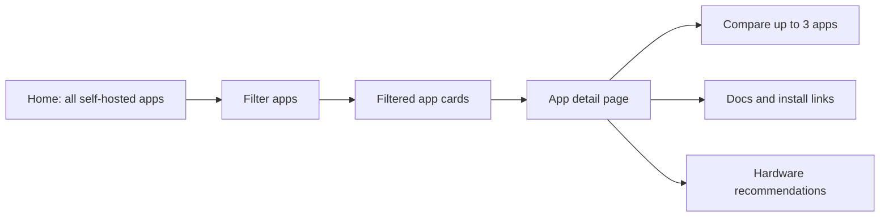

# V1 Product Plan

Date: 2026-06-05

## V1 Positioning

V1 should be simple, direct, and useful immediately.

The product is not a guided wizard yet. It is a powerful self-hosted app directory with practical filtering, rich app detail pages, and side-by-side comparisons.

The user should be able to:

1. Land on the home page.
2. See all self-hostable apps.
3. Filter by what matters to them.
4. Click an app card.
5. Understand the app in detail.
6. Compare it with up to two alternatives.

The core V1 value:

> Awesome Selfhosted gives users the list. This site tells users whether an app is practical for their needs, actively maintained, easy enough to run, and suitable for their hardware.

## V1 User Flow

## V1 Pages

V1 needs only a small number of core pages:

1. Home page with app directory and filters.
2. App detail page.
3. Compare page or compare mode.
4. Blog/news page.
5. Legal and trust pages.

Later pages like server planner, stack builder, hosting price calculators, alerts, and saved stacks can come after V1.

## Home Page

The home page is the main product surface.

It should show a large browsable list of self-hostable apps as cards, with a sidebar for filtering.

### Home Page Goals

From the user's perspective:

- I can immediately see apps.
- I can search for a known app.
- I can filter down to apps that fit my use case.
- I can quickly understand whether each app is Docker-friendly, lightweight, active, and relevant.
- I can open any app to see deeper details.

### Home Page Layout

Suggested layout:

- Header/nav at top.
- Search bar near top of content.
- Left sidebar with filters.
- Main content grid/list of app cards.
- Sort control above cards.
- Result count.

### Home Page Filters

Important V1 filters:

- Search by app name or description.
- Category.
- Docker support.
- RAM requirement.
- Storage requirement.
- Actively maintained.
- Setup difficulty.
- License.
- Deployment method.

Optional V1 filters if data is available:

- Has official docs.
- Has demo.
- Has mobile app.
- Requires database.
- Public internet friendly.
- Beginner friendly.
- OpenSSF/security score.
- GitHub stars range.

### Category Filter Examples

Initial categories can come from Awesome Selfhosted tags, then be normalized into cleaner user-facing groups.

Suggested user-facing categories:

- Photos
- Media
- Notes
- Wiki
- Bookmarks
- Password managers
- DNS
- Backups
- File sync
- Documents
- Finance
- Monitoring
- Analytics
- Automation
- Project management
- Communication
- Email
- Development tools
- Home automation

### RAM Filters

RAM filters should be simple and understandable:

- Under 512 MB
- Under 1 GB
- 1-2 GB
- 2-4 GB
- 4 GB+
- Unknown

### Storage Filters

Storage filters:

- Tiny
- Low
- Medium
- High
- Very high
- Depends on user data
- Unknown

Storage examples:

- Tiny: DNS, bookmarks, small notes.
- Low: wiki, RSS, uptime monitoring.
- Medium: documents, finance, project management.
- High: photos, file sync, backups.
- Very high: media server, video, large archives.

### Maintenance Filters

Maintenance status:

- Actively maintained.
- Slow but alive.
- Possibly stale.
- Archived.
- Unknown.

Derived from:

- Last commit date.
- Last release date.
- Commit history.
- Archived status.
- Docker image freshness if available.

### Sort Options

Suggested sorts:

- Best match.
- Most popular.
- Recently updated.
- Easiest setup.
- Lowest RAM.
- Healthiest projects.
- Newest releases.

### App Card

Each app card should be dense but scannable.

Fields:

- App name.
- Short description.
- Primary category.
- Docker support badge.
- RAM estimate.
- Storage intensity.
- Maintenance status.
- Setup difficulty.
- License.
- Stars or popularity indicator.
- View details button.

Possible badges:

- Docker.
- Lightweight.
- Active.
- Stale.
- Beginner friendly.
- Needs database.
- Storage heavy.

## App Detail Page

The app detail page is the most important V1 page.

This is where the site becomes better than a directory.

### App Detail Page Goals

From the user's perspective:

- I understand what the app does.
- I know whether it is right for my use case.
- I know its limitations.
- I know whether it is actively maintained.
- I know what hardware/resources it needs.
- I know how difficult it is to install and maintain.
- I can find official docs and install links.
- I can compare it with alternatives.

### App Detail Page Sections

#### Header

Include:

- App name.
- Short description.
- Website link.
- Source code link.
- Docs link if available.
- Compare button.
- Key badges.

Key badges:

- Docker support.
- Maintenance status.
- RAM tier.
- Storage tier.
- Difficulty.
- License.

#### Quick Verdict

A concise practical summary.

Examples:

- Good beginner-friendly option for lightweight home use.
- Powerful but more complex to maintain.
- Great for media libraries, but storage and CPU needs can grow quickly.
- Active project, but setup requires multiple services.
- Possibly stale; consider alternatives.

#### What This App Does

Explain in plain language:

- Main purpose.
- Main use cases.
- Who it is for.
- Typical alternatives it replaces.

#### Best For / Not Best For

Best for:

- Specific user types or use cases.

Not best for:

- Cases where the app is too heavy, too complex, too stale, or missing important features.

#### Limitations

Important practical limitations:

- Missing features.
- Heavy resource use.
- Hard migration.
- Weak mobile support.
- Needs external database.
- Not ideal for public exposure.
- Complex backup/restore.
- Difficult upgrades.

#### Deployment And Install

Include:

- Docker support.
- Docker Compose support.
- Kubernetes/Helm support if relevant.
- Binary/package install if available.
- Official install docs.
- Community install guides if useful.

Links:

- Official docs.
- Install docs.
- Docker image.
- Compose example.
- GitHub repository.
- Release page.

#### Resource Requirements

This should be one of the most useful sections.

Include:

- Minimum RAM.
- Recommended RAM.
- CPU needs.
- Storage baseline.
- Storage growth behavior.
- Database requirements.
- Redis/cache requirements.
- Object storage requirements.
- GPU/transcoding needs if applicable.

Resource confidence:

- Confirmed from docs.
- Estimated.
- Community reported.
- Unknown.

#### Maintenance And Project Health

Include:

- Active, slow but alive, possibly stale, archived, or unknown.
- Last release.
- Last commit or update.
- Commit history.
- GitHub stars.
- GitHub forks.
- Open issues.
- Archived status.
- Release cadence.

Optional if available:

- Star history chart.
- Commit history chart.
- Release history.
- Docker image freshness.
- OpenSSF Scorecard.

#### Security And Trust

V1 can keep this practical and lightweight.

Include:

- License.
- OpenSSF Scorecard if available.
- Known security signals if available.
- Public exposure caution.
- Authentication notes.
- Backup importance.

#### Hardware Recommendations

This section should recommend hardware classes, not only exact products.

Examples:

- Runs well on a tiny VPS.
- Good fit for a 4 GB RAM VPS.
- Good fit for an Intel N100 mini PC.
- Better with NAS storage.
- Avoid SD cards for storage-heavy use.
- GPU helpful for transcoding.

Include affiliate recommendations only after the reasoning.

Required note:

> These are not the only suitable options. Many apps can run well on hardware you already own, depending on your usage, storage, and number of users.
>
> Some links may be affiliate links. We may earn a commission at no extra cost to you, which helps support the website.

#### Alternatives

Show similar apps.

For each alternative:

- Name.
- Short description.
- Why consider it.
- Main tradeoff.
- Compare button.

#### Compare Action

The user should be able to compare from the detail page.

Flow:

1. User clicks Compare.
2. User chooses one or two alternatives.
3. Page becomes a side-by-side comparison, or user navigates to compare page.
4. Up to 3 apps are shown side by side.

## Compare Page / Compare Mode

The compare experience should be practical, not just raw stats.

### Compare Goals

From the user's perspective:

- I can see which app is best for my use case.
- I can compare limitations and hardware needs.
- I can quickly choose one.

### Compare Layout

Options:

1. Dedicated compare page.
2. App detail page split into columns.

The user's proposed V1 idea:

- App detail page can split into two or three columns.
- Show up to 3 apps side by side.

This is a good V1 interaction because it keeps the user close to the app detail context.

### Compare Sections

Each app column should include:

- Name.
- Quick verdict.
- Best for.
- Not best for.
- Docker support.
- RAM requirement.
- Storage intensity.
- CPU needs.
- Database needs.
- Setup difficulty.
- Maintenance difficulty.
- Active maintenance status.
- Last release.
- Stars.
- License.
- Limitations.
- Docs link.
- Hardware recommendation.

### Comparison Summary

Above or below the columns, include:

- Best overall.
- Best for beginners.
- Best for low-power hardware.
- Best for large storage.
- Best for advanced users.
- Avoid if stale or too complex.

## Blog And News

Blog/news is useful for SEO and returning users, but it should not block the V1 app directory.

Suggested sections:

- Open source news.
- Self-hosted app news.
- Hardware news.
- VPS details.
- Hosting provider comparisons.
- App update roundups.
- Best self-hosted apps by category.
- Beginner guides.
- Docker and Compose tutorials.

Future useful content:

- Hosting price calculators.
- VPS comparison pages.
- Hardware buyer guides.
- Home server build guides.
- Stack guides.

## Legal And Trust Pages

V1 should include:

- About.
- Privacy Policy.
- Terms.
- Affiliate Disclosure.
- Contact.

### About Page

Include:

- What the site does.
- Why it exists.
- How data is collected.
- How recommendations are made.
- Editorial principles.

### Privacy Policy

Include:

- Analytics usage.
- Cookies.
- Affiliate links.
- Contact form data.
- Newsletter data if applicable.
- User account data if added later.

### Terms

Include:

- Informational nature of content.
- No warranty.
- External links.
- Affiliate links.
- User responsibility for self-hosting/security decisions.

### Affiliate Disclosure

Include:

- Some links may earn commission.
- No extra cost to user.
- Affiliate status does not guarantee recommendation.
- Recommendations are based on practical fit where possible.

## V1 Data Requirements

### Required Data

For the first version, every app should ideally have:

- Name.
- Description.
- Website URL.
- Source code URL.
- License.
- Category/tags.
- Platform/deployment methods.
- Docker support status.
- Maintenance status.
- Basic GitHub stats.

### High-Value Curated Data

The most valuable fields to manually curate:

- RAM tier.
- Storage tier.
- Setup difficulty.
- Maintenance difficulty.
- Limitations.
- Hardware recommendation.
- Best for.
- Not best for.
- Docs/install links.
- Alternatives.

### App Status Values

Maintenance status:

- Active.
- Slow but alive.
- Possibly stale.
- Archived.
- Unknown.

Docker support:

- Official Docker image.
- Project-maintained Docker image.
- Community Docker image.
- Dockerfile only.
- No Docker support.
- Unknown.

RAM tier:

- Under 512 MB.
- Under 1 GB.
- 1-2 GB.
- 2-4 GB.
- 4 GB+.
- Unknown.

Storage tier:

- Tiny.
- Low.
- Medium.
- High.
- Very high.
- Depends.
- Unknown.

Difficulty:

- Very easy.
- Easy.
- Moderate.
- Hard.
- Expert.
- Unknown.

## V1 Monetization

Monetization should be present but not aggressive.

Best V1 monetization surface:

- Hardware recommendations inside app detail pages.
- Blog posts about hardware and VPS choices.
- VPS comparison content.
- Storage and backup recommendations.

Important principle:

The site should feel useful first. Affiliate links should support the site, not drive the recommendations.

Required affiliate note on recommendation sections:

> These are not the only suitable options. Many apps can run well on hardware you already own, depending on your usage, storage, and number of users.
>
> Some links may be affiliate links. We may earn a commission at no extra cost to you, which helps support the website.

## Out Of Scope For V1

These are good ideas, but should come later:

- Full server planner.
- Stack builder.
- Hosting price calculator.
- Paid alerts.
- User accounts.
- Saved stacks.
- Personalized recommendations.
- Email monitoring.
- Complex onboarding wizard.
- Automatic Docker Compose generation.

## V1 Success Criteria

V1 is successful if users can:

- Find apps quickly.
- Filter by practical constraints.
- Understand whether an app fits their needs.
- See limitations clearly.
- Compare up to 3 apps.
- Find docs/install links.
- Get sensible hardware guidance.

The site should beat a plain directory by answering:

> Should I actually run this app, and what should I know before installing it?

