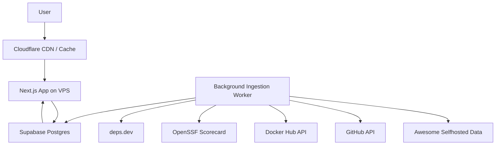
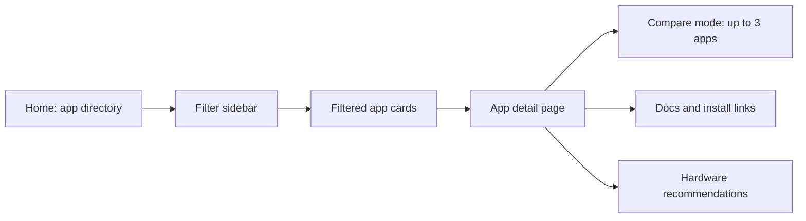
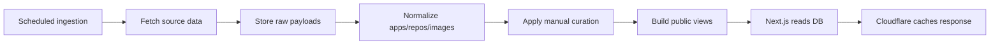

# V1 Technical Plan

Date: 2026-06-05

## Technical Direction

V1 should be a fast, SEO-friendly, app-like website for browsing, filtering, and comparing self-hosted apps.

Recommended stack:

- Next.js App Router.
- TypeScript.
- Tailwind CSS.
- shadcn/ui for all UI primitives.
- lucide-react for icons.
- Recharts through shadcn chart components.
- Supabase Postgres for database.
- Background ingestion workers for external data.
- VPS + Docker + Dokploy for deployment.
- Cloudflare in front of the app for caching and protection.

No external source APIs should be called when users load public pages. Data should be gathered in the background, stored in the database, normalized, cached, and served from our own application.

## Database Recommendation

Use Supabase/Postgres for V1.

Supabase is a better fit than Convex for this version because the product is:

- Public and SEO-heavy.
- Directory/filter/search heavy.
- Relational.
- Data-ingestion heavy.
- Snapshot/history oriented.
- Mostly read-heavy.
- Better served by SQL queries, views, and materialized views.

Convex is strong for realtime product experiences, live dashboards, and highly reactive user-specific apps. It can be reconsidered later if the product grows into paid alerts, user dashboards, saved stacks, or realtime monitoring.

## High-Level Architecture



## User-Facing App Flow



## Frontend Principles

### App-Like UI

The website should feel like a focused app/dashboard, not a marketing landing page.

Guidelines:

- Make the home page the usable product surface.
- Avoid oversized hero sections.
- Avoid decorative marketing sections.
- Prioritize search, filters, cards, data, and comparison.
- Use predictable navigation.
- Make interaction feel fast and direct.
- Keep filters visible and easy to adjust.
- Use URL-based filters so views can be shared.

### Minimal And Visual Storytelling

The UI should communicate with compact visual signals rather than long blocks of text.

Use:

- Badges for Docker, maintenance, RAM tier, storage tier, difficulty, license.
- Small charts for stars, commits, releases, or Docker freshness.
- Status indicators for active/stale/archived.
- Compact comparison tables.
- Short verdict blocks.
- Icons with tooltips where helpful.
- Clear empty states.

Avoid:

- Long marketing copy.
- Large text-heavy cards.
- Overly decorative layouts.
- Generic stock imagery.
- Huge headings inside dashboard sections.

### Compact, Readable Dashboard Style

The UI should be small, readable, and polished.

Guidelines:

- Use compact typography.
- Keep headings proportional to the content area.
- Use dense but breathable spacing.
- Use cards for repeated app records, not for every page section.
- Keep buttons and badges readable but not oversized.
- Use tables where comparison is the clearest layout.
- Keep text labels short.
- Use tooltips for extra explanations.
- Keep mobile filters inside a sheet/drawer.
- Make desktop filters persistent in a sidebar.

The design should feel like a serious product dashboard for technical users, while still being approachable for beginners.

## shadcn/ui Usage

Use shadcn/ui for all interface primitives.

Examples:

| UI Need | shadcn Component |
|---|---|
| Filter sidebar | `Sidebar` |
| Mobile filters | `Sheet` |
| App cards | `Card` |
| Status labels | `Badge` |
| Search | `Input` |
| Category filter | `Checkbox`, `Command`, or `Select` |
| RAM/storage filters | `Select`, `Slider`, or `RadioGroup` |
| Toggle filters | `Switch` |
| Sort menu | `Select` |
| Compare layout | `Resizable`, `Table`, `Tabs` |
| Detail panels | `Card`, `Tabs`, `Accordion` |
| Popups | `Dialog`, `Popover`, `HoverCard` |
| Extra help | `Tooltip` |
| Charts | shadcn `Chart` with Recharts |
| Notifications | `Sonner` |
| Legal/content pages | `Typography`, `Separator`, `Accordion` |

Use lucide-react icons inside buttons and compact UI controls where appropriate.

## Semantic HTML And SEO

Use semantic HTML throughout:

- `header`
- `nav`
- `main`
- `aside`
- `section`
- `article`
- `footer`

SEO requirements:

- Metadata per page.
- Canonical URLs.
- OpenGraph metadata.
- Twitter card metadata.
- Sitemap generation.
- robots.txt.
- Clean slugs for app pages.
- SEO-friendly category URLs.
- Shareable compare URLs.

Suggested URL patterns:

- `/apps`
- `/apps?category=photos&docker=true&ram=under-1gb`
- `/apps/immich`
- `/compare?apps=immich,photoprism,nextcloud`
- `/blog`
- `/blog/best-self-hosted-photo-apps`
- `/about`
- `/privacy`
- `/terms`
- `/affiliate-disclosure`

## Colors And Theme

Use shadcn semantic theme tokens.

Requirements:

- Use semantic colors such as `background`, `foreground`, `muted`, `primary`, `secondary`, `accent`, `destructive`, `border`, `input`, and `ring`.
- Avoid hardcoded one-off colors unless needed for charts or status.
- Keep status colors consistent.
- Support light mode first.
- Consider dark mode after the core UI is stable.

Suggested status colors:

- Active: green semantic status.
- Slow but alive: amber semantic status.
- Possibly stale: orange semantic status.
- Archived/problem: destructive.
- Unknown: muted.

## Data Flow



## No Live API Calls On User Load

Public page loads should only read from our own database/cache.

Do not call:

- GitHub API.
- Docker Hub API.
- OpenSSF Scorecard API.
- deps.dev API.
- Awesome Selfhosted raw GitHub files.

These external calls should happen only in background jobs.

## Database Tables

Suggested V1 tables:

- `apps`
- `app_categories`
- `app_category_map`
- `repositories`
- `repo_snapshots`
- `container_images`
- `container_snapshots`
- `app_requirements`
- `app_curation`
- `app_links`
- `compare_groups`
- `raw_imports`
- `data_sources`
- `ingestion_runs`
- `affiliate_links`

## Important Data Modeling Rules

Every automated field should include:

- Source.
- Confidence.
- Last checked time.

Examples:

- `ram_source`
- `ram_confidence`
- `ram_last_checked_at`
- `docker_source`
- `docker_confidence`
- `docker_last_checked_at`

Manual curation should override automated values where needed.

Keep raw imported data separate from normalized public data.

## Caching Strategy

Use three layers of caching.

### 1. Database/View Layer

Precompute public app card data into a view or materialized table.

Purpose:

- Avoid heavy joins on every request.
- Make app directory filters fast.
- Make caching easier.

### 2. Next.js Cache

Use Next.js server rendering and caching intentionally.

Use:

- Static rendering where possible.
- Revalidation after ingestion updates.
- Cache tags for app detail pages and app directory data.
- Server components for database reads.

### 3. Cloudflare Cache

Cloudflare should sit in front of all public pages.

Rules:

- Users should hit Cloudflare whenever possible.
- Public anonymous GET pages should be cacheable.
- Avoid setting cookies on public pages.
- Cache `/apps`, `/apps/*`, `/compare`, `/blog`, and legal pages.
- Purge or revalidate after ingestion jobs update public data.

## Deployment

Deployment target:

- Existing VPS.
- Docker.
- Dokploy.
- Cloudflare DNS/proxy.

Suggested services:

- `web`: Next.js app.
- `worker`: ingestion worker.
- `cron`: scheduled ingestion trigger, if not handled by Dokploy or external scheduler.

Environment variables:

- `DATABASE_URL`
- `SUPABASE_URL`
- `SUPABASE_SERVICE_ROLE_KEY`
- `GITHUB_TOKEN`
- `DOCKER_HUB_TOKEN`
- `OPENSFF_SCORECARD_BASE_URL`
- `DEPS_DEV_BASE_URL`
- `CLOUDFLARE_API_TOKEN`
- `CLOUDFLARE_ZONE_ID`

Only server-side code should access service keys.

## Code Commenting Rules

The codebase should be easy to read and understand.

Use comments intentionally:

- Every exported function should have a short JSDoc comment.
- Every scoring rule should explain why it exists.
- Every non-obvious transformation should explain the assumption.
- Every ingestion step should explain the source and failure behavior.
- SQL views/functions should include comments.
- UI components should have comments only where behavior is not obvious.

Avoid noisy comments like:

- "Set variable."
- "Return result."
- "Loop through array."

Example:

```ts
/**
 * Builds the public app card model used by the app directory.
 * This keeps UI code independent from raw imported source fields.
 */
export function toAppCardModel(app: AppWithSignals): AppCardModel {
  // Prefer curated values because upstream data often lacks practical
  // hosting details like RAM, storage, and setup difficulty.
  return {
    name: app.name,
    ramTier: app.curatedRamTier ?? app.estimatedRamTier,
  }
}
```

## V1 Public Pages

### Home / App Directory

Purpose:

- Show all self-hostable apps.
- Let users filter immediately.
- Let users open app detail pages.

Requirements:

- Filter sidebar.
- Search.
- Sort.
- Result count.
- App card grid/list.
- Shareable filtered URL.

### App Detail Page

Purpose:

- Give practical details about one app.

Requirements:

- App overview.
- Best for / not best for.
- Limitations.
- Docker support.
- RAM/storage requirements.
- Maintenance status.
- GitHub stats.
- Release/commit history.
- Docs/install links.
- Alternatives.
- Hardware recommendations.
- Affiliate disclosure where needed.

### Compare Page / Compare Mode

Purpose:

- Compare up to 3 apps side by side.

Requirements:

- Shareable compare URL.
- Up to 3 app columns.
- Practical comparison rows.
- Compact charts or badges if helpful.
- Clear best-for/tradeoff summary.

### Blog / News

Purpose:

- SEO and returning audience.

Topics:

- Open source news.
- Self-hosted news.
- Hardware news.
- VPS details.
- App update roundups.
- Best app category posts.

### Legal Pages

Required:

- About.
- Privacy Policy.
- Terms.
- Affiliate Disclosure.
- Contact.

## Hardware Recommendation Disclosure

Use this note wherever affiliate hardware recommendations appear:

> These are not the only suitable options. Many apps can run well on hardware you already own, depending on your usage, storage, and number of users.
>
> Some links may be affiliate links. We may earn a commission at no extra cost to you, which helps support the website.

## Technical Priorities

Build in this order:

1. Project setup with Next.js, shadcn/ui, Tailwind, and TypeScript.
2. Supabase schema.
3. Static seed data or imported Awesome Selfhosted data.
4. Home page app directory.
5. Filters and URL state.
6. App detail page.
7. Manual curation fields.
8. Compare mode.
9. GitHub enrichment worker.
10. Charts/history.
11. Cloudflare caching and deployment.
12. Blog/legal pages.

## Out Of Scope For V1

- Full stack builder.
- Server planner wizard.
- Hosting price calculator.
- User accounts.
- Paid alerts.
- Saved stacks.
- Realtime dashboards.
- Automatic Docker Compose generation.

