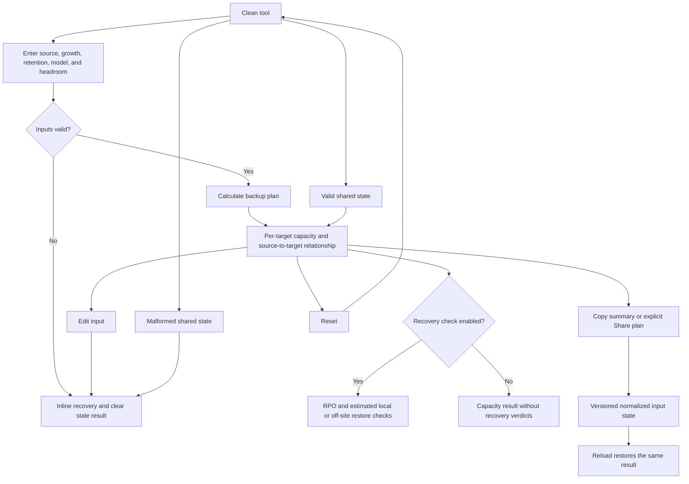

# Implementation report: 3-2-1 backup calculator

Status: ready
Tool: 3-2-1 backup calculator
Route: /backup-321-calculator
Depends on: competitive-report.md
Input fingerprint: `competitive-report.md sha256:2f44815aab1fd369a2fc5ce558fbab61284f1f2752eb109509df8a46dae57d1e`
Contract type: formula

## Product decision

- Primary user: A homelab owner who knows roughly how much data is on the server and wants to size one local backup target and one off-site target before buying or allocating storage.
- Job: Calculate the projected source size, retained repository size, and capacity needed for each of two backup targets, then optionally check whether the backup interval and a full restore fit recovery goals.
- Product thesis: The calculator makes the capacity model visible. It shows one target, the second target, and the source copy separately, names the full or incremental assumption, adds headroom transparently, and keeps RPO and RTO checks separate from the capacity answer. A reader can audit the result instead of trusting a hidden multiplier.
- Evidence: The competitive report's search intent, user pain evidence, formula disagreements, comparison matrix, and evidence-backed opportunities. Competitors commonly hide retention behavior, copy counting, or recovery assumptions, while no reviewed tool combines a named model with two target capacities and an auditable receipt.

## Scope

### Table stakes

- Accept protected data, source unit, annual growth, planning horizon, backup model, retained restore points, average changed data per additional point, and target headroom.
- Offer full-only and full-plus-incremental models with explicit labels. One shared retention policy sizes both backup targets in version 1.
- Show projected source data, the repository estimate before headroom, headroom, capacity for the local target, capacity for the off-site target, and combined target capacity.
- State that the production source is copy 1 and the two calculated targets are copies 2 and 3. Do not call this a verified 3-2-1 compliance result.
- Use one explicit Calculate backup plan action, Reset, Copy summary, and explicit Share plan. Editing a result-driving input clears stale output.
- Return structured assumptions, ordered derivation steps, dated sources, value classifications, and one modelled uncertainty statement through the shared storage result contract.
- Handle invalid grammar, unsupported units, boundaries, tiny values, large values, malformed shared state, and unsupported versions without showing a stale or plausible result.
- Keep calculation browser-local and use the shared versioned URL-state envelope only after an explicit Share plan action.
- Offer an optional recovery check for backup interval versus RPO and estimated local or off-site full-restore time versus RTO.
- Keep the workbench and exact result values usable at 320px, 375px, 760px, and desktop widths in both themes.

### Launch differentiators

- Lead with the capacity for one target, then show the other target and the combined total instead of hiding both inside a raw copy count.
- Use one named, reproducible model: project the source to the planning horizon, store either one full per point or one full plus an allowance for each additional point, then add explicit headroom.
- Show a compact exact breakdown of repository data and headroom with labeled values. Do not use marker art for numeric output.
- Keep recovery checks optional so a first-time homelab owner can size storage without completing an audit form, while a technical user can still inspect RPO and RTO assumptions.
- Keep prices, provider catalogs, compression, and deduplication out of the technical answer. The result remains reproducible as products and prices change.
- Link the result to the backups-before-serious-apps course lesson for restore tests, external copies, and the broader backup habit.

### Deferred

- Daily, weekly, monthly, and yearly GFS buckets with product-specific chain behavior.
- Separate retention policies for local and off-site targets.
- Compression, deduplication, synthetic fulls, immutable retention, snapshot space, and vendor-specific repository formats.
- Cost, cloud-provider price, egress, request, minimum-duration, and hardware catalog estimates.
- Multi-plan comparison, app-by-app backup inventory, restore command generation, and verification against a real host.
- A probability of loss, reliability score, or universal safety grade.
- A clean yearly demand chart. The first version needs the projected source value and exact capacity anatomy, not a second growth-planner surface.

### Non-goals

- The result does not prove that a backup exists, is isolated, uses two media types, restores correctly, or satisfies an organization's policy.
- The result does not model a specific backup product or filesystem. Full-plus-incremental is a planning model, not a promise about a vendor's chain, merge, or pruning behavior.
- The result does not count parity, snapshots, filesystem metadata, compression savings, deduplication savings, or block-level overhead.
- The result does not provide financial advice or a live purchase recommendation.
- The result does not send input to a server, accept a domain or file upload, inspect a host, or verify a remote target.

## Formula and data contract

The adapter is backup-321-capacity, calculation version 1, input version 1. It accepts one policy for two repository targets. Capacity is calculated as exact whole bytes, but the result is classified as estimated because the retention model is product-neutral.

### Inputs and normalization

| Input | Type and unit | Default | Valid range | Normalization |
| --- | --- | --- | --- | --- |
| sourceData | non-negative decimal with sourceUnit | 2 | 1 MB to 1,000 TB after conversion | Trim whitespace. Accept digits and a decimal point only. Reject signs, separators, exponent notation, and fractions that cannot resolve to whole bytes. |
| sourceUnit | enum GB, TB, GiB, or TiB | TB | supported enum | Keep the canonical enum in state and convert to bytes before calculation. |
| annualGrowth | decimal percent string | 20 | 0% to 100%, at most 2 decimal places | Convert to basis points where 100% is 10,000. |
| horizonYears | decimal-free integer string | 3 | 0 to 10 | Parse as a safe integer. Zero means size the plan for the current source value. |
| backupModel | enum full-only or full-plus-incremental | full-plus-incremental | supported enum | Keep the canonical enum in state. |
| retainedPoints | decimal-free integer string | 30 | 1 to 1,000 | Count the restore points kept by each target. |
| changedPerBackup | decimal percent string | 5 | 0% to 100%, at most 2 decimal places | Convert to basis points. It is an average allowance for each additional point, not a compression or deduplication ratio. |
| headroom | decimal percent string | 20 | 0% to 50%, at most 2 decimal places | Convert to basis points and add after the repository estimate for each target. |
| recoveryChecksEnabled | boolean | false | boolean | When false, recovery fields do not affect the result and recovery values are omitted. |
| backupIntervalHours | decimal-free integer string | 24 | 1 to 168 hours | Used only when recovery checks are enabled. |
| targetRpoHours | decimal-free integer string | 24 | 1 to 720 hours | Used only when recovery checks are enabled. |
| targetRtoHours | decimal-free integer string | 12 | 1 to 720 hours | Used only when recovery checks are enabled. |
| localRestoreMbps | decimal Mbps string | 1000 | 0.01 to 100,000 Mbps, at most 2 decimal places | Reject separators in state. Convert to integer bits per second without floating point. |
| offsiteRestoreMbps | decimal Mbps string | 100 | 0.01 to 100,000 Mbps, at most 2 decimal places | Convert to integer bits per second without floating point. |
| transferEfficiency | decimal percent string | 80 | 1% to 100%, at most 2 decimal places | Convert to basis points. |
| displayUnit | enum TB or TiB | TB | supported enum | Display only. It never changes source bytes or derived bytes. |

The typed input guard requires the exact supported key set. Advanced recovery fields remain present with valid defaults in the serialized shape even when checks are disabled. They do not affect capacity until enabled. The adapter normalizes before calculation and does not treat a type assertion as validation.

### Equations or resolution order

Use positive integer arithmetic. For positive integers, roundHalfUp(a / b) is (a + floor(b / 2)) / b, and ceilDiv(a / b) is (a + b - 1) / b.

1. Parse all input strings, convert sourceData to sourceBytes, convert percentages to basis points, and convert restore speeds to integer bits per second. Reject the input if any field is outside its bound or has unsupported grammar.
2. Set projectedSourceBytes[0] = sourceBytes. For each year y from 1 through horizonYears, calculate projectedSourceBytes[y] = roundHalfUp(projectedSourceBytes[y - 1] * (10,000 + annualGrowthBasisPoints) / 10,000). Use the last value as projectedSourceBytes.
3. Set n = retainedPoints. The input guard requires n >= 1.
4. Calculate changedPerPointBytes = ceilDiv(projectedSourceBytes * changedPerBackupBasisPoints, 10,000). A zero change rate produces zero changed bytes. The ceiling prevents a positive allowance from disappearing.
5. Calculate fullOnlyRepositoryBytes = projectedSourceBytes * n.
6. Calculate fullPlusIncrementalRepositoryBytes = projectedSourceBytes + changedPerPointBytes * (n - 1). The first point is one full source copy, and each additional point receives one average changed-data allowance.
7. Select repositoryBytes from the named backup model. The model is deliberately simpler and more transparent than pretending to reproduce a product's chain or synthetic-full behavior.
8. Calculate headroomBytes = ceilDiv(repositoryBytes * headroomBasisPoints, 10,000) and targetBytes = repositoryBytes + headroomBytes. Set localTargetBytes = targetBytes, offsiteTargetBytes = targetBytes, and totalTargetBytes = localTargetBytes + offsiteTargetBytes.
9. Describe the copy relationship without calculating a safety score: the production source is copy 1, the local target is copy 2, and the off-site target is copy 3. The tool can state that two target locations are planned, but cannot verify media types, physical separation, isolation, encryption, or a restore test.
10. If recoveryChecksEnabled is false, omit recovery values and verdicts. If true, set rpoPasses = backupIntervalHours <= targetRpoHours. For each target, calculate restoreSeconds = ceilDiv(projectedSourceBytes * 8 * 10,000, restoreBitsPerSecond * transferEfficiencyBasisPoints), then compare it with targetRtoHours * 3,600. The restore estimate uses the projected full source, not the retained repository total.
11. Return a valid StorageCalculationResult with values, assumptions, ordered derivation, dated sources, and uncertainty.kind = modelled. Capacity and recovery values use storageValue with unit bytes or seconds and classification estimated. Do not expose formatted strings as engine source values.

### Rounding, display, and versioning

- Capacity values remain bigint bytes. No capacity calculation uses floating-point arithmetic or converts capacity to JavaScript Number.
- Decimal parsing rejects exponent notation, signs, separators, unsupported units, and excess meaningful fractional precision. A decimal is accepted only when its exact unit conversion resolves to whole bytes.
- Growth rounds half up to whole bytes after every annual step. Changed-data and headroom allowances round up so a positive allowance cannot make the target smaller than the model requires.
- displayUnit selects decimal TB or binary TiB. Use the shared byte formatter and preserve exact bytes. Display capacities with at most two fractional digits, with a precision fallback for nonzero values that would otherwise display as zero.
- Display restore duration as an estimate with raw seconds available in the receipt; show sub-hour durations in seconds rather than rounding a nonzero result to zero hours. Do not present it as a measured transfer time.
- The result lead names the per-target value first. The second target and total are separate labeled values, not an unlabeled 3x multiplier.
- Formula metadata includes calculatorId = backup-321-capacity, calculation version 1, input version 1, and shared engine version 1.
- The URL stores normalized inputs only in the shared stack127-storage-state envelope. It stores no formatted results, source names, or derived values. A future formula change registers a new calculation version and preserves version 1 behavior for old state or rejects it explicitly.

### Invalid, unknown, absent, and partial states

- Clean form uses defaults, keeps the result region absent, leaves the URL at the canonical route, and does not serialize defaults on mount.
- Invalid source data, unit, growth, horizon, model, retained points, changed data, headroom, display unit, or enabled recovery field produces structured field issues, clears any prior result, and exposes no capacity, recovery verdict, or share state.
- Zero source data is invalid because this page sizes a real backup plan. Zero growth, zero changed data, and zero headroom are valid. Retained points must be at least 1.
- Recovery checks are all-or-nothing when enabled. A missing or invalid recovery field prevents the result instead of showing a capacity answer beside an invalid recovery claim.
- When recovery checks are disabled, recovery values are absent, not zero or an unknown value presented as a measurement. A short Not checked label may appear when it helps the next decision.
- A valid result has no error-level issue and includes a modelled uncertainty statement. An invalid result has values = null.
- A valid state query decodes, validates, recalculates, and restores the result for the exact calculator and input versions. A malformed, oversized, unsafe, future, or unsupported state keeps defaults, shows Shared plan could not load., and shows no result.
- Editing any result-driving input clears the result and removes state. Changing only displayUnit may reformat the existing result because it does not change source bytes or formula values.
- The calculation is synchronous and local. There is no loading, upstream, no-data, or network-failure state. Do not render a fake spinner or imply that a provider was contacted.
- The result includes a limitation that placement, media independence, isolation, encryption, and restore success were not verified. This is a sentence, not a compliance badge.

### Assumptions and exclusions

- sourceData is the current protected logical dataset. It is not installed free space, raw drive capacity, or a filesystem allocation measurement.
- Annual growth compounds to the planning horizon. Every retained point is sized from the projected horizon source value, which is intentionally conservative for older points.
- changedPerBackup is the average data represented by one additional retained point. It must not be described as guaranteed daily change, compression, or deduplication.
- The full-only model stores one projected full for every retained point. The full-plus-incremental model stores one projected full plus one average changed-data allowance for every additional point.
- Headroom is extra target capacity added after the repository estimate. It is not a filesystem free-space policy or a restore guarantee.
- Both targets use the same retention and sizing policy. Different local and off-site policies are deferred.
- The RPO check compares a planned interval with a user target. The RTO check estimates transfer time for the projected full source at user-supplied nominal throughput and efficiency. Both exclude application restore work, contention, encryption overhead, provider throttling, verification, and other downtime.
- The tool cannot verify that a target is off-site, isolated, disconnected, encrypted, on a different medium, or tested through a real restore. The course lesson owns the practical restore workflow.
- The model excludes compression, deduplication, synthetic fulls, incremental merge behavior, snapshots, metadata, filesystem overhead, parity, costs, and provider-specific fees.

### Primary sources

- [CISA data backup options](https://www.cisa.gov/sites/default/files/publications/data_backup_options.pdf), checked 2026-09-10. Supports three copies, two storage types, and one off-site copy. It does not support a capacity formula or safety score.
- [CISA ransomware guide](https://www.cisa.gov/stopransomware/ransomware-guide), checked 2026-09-10. Supports offline or isolated backups and regular testing of availability and integrity.
- [NIST SP 800-34 Rev. 1](https://nvlpubs.nist.gov/nistpubs/legacy/sp/nistspecialpublication800-34r1.pdf), checked 2026-09-10. Supports the definitions of recovery point objective and recovery time objective. It does not supply the transfer-time model.
- [Synology backup storage calculation](https://kb.synology.com/en-in/DSM/tutorial/How_do_I_calculate_storage_size_for_backups), checked 2026-09-10. Supports using source data, changed data, retention, and an explicit product-dependent model. Its vendor formula is not copied as a universal rule.
- [Stack127 storage calculation engine](content_docs/storage-tools/calculation-engine.md), checked 2026-09-10. Defines exact bytes, versioned adapters, structured issues and results, evidence classifications, and safe URL state for this repository.

## User flow



The calculation is explicit rather than live because the task combines several assumptions and benefits from one stable answer. A valid submission focuses the result heading and announces the lead answer. An invalid submission focuses the first invalid field, retains input values, and announces one recovery summary. Enter from any form control submits the same action. Synchronous repeat submissions keep one result and do not create duplicate history entries.

## Interface wireframes

### Desktop: clean

```text
[stack127 shell and storage tools sidebar]

3-2-1 backup calculator
Size two backup targets from your data and retention policy.

===============================================================================
  Protected data and planning
  Protected data       [ 2                  ] [TB v]
  Annual growth        [ 20                 ] %
  Plan horizon         [ 3                  ] years

  Backup policy
  Backup model         (o) Full-only  (.) Full plus incremental
  Retained points      [ 30                 ]
  Changed data/point   [ 5                  ] %
  Headroom             [ 20                 ] %

  [ ] Check recovery goals
  Show capacities in   [ TB v ]

  [Calculate backup plan]                                      [Reset]
-------------------------------------------------------------------------------
  Result is absent until the plan is calculated.
===============================================================================
```

### Desktop: result

```text
===============================================================================
  [same form and chosen values remain above]
-------------------------------------------------------------------------------
  Each backup target needs about 10.16 TB.
  Source copy: 1. Local target: 2. Off-site target: 3.
  This is a capacity estimate, not a verified compliance result.

  Local target                 Off-site target              Both targets
  10.16 TB                     10.16 TB                     20.32 TB

  Capacity breakdown for one target
    Repository before headroom   8.47 TB
    Headroom                     1.69 TB
    Target capacity              10.16 TB

  Model and retained points
    Full plus incremental        30 points
    Projected source             3.46 TB
    Changed allowance/additional point  0.17 TB

  Recovery goals
    RPO                          Not checked
    Local full restore           Not checked
    Off-site full restore        Not checked

  [Copy summary] [Share plan] [Reset]
  Formula, assumptions, sources, and limits [details]
===============================================================================
```

### Narrow mobile

```text
3-2-1 backup calculator

Protected data and planning
Protected data [2] [TB v]
Annual growth [20] %
Plan horizon [3] years

Backup policy
Backup model
(o) Full-only
(.) Full plus incremental
Retained points [30]
Changed data/point [5] %
Headroom [20] %
[ ] Check recovery goals
Show capacities in [TB v]
[Calculate backup plan]
[Reset]
-----------------------------
Each target needs about 10.16 TB.
Local target: 10.16 TB
Off-site target: 10.16 TB
Both targets: 20.32 TB
Repository: 8.47 TB
Headroom: 1.69 TB
Recovery goals: not checked
[Copy summary] [Share plan]
Formula and sources [details]
```

### Error, loading, partial, and restored states

- Error: retain every entered value, place one short Check the marked inputs. status near the action, mark invalid controls with aria-invalid and aria-describedby, show each issue once below its field, focus the first invalid control, remove the old result, and do not create URL state.
- Loading: not applicable. Calculation is synchronous and local. Keep the action width stable and do not render a fake spinner.
- Partial result: when recovery checks are disabled, show capacity and label recovery Not checked or omit that region. When recovery checks are enabled, invalid recovery fields invalidate the whole submission instead of creating a mixed result.
- Upstream failure: not applicable. The tool has no upstream source or network request.
- Restored valid state: load normalized inputs, recalculate, keep state in the URL, and show one Shared plan loaded. status.
- Restored invalid state: keep clean defaults, show Shared plan could not load., show no result, and remove the malformed query without persisting it.

## Interaction contract

| Event | UI response | Result state | Focus/announcement | URL/persistence |
| --- | --- | --- | --- | --- |
| First load without state | Load defaults and an empty result region | Empty | Focus stays at browser default | Canonical route, no query, no storage |
| Edit a result-driving input | Keep the new value and clear the old result | Empty or invalid | No focus jump; announce result cleared once | Remove state without a history entry |
| Change only displayUnit after a result | Reformat capacities without changing bytes or formula values | Same valid result | No focus jump | No URL change until explicit share |
| Enable recovery checks | Reveal recovery fields and preserve capacity inputs | Empty if no result, otherwise clear stale result | Keep focus on the checkbox and announce new fields | No URL change |
| Click Calculate backup plan with valid inputs | Normalize, calculate, and render the result | Valid | Focus result heading and announce lead answer | Clean route, no automatic state |
| Click Calculate backup plan with invalid inputs | Render field issues and no result | Invalid | Focus first invalid field and announce one summary | No state creation |
| Press Enter from a form control | Run the same primary action exactly once | Valid or invalid | Same focus behavior as click | Same URL behavior as click |
| Rapid repeat submission | Keep one deterministic result and one status announcement | Valid or invalid | No duplicate focus jump or live message | No duplicate history entry |
| Click Copy summary after a valid result | Copy a concise result, model, version, and uncertainty note | Result remains | Report success only after copy; expose selectable text on failure | No URL change |
| Click Share plan after a valid result | Encode normalized inputs and copy the share URL | Result remains | Report success after copy; expose URL on failure | Add state with history.replaceState |
| Open a valid shared URL | Decode and recalculate the recorded version | Restored valid | Show Shared plan loaded. without stealing focus on reload | Keep state until edit or reset |
| Open malformed, unsafe, oversized, or unsupported state | Ignore payload and restore defaults | Empty with restore error | Announce restore error once | Remove malformed query without persistence |
| Click Reset | Restore defaults and clear the result | Empty | Focus the first useful input | Remove state with a clean route |

## Page composition

| Claim or task | Medium | Position | Why this medium |
| --- | --- | --- | --- |
| Enter backup assumptions | Tool UI | First workbench region | Controls must stay adjacent to the decisions they affect. |
| Whether each target is large enough | Answer sentence plus labeled values | Top of result region | The user needs the allocation answer before the method. |
| Repository data versus headroom | Exact labeled breakdown table | Immediately below lead | Repeated quantities are easier to scan and quote as rows. |
| Full-only versus full-plus-incremental contribution | Labeled result rows and formula details | Result detail | The selected model and its components are structured facts, not decorative prose. |
| Source and target copy relationship | Short sentence and labeled copy positions | Result lead | Copy counting needs a direct explanation, not a compliance score. |
| RPO and estimated RTO | Status rows and a short explanation | Optional recovery result region | Exact durations and pass or miss states remain separate and honest. |
| Formula, assumptions, uncertainty, and sources | Details disclosure with links | Result bottom | The receipt supports audit without competing with the answer. |
| Restore tests and practical backup habits | Server-rendered supporting Markdown with course link | Below workbench | The course owns the longer operational explanation. |

No marker art, screenshot, or decorative chart is required. The tool's numeric relationship belongs in exact values and structured rows.

## Technical plan

### Architecture and file ownership

- Route: app/(site)/(tools)/backup-321-calculator/page.tsx. It loads the tool row with getRequiredToolPage, reads only the state query parameter, renders ToolPageHeader, the client island, and ToolPageMarkdown.
- Client island: app/(site)/(tools)/backup-321-calculator/backup-321-calculator.tsx. It owns form state, submit and Reset behavior, result presentation, focus, live status, clipboard feedback, explicit Share URL creation, and display formatting.
- Pure engine: lib/storage/backup-321.ts. It owns the typed input guard, normalization, formulas, structured result values, sources, assumptions, derivation, uncertainty, formatting helpers that do not need React, and the versioned calculator adapter. It has no React, DOM, network, analytics, cookie, or browser-storage dependency.
- Shared export: lib/storage/index.ts exports the backup adapter with the existing exact-byte storage helpers. No existing calculator behavior is changed.
- Styles: app/(site)/(tools)/backup-321-calculator/backup-321-calculator.module.css. Use semantic tokens, the full-width workbench band, min-width: 0, explicit narrow breakpoints, no gradients, no global selectors, and no nested cards around the tool.
- Shared controls: use existing app/tool-ui/tool-controls.tsx primitives where the reviewed interface contract fits. The builder must not add controls or result regions outside that contract.
- Storage discovery: add one card and one sidebar item to app/(site)/(catalogs)/storage-tools/page.tsx and storage-tools-sidebar.tsx, with spec-backed catalog artwork only if the card requires it. Keep the canonical route flat.
- Content ownership: content_docs/backup-321-calculator/ owns planning and handoff artifacts. The writing stage owns the database-backed title, introduction, and supporting Markdown. Do not copy live Markdown into the route or this folder.
- Tests and manifest: create tests/pages/backup-321-calculator/page.json with state unpublished, this docs folder, focused engine/state/page/browser tests, the guarded storage preview script, relevant skills, and an empty repositories array. Update storage hub coverage only as needed for the new catalog link.
- Script ownership: extend the guarded scripts/storage-tools/preview-local-pages.mjs only if a managed-development preview row is needed. Do not add a one-off backup script or package script.
- Publication ownership: do not create a migration, production registry row, sitemap entry, canonical rule, robots rule, route-local metadata, or JSON-LD in this build. The route remains unpublished until separately approved.

### Accessibility, privacy, security, and performance

- Use persistent labels, fieldsets and legends for grouped choices, real radio inputs for the model and display unit, aria-invalid, aria-describedby, one concise aria-live polite status, and a focusable result heading.
- Keep the primary action separate from Reset, Copy, and Share. Do not submit on every keystroke. Keep action width stable when errors appear.
- Pair exact values with a semantic table or labeled rows. Color must not be the only distinction between repository data and headroom.
- Treat URL state as untrusted. Use the shared codec's schema, version, size, prototype-key, reserved-tag, and base64url checks. Render decoded values as text, never HTML.
- A Share URL contains normalized user inputs. Do not put result values, source names, private notes, or arbitrary user text into the URL.
- Do not send calculation inputs in analytics events, query requests, cookies, local storage, session storage, or external price requests. The tool adds no input-bearing telemetry.
- Add no runtime dependency. The bounded bigint calculation is synchronous and needs no loading state or chart library.
- Preserve 44px target sizes, visible keyboard focus, zoom usability, reduced-motion behavior, dark mode first, light mode second, and no page-level horizontal overflow at 320px.
- Use the shared shell, ToolPageHeader, ToolPageMarkdown, storage sidebar, and design tokens. Do not place page styles in app/globals.css.

### Publication state

Unpublished. The future route may be reviewed through a guarded managed-development preview, but its exact slug must return 404 in production until a separate publication decision adds the central registry row. No publication migration, content row, sitemap entry, metadata export, canonical, robots rule, or JSON-LD belongs in this stage.

## Acceptance criteria

| ID | Observable acceptance criterion | Evidence at build time |
| --- | --- | --- |
| R1 | The calculator accepts only the documented input shape, units, enums, decimal grammar, and bounds, and normalizes accepted capacity values to exact bytes. | Pure engine guard and normalization tests |
| R2 | Annual growth compounds through the zero to ten-year range with whole-byte half-up rounding after each annual step. | Hand-derived formula fixtures and boundary tests |
| R3 | Full-only capacity equals projected source bytes multiplied by retained points. | Pure engine formula fixtures |
| R4 | Full-plus-incremental capacity equals one projected full plus one ceil-rounded changed-data allowance for each additional retained point. | Pure engine zero, tiny, ordinary, and maximum change fixtures |
| R5 | Headroom is ceil-rounded and added independently to each target; local, off-site, and combined target values are labeled and exact. | Pure engine capacity fixtures |
| R6 | A valid result states that the source is copy 1 and the two planned targets are copies 2 and 3 without claiming verified compliance or isolation. | Engine metadata and rendered result tests |
| R7 | Every valid result exposes calculator and input version metadata, assumptions, ordered derivation, dated sources, value classifications, and a modelled uncertainty statement. | Pure engine result-contract test |
| R8 | Invalid grammar, unsupported units, bounds, zero source data, zero retained points, and invalid enabled recovery fields return status invalid, values null, and structured issues. | Pure engine invalid-state tests |
| R9 | Recovery values are absent when disabled; when enabled, RPO compares interval to target and local or off-site restore seconds use exact throughput and efficiency arithmetic. | Pure engine recovery fixtures |
| R10 | The clean route has defaults, no result, no serialized state, and one obvious primary calculation action. | Route and Playwright tests |
| R11 | A valid submission focuses the result heading and an invalid submission focuses the first invalid field while retaining entered values. | Browser accessibility and state tests |
| R12 | Editing any result-driving input removes stale output and state; display-unit changes reformat without changing source bytes. | Browser interaction tests |
| R13 | Click and Enter run the same calculation once, and repeat submission does not duplicate announcements or history entries. | Browser interaction tests |
| R14 | Explicit Share stores normalized inputs in a versioned state URL, copies the URL after success, and restores the same result after reload. | Engine state tests and browser restore test |
| R15 | Malformed, unsafe, oversized, future, and unsupported shared state shows recovery text, keeps defaults, and exposes no result. | State tests and browser restore test |
| R16 | Copy and Share failures leave selectable local fallback text or URL and never send input to a server or browser storage. | Browser clipboard and request inspection |
| R17 | The lead result and exact supporting rows remain readable at 320px, 375px, 760px, and desktop widths in both themes, with no page-level overflow. | Browser measurements and screenshots |
| R18 | Every control has a persistent accessible label, grouped choices have native semantics, status changes are announced, and focus remains visible. | Browser accessibility checks and static inspection |
| R19 | The engine has no React, DOM, network, analytics, cookie, or storage dependency and adds no runtime package. | Static engine test, typecheck, and package diff |
| R20 | The route uses the shared shell, server-renders its page header and supporting Markdown, and contains no route-local metadata, canonical, robots, sitemap, or JSON-LD. | Static route and policy tests |
| R21 | The storage catalog and sidebar expose one flat /backup-321-calculator link without a collection-prefixed duplicate. | Storage hub coverage test |
| R22 | The ownership manifest marks the route unpublished, references the correct docs and tests, uses the guarded preview script, and keeps repositories empty. | Manifest test |
| R23 | The production registry remains unchanged and the exact route remains unavailable to production crawlers until separately approved. | Production registry and unpublished-route SEO test |
| R24 | Focused route tests, shared storage tests, typecheck, static policy, SEO policy, and the production build pass without modifying unrelated worktree changes. | Quality command and diff review |

## Open questions and blockers

- None. The retention model, growth convention, headroom order, unit behavior, optional recovery scope, source boundaries, privacy behavior, URL versioning, ownership, and publication state are resolved for implementation.
- Implementation must preserve the exact input keys and formula version in this report. Adding GFS buckets, product-specific behavior, compression or deduplication savings, live prices, or a safety score requires returning to product planning.
