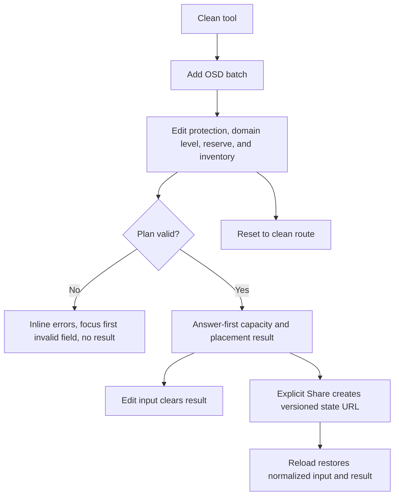

# Implementation report: Ceph Capacity and Failure-Domain Planner

Status: ready
Tool: Ceph Capacity and Failure-Domain Planner
Route: `/ceph-capacity-calculator`
Depends on: `competitive-report.md`
Input fingerprint: `competitive-report.md sha256:125ace091ab223b95f8be3c74afd57cdded386759afa5d770b32e0bc17ff534d`
Contract type: formula

## Product decision

- Primary user: A homelab or small-cluster operator choosing a Ceph pool profile from a known OSD inventory before buying drives or writing the CRUSH rule.
- Job: Determine the modeled capacity, the required number of distinct failure domains, and what the plan looks like after its largest entered domain is unavailable.
- Product thesis: stack127 can make the topology decision clearer by showing exact mixed-domain accounting and the placement minimum beside the capacity ratio, while keeping live-cluster uncertainty visible.
- Evidence: `competitive-report.md`, especially Evidence-backed opportunities, the comparison matrix, and Formula and data disagreements.

## Scope

### Table stakes

- Replicated pool `size` from 2 through 5.
- Erasure-coded pool `k` and `m` with a visible `k+m` placement requirement.
- OSD inventory as repeatable batches grouped by a chosen CRUSH failure-domain level.
- Mixed OSD capacities and mixed capacity batches within one failure domain.
- Decimal and binary capacity units with exact byte normalization.
- Raw capacity, modeled protection capacity, protection overhead, explicit planning reserve, and planning target.
- Required domain count, entered domain count, extra-domain headroom, and largest-domain-loss scenario.
- Explicit Plan action, Reset, explicit Share, keyboard submission, invalid recovery, and stale-result clearing.
- A concise warning that this is a local planning model and cannot reproduce a live CRUSH map or `ceph df`.

### Launch differentiators

- Each row represents a capacity batch inside a named failure domain, so unequal OSD sizes can be entered without pretending every host is uniform.
- The result separates the protection ratio from the user-selected planning reserve. The reserve never changes the raw or modeled protection capacity.
- The page reports the difference between “meets the placement minimum” and “has one extra domain of headroom.” After the largest domain is removed, it reports surviving raw capacity and whether full placement can still be satisfied.
- An exact capacity-composition bar and an exact domain table make the relationship scanable without adding a PG, IOPS, or export dashboard.
- All formula work stays in a route-local pure engine, and inputs remain local unless the user explicitly creates a share URL.

### Deferred

- `min_size` and write-availability modelling.
- Multiple pools with different profiles.
- CRUSH rule generation or command output.
- Device classes, pool weights, PG count, autoscaler behavior, nearfull and full ratios, BlueStore metadata, WAL/DB, snapshots, and object-size amplification controls.
- Importing `ceph osd tree`, `ceph osd df`, or a live cluster report.
- CSV, JSON, image, or document exports.

### Non-goals

- Do not label a plan “safe,” “production-ready,” or “data-loss proof.”
- Do not predict exact usable space, free space, IOPS, latency, recovery time, PG placement, or rebalance behavior in an installed cluster.
- Do not recommend a protection profile automatically. Show the selected model and its consequences.
- Do not treat the largest-domain scenario as a durability proof. It is a capacity and placement stress case over the entered inventory.
- Do not publish or add the route to the storage hub, sidebar, collection count, migrations, or registry in this worktree.

## Formula and data contract

### Inputs and normalization

| Input | Type and unit | Default | Valid range | Normalization |
| --- | --- | --- | --- | --- |
| Protection mode | enum: `replicated` or `erasure` | `replicated` | Two values | Determines the data and total shard counts. |
| Replica size | integer | `3` | 2 to 5 | Used only for replicated mode. |
| EC data chunks `k` | integer | `4` | 2 to 12 | Used only for erasure mode. Values above 8 show a documented caution. |
| EC coding chunks `m` | integer | `2` | 1 to 8 | Used only for erasure mode. `m=1` calculates but shows the Ceph production warning. |
| CRUSH failure domain | enum | `host` | `osd`, `host`, `rack`, `datacenter` | Describes the bucket represented by each entered domain label. It does not inspect a CRUSH hierarchy. |
| Domain label | string | none | Trimmed non-empty ASCII or Unicode text, maximum 48 characters | Trim whitespace and group labels case-insensitively. Repeated labels intentionally model multiple capacity batches in one domain. |
| OSD count per batch | integer | none | 1 to 64 per row; 1 to 256 across all rows | ASCII decimal integer only. |
| OSD capacity per batch | decimal plus unit | none | Positive whole-byte value, at most 100 PB per OSD | Accept plain decimal notation with up to 9 fractional digits. Reject signs, exponent notation, locale separators, and fractional bytes. |
| Capacity unit | enum | `TB` | `GB`, `TB`, `GiB`, `TiB` | Convert to bytes using decimal or binary multipliers before calculation. |
| Planning reserve | decimal percent | `20%` | 0% to 50%, at most two fractional digits | Store as basis points. This is an explicit planning choice, not a Ceph nearfull or full threshold. |

The inventory is capped at 32 rows and 256 OSDs. A protection profile is invalid when `k+m > 16`. These caps are interaction and performance limits, not Ceph limits.

### Equations or resolution order

1. Normalize every domain label with trim plus case-folding. Reject a blank label, invalid count, invalid capacity, unsupported unit, or a profile outside its bounds.
2. For each inventory row `i`, compute exact `rowRawBytes[i] = osdCount[i] * osdCapacityBytes[i]`.
3. Compute `rawCapacityBytes = sum(rowRawBytes)` and `osdCount = sum(osdCount[i])`.
4. Group rows by normalized domain label. For each domain `d`, compute `domainRawBytes[d] = sum(rowRawBytes[i])` and `domainOsds[d] = sum(osdCount[i])`.
5. Set the protection fraction:
   - replicated: `dataShards = 1`, `totalShards = replicaSize`;
   - erasure coded: `dataShards = k`, `totalShards = k + m`.
6. Compute `modeledUsableBytes = floor(rawCapacityBytes * dataShards / totalShards)`. This is the mathematical protection model before planning reserve and live-cluster overhead.
7. Compute `protectionOverheadBytes = rawCapacityBytes - modeledUsableBytes`.
8. Compute `planningReserveBytes = floor(modeledUsableBytes * reserveBasisPoints / 10_000)` and `planningTargetBytes = modeledUsableBytes - planningReserveBytes`. Reserve is applied after the protection ratio so it cannot be mistaken for replication or coding overhead.
9. Set `requiredFailureDomains = totalShards`. The baseline placement state is:
   - invalid before calculation when `enteredDomains < requiredFailureDomains`;
   - `minimum met` when `enteredDomains === requiredFailureDomains`;
   - `extra-domain headroom` when `enteredDomains > requiredFailureDomains`.
10. Find the domain with the greatest `domainRawBytes`. Compute `largestDomainLossRawBytes`, `rawAfterLargestDomainLossBytes`, and `modeledAfterLargestDomainLossBytes = floor(rawAfterLargestDomainLossBytes * dataShards / totalShards)`.
11. Compute `remainingDomainsAfterLargestLoss = enteredDomains - 1`. The loss scenario is labelled `full placement remains` only when `remainingDomainsAfterLargestLoss >= requiredFailureDomains`; otherwise it is labelled `degraded placement` and the surviving capacity is explicitly a degraded inventory model, not a full-placement result.
12. Compute domain share percentages from exact bytes for display only. Never use rounded display values in later equations.

### Rounding, display, and versioning

- Engine values remain `bigint` byte counts and integer counts.
- Unit conversion uses decimal `GB` and `TB`, and binary `GiB` and `TiB` multipliers. Display values round half up to two decimal places, with a `<0.01` marker for a positive value that rounds below that threshold.
- Percentages round half up to two decimal places. A positive share below 0.01% displays `<0.01%`.
- The formula version is `ceph-capacity-1`; serialized inputs use `ceph-capacity-input-1`.
- A share payload contains only normalized inputs and both version strings. It never contains result values, browser history beyond the explicit `state` query, analytics data, or device paths.
- A clean load has no query state and no automatic result. An explicit Share action creates `?state=...`. Input edits remove the state query and clear the result.

### Invalid, unknown, absent, and partial states

- No inventory rows, a blank domain, non-positive count or capacity, invalid decimal grammar, unsupported unit, out-of-range reserve, or out-of-range protection profile is invalid. No result may remain visible.
- Fewer distinct entered domains than `size` or `k+m` is invalid because the selected CRUSH failure-domain model cannot place one copy or shard in every required domain. The form remains editable and the first invalid field receives focus.
- A valid profile with no extra domain is not invalid. It shows `minimum met` and makes the one-domain-loss scenario visibly degraded when the remaining domain count drops below the placement minimum.
- A valid profile with more than the minimum domain count shows extra-domain headroom. It does not call the plan safe.
- A malformed, unsupported, or wrong-version share state is discarded. The URL is restored to the clean route, the form is reset, and a concise recovery status is announced.
- If current input changes after a result, the result is cleared immediately. A stale result can never coexist with invalid or changed current inputs.
- The page performs no network request to calculate, and there is no loading or upstream failure state in this formula-only release.

### Assumptions and exclusions

The model assumes that each named inventory group is a CRUSH failure-domain bucket and that the selected profile can distribute its copies or chunks across the required number of distinct buckets. It does not inspect the CRUSH map, device classes, weights, PGs, current utilization, metadata, snapshots, small-object amplification, nearfull or full policy, `min_size`, or recovery state. A domain table is a planning view of entered capacity, not evidence of actual placement.

### Primary sources

- [Ceph erasure coding](https://docs.ceph.com/en/latest/rados/operations/erasure-code/), checked 2026-08-23. Supports EC overhead, `k+m` failure-domain guidance, and small-object and recovery caveats.
- [Ceph erasure-code profiles](https://docs.ceph.com/en/latest/rados/operations/erasure-code-profile/), checked 2026-08-23. Supports `k`, `m`, chunk tolerance, and stripe concepts.
- [Ceph CRUSH maps](https://docs.ceph.com/en/latest/rados/operations/crush-map/), checked 2026-08-23. Supports failure-domain-aware placement.
- [Ceph pool and PG configuration](https://docs.ceph.com/en/latest/rados/configuration/pool-pg-config-ref/), checked 2026-08-23. Supports replicated `size` and `min_size` context.

## User flow



The primary action is `Plan capacity`. `Add OSD batch`, remove, unit changes, Share, and Reset never silently calculate. Enter submits the form from a text or numeric input. A valid plan moves focus to the result heading and announces one concise summary. An invalid plan focuses the first invalid control and exposes a grouped alert with field-associated errors.

## Interface wireframes

### Desktop: clean

```text
sidebar                 page column
Storage tools           Ceph Capacity and Failure-Domain Planner
                        short intro
                        +--------------------------------------------------+
                        | OSD inventory                                  |
                        | CRUSH failure domain [host v]  reserve [20%]     |
                        | Protection [ Replicated ] [ Erasure coded ]      |
                        | size [3] or k [4] m [2]                         |
                        |                                                  |
                        | No OSD batches yet.                             |
                        | [Add OSD batch]                                  |
                        |                                                  |
                        | [Reset]                         [Plan capacity]  |
                        +--------------------------------------------------+
                        compact guide begins below the tool later
```

### Desktop: valid result

```text
+--------------------------------------------------------------------------+
| Plan capacity                                                            |
| 21.33 TB modeled usable                                                  |
| 64 TB raw  | 12 OSDs  | 3 hosts  | replicated size=3  | reserve 20%     |
| [exact capacity bar: modeled data | protection overhead]                 |
| Planning target 17.07 TB       Reserved headroom 4.27 TB                |
|                                                                          |
| Failure-domain placement                                                 |
| Minimum 3 domains   Entered 3 domains   Extra headroom 0                |
| Minimum met. One largest-domain loss leaves degraded placement.          |
|                                                                          |
| Largest-domain loss                                                      |
| host-c 16 TB raw lost | 48 TB raw remains | 2 of 3 domains remain        |
| Modeled surviving capacity 16 TB | full placement after loss: no          |
|                                                                          |
| Domain inventory                                                         |
| Domain       OSDs      Raw capacity      Share       Loss order           |
| host-a       4         16 TB             25.00%                           |
| host-b       4         16 TB             25.00%                           |
| host-c       4         16 TB             25.00%       largest              |
|                                                                          |
| [Share plan] [Reset]                                                     |
+--------------------------------------------------------------------------+
```

### Narrow mobile

```text
Ceph Capacity and Failure-Domain Planner
intro

+-------------------------------+
| OSD inventory                  |
| Protection                     |
| [Replicated] [EC]              |
| size [3]                       |
| failure domain [host]          |
| reserve [20%]                  |
|                               |
| Domain [host-a]                |
| OSD count [4]                  |
| OSD size [4] [TB]              |
| [remove batch]                 |
|                               |
| [Add OSD batch]                |
| [Reset]                        |
| [Plan capacity]                |
|                               |
| Result                         |
| 21.33 TB                       |
| modeled usable                |
| raw 64 TB | 12 OSDs           |
| exact bar                     |
| placement summary             |
| loss scenario                 |
| domain rows reflow as         |
| labelled domain blocks        |
| [Share plan]                  |
+-------------------------------+
```

### Error, loading, partial, and restored states

```text
Error: neutral framed alert, field errors under the affected controls,
first invalid control focused, no result section rendered.

Loading: not applicable. The formula runs synchronously with no upstream.

Partial/no-data: not applicable. A formula either has a valid complete
inventory or returns a structured invalid result.

Restored: the normalized input form renders with the result, a small
"Shared plan loaded" status is announced, and the URL keeps its state query
until Reset or an input edit.
```

## Interaction contract

| Event | UI response | Result state | Focus/announcement | URL/persistence |
| --- | --- | --- | --- | --- |
| Add OSD batch | Append an empty row and keep the primary action separate | Clear any result | Focus the new domain label | Clean route, no storage |
| Remove batch | Remove only that row | Clear result | Focus the next row or Add button | Remove state query if present |
| Edit any input | Update controlled form and clear stale result | Empty | Announce “Inputs changed” only once per edit burst if needed | Remove state query |
| Change unit | Convert the current exact value when valid; retain a field error if conversion cannot happen | Empty | Keep focus on the unit or value control | Remove state query |
| Submit by click or Enter | Validate, calculate, or expose errors | Valid result or empty invalid state | Focus result heading on success, first invalid control on failure | Clean route unless Share was clicked |
| Share | Encode normalized inputs and copy the URL when possible | Keep valid result | Status says link ready or copy failed | Add `state` query explicitly |
| Load valid share state | Restore input and calculate | Valid result | Announce “Shared plan loaded” | Keep state query |
| Load malformed share state | Discard payload and reset | Empty | Announce recovery status | Replace URL with clean route |
| Reset | Restore empty inventory and defaults | Empty | Focus Add OSD batch | Replace URL with clean route |

## Page composition

| Claim or task | Medium | Position | Why this medium |
| --- | --- | --- | --- |
| Enter a Ceph inventory and protection profile | Tool UI | Above the fold | The primary job belongs in the interactive surface. |
| Raw versus protection overhead | Exact result visualization | Inside result | The relationship is exact and faster to scan as a bar plus values. |
| Domain contribution and largest loss | Table | Inside result | Repeated domain facts need aligned columns and remain exact. |
| Minimum domains and extra headroom | Tool UI plus sentence | Inside result | The live model should answer the placement question directly. |
| Replication versus EC terminology | Table | Supporting guide | Repeated profile facts are clearer as a comparison. |
| CRUSH and small-object limitations | Sentences with official links | Supporting guide | These are caveats and boundaries, not computed facts. |
| Next verification commands and sources | Sentences and links | End of guide | The real cluster must be checked after planning. |

## Technical plan

### Architecture and file ownership

- `app/(site)/(tools)/ceph-capacity-calculator/page.tsx`: server shell, h1, short introduction, search-state handoff, and guide composition. No metadata, canonical, robots, sitemap, or JSON-LD.
- `app/(site)/(tools)/ceph-capacity-calculator/ceph-capacity-calculator.tsx`: smallest practical client island for form state, interaction, result rendering, focus, share, and announcements. It imports the route-local engine and CSS Module.
- `app/(site)/(tools)/ceph-capacity-calculator/ceph-capacity-engine.ts`: pure TypeScript formula, validation, exact decimal and unit parsing, display helpers, and versioned serialization. No React, browser history, network, or side effects.
- `app/(site)/(tools)/ceph-capacity-calculator/ceph-capacity-calculator.module.css`: route-owned layout and result styles. Use shared tokens, one framed tool, no global selectors, no gradients, shadows, or colored left-edge callouts.
- `app/(site)/(tools)/ceph-capacity-calculator/ceph-capacity-guide.tsx`: later server-rendered explanatory guide using shared prose classes, official source links, one compact table, and no FAQ or methodology essay.
- `content_docs/ceph-capacity-calculator/`: route-owned brief, research, implementation, test-design, and writing/SEO artifacts. The brief and supporting artifacts stay with this tool and do not enter the legacy `content/` workflow.
- `lib/`: no changes planned. The calculation engine stays route-local because this contract has one consumer and the parent task does not authorize shared utility changes.
- `tests/pages/ceph-capacity-calculator/page.json`: route ownership manifest with `state: unpublished` and a reason that the parent task must integrate shared publication changes.
- `tests/pages/ceph-capacity-calculator/page.test.mjs`: source ownership, content structure, route-local engine boundary, styles, and publication-state policy.
- `tests/pages/ceph-capacity-calculator/ceph-capacity-calculator.test.mjs`: pure engine fixtures, parser, validation, calculation invariants, and serialization.
- `tests/pages/ceph-capacity-calculator/ceph-capacity-calculator.spec.ts`: focused rendered interaction, keyboard, state, responsive, theme, and overflow checks under the guarded preview.
- `scripts/storage-tools/preview-local-pages.mjs`: shared guarded managed-development preview workflow for all eight unpublished storage routes. It positively identifies the managed development project, refuses production or any other database, refuses overwrites, and removes only matching temporary rows after visual QA.

No shared storage hub, sidebar, count, migration, publication registry, or `lib/storage` file is part of this implementation.

### Accessibility, privacy, security, and performance

- Use real labels, fieldsets, legends, associated errors, `aria-invalid`, `aria-describedby`, a grouped `role=alert`, and one polite result announcement.
- Keep every input and remove button at least 44px high. Preserve keyboard order and make Enter submit without duplicate submission.
- Never use user labels as HTML. React text rendering and URL encoding handle untrusted values. Reject oversized inventory before calculation.
- Calculate in the browser with no API, no local storage, no cookies, and no analytics payload. Explicit share URLs contain user-entered inventory, so the Share action must state that fact.
- Keep the pure engine deterministic and under 10 ms for the 32-row and 256-OSD cap in a focused performance fixture. Avoid a dependency for the bar or table.
- Inspect 320px, 375px, 760px, and desktop widths in dark and light themes. Use `min-width: 0` at grid and flex boundaries and reflow the domain table into labelled blocks below 760px.

### Publication state

Unpublished. The exact route must return 404 through the central registry until the parent task integrates a reviewed registry row. The route code must not own publication behavior.

## Acceptance criteria

| ID | Observable acceptance criterion | Evidence at build time |
| --- | --- | --- |
| R1 | A valid replicated inventory returns exact raw, modeled usable, protection overhead, reserve, and target values. | Pure engine fixtures and result assertions. |
| R2 | A valid EC inventory returns `k/(k+m)` capacity and labels the `k+m` domain requirement. | EC fixtures and browser result. |
| R3 | Repeated domain labels aggregate mixed capacity batches without losing exact OSD or raw totals. | Mixed-domain engine fixture and domain table test. |
| R4 | Fewer distinct domains than the profile requires cannot show a result. | Invalid engine fixture and focused invalid browser flow. |
| R5 | The result distinguishes minimum met, extra-domain headroom, and degraded placement after the largest-domain loss. | Placement-state fixtures and result assertions. |
| R6 | The largest-domain scenario removes the greatest grouped raw capacity and never changes the baseline modeled capacity. | Loss-order and invariant fixtures. |
| R7 | Decimal and binary units, decimal grammar, basis-point reserve, and display rounding preserve exact source bytes. | Parser and formatting fixtures. |
| R8 | Add, remove, unit edit, reset, and Plan actions remain distinct; adding a batch never calculates. | Playwright interaction test. |
| R9 | Editing any current input clears the previous result and any state query. | Playwright stale-result test. |
| R10 | Click and Enter submission expose the same result; invalid submit focuses the first invalid control and associates errors. | Playwright keyboard and accessibility test. |
| R11 | Share is explicit, versioned, result-free in its payload, restores valid state, and recovers malformed state to the clean route. | Serialization fixtures and Playwright history test. |
| R12 | The complete result remains readable without page overflow at required widths and in both themes. | Playwright bounding boxes, scroll widths, and screenshots. |
| R13 | The supporting guide is server-rendered, concise, source-linked, and does not repeat the live result or add an FAQ. | Static source test and rendered content test. |
| R14 | Route files contain no page-owned metadata, robots, canonical, sitemap, or JSON-LD code, and the route remains unpublished. | Page source test, ownership manifest, and SEO route guard. |
| R15 | The engine contains no React or network dependency and stays within the max inventory performance budget. | Static boundary test and benchmark fixture. |

## Open questions and blockers

- None. `min_size`, PGs, live CRUSH inspection, and performance estimates are deliberate non-goals for this release.
