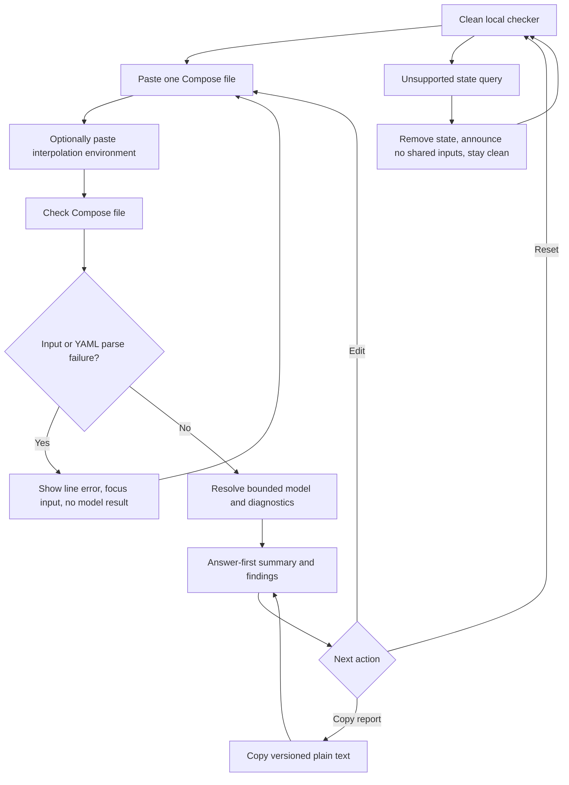

# Implementation report: Docker Compose checker

Status: ready
Tool: Docker Compose checker
Route: `/docker-compose-checker`
Depends on: `competitive-report.md`
Input fingerprint: `competitive-report.md sha256:bb8cce9a5c129e931e9df10005408b430af2e851b8d6fb0e9db8db957e32d3ae`
Contract type: resolution

## Product decision

- Primary user: A homelab operator or developer with one Compose file open before running `docker compose config` or `docker compose up`.
- Job: Find syntax and static Compose-model problems, see the exact source location and repair direction, and understand what remains unresolved without a Docker daemon or project files.
- Product thesis: Make the boundary between YAML syntax, Compose structure, and static advisories visible in one local result. The user should understand why a green YAML parse is not the same as a usable Compose model.
- Evidence: The competitive report's `User pain evidence`, `Comparison matrix`, `Formula and data disagreements`, and `Evidence-backed opportunities` sections. The report is explicit that browser tools cover cross-references and ports well, while the official Compose command remains authoritative for merged files, real environment values, and runtime behavior.

Material facts are labelled below. `[Documented]` comes from Docker or the Compose Specification. `[Observed]` comes from the report's controlled competitor probes. `[Inferred]` is a product or implementation conclusion from that evidence. `[Unknown]` is not claimed by this contract.

## Scope

### Table stakes

- Accept one pasted Compose YAML document in a multiline editor.
- Accept one optional multiline `KEY=VALUE` environment text input used only for Compose interpolation analysis. It represents a user-supplied `.env` or CLI `--env-file` snapshot, not a service `env_file`.
- Run one explicit `Check Compose file` action. Do not validate on every keystroke.
- Separate YAML syntax failures from Compose-model diagnostics and static advisories.
- Show line and column when the parser supplies them, a Compose path, stable code, severity, source excerpt when useful, and a concise fix direction.
- Show counts for services, published ports, named volumes, networks, secrets, configs, profiles, interpolation tokens, errors, warnings, and advisories.
- Keep the check browser-local. No upload, server action, Docker socket, registry request, host-file read, remote include fetch, analytics payload, or input persistence.
- Provide `Load example`, `Reset`, and `Copy report` as secondary actions.
- Reflow findings without page-level horizontal overflow at 320px, 375px, 760px, and desktop widths.

### Launch differentiators

- Lead with three named layers: `YAML syntax`, `Compose model`, and `Static advisories`. A result never says only `Valid YAML`.
- Pin the supported Compose key and type snapshot to the current Compose Specification reviewed on 2026-09-10. Treat `version` as accepted but obsolete and informative. It never selects a legacy 2.x or 3.x schema.
- Use a source-anchored diagnostic model with stable rule codes, paths, locations, excerpts, and fix guidance. Copy output preserves the same codes and counts.
- Explain interpolation as a separate concern from `environment:` and service-level `env_file:`. Show known, defaulted, unresolved, escaped, and required-variable states without claiming access to the real shell or project directory.
- Show a compact normalized model summary, not a fake runtime result: service and resource counts, profile names, published-port keys, dependency edges, interpolation count, and an incomplete-model flag.
- Mark `include`, `extends`, and multi-file override assumptions as unresolved in v1. Missing references remain errors for a complete one-file model and become warnings with a visible incomplete-model reason when external composition may supply them.

### Deferred

- A local file picker. Paste is the launch input so the privacy and no-file-access promise is easy to verify.
- Multiple Compose documents, override files, explicit profile-selection controls, merge previews, and user-selected file bundles.
- Full Compose Specification validation for every current and future key. The launch rule set covers the documented fields in this report, validates the targeted known field types, and warns on unsupported unknown keys.
- Auto-fix, formatted YAML, JSON conversion, graph views, downloads, share links, saved drafts, and CI output formats beyond copied plain text.
- A complete security lint catalog, policy configuration, Dockerfile checks, or organization-specific rules.

### Non-goals

- Do not run Docker, call `docker compose config`, pull an image, contact a registry, inspect a build context or Dockerfile, or connect to a Docker daemon.
- Do not prove that an image exists, is pullable, is compatible with the host, or has no vulnerabilities.
- Do not prove that a bind mount, `env_file`, secret file, config file, external volume, or external network exists or can be read.
- Do not prove that a host port is free, a container starts, a process listens, a healthcheck passes, or an application is ready.
- Do not inspect secret values or claim that a configuration is secure, safe, production-ready, or compliant.
- Do not fetch `include`, `extends`, remote URLs, local paths, or environment files automatically.
- Do not treat an advisory as a Compose validity failure. Do not call a file complete when `include`, `extends`, unresolved variables, external resources, or profile selection remain unknown.

## Formula and data contract

This is a deterministic local resolution contract. It resolves a bounded view of one pasted YAML document into a normalized model and diagnostics. It does not resolve the full project model that Docker Compose can build from files, environment, profiles, and implementation state.

### Inputs and normalization

| Input | Type and unit | Default | Valid range | Normalization |
| --- | --- | --- | --- | --- |
| Compose file | UTF-8 text | Empty | 256 KiB, 4,000 physical lines, one YAML document | Accept LF and CRLF. Strip one UTF-8 BOM. Preserve source text and 1-based physical lines. Reject an empty document, multiple YAML documents, NUL, and control characters other than tab, LF, and CR. |
| Interpolation environment | UTF-8 `KEY=VALUE` lines | Empty, meaning no values are known | 64 KiB, 2,000 lines, keys matching `[_A-Za-z][_A-Za-z0-9]*` | Treat this input as one explicit user-provided interpolation source. Trim one surrounding space around the key and `=`. Preserve empty values. Ignore blank lines and `#` comments. Reject malformed assignments and duplicate keys with a line diagnostic. Never read the shell, `.env`, service `env_file`, or host files. |

The input is one Compose document only. Multiple files, overrides, includes, and extends are not accepted as additional inputs in v1. `[Inferred]` This keeps the result explainable and prevents a browser file picker from quietly widening the privacy boundary.

### Equations or resolution order

1. Enforce input limits and source-character rules before parsing. If a limit fails, produce an input diagnostic and no model result.
2. Parse one YAML document with the safe YAML 1.2 `yaml@2.8.1` parser, pinned as one direct runtime dependency, while preserving node ranges and source locations. A hand-written YAML parser would mishandle quoting, block scalars, anchors, aliases, flow collections, duplicate keys, and line/column recovery. No JSON Schema package, YAML constructor, expression evaluator, or network-backed parser is needed.
3. Configure the parser to reject duplicate mapping keys, unsafe custom tags, malformed aliases, and multiple documents. Standard anchors and aliases may parse. The structural engine uses the resolved node view while retaining the original node location where the parser provides one. Unsupported YAML features produce a syntax or compatibility diagnostic, never a guessed model.
4. Require a mapping at the document root. Recognize the current Compose Specification fields needed by this contract: `name`, `services`, `volumes`, `networks`, `secrets`, `configs`, `include`, and top-level `version`. Preserve `x-` extension fields without validating their contents. Unknown non-extension fields produce a compatibility warning, not an automatic invalid result.
5. Validate known keys and types against a checked-in Compose Specification snapshot reviewed on 2026-09-10. The snapshot is a launch implementation artifact, not created in this planning stage. A future schema update requires a contract review, source date, fixture changes, and an engine version increment.
6. Treat top-level `version` as accepted but obsolete and informative. Emit `COMPOSE-VERSION-OBSOLETE` at its source location. Never use its value to choose a Compose 2.x or 3.x schema. `[Documented]` Docker and the Compose Specification say current Compose uses the merged Compose Specification and that this key does not select a schema.
7. Normalize services by name. For each service, collect image/build presence, `depends_on`, `ports`, `volumes`, `networks`, `secrets`, `configs`, `profiles`, `healthcheck`, `environment`, `env_file`, `privileged`, `cap_add`, `network_mode`, `pid`, and selected host-facing declarations. Unknown service keys warn and do not silently pass as fully supported.
8. Resolve interpolation tokens in YAML values only. Support `$VAR`, `${VAR}`, `$$`, default operators `-` and `:-`, required operators `?` and `:?`, alternative operators `+` and `:+`, and nested expressions to a bounded depth of 8. Do not interpolate mapping keys. Use only the optional pasted environment text. Record token, operator, path, source location, and state: `known`, `empty`, `defaulted`, `required-present`, `required-missing`, `unresolved`, or `escaped`. A required missing token is an error. A plain unresolved token is a warning. A defaulted token is an info diagnostic. Unsupported or over-deep expressions are warnings with no fabricated substitution.
9. Keep interpolation separate from container environment declarations. `environment:` values are Compose values that may contain interpolation. A service `env_file:` supplies container environment values and is not read or used to resolve the Compose document. Report `COMPOSE-ENV-FILE-NOT-READ` when present. The optional environment input is labelled `Interpolation environment`, so it cannot be mistaken for a service `env_file`.
10. Validate service references. A `depends_on` service name that is absent from the pasted `services` map is an error in a complete one-file model. If `include` or `extends` is present, emit `COMPOSE-INCOMPLETE-MODEL` and downgrade a potentially externally supplied missing service reference to a warning with that reason. Validate short-list and long-map `depends_on` forms, allowed conditions `service_started`, `service_healthy`, and `service_completed_successfully`, and supported `required` and `restart` fields. An invalid condition is an error.
11. Validate healthcheck and dependency conditions. A `service_healthy` dependency whose target has no enabled `healthcheck` is an error for the pasted model. `healthcheck.disable` is recognized. The checker reports declarations only and never says that a healthy status proves application readiness.
12. Normalize short and long port declarations into `host_ip`, `published`, `target`, and `protocol`, including published/target ranges and bracketed IPv6 short syntax. Report malformed port syntax, non-integer or out-of-range ports, mismatched ranges, and unresolved interpolation that prevents normalization. Detect overlapping published host-port ranges within this file for the same protocol when wildcard or equal host addresses collide. Different explicit host addresses are separate bindings. An unresolved or omitted host port is not treated as a duplicate. A host port used by another process is unknown.
13. Resolve named resource references. A service volume source without `/`, `./`, `../`, `~`, or a recognized device path is a named volume reference and must appear in top-level `volumes`, unless the resource is declared `external`. Apply the same model to service network names, secret sources, and config sources. Missing declarations are errors in a complete model. External declarations emit an info or warning that existence is unknown. Bind paths and file-backed secret/config paths are identified but not read.
14. Inventory profiles. Validate profile entries as non-empty strings and report duplicates. No profile-selection input exists in v1. Mark the active profile set as unknown, show profile membership in the summary, and warn when an otherwise active service depends on a profile-gated service or when a dependency edge crosses profile boundaries. Do not invent a runtime result for a profile set the user did not provide.
15. Detect incomplete composition. A root `include` entry, a service `extends` entry, or a declared expectation of override files produces `COMPOSE-INCOMPLETE-MODEL` with the referenced path or service where available. The engine never fetches or merges these inputs. It still checks the pasted document and clearly labels findings that may depend on the missing model.
16. Emit a short reviewed advisory set. Use `advisory` severity for `privileged: true`, host PID or host network, Docker socket bind mounts, broad host bind mounts, `cap_add` containing high-impact capabilities such as `SYS_ADMIN`, plaintext values under password/token/secret-looking environment keys, and floating image tags such as `latest`. A published host port without an explicit host IP gets a narrower host-exposure advisory. These are static clues, not security verdicts.
17. Produce a normalized summary after parsing and targeted checks. It includes service names and count, resource counts, profile names, published-port keys, dependency edge count, interpolation token count and states, incomplete-model reasons, and diagnostic counts. It does not render a canonical Compose file or claim that the normalized object is Docker's final model.

### Rounding, display, and versioning

- Counts are exact integers. Port values and line/column positions are not rounded.
- Paths use Compose-style dotted or bracketed segments, for example `services.web.depends_on.db.condition` and `services.web.ports[0]`.
- `line` and `column` are 1-based. `line` and `column` are `null` only when a finding comes from a normalized relationship with no single source node.
- A source excerpt contains the source line with leading and trailing whitespace trimmed, capped at 240 Unicode code points. The complete source remains selectable in the editor.
- Diagnostic codes are stable uppercase identifiers prefixed by `COMPOSE-`, `YAML-`, or `INPUT-`. The result-copy schema is version `1`.
- Engine contract version: `compose-checker-resolution-2`. The parser package version, Compose Specification snapshot date, and schema snapshot identifier are shown as small provenance text in the result.
- Tool behavior changes to parsing, normalization, interpolation, severity, supported keys, limits, result fields, or incomplete-model handling require an engine contract version increment and refreshed fixtures. Content-only changes do not.
- No state is serialized in the URL, local storage, cookies, IndexedDB, or analytics. A clean route stays clean after hydration.

### Invalid, unknown, absent, and partial states

- Clean state has empty Compose input, empty interpolation input, no result, and `Check Compose file` available. `Load example` is secondary and does not submit.
- Input-limit, character, malformed-environment, or duplicate-environment-key failure removes the prior result, identifies the affected editor, and focuses it. No model summary is shown for an input boundary failure.
- A YAML syntax failure such as a multi-document file, unsafe tag, alias error, or malformed document removes the prior result, shows syntax findings, and focuses the Compose editor. No semantic model is shown beside a parse failure.
- A parsed document with a wrong root shape returns a `model-invalid` root finding. Missing `services`, invalid known types, missing references, bad ports, bad conditions, or missing healthchecks remain parsed semantic diagnostics with a normalized summary. Errors, warnings, advisories, and info findings remain separate.
- An unresolved variable never becomes an empty string in the normalized summary unless the Compose operator explicitly supplies an empty value. Required missing variables are errors. Unknown real shell values stay unknown.
- A parsed file with `include` or `extends` shows `Cannot fully resolve this file` as the completeness state. It may show structural findings from the pasted fragment, but it does not claim final merged-model validity.
- A file with no blocking syntax or model errors but with advisories says `No blocking static issues found` and keeps advisories visually separate. It never says `ready`, `safe`, or `valid` without qualification.
- A file with no errors, warnings, or advisories says `No blocking static issues found` and states that Docker and runtime checks remain outside the browser tool.
- There is no network loading or upstream failure state in v1. An unexpected engine exception preserves both inputs, clears the result, and shows a focused retry message.
- Editing either input immediately clears counts, findings, copy output, and the old completeness state. A stale result never remains beside changed source.
- Copy failure leaves the result visible and announces `Copy failed`. Successful copy announces `Report copied`.
- If a user opens the route with a `state` query parameter, the client does not decode it. It removes only `state`, preserves unrelated parameters, shows `Shared inputs are not supported`, and stays clean. Refresh starts clean.

### Assumptions and exclusions

The checker assumes the pasted document is the effective one-file input the user wants to inspect. It does not assume that the pasted environment text is the user's real shell or project `.env`; it is only a named, explicit source supplied to this tool. `[Unknown]` The exact Compose CLI behavior for every future Specification field and implementation version cannot be represented by this bounded rule set, so unsupported fields stay warnings or unknowns rather than guessed failures.

### Primary sources

- [Docker Compose file reference](https://docs.docker.com/reference/compose-file/), checked 2026-09-10. `[Documented]` Current Compose Specification relationship and obsolete `version` behavior.
- [Compose Specification](https://compose-spec.github.io/compose-spec/spec.html), checked 2026-09-10. `[Documented]` Services, profiles, interpolation, `include`, `extends`, extension fields, and unknown-field behavior.
- [Compose Specification JSON schema](https://github.com/compose-spec/compose-spec/blob/main/schema/compose-spec.json), checked 2026-09-10. `[Documented]` Reference shape for the checked-in supported-key snapshot.
- [Docker interpolation guide](https://docs.docker.com/compose/how-tos/environment-variables/variable-interpolation/), checked 2026-09-10. `[Documented]` Operators, precedence, `.env`, `--env-file`, and missing-variable behavior.
- [Docker interpolation reference](https://docs.docker.com/reference/compose-file/interpolation/), checked 2026-09-10. `[Documented]` Value-only interpolation, nesting, and escaped dollars.
- [Docker `docker compose config` reference](https://docs.docker.com/reference/cli/docker/compose/config/), checked 2026-09-10. `[Documented]` The authoritative command's merge, environment, profile, and validation boundary.
- [Docker services reference](https://docs.docker.com/reference/compose-file/services/), checked 2026-09-10. `[Documented]` `depends_on`, conditions, healthchecks, ports, and service declarations.
- [Docker include reference](https://docs.docker.com/reference/compose-file/include/), checked 2026-09-10. `[Documented]` Include loading and project-directory behavior.
- [Docker Compose trust model](https://docs.docker.com/compose/trust-model/), checked 2026-09-10. `[Documented]` Why file references, remote includes, and interpolation need an explicit trust boundary.
- [Docker volumes](https://docs.docker.com/reference/compose-file/volumes/), [secrets](https://docs.docker.com/reference/compose-file/secrets/), and [configs](https://docs.docker.com/reference/compose-file/configs/), checked 2026-09-10. `[Documented]` Top-level resource declaration and service-reference rules.
- [Competitive report](competitive-report.md), checked 2026-09-10. `[Observed]` Browser behavior, user pain, privacy expectations, mobile risks, and the recommended product wedge.

## User flow



`Check Compose file` is the only primary action. Editing does not run a hidden live check because explicit submission keeps the result stable while a user is typing a multiline document and makes stale-result clearing testable. Enter submits from the environment field or an auxiliary single-line control, while Enter in the Compose textarea inserts a newline. A valid submission moves focus to the result heading. An invalid submission focuses the first invalid input or the first source line that can be anchored.

## Interface wireframes

### Desktop: clean

```text
Docker Compose checker
Check one Compose file for YAML, Compose structure, and static clues.

+----------------------------------------------------------------------------+
| Compose file                                                               |
| +------------------------------------------------------------------------+ |
| | services:                                                              | |
| |   web:                                                                 | |
| |     image: nginx:latest                                                | |
| |     ports:                                                              | |
| |       - "8080:80"                                                      | |
| +------------------------------------------------------------------------+ |
|                                                                            |
| Interpolation environment (optional)                                      |
| +------------------------------------------------------------------------+ |
| | APP_TAG=latest                                                         | |
| +------------------------------------------------------------------------+ |
|                                                                            |
| Inputs stay in this browser. No Docker daemon, registry, or host files.    |
| [Load example] [Reset]                              [Check Compose file]   |
+----------------------------------------------------------------------------+
```

### Desktop: result

```text
+----------------------------------------------------------------------------+
| No blocking static issues found                                            |
| 2 services  | 2 published ports  | 1 named volume  | 1 warning  | 2 advis. |
|                                                                            |
| YAML syntax       Pass                                                     |
| Compose model     1 warning                                                |
| Static advisories 2 advisories                                             |
| Completeness      One pasted file                                         |
|                                                                            |
| Findings                                                                   |
| Warning  COMPOSE-VERSION-OBSOLETE                                          |
| services.web.ports[0]  line 6, column 9                                    |
| This key is accepted but does not select a legacy Compose schema.          |
| Fix: remove version when you no longer need compatibility with old tooling. |
|                                                                            |
| Advisory COMPOSE-HOST-EXPOSURE                                             |
| services.web.ports[0]  line 6                                               |
| Published without an explicit host address. This is a review clue, not a   |
| proof that the port is reachable from another machine.                     |
|                                                                            |
| Normalized model                                                           |
| services 2 | depends_on edges 1 | profiles none | interpolation 0           |
| volumes 1 | networks 0 | secrets 0 | configs 0 | complete: no external files |
|                                                                            |
| [Copy report]                                                              |
| Compose checker resolution v2 | Compose Specification snapshot 2026-09-16 |
+----------------------------------------------------------------------------+
```

### Narrow mobile: result

```text
Docker Compose checker

+----------------------------------+
| No blocking static issues found  |
| 2 services                       |
| 2 published ports                |
| 1 named volume                   |
| 1 warning | 2 advisories        |
|                                  |
| YAML syntax       Pass           |
| Compose model     1 warning     |
| Static advisories 2 advisories  |
| Completeness      One file      |
|                                  |
| Findings                         |
| Warning                          |
| COMPOSE-VERSION-OBSOLETE         |
| services.web.ports[0]            |
| line 6, column 9                 |
| accepted, but not a schema mode  |
| [Show source]                    |
|                                  |
| Advisory                         |
| COMPOSE-HOST-EXPOSURE            |
| services.web.ports[0]            |
| review clue only                 |
|                                  |
| Normalized model                 |
| services 2 | ports 2            |
| volumes 1 | networks 0          |
| secrets 0 | configs 0            |
|                                  |
| [Copy report]                    |
+----------------------------------+
```

### Syntax error, incomplete model, and reset states

```text
Syntax error
+----------------------------------------------------------------------------+
| YAML syntax error                                                         |
| Line 5, column 13: expected ',' or ']' in a flow sequence.                |
| >     ports: ["8080:80"                                                   |
|                                                                       ^    |
| Fix: close the sequence, then check the file again.                       |
| No Compose model or static advisories are shown.                          |
+----------------------------------------------------------------------------+

Incomplete model
+----------------------------------------------------------------------------+
| Cannot fully resolve this file                                             |
| COMPOSE-INCOMPLETE-MODEL  include: ./base.yml                             |
| This check uses the pasted file only. The included project was not read.   |
| Structural findings may change after Compose merges the project.           |
+----------------------------------------------------------------------------+

Reset or changed input
+----------------------------------------------------------------------------+
| Editors keep the current text. The previous result is cleared.             |
| [Load example] [Reset]                              [Check Compose file]   |
+----------------------------------------------------------------------------+
```

There is no loading or upstream-failure state because the launch engine is local and bounded. An unexpected engine exception has a separate retry message and keeps the user's text.

## Interaction contract

| Event | UI response | Result state | Focus/announcement | URL/persistence |
| --- | --- | --- | --- | --- |
| Initial clean load | Empty labelled editor, optional environment editor, one primary action | No result | Normal focus; no unsolicited announcement | Canonical route stays unchanged; no storage |
| Load example | Replace both inputs with a small example containing one structural finding and one advisory | Clear any previous result | Focus Compose editor; announce `Example loaded` | No URL or storage write |
| Edit either input | Preserve draft and clear findings, counts, copy action, and completeness state immediately | No result | Keep caret focus; polite `Inputs changed` status | No URL, cookie, or storage write |
| Submit valid YAML | Parse, normalize, run the bounded rules, and render the result | Summary plus diagnostics | Focus result heading with `tabindex=-1`; announce the lead answer once | No persistence |
| Submit invalid input | Show exact input or source location and recovery text | No semantic result beside a parse failure | Focus first invalid editor; associate error with `aria-describedby` and `aria-invalid` | No persistence |
| Include or extends detected | Keep pasted-file findings and show an incomplete-model warning | Partial static result with explicit unknown boundary | Focus result heading; announce incomplete resolution | No persistence |
| Expand source excerpt | Reveal exact source line or diagnostic detail in place | Result unchanged | Native button or disclosure keyboard behavior | No persistence |
| Copy report | Copy versioned plain text with counts, summary, and findings | Result unchanged | Announce `Report copied` or `Copy failed`; focus stays on copy action | Clipboard only |
| Reset | Clear both inputs, errors, notices, and result | Clean state | Focus Compose editor; announce `Checker reset` | Remove unsupported `state` query only; no storage |
| Open with `state` query | Do not decode input; remove only `state` and show a neutral notice | Clean state | Polite `Shared inputs are not supported` | Preserve unrelated query parameters with `replaceState` |

## Page composition

| Claim or task | Medium | Position | Why this medium |
| --- | --- | --- | --- |
| Paste one Compose file and optional interpolation values | Tool UI | First workbench band | The user needs to edit source before reading explanation. |
| Distinguish syntax, model, advisory, and completeness status | Structured result summary | First result region | These are discrete states and must not be buried in prose. |
| Show the exact problem and repair direction | Diagnostic table that stacks on mobile | Immediately below the lead result | Code, severity, path, location, excerpt, and fix repeat across findings. |
| Show services, resources, profiles, ports, dependencies, and interpolation state | Normalized summary table | Below diagnostics | Counts and named repeated fields are easier to compare than a paragraph. |
| Explain why `.env`, `--env-file`, and service `env_file` differ | Connected sentences and one small comparison table | Supporting Markdown after the tool | The distinction needs context, while repeated fields fit a table. |
| Explain `version`, `include`, `extends`, and the Docker handoff | Sentences with official links and one command block | Supporting Markdown after the tool | These are scope and interpretation questions, not live result fields. |
| Show an exact service graph | Omit at launch | Not rendered | A graph would add decoration without locating the line that needs repair. |
| Show risk findings | Diagnostic rows with advisory severity | Mixed with findings but separated by layer | These are useful review clues, but color or a single verdict must not imply security proof. |
| Explain the browser-local boundary | Short sentence beside the inputs and a concise limits section | Workbench and supporting content | Privacy and non-goals affect how the result should be trusted. |

No marker art, clean chart, screenshot, or decorative diagram is planned. The source-anchored result is the useful visual. The later content pass must keep the workbench first and must not repeat its exact counts in prose.

## Technical plan

### Architecture and file ownership

- `app/(site)/(tools)/docker-compose-checker/page.tsx`: server-rendered shell using `AppShell`, `PageCanvas`, `ToolPageHeader`, and `ToolPageMarkdown`. It owns no route metadata, canonical, robots, sitemap, or JSON-LD.
- `app/(site)/(tools)/docker-compose-checker/docker-compose-checker.tsx`: the smallest client island for text state, explicit submit, reset, example, copy, result focus, live announcements, and unsupported-state cleanup.
- `app/(site)/(tools)/docker-compose-checker/docker-compose-checker.module.css`: route-owned responsive styles, source excerpts, diagnostic rows, summary layout, both themes, and mobile stacking. No global CSS additions.
- `lib/docker-compose-checker/parser.ts`: safe YAML parser adapter, source ranges, document limits, duplicate-key and multi-document errors, and source excerpts.
- `lib/docker-compose-checker/engine.ts`: pure normalization, current-Spec targeted key checks, interpolation, references, ports, profiles, healthcheck/dependency conditions, incomplete-model state, advisory rules, summary, and diagnostic ordering.
- `lib/docker-compose-checker/types.ts`: versioned input, normalized summary, diagnostic, and copy-result types. No React or browser imports.
- `tests/pages/docker-compose-checker/page.json`: route ownership manifest, kept unpublished until separately approved.
- `tests/pages/docker-compose-checker/docker-compose-checker.test.mjs`: pure engine, parser, interpolation, fixture, limit, version, ordering, and copy tests.
- `tests/pages/docker-compose-checker/docker-compose-checker.spec.ts`: rendered desktop/mobile, keyboard, focus, reset, stale result, copy, state-query, no-overflow, theme, and browser-network tests.
- `tests/pages/docker-compose-checker/fixtures/`: exact YAML and environment fixtures listed in the acceptance criteria below. The fixtures must record expected diagnostics by code, severity, path, line, column, and normalized summary.
- `scripts/docker-compose-checker/scripts.json`: page-owned verification metadata if a durable schema or browser-network audit script is needed. Do not add a one-off package script.
- `content_docs/docker-compose-checker/`: the implementation report and brief now, followed later by the interface, test, and reviewed writing artifacts owned by their respective planning stages. The route must not keep a second live copy of tool Markdown.

The builder must compare the existing `.dockerignore` tester and Home Assistant entity checker for explicit-submit behavior, result focus, local-only wording, and narrow reflow. The final interface contract stage owns the exact component inventory. This report does not authorize a route, tests, manifest, dependency install, database change, or publication.

### Accessibility, privacy, security, and performance

- Use one semantic form, persistent labels, native multiline textareas, real buttons, keyboard-reachable disclosures, a focusable result heading, one concise live region, and `aria-invalid` plus `aria-describedby` for input errors.
- Keep source text as React text nodes. Never render user input as HTML. Never evaluate YAML tags, shell expressions, regular expressions from user input, or Compose commands.
- Preserve the editor's caret on edits. On submit, focus the first invalid editor or the result heading. Color supplements the words `Error`, `Warning`, `Advisory`, `Info`, and `Pass`.
- The checker path must make no network request containing user input and must not read files, cookies, local storage, IndexedDB, clipboard input, analytics payloads, or server logs. Clipboard write is allowed only after an explicit `Copy report` action.
- The no-network claim must be tested in a production-like browser run, including that the checker does not request remote schema, registry, include, env, or error-reporting resources.
- Route-owned JavaScript, excluding shared Next and React chunks, should stay below 70 KiB gzip. The direct YAML parser is the only new runtime dependency allowed by this contract.
- Maximum accepted Compose input must finish within 250 ms p95 on a current desktop Chromium run and 750 ms at 4x CPU throttling. If the bound is missed, reduce documented limits before adding a loading state.
- Maximum limits are product limits, not Compose limits: 256 KiB source, 4,000 lines, 100 services, 512 total declared or referenced resources, 512 interpolation tokens, and 1,000 emitted diagnostics. Environment text is limited to 64 KiB and 2,000 lines.
- Long paths, image names, variable expressions, excerpts, and codes must wrap or scroll inside their own bounded region without page-level overflow. Mobile findings stack their fields in source order.

### Publication state

Unpublished. The route may be implemented later but must return 404 or an explicit approved noindex state until a separate publication decision creates the registry row. This planning stage creates no route, manifest, database row, migration, or SEO behavior.

## Acceptance criteria

The next implementation stage must use exact fixtures, not only browser screenshots. Each fixture records the input text, optional environment text, expected engine version, expected summary, and ordered diagnostics. Expected diagnostics include `code`, `severity`, `layer`, `path`, `line`, `column`, and `fix`; `excerpt` is asserted when the source node has a stable line.

| ID | Observable acceptance criterion | Evidence at build time |
| --- | --- | --- |
| R1 | A clean route renders one Compose editor, one optional interpolation editor, one primary `Check Compose file` action, `Load example`, `Reset`, and no result. | Server-rendered source test and Browser test |
| R2 | The engine accepts one UTF-8 YAML document with LF or CRLF, strips one BOM, preserves 1-based locations, and classifies empty, multi-document, over-limit, NUL, and disallowed-control input as input or syntax failures without partial output. | `input-limits.yml` and parser unit fixtures |
| R3 | The parser reports malformed YAML with a line, column when available, source excerpt, `YAML-PARSE-ERROR`, and fix guidance; semantic diagnostics are absent for that submission. | `syntax-error.yml` unit and Browser fixture |
| R4 | A mapping root with current targeted Compose fields normalizes services, ports, resources, profiles, dependencies, healthchecks, and interpolation tokens into the documented summary. | `valid-current-compose.yml` exact summary fixture |
| R5 | Top-level `version: "3.8"` produces `COMPOSE-VERSION-OBSOLETE` with warning severity and never changes the targeted current-Spec rules. | `obsolete-version.yml` exact diagnostic fixture |
| R6 | Unknown non-extension keys produce compatibility warnings, `x-` extension keys are preserved without false errors, and a known key with the wrong type produces a model error. | `unknown-and-extension.yml` fixture |
| R7 | A missing `depends_on` service is an error in a complete one-file model, with a service path and source location. | `missing-dependency.yml` fixture |
| R8 | `service_healthy` without an enabled target healthcheck is a model error, while a valid healthcheck condition passes structural checks and never claims runtime readiness. | `dependency-healthcheck.yml` fixture |
| R9 | Short and long ports, published/target ranges, and bracketed IPv6 bindings normalize to comparable keys; malformed or out-of-range ports are errors; unresolved port interpolation is not fabricated; and same-protocol overlapping published host ranges are diagnosed when wildcard or equal host addresses collide. | `ports-and-collisions.yml` and Compose-compatible port fixtures |
| R10 | Named volume, network, secret, and config references require matching top-level declarations unless marked external. Missing declarations are errors; external existence and file readability remain unknown. | `resource-references.yml` fixture |
| R11 | Profiles are inventoried, malformed or duplicate profile entries are diagnosed, profile membership is visible, and profile-dependent edges are marked unknown or warning without a fabricated active-profile result. | `profiles.yml` fixture |
| R12 | `include` and `extends` are never fetched or merged. The result contains `COMPOSE-INCOMPLETE-MODEL`, names the referenced path or service, and downgrades potentially external missing references with a visible reason. | `incomplete-composition.yml` fixture and request audit |
| R13 | `$VAR`, `${VAR}`, `$$`, default, required, alternative, and bounded nested expressions are classified against the optional environment text. Required missing values are errors, plain unresolved values are warnings, defaults are recorded, and service `env_file` is never read. | `interpolation.yml` plus `.env` text fixture |
| R14 | Advisory rules report privileged mode, host namespace use, Docker socket mounts, broad host binds, high-impact capabilities, secret-looking plaintext environment values, floating image tags, and broad published exposure as advisories only. | `risk-advisories.yml` exact codes fixture |
| R15 | Diagnostics contain stable code, severity, layer, path, line/column or null, message, fix, and source excerpt where available. Ordering is syntax, model errors, model warnings, advisories, then info, with source order within each group. | Diagnostic schema unit test |
| R16 | The lead result distinguishes parse failure, incomplete model, blocking static issues, and no blocking static issues. A result never says only `Valid YAML`, `safe`, or `ready`. | Result-state unit and Browser test |
| R17 | Editing either input immediately clears the old result. Reset clears both inputs and result. Load example replaces both inputs and clears the result. | Browser interaction test |
| R18 | A valid submission focuses the result heading and announces one concise lead status. An invalid submission focuses the first invalid field and associates its error with the control. | Keyboard and accessibility Browser test |
| R19 | `Copy report` emits result schema version 1, engine version, counts, completeness, summary, and every diagnostic in plain text. Copy failure preserves the result and announces failure. | Copy unit test and clipboard Browser test |
| R20 | The clean canonical route is unchanged through hydration. A `state` query is not decoded, is removed without dropping unrelated parameters, and leaves a clean notice. No input enters URL, storage, cookies, analytics, network, or server logs. | URL, static, and request-audit tests |
| R21 | The largest accepted fixture completes within 250 ms p95 desktop and 750 ms at 4x CPU throttling, with no route-level page overflow at 320px, 375px, 760px, or desktop widths. | Performance fixture, Browser measurements, and screenshots |
| R22 | The route stays unpublished and no database row, migration, registry entry, route file, test file, script, or dependency is created during this planning stage. | Worktree check and static policy |

## Open questions and blockers

- None for this product-contract stage. The exact approved `yaml` package version, current schema snapshot contents, and final component choices are implementation-stage decisions constrained by this report and must be recorded in tests and provenance before the engine can be marked complete.
