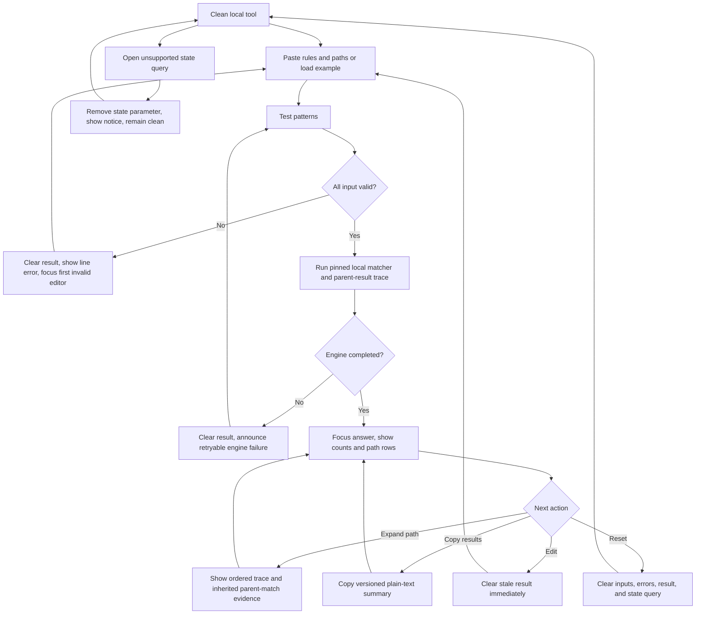

# Implementation report: `.dockerignore` Pattern Tester

Status: ready
Tool: `.dockerignore` Pattern Tester
Route: `/dockerignore-tester`
Depends on: `competitive-report.md`
Contract type: formula

## Product decision

- Primary user: A developer debugging one effective `.dockerignore` file before a Docker build.
- Job: Test representative context-relative paths and see each final verdict, deciding rule, earlier matching rules, normalization, and inherited parent-match evidence.
- Product thesis: Earn preference through a batch, local-only trace anchored to Moby `patternmatcher` v0.6.1, with inherited parent matches and source line numbers made explicit instead of presenting an unexplained generic-glob verdict.
- Evidence: `competitive-report.md` sections `User pain evidence`, `Formula and data disagreements`, `Comparison matrix`, and `Evidence-backed opportunities` show repeated demand for testing, two direct competitors with incomplete authority or batch scope, and harmful dialect differences in generic glob tools.

## Scope

### Table stakes

- Accept one pasted effective `.dockerignore` file and one context-relative path per line.
- Use one explicit `Test patterns` action. Editing either input immediately removes the old result.
- Show included and excluded counts, one verdict per submitted path, normalized path, winning source line, and an expandable ordered trace.
- Show inactive comments, blank lines, the historical `.` no-op, and normalized rules in pattern diagnostics without treating them as matches.
- Keep all evaluation in the browser. Provide `Load example`, `Reset`, and `Copy results` without file or repository upload.
- Remain usable with keyboard and screen reader operation at desktop and 320px to 390px widths in both themes.

### Launch differentiators

- Compatibility is pinned to the Linux and slash-delimited behavior of Moby `patternmatcher` v0.6.1 at commit `5a6d8429a19bb6948a372ff19e86fe83599a04b7`, not minimatch, picomatch, or a claimed generic glob dialect.
- Each path explains all rule lines that matched, identifies the last effective rule, and distinguishes a direct match from a match inherited from the same rule on a parent path.
- The engine is accepted only after differential fixtures cover upstream Moby cases plus line parsing, negation order, classes, escapes, `**`, Unicode, malformed input, Windows-style pasted paths, and parent-result tracing. A separate current Docker and BuildKit receipt must prove that `docs` followed by `!docs/README.md` includes `docs/README.md` end to end.
- Narrow results become stacked semantic rows instead of retaining a desktop-width table.

### Deferred

- Parsing a real directory listing, archive, Git tree, or uploaded repository.
- Comparing root and Dockerfile-specific ignore files side by side.
- Parsing `COPY` and `ADD` sources from a Dockerfile.
- Context-size estimates, file sizes, downloads, CSV export, share links, saved drafts, and presets beyond one example.
- Windows-container matcher mode. Launch behavior is explicitly slash-delimited Linux and BuildKit-oriented compatibility.

### Non-goals

- Do not generate or recommend `.dockerignore` rules.
- Do not call a result secure, safe, complete, or proof that a secret cannot reach a build.
- Do not claim to reproduce filesystem discovery, symlinks, permissions, Docker archive transfer, `COPY` validity, named contexts, or remote Git contexts.
- Do not merge root and Dockerfile-specific ignore files. Docker documentation says a Dockerfile-specific ignore file takes precedence.
- Do not treat braces, extglobs, or generic Git ignore behavior as Docker syntax.
- Do not claim the TypeScript runtime is upstream Go code. It is a compatibility port that must pass pinned upstream fixtures.
- Do not infer that current BuildKit vendors Moby `patternmatcher` v0.6.1. The current real-Docker receipt proves one end-to-end traversal outcome and is version-recorded separately from the pinned matcher contract.
- Do not derive a third user-facing verdict from an ancestor's intermediate state. Only the submitted path's final Moby ignored boolean determines `Included` or `Excluded`.

## Formula and data contract

### Inputs and normalization

| Input | Type and unit | Default | Valid range | Normalization |
| --- | --- | --- | --- | --- |
| Ignore patterns | Multiline string containing one effective `.dockerignore` file | Example placeholder only, stored value is empty | At most 64 KiB, 200 physical lines, and 1,024 Unicode code points per line | Accept LF and CRLF. Strip one UTF-8 BOM on line 1. A `#` in column 1 is a comment. For other lines, trim surrounding Unicode whitespace, detect leading `!`, trim again after `!`, apply slash-based path cleaning, remove one leading slash, and preserve source line and raw text. Blank and comment lines are inactive. `.` is an inactive historical no-op. |
| Paths | Multiline string, one build-context probe per line | Empty | At most 64 KiB, 500 nonblank lines, 1,024 Unicode code points per line, and 64 path segments after normalization | Accept LF and CRLF. Ignore blank lines. Trim surrounding whitespace, convert `\` to `/` for pasted Windows-style paths, remove repeated leading `./` and one leading `/`, collapse repeated `/` and `.` segments, and reject a path that is empty, resolves to `.`, contains NUL or control characters, or escapes the context through `..`. Preserve source line and raw text. Repeated normalized paths remain repeated probes and counts say `path lines`, not unique files. |
| Effective ignore source | Enum `root` or `dockerfile-specific` | `root` | Exact enum | This label does not change matching. In `dockerfile-specific` mode, visible copy states that the pasted rules replace rather than merge with the root `.dockerignore`. No second rule set is accepted. |

Input boundaries are applied before compilation. If any P0 input rule fails, no result rows are returned. JavaScript strings are Unicode, but matching and source-line reporting must preserve code points without lossy byte conversion.

### Equations or resolution order

Contract version 1 uses slash as the path separator and ports the behavior of `ignorefile.ReadAll`, `PatternMatcher.New`, pattern compilation, and `MatchesUsingParentResults` from Moby `patternmatcher` v0.6.1.

1. Split the pattern editor into physical lines while retaining 1-based source line numbers and raw text.
2. Apply the pattern normalization above. Compile every active rule before testing paths. A lone `!`, malformed character class, trailing invalid escape, or any compilation error invalidates the pattern set and produces no verdicts.
3. Compile exact, prefix `**`, suffix `**`, and regular-expression match forms using the same ordered scanner rules as the pinned Moby source. `*` never crosses `/`, `?` matches one non-`/` code point, `**` can cross zero or more directories, bracket classes follow Go `filepath.Match` compatibility, and backslash is an escape in launch mode.
4. Start every path as included, represented internally by `ignored = false`.
5. Build each normalized path's ancestor chain from context root to the submitted path. Synthetic ancestors are used only to compute the parent-match information expected by the pinned matcher and are never added to visible path counts.
6. For each ancestor and then the submitted path, process active rules in source order using the pinned `MatchesUsingParentResults` state rule. A positive matching rule sets `ignored = true`. A matching `!` rule sets `ignored = false`. The final boolean returned for the submitted path is authoritative.
7. Record trace evidence separately from that final boolean. For every rule, record source line, raw rule, normalized rule, polarity, whether it matched the submitted node directly or inherited the same rule's parent match, whether it was eligible at that state, and the state after evaluation. The trace must explain the result but must never create a third verdict or override the matcher boolean.
8. Classify only `Excluded` when the submitted path's final Moby `ignored` boolean is true and `Included` when it is false. An included path with no effective rule says `No rule matched`.
9. Lock the required parent-exception example: with line 1 `docs`, line 2 `!docs/README.md`, and path `docs/README.md`, line 1 appears as inherited parent-match evidence, line 2 directly re-includes the file, and the final verdict is `Included` with deciding line 2.
10. Count submitted path lines in exactly two groups, included and excluded. Repeated normalized paths count separately.
11. `Copy results` emits UTF-8 plain text with contract version, source mode, included and excluded counts, then tab-separated `raw path`, `normalized path`, `verdict`, and `deciding line`. It never copies the rule editors unless the matching rule is already present in a result row.

The TypeScript engine is not accepted from design similarity. The builder must create a fixture corpus identified as Moby v0.6.1, port the upstream public cases, add stack127 trace cases, and prove final verdict parity. Any unresolved disagreement is an engine error and blocks the page.

### Rounding, display, and versioning

- There is no numeric rounding. Counts are exact integers over submitted path lines.
- Pattern and path line numbers are 1-based physical editor lines.
- Display preserves raw user text in monospace and shows a separate normalized value only when it differs.
- Long paths and rules wrap without changing copied values. The result table does not truncate the authoritative deciding line.
- Matcher contract version is `moby-patternmatcher-v0.6.1-linux-slash`; result-copy schema version is `1`.
- The pinned source tag is `v0.6.1` and commit is `5a6d8429a19bb6948a372ff19e86fe83599a04b7`, checked 2026-08-07.
- A change to parsing, normalization, matching, parent-result tracing, the two-state classification, limits, or copied fields requires a contract version change and fresh differential fixtures.
- No serialized input version exists because launch does not persist or share inputs.

### Invalid, unknown, absent, and partial states

- Clean state has two empty editors, source mode `root`, no errors, and no result. `Test patterns` remains available so submitting empty input can focus the missing paths editor.
- An empty pattern file is valid once at least one path exists. Every path is included with `No rule matched`.
- Empty paths, exceeded size or line limits, context-escaping paths, NUL or control characters, a lone `!`, and malformed patterns are invalid. The previous result is removed, the first invalid editor receives focus, and exact line errors appear next to it.
- Any edit or source-mode change immediately removes result counts, rows, traces, and copy actions. Stale results never remain beside changed inputs.
- Validation is all-or-nothing. One invalid rule or path suppresses every result instead of presenting a plausible partial inventory.
- There is no loading, timeout, cache, upstream, absent-data, or partial-data state because the engine is synchronous and local. An unexpected exception clears results and shows a neutral retry message focused for assistive technology.
- A copied-results failure leaves the valid result visible and announces `Copy failed`. It does not invalidate the match.
- Inputs are not written to the URL, local storage, cookies, analytics, logs, or a server. Refresh starts clean. A `state` query parameter is never decoded; the client removes only that parameter, keeps unrelated parameters, shows `Shared inputs are not supported`, and starts clean.
- Dockerfile and ignore files have special builder-transfer behavior that this path matcher does not resolve. When a submitted basename is `Dockerfile`, `.dockerignore`, or ends in `.Dockerfile.dockerignore`, attach a neutral limitation note to that row and keep the matcher verdict unchanged.

### Assumptions and exclusions

- Paths are probes relative to one filesystem build-context root, not proof that those paths exist.
- Launch compatibility is Moby v0.6.1 on slash-delimited Linux semantics. Backslashes are normalized only in the path editor as a paste convenience. Backslashes inside patterns remain escapes.
- Docker implementations can change. The pinned matcher version and date remain visible in the calculation trace.
- The tool models ordered ignore matching and inherited parent-match state. It does not open a repository, walk symlinks, or simulate the complete client archive.
- A Dockerfile-specific ignore file takes precedence over root `.dockerignore`; the two are not concatenated.
- Included means the tested rule set did not exclude that path under this contract. It does not mean Docker will copy it, that the build references it, or that the path is safe to send.
- Excluded means the final Moby ignored boolean for that submitted path is true. It does not prove the file can never enter a build through another context, bind mount, secret, image layer, or generated artifact.

### Primary sources

- [Docker build context documentation](https://docs.docker.com/build/concepts/context/#dockerignore-files), checked 2026-08-07. Supports file precedence, preprocessing, `filepath.Match`, `**`, negation order, and special Dockerfile and ignore-file handling.
- [Moby patternmatcher v0.6.1](https://github.com/moby/patternmatcher/tree/v0.6.1), checked 2026-08-07. Supports the pinned parser, compiler, parent-result matching, and official fixture behavior.
- [Moby v0.6.1 `patternmatcher.go`](https://github.com/moby/patternmatcher/blob/v0.6.1/patternmatcher.go), checked 2026-08-07. Supports the exact compile and ordered state transitions to port.
- [Moby v0.6.1 `ignorefile.go`](https://github.com/moby/patternmatcher/blob/v0.6.1/ignorefile/ignorefile.go), checked 2026-08-07. Supports BOM, comment, whitespace, cleaning, slash, and negation preprocessing.
- [BuildKit v0.29.0 filesystem filter](https://github.com/moby/buildkit/blob/v0.29.0/vendor/github.com/tonistiigi/fsutil/filter.go), checked 2026-08-07. Supports continuing traversal when a later exception can match below an excluded directory. This current BuildKit behavior is a separate receipt target, not a claim about the version of the pinned TypeScript matcher port.

## User flow



`Test patterns` is the only accent action. Editors need multiline typing, so Enter always inserts a newline and never submits. Repeat tests use the same button. `Load example` and `Reset` are secondary actions and never replace or masquerade as testing.

## Interface wireframes

### Desktop: clean

```text
.dockerignore pattern tester
See which context paths match and which line decided each result.

+----------------------------------------------------------------------------+
| Effective file   (o) Root .dockerignore  ( ) Dockerfile-specific          |
|                                                                            |
| .dockerignore rules                    Context-relative paths              |
| +----------------------------------+   +----------------------------------+ |
| | docs                             |   | docs/README.md                   | |
| | !docs/README.md                  |   | docs/guide.md                    | |
| +----------------------------------+   +----------------------------------+ |
|                                                                            |
| [Load example] [Reset]                                    [Test patterns] |
+----------------------------------------------------------------------------+
```

### Desktop: valid result

```text
+----------------------------------------------------------------------------+
| editors remain above                                             [Test]    |
|============================================================================|
| 1 of 2 path lines is excluded. 1 stays included.                          |
| Excluded 1    Included 1                              [Copy results]       |
|                                                                            |
| Path              Verdict             Deciding rule                        |
| docs/guide.md     Excluded            line 1  docs              [details] |
| docs/README.md    Included            line 2  !docs/README.md   [details] |
|                                                                            |
| v0.6.1 Linux slash behavior                                                |
+----------------------------------------------------------------------------+
```

Expanded details stay inside the same result row and show an ordered trace table, not a nested card.

### Narrow mobile: valid result

```text
.dockerignore pattern tester

+----------------------------------+
| (o) Root  ( ) Dockerfile-specific|
| .dockerignore rules              |
| +------------------------------+ |
| | node_modules                 | |
| | *.log                        | |
| +------------------------------+ |
| Context-relative paths           |
| +------------------------------+ |
| | src/index.ts                 | |
| | debug.log                    | |
| +------------------------------+ |
| [Load example] [Reset]           |
| [Test patterns________________]   |
|==================================|
| 1 of 2 path lines is excluded.   |
|                                  |
| debug.log              Excluded  |
| line 2  *.log           [details]|
|----------------------------------|
| src/index.ts            Included |
| No rule matched         [details]|
|                                  |
| [Copy results]                   |
+----------------------------------+
```

### Invalid pattern

```text
+----------------------------------------------------------------------------+
| .dockerignore rules                                                        |
| +------------------------------------------------------------------------+ |
| | node_modules                                                           | |
| | [broken                                                                | |
| +------------------------------------------------------------------------+ |
| Line 2 has an unclosed character class.                                     |
| [Reset]                                                   [Test patterns] |
+----------------------------------------------------------------------------+
No counts, rows, trace, or copy action are visible.
```

### Engine failure and unsupported restored state

```text
+----------------------------------------------------------------------------+
| The matcher could not finish. Your inputs are still here. [Try again]      |
+----------------------------------------------------------------------------+

+----------------------------------------------------------------------------+
| Shared inputs are not supported. Nothing was loaded from this link.        |
| Empty editors remain ready on the clean route.                              |
+----------------------------------------------------------------------------+
```

There is no loading or partial-result wireframe. Maximum accepted input must finish synchronously within the performance budget. A browser history restoration may preserve the current DOM through native back-forward cache, but the product writes no persistent state and makes no restoration promise.

## Interaction contract

| Event | UI response | Result state | Focus/announcement | URL/persistence |
| --- | --- | --- | --- | --- |
| Initial clean load | Empty editors and root source mode | Absent | Normal document focus; no unsolicited announcement | Clean route; no storage |
| Load example | Replace both editors with the documented negation and parent example | Cleared | Focus rules editor; announce `Example loaded` | No URL or storage write |
| Edit rules, paths, or source mode | Preserve draft and clear old validation for the edited field | Cleared immediately | Polite status `Inputs changed`; do not move focus | Remove `state` only if present |
| Submit valid input | Compile and evaluate synchronously | Valid counts and rows replace absence | Move focus to result heading with `tabindex=-1`; live region announces only answer sentence | No persistence |
| Submit invalid input | Show exact editor and source line error | Absent | Focus first invalid editor; error linked with `aria-describedby` and `aria-invalid` | No persistence |
| Unexpected engine exception | Preserve editors and show retry message | Absent | Focus failure heading; assertive concise announcement | No persistence |
| Expand a path | Reveal trace rows in source order | Valid and unchanged | Native `details/summary` keyboard behavior; no live announcement | No persistence |
| Copy results | Copy versioned plain text | Valid and unchanged | Polite `Results copied` or `Copy failed`; focus stays on button | Clipboard only |
| Reset | Clear editors, source mode, errors, result, and notices | Absent | Focus rules editor; announce `Tester reset` | Remove `state`, no storage |
| Open with `state` | Do not decode; remove only `state`; show neutral notice | Clean and absent | Notice is in polite live region; no forced focus | `history.replaceState`; unrelated params preserved |

## Page composition

| Claim or task | Medium | Position | Why this medium |
| --- | --- | --- | --- |
| Enter effective rules and path probes | Tool UI | First workbench band after one-sentence introduction | Editing is the primary job and visual |
| Included or excluded answer | Tool UI answer sentence and exact counts | First result content | Conclusion must be scannable before detail |
| Repeated path verdicts | Responsive table that stacks visually on narrow screens | Below answer | Path, verdict, and deciding line repeat |
| Ordered matching and inherited parent-match explanation | Expandable table within each semantic result row | On demand | Direct matches, inherited evidence, and state transitions are exact repeated data and would overwhelm the first answer |
| Pattern normalization and inactive lines | Compact diagnostics table | After path results | Source line, raw, normalized, and status repeat |
| Moby version, local processing, and limits | Short sentences and mono metadata | Next to result and compact guide after tool | These are caveats and provenance, not decorative visuals |
| Dockerfile-specific precedence | One sentence that changes with the source radio | Beside source choice | It is a contextual rule, not a comparison surface |

No marker art, chart, screenshot, or decorative diagram is planned. The exact result and trace are the useful visual.

## Technical plan

### Architecture and file ownership

- `app/(site)/(tools)/dockerignore-tester/page.tsx`: server-rendered shell, title, short introduction, client-island props, and later compact guide. No route metadata, canonical, robots, sitemap, or JSON-LD.
- `app/(site)/(tools)/dockerignore-tester/dockerignore-tester.tsx`: smallest client island for editor state, explicit submission, focus, live announcements, details, copy, reset, example, and unsupported-state cleanup.
- `app/(site)/(tools)/dockerignore-tester/dockerignore-tester.module.css`: all route and component selectors, responsive stacked results, both themes, and no new global tokens.
- `lib/dockerignore/parser.ts`: pure line parsing, source mapping, bounds, slash cleaning, path normalization, and diagnostics.
- `lib/dockerignore/matcher.ts`: pure Moby v0.6.1 compatibility compiler and single-node state transition. It imports no React or browser API and exposes the pinned version constant.
- `lib/dockerignore/evaluate.ts`: pure parent-result evaluation, ordered trace, two-state classification, counts, and copy model. It never reads files, URLs, storage, or network.
- `tests/pages/dockerignore-tester/page.json`: published flat-route ownership for all docs, tests, scripts, and skills.
- `tests/pages/dockerignore-tester/dockerignore-tester.test.mjs`: P0 and P1 parser, matcher, trace, normalization, limit, version, and copy tests.
- `tests/pages/dockerignore-tester/page.test.mjs`: server content, flat route source, metadata prohibition, publication state, and static composition tests.
- `tests/pages/dockerignore-tester/dockerignore-tester.spec.ts`: real Browser action, invalid recovery, copy, responsive, theme, keyboard, state-query cleanup, and stale-result tests under guarded local preview.
- `tests/pages/dockerignore-tester/fixtures/moby-v0.6.1.json`: committed upstream-derived and stack127 differential fixtures with source tag, commit, source test name, path, rules, final boolean, deciding line, and expected trace evidence.
- `tests/pages/dockerignore-tester/fixtures/buildkit-parent-exception/`: an isolated Dockerfile, `.dockerignore`, and `docs/README.md` receipt fixture. Its rules are exactly `docs` then `!docs/README.md`; a successful Docker build must copy the file.
- `scripts/dockerignore-tester/verify-moby-fixtures.mjs`: page-owned check mode that validates pinned Moby v0.6.1 fixture provenance and runs every fixture against the pure TypeScript engine. It must not fetch during normal test or production runtime.
- `scripts/dockerignore-tester/verify-current-buildkit-receipt.mjs`: page-owned, explicitly invoked real-Docker check that builds the isolated receipt fixture, records Docker Engine, BuildKit, and Buildx versions, requires a successful `COPY docs/README.md`, and compares that `Included`, line 2 outcome with the pure engine. It writes only to a temporary directory and is separate from the pinned matcher-version claim.
- `scripts/dockerignore-tester/scripts.json` plus the sitewide `scripts/scripts.json` entry: durable script ownership. Do not add a one-off package script.
- `content_docs/dockerignore-tester/`: competitive, implementation, test, SEO/writing, and brief artifacts. No old `content/` folder.

The builder must compare `/dns-lookup` and `/zfs-padding-calculator` for shell width, one-box form/result composition, typography, focus behavior, and narrow reflow. No generic glob dependency is permitted. A TypeScript compatibility port is acceptable only with the pinned differential suite. If parity cannot be proven, implementation stops rather than shipping an approximate matcher.

### Accessibility, privacy, security, and performance

- Use one semantic form, explicit labels, real radio inputs, textareas, buttons, a focusable result heading, one concise polite live region, and `aria-invalid` plus `aria-describedby` for exact errors.
- Enter in a textarea inserts text. Only the Test button submits. Tab order follows source mode, rules, paths, secondary actions, primary action, answer, rows, and copy.
- Result color is supplementary. Every status uses one of the two words `Included` or `Excluded`.
- Keep table semantics in the DOM at all widths. CSS may stack cells with visible headers but must not reorder the accessible reading sequence or create horizontal page overflow at 320px.
- Never render user text through HTML. React text nodes and copied plain text are the only outputs. Enforce length, line, segment, and compilation bounds before regex use. No dynamic `RegExp` is accepted until the port's compiler and malformed-pattern fixtures pass.
- No network request, upload, filesystem API, cookie, local storage, server action, analytics event payload, console logging, or error telemetry may contain rules, paths, traces, or copied results.
- Target the maximum accepted 200 rules and 500 paths at 64 segments, including inherited parent-match trace generation, in at most 150 ms at p95 on a current desktop Chromium run and 500 ms at 4x CPU throttling. The real-Docker receipt is a build-time verification script and is excluded from this in-browser budget. If the local engine cannot meet the budget, reduce documented limits rather than add a loading state.
- Added route-owned JavaScript, excluding shared Next and React chunks, should stay below 35 KiB gzip. No Go Wasm or general glob library is allowed at launch.
- First server response must contain the h1, introduction, editor labels, source choices, primary action label, privacy sentence, and a compact explanation of verdicts. Computed results remain client-side.

### Publication state

Published after explicit approval on 2026-08-07. The flat slug `dockerignore-tester` is owned by `public.stack127_pages`, returns 200 at `/dockerignore-tester`, carries shared-registry metadata and JSON-LD, and appears in the sitemap. The forbidden nested route remains absent.

## Acceptance criteria

| ID | Observable acceptance criterion | Evidence at build time |
| --- | --- | --- |
| R1 | The flat route and ownership use only `dockerignore-tester`; no collection-owned child URL or nested docs folder exists. | Static test and page manifest |
| R2 | Rules parse with 1-based source lines, BOM removal, column-1 comments, whitespace cleanup, leading slash cleanup, negation, blank lines, and historical `.` no-op exactly as the pinned contract. | Unit fixtures derived from `ignorefile.ReadAll` |
| R3 | Final included and excluded booleans match every applicable upstream Moby v0.6.1 fixture for exact, `*`, `?`, `**`, Unicode, classes, escapes, negation, malformed patterns, and parent results. | P0 differential unit suite with pinned provenance |
| R4 | Windows-style pasted paths normalize to slash paths while pattern backslashes retain Linux escape semantics; both behaviors are visible and fixture-tested. | Unit and Browser tests |
| R5 | For rules `docs` then `!docs/README.md`, the pure engine returns `Included` for `docs/README.md` with deciding line 2, and the mandatory current Docker and BuildKit receipt successfully copies that file. The receipt records runtime versions separately from the Moby v0.6.1 matcher contract. | P0 engine fixture plus successful real-Docker receipt script |
| R6 | Every valid path row shows raw or normalized path, final word verdict, deciding source line or `No rule matched`, and an expandable ordered trace without changing the verdict. | Unit and Browser tests |
| R7 | One invalid rule or path clears any previous result, suppresses all new rows, shows an exact line error, and focuses the first invalid editor. | Unit and Browser tests |
| R8 | Any edit or source-mode change immediately removes old counts, rows, trace, and copy controls. | Browser regression |
| R9 | Empty rules with valid paths returns every path included; empty paths returns no result and focuses the paths editor. | Unit and Browser tests |
| R10 | The tool rejects inputs above 64 KiB, 200 rule lines, 500 path lines, 1,024 code points per line, 64 path segments, context escape, NUL, and control characters without partial output. | Boundary unit tests |
| R11 | Root and Dockerfile-specific modes test only the pasted effective file; specific mode clearly says it takes precedence and is not merged. | Static copy and Browser tests |
| R12 | `Load example`, `Reset`, `Test patterns`, path expansion, repeat test, and `Copy results` have distinct action semantics and keyboard behavior. | Browser tests |
| R13 | Copied output contains contract version, exact counts, and tab-separated path verdicts, and never adds hidden input or server transfer. | Unit and clipboard Browser test |
| R14 | A `state` parameter is not decoded, is removed without dropping unrelated parameters, and leaves a clean tool with a neutral notice. | Browser test |
| R15 | Results reflow without page overflow at 320px, 390px, and desktop; both themes retain visible focus, readable controls, and textual statuses. | Browser screenshots and measurements |
| R16 | User rules and paths produce no network, persistence, analytics payload, console output, or unsafe HTML. | Browser request audit, static test, and code review |
| R17 | Maximum accepted input completes within 150 ms p95 desktop and 500 ms at 4x throttling, and route-owned JS stays below 35 KiB gzip. | Performance fixture and build artifact check |
| R18 | The result shows the pinned Moby v0.6.1 provenance and attaches the special builder-control-file limitation when relevant. | Static, unit, and Browser tests |
| R19 | The exact flat slug is published through the registry, indexable at `/dockerignore-tester`, present in the sitemap, and not duplicated under a collection-owned URL. | Manifest, registry migration, SEO, sitemap, and forbidden-route checks |
| R20 | Server-rendered content contains the h1, introduction, field labels, primary action, privacy statement, and compact verdict explanation without an FAQ or article-length prose. | Server/static content test |

## Open questions and blockers

- None. R3, R4, and R5 passed before publication approval. The TypeScript port remains pinned to Moby v0.6.1, and the current Docker and BuildKit receipt includes `docs/README.md` through the line 2 exception.
