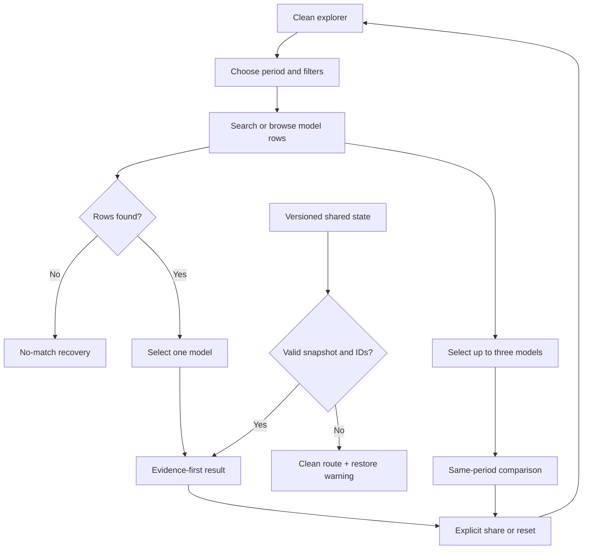

# Implementation report: Drive Reliability Explorer

Status: ready
Tool: Drive Reliability Explorer
Route: `/drive-reliability`
Depends on: `competitive-report.md`
Input fingerprint: `competitive-report.md sha256:7175170108b3bd1afd11a7e376876b1bcf4ed811524405d07dd80da5e69bb954`
Contract type: resolution

## Product decision

- Primary user: A homelab or NAS builder comparing exact hard-drive models before buying a replacement or filling a pool.
- Job: Resolve one or more model numbers to the correct Backblaze cohort and period, then understand the observed AFR together with the exposure and evidence strength behind it.
- Product thesis: This is a model-first, period-safe explorer that puts drive days, failures, age, and an approximate interval beside AFR. Existing alternatives either expose a single ranking, freeze one report, or turn fleet evidence into a personal-looking risk score.
- Evidence: The competitive report’s NASdisks, Home Server Blog, Tony LaTorre, RaidSize, StorageReview, and ServeTheHome reviews; Backblaze’s primary data page and Q1 2026 report.

## Scope

### Table stakes

- Search exact model numbers with case-insensitive, whitespace-normalized matching.
- Filter the snapshot by manufacturer and capacity range.
- Keep quarterly, annual, and lifetime views separate.
- Show source period, source date, inclusion rule, model, capacity, drive count, drive days, failures, AFR, and average age when present.
- Show an approximate 95% evidence interval beside the point AFR.
- Select up to three models for a same-period comparison.
- Keep the primary answer and the supporting data in one framed tool surface.
- Provide explicit reset and share actions. The clean base route must not serialize filter state automatically.
- Show unknown or unavailable values as `Unknown`, `Not reported`, or no-data states. Never backfill a missing age, interval, or model row from another period.
- Attribute Backblaze and link to the source report and dataset page.

### Launch differentiators

- Evidence-first result hierarchy: AFR is prominent, but drive days, failures, drive count, age, and the approximate interval are immediately adjacent.
- A period selector that changes the whole result scope, with the active source period and threshold visible rather than silently mixing periods.
- A compact exact comparison chart with text labels and an evidence-range marker. The chart never becomes a ranking or recommendation score.
- An explicit small-cohort state. Rows below Backblaze’s period threshold can be revealed, but they are marked as excluded from the source report’s qualified view.
- A small, attributed repository-owned aggregate snapshot. Runtime work is local and deterministic, with no API call, account, analytics event, or raw data download.
- Versioned share state that restores the dataset version, period, filters, and selected model IDs only when the user explicitly requests a share link.

### Deferred

- More historical quarters beyond the initial verified snapshot.
- Vendor specifications, CMR/SMR classification, warranty, price, noise, and power fields.
- A raw CSV or ZIP download. The source permits derivatives, but the initial page should not republish raw data.
- A user-uploaded SMART history analyzer.
- Array rebuild probability, MTTDL, URE exposure, or topology simulation. Those belong to the separate rebuild tool.
- Per-model pages or a continuously changing catalog.

### Non-goals

- No universal “best drive” ranking, badge, score, or recommendation.
- No prediction of whether one specific drive will fail next year.
- No home-NAS AFR claim from data-center observations.
- No cross-period ranking that treats quarterly, annual, and lifetime rows as interchangeable.
- No personal risk, capacity exposure, MTTDL, or data-loss probability output.
- No import or re-publication of Backblaze’s raw quarterly files.

## Formula and data contract

### Inputs and normalization

| Input | Type and unit | Default | Valid range | Normalization |
| --- | --- | --- | --- | --- |
| Period | Literal `quarterly`, `annual`, or `lifetime` | `quarterly` | Supported values present in the snapshot | Resolve to one exact snapshot period. Do not combine rows from different periods. |
| Search | String | Empty | 0 to 80 Unicode code points | Trim, collapse internal whitespace, case-fold for matching, preserve original input only in the control. |
| Manufacturer | String or `all` | `all` | Values present in snapshot | Case-insensitive exact filter after normalized comparison. |
| Capacity range | Integer TB bounds | Full snapshot range | 1 to 100 TB, lower bound at or below upper bound | Compare the stored decimal TB number; do not convert to binary capacity. |
| Show small cohorts | Boolean | `false` | Boolean | When false, only rows meeting the period’s source inclusion rule are listed. When true, below-threshold rows can appear with an evidence warning. |
| Selected model IDs | Array of stable strings | Empty | At most 3 unique IDs from the active snapshot | Normalize to the snapshot’s stable model IDs. Ignore unknown IDs and report a restore warning instead of showing a stale result. |
| Share state | Versioned encoded object | Absent | Bounded serialized payload under 8 KiB | Decode only known calculator, input, dataset, and state versions. Never evaluate arbitrary code or trust serialized labels. |

Each snapshot row is route-owned JSON and contains: `datasetVersion`, `sourceUrl`, `sourcePeriod`, `periodKind`, `periodStart`, `periodEnd`, `sourceCheckedAt`, `manufacturer`, `model`, `capacityTb`, `driveCount`, `driveDays`, `failures`, `averageAgeMonths` when reported, `includedBySource`, `inclusionRule`, `afrPercent`, `intervalLowPercent`, and `intervalHighPercent`. Raw source values remain integer counts. Display percentages are derived from counts or checked against the source value during the refresh script.

### Equations or resolution order

1. Resolve the requested dataset version. The initial snapshot is a Q1 2026 refresh containing separate quarterly Q1 2026, annual 2025, and lifetime-through-Q1-2026 scopes where the primary source provides each row. A missing scope is a no-data state, not a synthesized value.
2. Resolve the period kind and exact period boundary before applying search or filters.
3. Normalize each model identifier by trimming, collapsing whitespace, and case-folding for matching. Keep the source spelling for display. Stable IDs are derived from normalized manufacturer, model, capacity, and period, not from row position.
4. Apply the selected manufacturer and capacity filters, then the search term against manufacturer, model, and product line fields present in the snapshot.
5. Apply the source qualification rule unless `showSmallCohorts` is true. The initial rules are documented by Backblaze: quarterly requires drive count `> 100` and drive days `> 10,000`; annual requires `> 250` and `> 50,000`; lifetime requires `> 500` and `> 100,000`.
6. For every returned row, compute the primary AFR from source counts: `AFR percent = failures × 365 × 100 / driveDays`. A row with zero drive days is invalid and cannot render a result. A count mismatch or negative count invalidates the snapshot row.
7. Resolve the precomputed approximate evidence interval from the snapshot. The refresh script uses the versioned `poisson-normal-v1` approximation: exposure is `driveDays / 365`, standard error is `sqrt(max(failures, 0.5)) / exposure`, and bounds are `max(0, rate - 1.96 × standard error)` and `rate + 1.96 × standard error`. This is labeled `approx. 95% evidence range`, not a guarantee or individual-drive probability. The engine recomputes and checks the values within a fixed display tolerance.
8. If one model is selected, show its answer and available period history only for periods present in the snapshot. If multiple models are selected, show a same-period comparison and preserve selection order. Do not calculate a combined ranking or average.
9. If no row matches, show the active scope and filters with a recovery action. If a model exists but is below the source threshold and small cohorts are hidden, say that the row is known but excluded from the qualified view.

### Rounding, display, and versioning

- Store counts as integers and percentages as source-derived numbers. Never round before division.
- Display AFR and interval bounds to two decimal places when below 10%, and one decimal place at or above 10%. Keep a `0.00%` display only when the source count is zero and the interval is still visible.
- Display drive days with locale grouping, drive count as an integer, capacity as source decimal TB, and age as months to one decimal place only when reported.
- Show `0 failures` as a count, never as “zero risk.”
- Prefix the interval with `approx. 95% evidence range` and include the method version in the details/source line.
- The serialized state carries `calculatorId`, `calculatorVersion`, `inputVersion`, `datasetVersion`, period, filters, and selected model IDs. Any version mismatch clears to the clean route and announces that the shared state could not be restored.
- The initial implementation versions are `drive-reliability-v1`, `drive-reliability-input-v1`, and `poisson-normal-v1`.

### Invalid, unknown, absent, and partial states

- Missing or malformed snapshot JSON is a build-time failure and a runtime error state with no model result.
- Negative counts, zero drive days, impossible period values, duplicate stable IDs, capacity outside the supported range, or an interval lower bound above its upper bound invalidate the row.
- Missing average age renders `Not reported`; it never falls back to an age from another period.
- A model with no qualifying row in the selected period renders `No qualifying row in this period` and names the threshold. It may be found with `Show small cohorts` if a source aggregate exists.
- A search with no matches preserves the current controls and selection, clears the result only if the selected model is no longer in the active filtered set, and focuses the search field only after a user-submitted keyboard search, not on every keystroke.
- A current input change clears a stale result when it changes period, filters, or selection. The old result cannot coexist with a new active scope.
- There is no upstream loading state in v1 because the page resolves a bundled snapshot. A data refresh happens offline through the route-owned script.

### Assumptions and exclusions

- Backblaze’s population is a data-center fleet with its own hardware, workload, environment, replacement, and selection patterns. It is evidence about observed cohorts, not a home-NAS forecast.
- AFR is an annualized cohort rate, not the chance that one particular disk fails next year.
- The interval is an approximate statistical evidence range derived from failures and exposure. It does not include workload, firmware, temperature, purchase channel, or model-selection uncertainty.
- Source periods are not comparable unless the reader keeps the period and cohort boundary visible.
- A zero-failure row still has a nonzero upper bound when exposure is finite.
- The snapshot is a derived work and must attribute Backblaze. It must not include the raw source ZIPs.

### Primary sources

- [Backblaze Drive Stats data page](https://www.backblaze.com/cloud-storage/resources/hard-drive-test-data), checked 2026-08-23. Dataset collection, schema, data-use terms, current snapshot totals, and downloads.
- [Backblaze Drive Stats for Q1 2026](https://www.backblaze.com/blog/backblaze-drive-stats-for-q1-2026/), checked 2026-08-23. Model fields, period boundary, inclusion thresholds, and small-cohort caveat.
- [Backblaze/SNIA AFR formula presentation](https://sniadeveloper.org/sites/default/files/SDC/2023/presentations/SNIA-SDC23-Klein-What-10-Years-Drive-Stats.pdf), checked 2026-08-23. AFR derivation from failures and drive days.

## User flow



The table filters live because the source is local and deterministic. Selecting a row updates the result immediately. `Share comparison` is an explicit secondary action that serializes state; ordinary typing and filtering keep the base URL clean. `Reset explorer` clears filters, selection, and serialized state and returns focus to the period control. The result heading receives focus after a row selection by keyboard, while pointer selection keeps focus on the selected row action.

## Interface wireframes

### Desktop: clean

```text
[stack127 shell + storage navigation]

Drive reliability explorer
[short page intro is added by the later content pass]

┌────────────────────────────────────────────────────────────────────────────┐
│ Explore Backblaze drive evidence                                           │
│ [Q1 2026] [Annual 2025] [Lifetime]                                        │
│ [Search model or manufacturer................] [Manufacturer v] [TB range] │
│ [ ] Show small cohorts                         [Reset explorer]             │
│                                                                            │
│ 30 qualified models                                      0 selected        │
│ MODEL                 TB  AFR       EVIDENCE       ACTION                 │
│ WUH722222ALE6L4       22  0.38%     42 / 4.0M days  [Inspect]             │
│ ST16000NM001G         16  0.52%     44 / 3.1M      [Inspect]             │
│ ...                                                                        │
│                                                                            │
│ Select a model to see the observed cohort.                                │
└────────────────────────────────────────────────────────────────────────────┘
```

### Desktop: result and comparison

```text
┌────────────────────────────────────────────────────────────────────────────┐
│ [same period/filter controls and table]                                    │
│ 2 selected: WUH722222ALE6L4, ST16000NM001G          [Share comparison]     │
│                                                                            │
│ WUH722222ALE6L4, 22 TB                                                    │
│ Observed AFR 0.38%                                                        │
│ approx. 95% evidence range 0.27% to 0.50%                                 │
│                                                                            │
│ [exact interval/rate chart with text labels]                              │
│ [metric table: period, drive count, drive days, failures, average age]    │
│ Source: Backblaze Q1 2026 · qualified row · poisson-normal-v1             │
│                                                                            │
│ Compare selected models                                                    │
│ MODEL                 AFR       RANGE             DRIVE DAYS    FAILURES    │
│ WUH722222ALE6L4       0.38%     0.27 to 0.50%      3,992,942    42          │
│ ST16000NM001G         0.52%     0.37 to 0.67%      3,098,105    44          │
│ [Reset selection]                                                          │
└────────────────────────────────────────────────────────────────────────────┘
```

### Narrow mobile

```text
┌───────────────────────────────┐
│ Explore Backblaze evidence     │
│ [Q1 2026] [Annual] [Lifetime]  │
│ [Search model................] │
│ [Manufacturer v]              │
│ [Min TB] [Max TB]             │
│ [ ] Show small cohorts         │
│                               │
│ WUH722222ALE6L4               │
│ 22 TB · AFR 0.38%             │
│ 42 failures · 3,992,942 days  │
│ [Inspect] [Compare]           │
│                               │
│ Selected result               │
│ WUH722222ALE6L4              │
│ Observed AFR 0.38%            │
│ approx. 95% range             │
│ 0.27% to 0.50%                │
│                               │
│ Period                        │
│ Q1 2026                       │
│ Drive count                   │
│ 341,263                        │
│ Drive days                   │
│ 30,203,180                   │
│ Failures                     │
│ 1,030                         │
│ Average age                   │
│ Not reported for aggregate    │
│                               │
│ Compare selected models       │
│ WUH... 0.38% · 42 failures   │
│ ST16... 0.52% · 44 failures  │
└───────────────────────────────┘
```

### Error, loading, partial, and restored states

- No loading state: the route has no runtime upstream request.
- No matches: retain period and filter controls, show `No models match these filters`, show `Reset filters`, and keep the result area empty.
- Small cohort hidden: show `Known model, excluded from the qualified view` with the active threshold and a `Show small cohorts` recovery action.
- Malformed or stale shared state: render the clean snapshot, show a short restore status in an `aria-live="polite"` region, replace the URL with the clean route, and do not show a result from the stale payload.
- Snapshot validation failure: render a neutral error sentence, no result or chart, and a source/version diagnostic in development only. The production page never fabricates a fallback dataset.

## Interaction contract

| Event | UI response | Result state | Focus/announcement | URL/persistence |
| --- | --- | --- | --- | --- |
| Change period | Replace rows and clear selected models | Empty or new result for the new scope | `aria-live` announces period and row count | Base URL stays clean |
| Type search | Filter rows after a small debounce | Clear selected model if it leaves the filtered set | No focus move; result status updates politely | Base URL stays clean |
| Press Enter in search | Keep filtered rows and inspect first exact model only when there is one exact match | Result for exact match or no-match state | Focus result heading on exact match | Base URL stays clean |
| Inspect row | Select one model and render its evidence result | Valid result | Result heading focused for keyboard activation | Base URL stays clean |
| Compare row | Add or remove one model, maximum three | Comparison result when one or more are selected | Button remains focused; live region announces count | Base URL stays clean |
| Fourth compare action | Do not add; show a short limit message | Existing comparison unchanged | Live region announces `Choose up to three models` | No URL change |
| Toggle small cohorts | Include or exclude below-threshold rows | Clear selected rows that become hidden | Live region announces active rule | Base URL stays clean |
| Share comparison | Encode known state and copy the URL | Result remains visible | Status says `Share link copied` or `Share failed` | Explicit `state` query only |
| Reset explorer | Restore default period, filters, selection, and clean route | Empty result | Focus period control | `history.replaceState` to base route |
| Reload shared URL | Validate versions and IDs before rendering | Restored result or clean route with warning | `aria-live` restore status | State remains only for explicit share |
| Edit current scope after result | Clear stale result before new data is displayed | Empty result until a new selection | Status says inputs changed | Base URL stays clean |
| Keyboard tab/shift-tab | Follow period, filters, rows, result actions in DOM order | No hidden focus traps | Visible focus ring | No change |

## Page composition

| Claim or task | Medium | Position | Why this medium |
| --- | --- | --- | --- |
| Resolve the exact model and period | Tool UI | First visual after the short server-rendered intro | The interface is the answer surface. |
| Compare exact AFR, failures, exposure, and age | Table | Inside the result and comparison sections | Repeated facts need aligned columns. |
| Show the relationship between point AFR and evidence range | Exact result visualization | Beside the primary result | A bar with a labeled range is faster to scan than prose and keeps exact values visible. |
| Explain Backblaze population and period boundaries | Sentences | Later server-rendered guide | These are caveats and judgment, not UI decoration. |
| Explain the difference between AFR, drive days, and failures | Table plus sentences | Later guide, without repeating the live result | The table carries vocabulary; prose handles the common misunderstanding. |
| Show source, snapshot version, and refresh date | Tool metadata | Below the result | Provenance must stay adjacent to the number. |
| Explain why zero failures is not zero risk | Sentences | Later guide beside the evidence interpretation | It is a caveat that needs plain-language judgment. |
| Show a conceptual data-center-to-home boundary | No marker art at launch | Not planned | The live scope sentence and later prose are enough; marker art must not imply a quantitative transfer. |

## Technical plan

### Architecture and file ownership

- Server page: `app/(site)/(tools)/drive-reliability/page.tsx` owns the shell, h1, short tool identity, initial share-state string, and server-rendered content slot. It contains no route metadata, canonical, robots, sitemap, or JSON-LD.
- Client island: `app/(site)/(tools)/drive-reliability/drive-reliability.tsx` owns filters, selection, result visualization, focus, share/reset behavior, and live status only. It imports the pure engine and snapshot.
- Pure engine: the route-owned `lib/drive-reliability.ts` file owns snapshot validation, normalization, resolution, AFR derivation, interval verification, filtering, comparison, and versioned state encoding/decoding. It has no React, DOM, fetch, database, analytics, or browser APIs. This is the one route-specific engine file under `lib/`; it is not shared with another tool.
- Static data: `app/(site)/(tools)/drive-reliability/data/drive-reliability-snapshot.json` owns the small derived aggregate snapshot, source attribution fields, period rules, and checked source totals. Raw Backblaze ZIP files do not enter the repository.
- Styles: `app/(site)/(tools)/drive-reliability/drive-reliability.module.css` owns layout and result visualization styles. It uses semantic tokens, no global selectors, no gradients, no shadows, and no colored left-edge callouts.
- Route tests: `tests/pages/drive-reliability/page.json`, `drive-reliability.test.mjs`, `page.test.mjs`, and `drive-reliability.spec.ts` own the manifest, pure engine fixtures, static policy, rendered interaction, responsive, accessibility, URL, and unpublished-state checks.
- Refresh script: `scripts/drive-reliability/refresh-snapshot.mjs` plus `scripts/drive-reliability/scripts.json` own the offline source extraction and reconciliation workflow. It must not write to the production registry, hub, sidebar, migration, or another page.
- Content docs: `content_docs/drive-reliability/` owns the ready research, this contract, the brief, edge-case contract, and later writing/SEO plan.

### Accessibility, privacy, security, and performance

- Use real labels, fieldsets, table headers, buttons, and `aria-live="polite"` for state changes. The result heading is focusable only when a keyboard action creates a result.
- Do not use color as the only signal for the interval chart. Every bar/range has text values and a table row.
- Keep all controls at least 44px tall, preserve a visible focus ring, and reflow the comparison into labeled rows below 760px.
- No runtime network request, cookies, local storage, analytics payload, or user data leaves the browser. Share state contains only bounded public IDs and filters.
- Treat the query string as untrusted. Decode strict base64url/JSON, reject prototype keys and oversized payloads, validate every enum and ID, and replace malformed state with the clean route.
- The snapshot is imported at build time; there is no SSRF, remote model lookup, or HTML rendering of untrusted source strings. Render model labels as text.
- Keep the JSON snapshot small, avoid chart libraries, and keep the client island limited to the explorer. The pure engine must resolve the full snapshot in deterministic milliseconds.
- Verify 320px, 375px, 760px, and desktop widths with a real selected result, in dark and light themes. Measure document, tool, table, result, chart, and comparison widths.

### Publication state

Unpublished. The route source and manifest may exist for local verification, but `/drive-reliability` must remain outside `public.stack127_pages`, return the central registry’s unpublished `404`, stay out of the sitemap, and receive no migration or shared hub/sidebar entry in this task.

## Acceptance criteria

| ID | Observable acceptance criterion | Evidence at build time |
| --- | --- | --- |
| R1 | The explorer resolves only a known snapshot version and displays its source period and source date. | Engine tests and rendered result test |
| R2 | AFR equals failures divided by drive days converted to years, with integer source counts preserved. | Pure fixture tests against Backblaze rows |
| R3 | Quarterly, annual, and lifetime scopes use their own period and inclusion thresholds without mixing rows. | Resolution fixtures and period-switch Browser test |
| R4 | Search, manufacturer, and capacity filters return deterministic model rows and never fabricate a missing row. | Engine filter matrix |
| R5 | A model result shows AFR, approximate evidence range, drive count, drive days, failures, capacity, age when reported, and source metadata. | Engine shape test and rendered result test |
| R6 | Zero failures produces a visible nonzero upper evidence bound when exposure is finite and never a zero-risk claim. | Zero-failure fixture and rendered copy test |
| R7 | Below-threshold rows are hidden by default, recoverable with `Show small cohorts`, and visibly marked as excluded. | Threshold fixtures and interaction test |
| R8 | Up to three selected models compare in one active period; a fourth selection is rejected without changing the existing result. | Selection reducer and Browser test |
| R9 | The exact rate/range visualization and comparison table use the same source values and remain readable without color alone. | Cross-check fixture, static test, and Browser measurement |
| R10 | Changing the active scope clears stale results before a new selection is made. | Engine/UI regression test |
| R11 | Share state is explicit, bounded, versioned, and rejects malformed, stale, unknown, duplicate, or oversized payloads. | Serialization and Playwright history tests |
| R12 | Reset returns the clean base route, default period, default filters, no selection, and focus to the period control. | Browser keyboard test |
| R13 | No runtime request, storage, analytics event, or untrusted HTML rendering is used. | Static policy and source inspection tests |
| R14 | At 320px, 375px, 760px, and desktop widths, the complete selected result has no page-level or child overflow, and comparison rows reflow. | Playwright bounding-box and scroll-width checks |
| R15 | The route has a page-scoped unpublished ownership manifest and no shared registry, migration, hub, sidebar, or collection changes. | Manifest/static policy and git diff review |
| R16 | The route has no route-owned metadata, canonical, robots, sitemap, or JSON-LD implementation. | Static source test |
| R17 | The offline refresh script validates source totals, schema version, thresholds, AFR reconciliation, and interval bounds before writing the snapshot. | Script fixture tests |

## Open questions and blockers

- Product decision resolved: use a labeled `poisson-normal-v1` approximate 95% evidence range, computed from failures and drive-day exposure and verified in the route-owned snapshot.
- Implementation prerequisite: the refresh script must obtain and reconcile the latest source rows before the first snapshot is committed. Do not use a hand-entered “best models” list.
- Local visual preview prerequisite: the central publication registry returns unpublished routes as 404. The implementation and QA stages must use the repository’s guarded local preview path or an equivalent reversible local-only mechanism without changing tracked registry, hub, sidebar, collection, or migration files.
