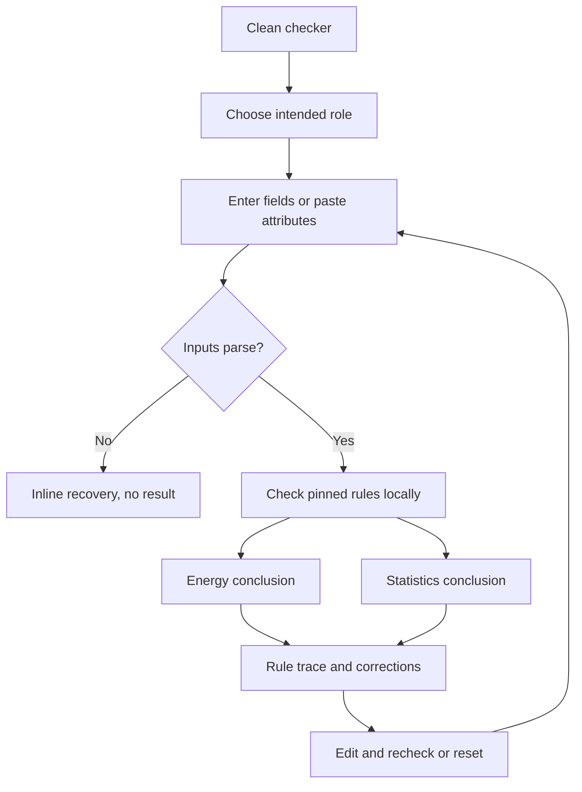

# Implementation report: Home Assistant Energy Entity Eligibility Checker

Status: ready
Tool: Home Assistant Energy Entity Eligibility Checker
Route: `/home-assistant-energy-entity-checker`
Depends on: `competitive-report.md`
Input fingerprint: `competitive-report.md sha256:d2a2d93cc0b54c03db997f41b8b2db7804c0b33f282e047eefaac875a29829d4`
Contract type: formula

## Product decision

- Primary user: A Home Assistant user whose sensor is missing from one Energy dashboard picker.
- Job: Compare the intended picker role and copied entity attributes with the pinned Home Assistant rules, see every failing field, and know which checks still require the live instance.
- Product thesis: One local check separates Energy attribute compatibility, long-term-statistics attribute compatibility, and unknowable recorder health instead of combining them into a false pass/fail.
- Evidence: `competitive-report.md` sections `Search intent`, `Formula and data disagreements`, and `Evidence-backed opportunities`.

## Scope

### Table stakes

- Require one intended role before evaluating the entity.
- Accept manual fields and a paste mode for copied state attributes.
- Evaluate domain, current-state kind, device class, state class, unit, and counter behavior in a deterministic order.
- Return separate Energy picker and long-term-statistics conclusions plus the exact failed checks.
- Keep all input and evaluation inside the browser.
- Identify recorder inclusion, statistic metadata, stored-unit conflicts, and live Energy validation as instance-only checks.

### Launch differentiators

- Role-first checks for grid import, grid export, solar production, battery charge, battery discharge, individual-device energy, optional power, gas, and water.
- A compact rule trace that shows received and accepted values without claiming that valid attributes guarantee picker visibility.
- Home Assistant Core `2026.8.1` and frontend `20260729.6` provenance in every result.
- Corrections only when the replacement is deterministic. Ambiguous ownership or counter behavior gets a next check, not invented YAML.

### Deferred

- Direct Home Assistant connection, entity registry import, YAML generation, share URLs, saved history, and automatic update checks.
- Gas or water flow-rate roles, prices, costs, compensation, and external statistics.
- A full YAML or Jinja parser. Paste mode accepts only a copied attribute block or JSON-like object with supported keys.

### Non-goals

- Guarantee that an entity will appear in a picker.
- Inspect recorder configuration, live statistic metadata, historical resets, stored-unit migrations, or integration ownership.
- Decide whether a physical sensor measures the real quantity its metadata claims.
- Repair an entity, generate generic configuration, or recommend `total_increasing` without compatible counter behavior.

## Formula and data contract

Formula version: `1`. Rules are pinned to Home Assistant Core `2026.8.1` and frontend `20260729.6`, checked 2026-08-09.

### Inputs and normalization

| Input | Type and unit | Default | Valid range | Normalization |
| --- | --- | --- | --- | --- |
| Intended role | enum | `grid_import` | `grid_import`, `grid_export`, `solar`, `battery_charge`, `battery_discharge`, `individual_device`, `power`, `gas`, `water` | Exact internal enum; visible labels stay human-readable |
| Entity ID or domain | string | `sensor.` | A valid Home Assistant entity ID up to 255 characters, or `sensor` | Trim once; derive the domain before the first dot; do not lowercase silently |
| Current state kind | enum | `numeric` | `numeric`, `non_numeric`, `unknown`, `unavailable` | Exact enum; the numeric value itself is not required |
| Device class | string | empty | 0 to 64 characters | Trim; preserve case for an exact diagnostic; accepted values are lowercase |
| State class | string | empty | 0 to 64 characters | Trim; accept exact `measurement`, `total`, or `total_increasing` only |
| Unit | string | empty | 0 to 32 Unicode characters | Trim outer whitespace only; comparison is case- and character-sensitive |
| Counter behavior | enum | `unknown` | `never_resets`, `resets_to_zero`, `can_decrease`, `unknown` | Required for total-quantity roles; hidden and ignored for power |
| Pasted attributes | string | empty | 0 to 20,000 characters | Extract only `entity_id`, `state`, `device_class`, `state_class`, `unit_of_measurement`, and `last_reset`; reject duplicate supported keys and malformed input |

Accepted unit sets for formula v1:

- Energy: `J`, `kJ`, `MJ`, `GJ`, `mWh`, `Wh`, `kWh`, `MWh`, `GWh`, `TWh`, `cal`, `kcal`, `Mcal`, `Gcal`.
- Power: `mW`, `W`, `kW`, `MW`, `GW`, `TW`, `BTU/h`.
- Gas with `device_class: gas`: `CCF`, `ft³`, `m³`, `L`, `MCF`.
- Gas with `device_class: energy`: the Energy set.
- Water: `CCF`, `ft³`, `m³`, `gal`, `L`, `MCF`.

### Equations or resolution order

1. Reject malformed or oversized form and paste inputs. A rejected form has no result.
2. Require domain `sensor`. Other domains fail both conclusions.
3. Require current state kind `numeric`. `unknown`, `unavailable`, and `non_numeric` fail Energy compatibility and the current-state part of statistics compatibility.
4. Resolve the role matrix:
   - Grid import/export, solar, battery charge/discharge, and individual-device energy require `device_class: energy`, `state_class: total` or `total_increasing`, and an Energy unit.
   - Optional power requires `device_class: power`, `state_class: measurement`, and a Power unit.
   - Gas accepts either `device_class: gas` with a Gas unit or `device_class: energy` with an Energy unit; state class is `total` or `total_increasing`.
   - Water requires `device_class: water`, `state_class: total` or `total_increasing`, and a Water unit.
5. Evaluate counter suitability separately from picker compatibility:
   - `total_increasing` is compatible only with a positive cumulative total that never decreases except by restarting at zero. `resets_to_zero` or `never_resets` pass; `can_decrease` fails suitability; `unknown` is unresolved.
   - `total` is compatible with totals that can increase and decrease and is the preferred general class when it fits. The tool does not require a reset signal.
   - Counter behavior is not evaluated for `measurement` power.
6. Energy attribute conclusion is `fails_attributes` when any role check fails. When all role checks pass, it is `attributes_match_instance_check_required`, never an unconditional `eligible`.
7. Evaluate long-term-statistics attributes independently. Core `2026.8.1` requires a numeric `sensor` with `state_class: measurement`, `measurement_angle`, `total`, or `total_increasing`. Device class and the current unit do not gate creation of new statistics; recorder inclusion, historical unit stability, statistic metadata, and stored-unit health remain live-instance checks. When the local attributes pass, return `attributes_match_recorder_check_required`.
8. Emit scoped rules in stable order: shared domain and state, Energy device class/state class/unit, statistics state class, then counter suitability. Each rule names whether it affects Energy, statistics, or both and contains `field`, `received`, `accepted`, `status`, `reason`, and a deterministic correction only when one value is unambiguous.

### Rounding, display, and versioning

There is no numerical rounding. Preserve received strings in the trace, escape them as text, and display at most 120 visible characters per received value with the full value available to assistive technology only when safe. Result summaries show formula v1, Core `2026.8.1`, frontend `20260729.6`, and source date 2026-08-09. Changing any role, unit, or class rule increments the formula version and replaces the pinned fixtures.

### Invalid, unknown, absent, and partial states

- Invalid form or paste syntax clears any prior result, focuses the first invalid input, announces one recovery summary, and never writes the URL.
- Missing attributes are explicit failed checks with `missing`, not empty accepted values.
- Unknown counter behavior may coexist with attribute compatibility only as an unresolved suitability warning. It never produces a recommended state-class correction.
- A clean attribute result remains partial by design: live recorder/statistics and Energy validation are always marked `not inspected`.
- Changing any evaluated input clears the prior result immediately. Repeat submission is deterministic and idempotent.

### Assumptions and exclusions

- The user selects the exact Energy configuration field they intend to populate.
- The pasted attributes represent the current entity state, not registry options or old recorder metadata.
- The checker mirrors the pinned public contract only. It does not run Home Assistant's `energy/validate` command.
- Attribute compatibility does not prove semantic measurement correctness, available history, nonnegative historical data, or picker visibility.

### Primary sources

- Home Assistant Core 2026.8.1 energy validator: https://github.com/home-assistant/core/blob/2026.8.1/homeassistant/components/energy/validate.py, checked 2026-08-09. Role device classes, unit sets, state classes, numeric state, recorder, and validation boundaries.
- Home Assistant Core 2026.8.1 constants: https://github.com/home-assistant/core/blob/2026.8.1/homeassistant/const.py, checked 2026-08-09. Exact unit characters.
- Home Assistant Core 2026.8.1 sensor contract: https://github.com/home-assistant/core/blob/2026.8.1/homeassistant/components/sensor/const.py, checked 2026-08-09. Device-class and state-class compatibility.
- Home Assistant frontend 20260729.6 Energy configuration: https://github.com/home-assistant/frontend/tree/20260729.6/src/panels/config/energy, checked 2026-08-09. Picker role and statistic unit-class filters.
- Home Assistant sensor developer documentation: https://developers.home-assistant.io/docs/core/entity/sensor/, checked 2026-08-09. Long-term statistics and counter semantics.
- Home Assistant Energy FAQ: https://www.home-assistant.io/docs/energy/faq/, checked 2026-08-09. Missing-entity troubleshooting and instance-only statistics checks.

## User flow



## Interface wireframes

### Desktop: clean

```text
+-----------------------------------------------------------------------+
| Intended Energy field                                                 |
| [Grid import] [Grid export] [Solar] [Battery] [Device] [Power] [...]  |
|                                                                       |
| [Manual fields] [Paste attributes]                                    |
| Entity ID        Device class      State class      Unit              |
| [sensor....   ]  [energy        ]  [total        ]  [kWh           ]  |
| Current state [Numeric]   Counter behavior [Never resets]             |
| Inputs stay in this browser.                    [Reset] [Check entity] |
+-----------------------------------------------------------------------+
```

### Desktop: result

```text
+-----------------------------------------------------------------------+
| Attributes match this Energy field. Check the live instance next.     |
| Energy picker         Long-term statistics                            |
| Attributes match      Attributes match                                |
| Instance: not checked Recorder: not checked                           |
|                                                                       |
| Rule             Received        Accepted                 Result       |
| Domain           sensor          sensor                   Pass         |
| Device class     energy          energy                   Pass         |
| State class      total           total, total_increasing  Pass         |
| Unit             kWh             energy units             Pass         |
|                                                                       |
| Core 2026.8.1 · frontend 20260729.6               [Reset] [Recheck]   |
+-----------------------------------------------------------------------+
```

### Narrow mobile

```text
+--------------------------------+
| Intended Energy field          |
| [Grid import] [Grid export]    |
| [Solar] [Battery] [...]        |
|                                |
| Fields stack at full width     |
| [Reset]                        |
| [Check entity]                 |
|--------------------------------|
| Attributes do not match        |
| Energy picker                  |
| State class: measurement       |
| Needs total or                 |
| total_increasing               |
|                                |
| Statistics: does not match     |
+--------------------------------+
```

### Error, loading, partial, and restored states

- Error: the form stays visible, the first invalid field has associated text, and no result region remains.
- Loading: not applicable; formula evaluation is synchronous and local.
- Partial: a matching result always shows `instance not checked` beside both conclusions.
- Restored/shared: not supported in v1. Query state is removed with a non-destructive notice and the base route remains clean.
- Runtime failure: one neutral failure region says the check could not run and offers `Try again`; no plausible result remains.

## Interaction contract

| Event | UI response | Result state | Focus/announcement | URL/persistence |
| --- | --- | --- | --- | --- |
| First load | Defaults and empty fields | None | Natural document order | Clean base route; no storage |
| Switch role | Role controls and accepted expectations update | Cleared | Selection announced by native radio semantics | No change |
| Paste valid attributes | Supported fields populate visibly | Cleared | Status announces imported fields; focus stays on paste control | No change |
| Paste invalid attributes | Paste error appears | Cleared | Focus paste control; error association | No change |
| Edit any field | Current value updates | Cleared immediately | No noisy live announcement | Remove unsupported query state |
| Submit valid | Compute once | Fresh answer | Focus answer h2; one polite result announcement | No change |
| Submit invalid | Show all field issues | None | Focus first invalid input; one summary announcement | No change |
| Repeat submit | Recompute identical result | Replaced in place | Focus answer h2 once | No change |
| Reset | Restore defaults and empty manual values | Cleared | Focus first role control | Clean base route |
| Unsupported `state` query | Remove parameter and preserve other query keys | None | Polite notice | `replaceState`, never push |
| Runtime failure and retry | Failure then recompute current inputs | None until success | Focus failure heading, then answer | No change |

## Page composition

| Claim or task | Medium | Position | Why this medium |
| --- | --- | --- | --- |
| Choose an Energy field and provide attributes | Tool UI | First interactive surface | It is the primary job |
| See the two different conclusions | Exact result visualization | First result row | Prevents a false combined verdict |
| Audit each rule | Responsive table that reflows to labelled rows | Below conclusions | Repeated exact facts need comparison, not prose |
| Understand what the browser cannot inspect | Short result boundary list | Beside conclusions | The caveat limits the answer immediately |
| Learn role requirements | One compact table | Supporting guide | Repeated role facts are clearest as a table |
| Choose `total` versus `total_increasing` | Short sentences plus one exact example | Supporting guide | Counter semantics need judgment, not another chart |

## Technical plan

### Architecture and file ownership

- Server page and guide: `app/(site)/(tools)/home-assistant-energy-entity-checker/page.tsx` and `home-assistant-energy-guide.tsx`.
- Small client island: `home-assistant-energy-entity-checker.tsx`.
- Pure parser/evaluator and pinned matrices: `lib/home-assistant-energy/eligibility.ts`.
- Route CSS Module: `home-assistant-energy-entity-checker.module.css`.
- Product artifacts remain owned by `content_docs/home-assistant-energy-entity-checker/`: `competitive-report.md`, `implementation-report.md`, `edge-cases-and-tests.md`, `brief.md`, and later `writing-and-seo.md`.
- Ownership and tests: `tests/pages/home-assistant-energy-entity-checker/page.json`, pure Node engine test, static page test, and Playwright interaction/responsive test.
- Guarded preview: `scripts/home-assistant-energy-entity-checker/preview-local-page.mjs` plus a route script manifest. No shared script manifest update is required for unpublished review.
- No collection link is required before publication. Any future home-automation collection owns that link separately.

### Accessibility, privacy, security, and performance

- Use a real form, fieldset/legend groups, visible labels, `aria-invalid`, described errors, one result status, and focusable result headings.
- Radio-style role choices remain native inputs and wrap. Every interactive target is at least 44px.
- Treat pasted data as untrusted text. No HTML rendering, expression evaluation, YAML constructors, prototype assignment, network, storage, clipboard read, or analytics payload containing inputs.
- Cap paste and field lengths before parsing. Ignore unsupported keys and reject duplicate supported keys.
- Keep the deterministic engine under 10ms for 1,000 representative evaluations on the test machine and add no dependency.
- At 320px, 375px, 760px, and desktop, the page and all result values have no page-level overflow; the rule table reflows rather than relying on hidden horizontal scroll.

### Publication state

Unpublished. The route manifest must carry a clear review reason, production registry metadata must not change, the public route must remain 404, and local Browser review must use a guarded local-only registry row that is removed afterward.

## Acceptance criteria

| ID | Observable acceptance criterion | Evidence at build time |
| --- | --- | --- |
| R1 | The exact flat route, docs, tests, engine, script, and unpublished ownership manifest exist without route metadata. | Static test and pipeline inspector |
| R2 | All nine intended roles resolve to the pinned device-class, state-class, and unit matrix. | Pure fixture tests |
| R3 | Energy and long-term-statistics conclusions are separate and neither guarantees picker visibility. | Engine and Browser tests |
| R4 | Every failed field shows received and accepted values in stable order. | Engine and rendered-result tests |
| R5 | Gas accepts both pinned gas-volume and energy branches; water accepts only its pinned volume set. | Pure fixtures |
| R6 | Exact case and Unicode unit mismatches fail, including `KWh`, `m3`, and `ft3`. | Pure fixtures |
| R7 | Counter suitability never recommends `total_increasing` for a decreasing or unknown counter. | Pure fixtures and Browser tests |
| R8 | Invalid, missing, unavailable, unknown, and non-numeric inputs clear stale results and focus recovery. | Engine and Playwright tests |
| R9 | Valid paste fills only supported keys; malformed, duplicate, oversized, and prototype-shaped input cannot execute or mutate objects. | Parser tests and Playwright tests |
| R10 | Reset, repeat submit, keyboard submit, runtime retry, and unsupported query cleanup follow the interaction contract. | Playwright tests |
| R11 | Inputs never leave the browser or enter persistent storage, URL state, or analytics calls. | Static architecture test |
| R12 | A calculated longest result has no page overflow and keeps 44px targets at 320px, 375px, 760px, and desktop in both themes. | Playwright measurements and Browser QA |
| R13 | Formula provenance names Core `2026.8.1`, frontend `20260729.6`, formula v1, and source date. | Engine and rendered-result tests |
| R14 | Guarded preview is local-only and its registry row is removed after Browser work. | Script guard test and cleanup query |
| R15 | Target-focused tests, full tests, static policy, typecheck, quality gate, and production build pass without publishing. | Command receipts |

## Open questions and blockers

- None.
