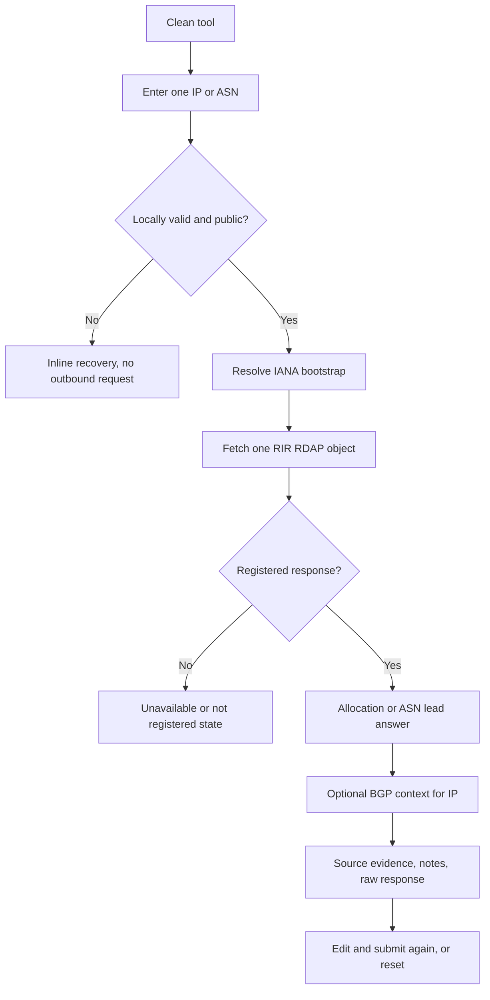

# Implementation report: IP and ASN registration lookup

Status: ready
Tool: IP and ASN registration lookup
Route: `/ip-asn-lookup`
Depends on: `competitive-report.md`
Input fingerprint: `competitive-report.md sha256:daf132c7da35fd0d6b68059903dcda6b6e6c1232c70c5c01a0647244510992c4`
Contract type: resolution

## Product decision

- Primary user: An operator, developer, or incident responder checking one public IP or ASN from a log, DNS result, or network report.
- Job: Identify the RIR-registered allocation or ASN holder, find the published abuse contact, and understand whether current routing information adds useful context.
- Product thesis: stack127 earns preference by separating the registered record from current BGP routing, showing the source beside each claim, and refusing to imply geolocation, subscriber identity, or reputation.
- Evidence: The competitive report shows repeated confusion between registry ownership and BGP origin, strong demand for abuse contacts, and mobile failures in mixed IP intelligence tools. See Evidence-backed opportunities 1 to 6.

## Scope

### Table stakes

- Accept one IPv4 address, one IPv6 address, or one ASN with an optional `AS` prefix.
- Auto-detect the input type and normalize it before any request.
- Reject malformed, CIDR, private, loopback, link-local, documentation, multicast, reserved, and private ASN values before outbound traffic.
- Resolve the responsible RIR from committed IANA IPv4, IPv6, and ASN bootstrap data.
- Query the RIR's IP or autnum RDAP endpoint with bounded HTTP, caching, global endpoint throttling, and safe errors.
- Lead with range, holder, registry, and registered country. Show handle, name, type or status, dates, parent, remarks, notices, and abuse contact when published.
- Keep unknown fields unknown and name the registry and fetch time.
- Preserve the raw RDAP response in a collapsed disclosure.
- Render a useful result even when optional BGP context is unavailable.

### Launch differentiators

- A lead sentence answers the registration question before the supporting facts.
- RIR registration and Team Cymru BGP origin appear in separate sections with separate source labels.
- The country field is explained as the registered country of the record, not a location estimate.
- Private and malformed inputs are stopped locally with recovery guidance, rather than returning a reserved record.
- Source provenance, cache state, registry URL, and fetched time are visible without making the reader inspect raw JSON.
- A short relationship strip shows IANA, RIR, allocation, and route as different layers. It is a conceptual relationship, not a numeric chart.

### Deferred

- CIDR or prefix lookup.
- Bulk IP and ASN lookup.
- Reverse DNS in the same request.
- RPKI validation, route history, geolocation, reputation, port scanning, hosted-domain inventory, and service discovery.
- Historical allocation comparison and WHOIS port 43 fallback.
- Persistent share URLs or serialized raw responses.
- A separate `/ip-tools` collection until there are multiple committed network tools.

### Non-goals

- Identifying a subscriber, person, customer, or physical location.
- Deciding whether an address is malicious or safe.
- Treating an RIR holder as the current route origin or combining both into one owner field.
- Claiming that an address is in the country attached to its registration record.
- Resolving hostnames, checking open ports, or describing services.

## Formula and data contract

### Inputs and normalization

| Input | Type and unit | Default | Valid range | Normalization |
| --- | --- | --- | --- | --- |
| `query` | String containing one IP literal or ASN | Empty | Maximum 256 Unicode code units after request parsing | Trim surrounding whitespace, reject control characters and CIDR slash, parse IP before ASN, canonicalize IPv4 and IPv6 for the outbound path, normalize ASN to an integer and display it as `AS<number>` |
| IP address | IPv4 or IPv6 literal | None | Public unicast address only | Use `net.isIP` plus the existing public-address blocklist. Reject zone identifiers, mapped IPv4 syntax, special-use ranges, and non-public ranges before bootstrap matching. |
| ASN | Unsigned integer with optional `AS` prefix | None | 1 to 4,294,967,294, excluding IANA private and reserved ranges | ASCII case-insensitive `AS` prefix; parse as a safe integer; display as `AS<number>`. |

### Equations or resolution order

1. Trim `query`. Reject an empty value, control characters, more than one token, a slash, or an input longer than 256 characters.
2. If `net.isIP(query)` is 4 or 6, classify it as an IP. Canonicalize the literal for matching and outbound use. If it is not public according to the shared address policy, return `private_or_reserved` without a network request.
3. Otherwise, match `^(?:AS)?([0-9]+)$` case-insensitively. Parse the captured number as an ASN. Reject non-integers, zero, values above the public maximum, and IANA private or reserved ASN ranges without a network request.
4. For IPv4 and IPv6, find the committed IANA bootstrap service whose CIDR contains the address. For ASN, find the service whose inclusive ASN range contains the number. Use the committed dataset only; never accept an upstream URL supplied by the user.
5. Construct exactly one fixed RDAP request: `<reviewed-base>/ip/<address>` for IP or `<reviewed-base>/autnum/<number>` for ASN. The only accepted base URLs come from the committed bootstrap data and must be HTTPS.
6. Read the response through the shared RDAP HTTP client. HTTP 200 is registered only when the bounded body is a readable object of the expected network type. HTTP 404 is not registered. HTTP 429, 403, timeout, oversized, and 5xx responses remain explicit failures and never become a negative or empty registration answer.
7. Normalize the network object. For IP, retain the returned start address, end address, IP version, handle, name, type, status, country, parent handle, events, entities, remarks, notices, links, source URL, HTTP status, and fetched time. For ASN, retain the returned start and end ASN, handle, name, status, country, events, entities, remarks, notices, links, source URL, HTTP status, and fetched time.
8. Choose the holder from the most relevant published organization or name entity, preferring an entity with a registrant or administrative role, then the object name. Choose an abuse entity with role `abuse`; retain its email, phone, contact form, and source as independent fields. Missing entity data is unknown.
9. For a public IP only, run the existing Team Cymru origin enrichment as a bounded best-effort operation. It may return current origin ASN, announced prefix, country code, and network name. It never changes the RIR result and is omitted or marked unavailable when it times out, returns no TXT answer, or conflicts with the RIR record.
10. Return the normalized result with a version number, input classification, registration state, RIR source, optional routing context, notes, and raw source bodies. A partial BGP result does not invalidate a registered RIR result. A failed RIR lookup never renders a plausible holder.

### Rounding, display, and versioning

There is no numeric calculation. Preserve upstream address, ASN, date, handle, and range strings in the raw record. Display dates in the existing lookup date format while retaining ISO values in the serialized report. Display long names and emails without truncation; wrap them on narrow screens. Display missing fields as `Not published`, not an empty cell. Display source labels as `RIR registration` and `Current BGP route` rather than a generic `owner`.

Set `reportVersion: 1` and `networkLookupVersion: 1` on downloaded or API results. Do not encode the result into the URL. An explicit `?query=` may prefill the form, but clean `/ip-asn-lookup` must stay unchanged through hydration and no result is restored without an explicit submit.

### Invalid, unknown, absent, and partial states

- Empty or malformed input: inline field error, no request, no result, focus returns to the input.
- CIDR input: explain that this launch checks one IP or ASN and link to the future subnet or prefix task without sending the range to an RIR.
- Private or reserved IP or ASN: explain why no RIR request was made and offer the DNS Lookup link for hostname-shaped input.
- No matching bootstrap service: `no_service`, never a guessed endpoint.
- HTTP 404: `not_registered`, with no holder or abuse contact.
- HTTP 429 or 403: rate-limited or blocked, with retry guidance and no stale-looking result unless a valid cached answer exists.
- Timeout, network error, unreadable body, schema mismatch, or oversized body: explicit unavailable state, no result body.
- Missing field in a successful response: `Not published`; never infer country, holder, abuse, parent, dates, or a route.
- Missing BGP context: keep the RIR answer and say current routing context was not available.
- BGP conflict: show both values and explain that the RIR and route sources answer different questions.

### Assumptions and exclusions

RIR RDAP is authoritative for the current registry object returned by its service, not for physical location, subscriber identity, current route origin, or historical ownership. Team Cymru is used only as optional routing context. Registry data can differ by RIR and object type. The tool does not send a rejected input to any upstream service. Requester identifiers are used transiently for rate limiting and are not joined to cached lookup rows.

### Primary sources

- IANA IPv4, IPv6, and ASN bootstrap files: https://data.iana.org/rdap/ipv4.json, https://data.iana.org/rdap/ipv6.json, and https://data.iana.org/rdap/asn.json, checked 2026-09-10. Resolve fixed authoritative RIR services.
- RFC 9224: https://www.rfc-editor.org/rfc/rfc9224, checked 2026-09-10. Defines RDAP bootstrap discovery.
- RFC 9082: https://www.rfc-editor.org/rfc/rfc9082, checked 2026-09-10. Defines IP network and autnum query paths.
- ARIN RDAP guide: https://www.arin.net/resources/registry/whoisrws/rdap/, checked 2026-09-10. Supports response field interpretation.
- Team Cymru IP to ASN mapping: https://www.team-cymru.com/ip-asn-mapping, checked 2026-09-10. Supports the separate current-route context.

## User flow



The initial page has no result. Submit clears any previous result before a new request begins, so an old answer cannot remain beside a new error. A successful lookup keeps the input and replaces the result. Reset clears the input and result and focuses the input. An explicit `?query=` pre-fills the input only; it does not auto-submit.

## Interface wireframes

### Desktop: clean

```text
Domain tools sidebar       IP and ASN registration lookup
                            Look up the RIR record for one public IP address or ASN.

                            +------------------------------------------------------+
                            | IP address or ASN                                    |
                            | [ 1.1.1.1                                      ]    |
                            | [Look up registration]                               |
                            +------------------------------------------------------+

                            Data comes from the RIR that publishes the allocation.
                            It is not geolocation or a reputation check.
```

### Desktop: result

```text
                            +------------------------------------------------------+
                            | IP address or ASN                                    |
                            | [ 1.1.1.1                                      ]    |
                            | [Look up registration]                               |
                            +------------------------------------------------------+
                            1.1.1.1 is inside 1.1.1.0 to 1.1.1.255,
                            registered to APNIC Research and Development. APNIC.

                            Allocation
                            range                 1.1.1.0 to 1.1.1.255
                            name                  APNIC-LABS
                            handle                [registry value]
                            registered country   AU
                            type                  ASSIGNED PORTABLE
                            registry              APNIC

                            Abuse contact         helpdesk@apnic.net
                            RIR registration      APNIC RDAP | fetched time

                            Current BGP route
                            current origin        AS13335
                            announced prefix      1.1.1.0/24
                            network               Cloudflare
                            This is the current route, not the registered holder.

                            IANA -> RIR -> allocation -> current route
                            [Notes] [Raw RDAP response]
```

### Narrow mobile

```text
IP and ASN registration lookup
Look up one public IP address or ASN.

IP address or ASN
[ 1.1.1.1                         ]
[Look up registration]

1.1.1.1 is inside 1.1.1.0 to 1.1.1.255,
registered to APNIC Research and Development. APNIC.

Allocation
range              1.1.1.0 to 1.1.1.255
name               APNIC-LABS
handle             [value]
registered country AU
registry           APNIC

Abuse contact
helpdesk@apnic.net

Current BGP route
origin             AS13335
prefix             1.1.1.0/24
network            Cloudflare
separate from RIR registration

IANA -> RIR -> allocation -> current route
[Notes]
[Raw RDAP response]
```

### Error, loading, partial, and restored states

- Error: preserve the input, show one inline error below it, clear the prior result, and focus the input for validation errors. API failures keep focus on the form and expose a retry through the same primary action.
- Loading: disable the submit button, keep the input readable, show `Looking up registration...` in a polite status region, and do not show a half-built result.
- Partial: render the complete RIR result. If BGP is absent, show a short note in the BGP section or omit that section when it has no useful data. Never downgrade the lead answer.
- Restored: `?query=` fills the input on first render, leaves the URL intact, and waits for submit. Browser back and forward change the prefilled input only if the explicit query changes.

## Interaction contract

| Event | UI response | Result state | Focus/announcement | URL/persistence |
| --- | --- | --- | --- | --- |
| Submit valid IP or ASN | Disable primary action and show bounded loading state | Clear old result, then render one response | Polite loading status; lead result is `aria-live="polite"` | No URL mutation, no analytics payload |
| Submit empty or invalid input | Inline error | No result | Focus input and associate error with `aria-describedby` | No request or URL mutation |
| Edit query after result | Keep result until submit? No, clear it on edit to prevent stale interpretation | Empty or loading only after submit | No announcement for every keystroke | No URL mutation |
| RIR response with optional BGP failure | Keep registered result | Partial supporting context | Announce only the lead result | No extra request retry loop |
| Retry after upstream failure | Reuse current input | Replace failure with loading, then result or new failure | Loading status announced | No URL mutation |
| Reset | Clear input, errors, result, and status | Initial | Focus input | No URL mutation |
| Expand raw RDAP | Open the corresponding disclosure | Result unchanged | Native disclosure semantics | No URL mutation |
| Explicit `?query=` on first load | Prefill input | No result until submit | No automatic announcement | URL stays as entered |

## Page composition

| Claim or task | Medium | Position | Why this medium |
| --- | --- | --- | --- |
| Enter one IP or ASN and get the answer | Tool UI | First workbench band | The primary task must be usable before reading the guide. |
| Which allocation was returned | Lead sentence plus key/value rows | Top of result | Exact facts are easier to scan than prose. |
| Repeated allocation fields and source | Key/value table | Immediately after lead | Repeated facts share a stable comparison shape. |
| Abuse contact | Dedicated value block with source | Beside or immediately after allocation | It is the most common action after the lookup. |
| Registered holder versus current route | Two labeled sections and a short relationship strip | After allocation | The relationship matters, but geometry should not imply a numeric comparison. |
| RIR hierarchy | Plain relationship strip, not a chart | Supporting result and guide | It shows relationship without fake scale or exact allocation size. |
| Raw response and notices | Disclosure | End of result | Evidence is available without competing with the answer. |
| What the country and abuse fields mean | Connected prose | Server-rendered guide | Interpretation and limitations require sentences. |
| How to report abuse | Short ordered list | Guide after the result | A sequence is clearer than a large caveat panel. |

## Technical plan

### Architecture and file ownership

- Server-rendered route: `app/(site)/(tools)/ip-asn-lookup/page.tsx`, using the shared app shell and tool page content helpers. It reads `stack127_tool_pages` and contains no route-owned metadata, JSON-LD, robots, or sitemap logic.
- Client island: `app/(site)/(tools)/ip-asn-lookup/ip-asn-lookup-tool.tsx` owns form state, request state, focus, result rendering, disclosure state, and download behavior.
- Styles: `ip-asn-lookup.module.css` owns page-specific result and responsive styles. Shared tool workbench and domain family styles remain the owner of their existing concerns.
- Pure engine: `lib/ip-asn/parse.ts`, `bootstrap.ts`, `resolve.ts`, `normalize.ts`, `types.ts`, and `routing.ts`. It accepts injected fetch and routing functions for deterministic tests.
- HTTP boundary: `app/api/ip-asn-lookup/route.ts` uses same-origin checks, a 4096-byte body cap, one bounded query, the existing per-visitor limiter, shared RDAP cache and endpoint throttle, and generic upstream errors.
- Dataset: `lib/domain/data/rdap-bootstrap-ip.json` remains the committed source. `scripts/domain-tools/refresh-datasets.mjs` already refreshes it; no request fetches bootstrap metadata.
- Tests and fixtures: `tests/pages/ip-asn-lookup/page.json`, pure engine tests, API tests with fixture responses for all five RIRs, shared workbench browser coverage, and a route Playwright spec.
- Content: `content_docs/ip-asn-lookup/brief.md`, this report, the interface and edge-case reports, and reviewed introduction/supporting Markdown in `public.stack127_tool_pages`.

### Accessibility, privacy, security, and performance

Use a real form, visible label, native submit button, error association, polite loading status, live lead result, keyboard-accessible disclosures, and no focus trap. Preserve keyboard access to any raw-data scroll region. Test 320px, 375px, 760px, and 1440px in dark and light themes.

Validate and classify before outbound work. Build request URLs only from committed HTTPS bootstrap bases. Bound request body, query length, response bytes, redirect behavior, timeout, and response parsing. Do not interpolate user text into arbitrary URLs. Do not expose upstream error bodies, request headers, stack traces, or filesystem paths. Do not call Team Cymru for rejected inputs.

Cache valid RIR records by upstream URL using the existing RDAP cache. Keep requester identifiers only in the transient rate limiter. Do not emit lookup text, raw records, IP addresses, or ASN values to analytics. Keep BGP enrichment bounded and best effort so it cannot make the main lookup appear failed.

### Publication state

Unpublished during implementation and QA. Create the route and development row only after the page contract exists, keep `is_published=false`, and publish only with explicit approval after all four requested tools are complete.

## Acceptance criteria

| ID | Observable acceptance criterion | Evidence at build time |
| --- | --- | --- |
| R1 | The flat route renders the server-rendered title, introduction, and supporting explanation while the clean URL has no result. | Route test, page test, database content check |
| R2 | IPv4, IPv6, `13335`, `AS13335`, and `as13335` normalize to the expected input type and canonical display. | Pure engine tests |
| R3 | Empty, malformed, CIDR, private, reserved, and private ASN inputs make no upstream request and return recoverable errors. | Pure engine and API tests |
| R4 | The engine selects the correct committed IANA service for IPv4, IPv6, and ASN ranges without accepting a user-supplied endpoint. | Bootstrap fixture tests |
| R5 | HTTP 200, 404, 403, 429, timeout, oversized, invalid JSON, and 5xx responses map to distinct result states. | RDAP fixture and API tests |
| R6 | A successful IP result leads with the containing range and holder, then shows registry, country, handle, type, dates, parent, notices, and abuse contact when present. | Normalizer tests and browser result test |
| R7 | A successful ASN result shows holder, ASN range, registry, country, status, dates, and abuse contact when published. | Normalizer tests and browser result test |
| R8 | BGP context is visibly labeled as current routing, remains separate from RIR registration, and cannot replace or invalidate the RIR lead. | Routing fixtures and browser result test |
| R9 | Missing fields render as unknown or not published, and conflicting RIR and BGP values remain visibly separate. | Normalizer tests and manual review |
| R10 | Cache metadata, source URL, fetched time, and raw RDAP response are available without associating the lookup with a requester. | Cache/API tests and browser disclosure test |
| R11 | The form handles loading, retry, reset, edit-after-result, keyboard submit, error focus, and live result announcement without stale results. | Playwright interaction suite |
| R12 | The page has no document-level horizontal overflow at 320px, 375px, 760px, or 1440px in both themes; only raw evidence may own inner scrolling. | Playwright viewport and CSS assertions |
| R13 | The route is covered by a page ownership manifest, stays unpublished in development, and does not add route-owned metadata or indexing behavior. | Static policy, route manifest, DB verification |

## Open questions and blockers

- None for the launch contract. The existing shared RDAP cache and throttle need a small network-object extension during implementation; the product behavior is decided here.
