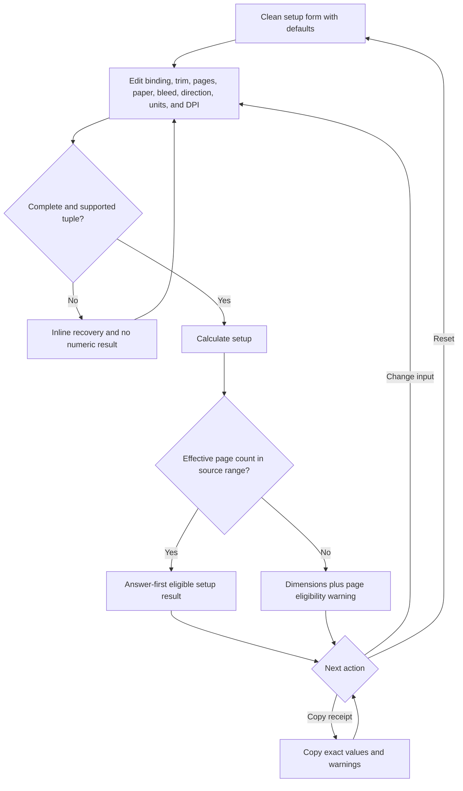

# Implementation report: KDP book setup calculator

Status: ready
Tool: KDP book setup calculator
Route: `/kdp-book-setup-calculator`
Depends on: `competitive-report.md`
Input fingerprint: `competitive-report.md sha256:39b41e517516ee03bf27e73acdfbe52af6231188e671674c6fae3310f8df8932`
Contract type: formula

## Product decision

- Primary user: A self-publishing author preparing a KDP print interior and cover after choosing a binding, trim, and page count.
- Job: Get one source-backed setup receipt with the interior page size, minimum margins, spine width, full cover size, unit conversions, and page eligibility warnings.
- Product thesis: The tool connects the separate bleed, margin, spine, and cover questions into one calculation, then keeps official paperback dimensions distinct from the estimated hardcover geometry that KDP does not publish as one closed formula.
- Evidence: `competitive-report.md` sections `User pain evidence`, `Technical truth to verify`, `Comparison matrix`, `Formula and data disagreements`, and `Evidence-backed opportunities`.

## Scope

### Table stakes

- Support KDP US paperback and hardcover setup choices with binding, trim, page count, interior type, paper, bleed, reading direction, display units, and pixel DPI.
- Filter trim sizes by binding and reject unsupported interior and paper combinations before calculation.
- Apply KDP's even-page rule, page-count margin bands, trim-specific page limits, bleed dimensions, and paperback spine coefficients.
- Show the calculated interior page, minimum inside margin, minimum outside/top/bottom margin, spine, and full cover dimensions.
- Show every dimension in inches, millimeters, and pixels, with the DPI assumption attached to pixel values.
- Show page-count eligibility, unsupported-combination, and reading-direction warnings without calling the result a KDP acceptance decision.
- Draw the exact paperback back, spine, front, and outer-bleed relationship. Draw the hardcover relationship as an estimate with its wrap and hinge inputs named.
- Copy a plain-text setup receipt that includes inputs, effective page count, outputs, warnings, formula version, and source date.

### Launch differentiators

- One answer keeps page count beside the gutter threshold, paper coefficient, page-limit table, and cover dimensions. The user does not have to carry a value between four small calculators.
- The result leads with the cover-file size, then exposes the interior page and margin values that must match it. Repeated values use one compact dimensions table rather than equal-weight metric cards.
- The page-limit table is source-backed and trim-specific. An out-of-range page count keeps the dimension math visible but clearly separates it from KDP eligibility.
- Hardcover output uses a visible estimate label and names the official wrap and hinge measurements. It does not present a paperback-style closed formula as a KDP guarantee.
- The receipt includes all three unit forms and the exact DPI input, so a value copied into a layout or cover program retains its conversion assumption.

### Deferred

- Custom trim sizes, marketplace-specific tables, and non-KDP printers.
- A generated cover-template PDF, safe-area overlay, barcode placement, or interior PDF inspection.
- Exact hardcover spine and total-width resolution from an official KDP endpoint or downloaded KDP template.
- Shareable query-string state, saved projects, URL presets, and server-side calculation history.
- Margin presets for specific software, language-specific RTL validation, and typography or cover-design advice.
- Royalty, print-cost, metadata, page-count estimation, and PDF preflight logic. Those belong to separate KDP tools.

### Non-goals

- Do not claim that a calculated file will pass KDP review or replace the KDP cover calculator and final template.
- Do not imply that a hardcover estimate is an official total-width or spine formula.
- Do not accept an unsupported binding, trim, interior, or paper combination and quietly substitute a nearby supported option.
- Do not infer a language from the reading direction or claim that every RTL book is supported.
- Do not generate a barcode, ISBN, cover artwork, interior layout, or upload-ready PDF.
- Do not store input values in a database, URL, cookie, local storage, analytics payload, or server log.

## Formula and data contract

### Inputs and normalization

The launch contract is the KDP US print specification set checked on 2026-09-16. The engine receives a complete normalized object only after the client has validated the editor. Blank or malformed editor fields never reach the engine.

| Input | Type and unit | Default | Valid range | Normalization |
| --- | --- | --- | --- | --- |
| Binding | Enum | `paperback` | `paperback`, `hardcover` | Lowercase enum. The binding filters trim, interior, and paper choices. |
| Trim size | Preset record, inches | `6 x 9` for paperback, `6 x 9` for hardcover | Paperback: the 16 source-backed trims below. Hardcover: `5.5 x 8.5`, `6 x 9`, `6.14 x 9.21`, `7 x 10`, `8.25 x 11` | Store `trimId`, `widthIn`, and `heightIn`. Do not swap width and height when direction changes. |
| Page count | Integer, pages | `300` | `1` to `828` editor bound. Effective KDP count must satisfy the selected binding and trim table. | Reject decimals, signs, exponent notation, and empty values. `effectivePages = pageCount` when even, otherwise `pageCount + 1`. |
| Interior type | Enum | `black-white` | `black-white`, `standard-color`, `premium-color` | The engine maps this to the source table and spine coefficient. |
| Paper | Enum | `white` | Paperback: `white`, `cream`, `groundwood`; hardcover: `white`, `cream` | Reject paper values not available for the selected binding and interior. Color interiors use white paper only. |
| Bleed | Boolean | `false` | `true` or `false` | Affects interior page dimensions and outside/top/bottom minimums. Paperback and hardcover cover files keep their own cover requirements. |
| Reading direction | Enum | `ltr` | `ltr`, `rtl` | Affects the diagram's back/front order and adds an eligibility warning when the KDP RTL scope cannot be established. It does not change dimensions. |
| Display unit | Enum | `in` | `in`, `mm` | Selects the primary displayed value. The result and receipt still include inches, millimeters, and pixels. |
| Pixel DPI | Integer, dots per inch | `300` | `72` to `600` | Used only for pixel conversion. `round(inches * dpi)` is display output, not a formula input. |

The supported paperback trim presets are `5 x 8`, `5.06 x 7.81`, `5.25 x 8`, `5.5 x 8.5`, `6 x 9`, `6.14 x 9.21`, `6.69 x 9.61`, `7 x 10`, `7.44 x 9.69`, `7.5 x 9.25`, `8 x 10`, `8.25 x 6`, `8.25 x 8.25`, `8.27 x 11.69`, `8.5 x 8.5`, and `8.5 x 11`. The supported hardcover presets are `5.5 x 8.5`, `6 x 9`, `6.14 x 9.21`, `7 x 10`, and `8.25 x 11`.

The page-limit records are part of calculation version 1. For paperback, the following trim groups use the same limits:

| Trim group | Black-and-white white | Black-and-white cream | Groundwood | Standard color | Premium color |
| --- | --- | --- | --- | --- | --- |
| `5 x 8`, `5.06 x 7.81`, `5.25 x 8`, `5.5 x 8.5`, `6 x 9`, `6.14 x 9.21`, `6.69 x 9.61`, `7 x 10`, `7.44 x 9.69`, `7.5 x 9.25`, `8 x 10` | 24 to 828 | 24 to 776 | 24 to 812 | 72 to 600 | 24 to 828 |
| `8.25 x 6`, `8.25 x 8.25` | 24 to 800 | 24 to 750 | 24 to 784 | 72 to 600 | 24 to 800 |
| `8.27 x 11.69` | 24 to 780 | 24 to 730 | 24 to 764 | unavailable | 24 to 590 |
| `8.5 x 8.5`, `8.5 x 11` | 24 to 590 | 24 to 550 | 24 to 578 | 72 to 600 | 24 to 590 |

For hardcover, the supported trims and supported interior/paper combinations use 75 to 550 effective pages. Hardcover supports black-and-white white, black-and-white cream, and premium color with white paper. Groundwood and standard color are unavailable for hardcover.

### Equations or resolution order

All source values are stored as decimal integers or fixed-point values. Do not pass a source dimension or page count through a binary floating-point value when a fixed-point or integer calculation is available. Define `roundHalfUp(x)` for positive display values and `mm(inches) = inches * 25.4`.

1. **Validate the option tuple.** Confirm that the binding, trim, interior, and paper exist in the version 1 table. Reject unsupported tuples with `values = null`. Keep the selected values in the editor; never auto-correct them.
2. **Normalize page count.** Set `effectivePages = pageCount + (pageCount % 2)`. Compare `effectivePages` to the selected table's minimum and maximum. A count outside the table creates an eligibility warning but does not invalidate the geometry calculation, because the dimensions still answer the setup question. A count outside the editor bound is an input error and produces no result.
3. **Resolve the margin band.** Use the effective page count to select the inside minimum: 0.375 inches for 1 to 150 pages, 0.5 inches for 151 to 300, 0.625 inches for 301 to 500, 0.75 inches for 501 to 700, and 0.875 inches for 701 to 828. A count below KDP's 24-page paperback minimum uses the first 0.375-inch band as a conservative provisional value and keeps the minimum-page warning visible. Use an outside, top, and bottom minimum of 0.25 inches without bleed and 0.375 inches with bleed.
4. **Resolve the interior page.** Let `trimWidth` and `trimHeight` be the preset inches. Without bleed, `pageWidth = trimWidth` and `pageHeight = trimHeight`. With bleed, `pageWidth = trimWidth + 0.125` and `pageHeight = trimHeight + 0.25`. The bleed option does not alter the trim preset or spine formula.
5. **Resolve the paperback spine coefficient.** Use `0.002252` inches per page for black-and-white white and standard color, `0.0025` for black-and-white cream, `0.00235` for groundwood, and `0.002347` for premium color. `spineWidth = effectivePages * coefficient`. Compute from the selected interior and paper before display rounding.

The cover-specific KDP page distinguishes standard color from premium color and is the controlling source for cover geometry. The broader paperback submission page uses a generic color-paper row; that source disagreement remains recorded rather than silently merged into one coefficient.
6. **Resolve the paperback cover.** Use the required outer cover bleed `coverBleed = 0.125` inches on each side. `coverWidth = (2 * trimWidth) + spineWidth + (2 * coverBleed)`. `coverHeight = trimHeight + (2 * coverBleed)`. The back and front each use the trim width. The cover bleed is present in the cover formula even when the interior bleed option is off.
7. **Resolve the hardcover estimate.** KDP documents a 0.51-inch wrap beyond each cover edge and a 0.4-inch hinge space between the spine and the safe area, but does not publish one closed total-width formula or an official hardcover spine coefficient in the reviewed source. Reuse the selected paper coefficient only as a paper-thickness estimate: `spineEstimate = effectivePages * coefficient`. Then calculate `hardcoverCoverWidthEstimate = (2 * trimWidth) + spineEstimate + (2 * 0.51) + (2 * 0.4)` and `hardcoverCoverHeightEstimate = trimHeight + (2 * 0.51)`. Mark both values as estimates and instruct the user to confirm them with KDP's cover calculator or template. The interior page and margin equations remain exact under the source scope.
8. **Convert every dimension.** For each inch value, calculate `millimeters = inches * 25.4` and `pixels = roundHalfUp(inches * dpi)`. Keep the unrounded inch source value in the result model. Round displayed inches and millimeters to four decimal places and pixels to an integer. A copy receipt includes the full four-decimal inch values and the selected DPI.
9. **Build the eligibility findings.** Add findings for an effective count below the minimum or above the maximum, an unavailable tuple, RTL outside the documented paperback language scope, and the hardcover estimate boundary. Unsupported tuples are errors with no result. Page-count and source-boundary findings are warnings attached to an otherwise calculable result.
10. **Build the exact diagram model.** For paperback, use segments `outer bleed`, `back`, `spine`, `front`, and `outer bleed`, with widths equal to the calculated values. For hardcover, use `outer wrap`, `back`, `hinge`, `spine estimate`, `hinge`, `front`, and `outer wrap`, with the official wrap and hinge values named. The diagram is a truthful relationship view, not a decorative scale drawing. Its accessible text repeats the segment names and exact values.

### Rounding, display, and versioning

- `calculationVersion = 1`, `inputVersion = 1`, and `calculatorId = kdp-book-setup`. Any change to page tables, margin bands, bleed constants, spine coefficients, hardcover estimate inputs, default result-driving values, or warning semantics increments the calculation version. A serialized input shape change increments the input version.
- The engine keeps dimensions as fixed decimal values in inches. Conversion and display rounding never feeds another equation.
- Effective page count is shown beside entered page count. The result never hides the one-page KDP rounding adjustment.
- The selected display unit controls the lead dimensions. The dimensions table always shows `in`, `mm`, and `px`; pixels always show `at N DPI`.
- The lead uses the full cover dimensions: `Paperback cover file` for the exact paperback result and `Estimated hardcover cover file` for the hardcover result. Interior page size, margins, and spine follow in that order.
- An eligible result says `Within the current KDP page range` only when the effective count and option tuple match the source table. A warning result says `Dimensions calculated, page eligibility needs attention` and names the exact limit.
- The copy receipt uses plain text with one value per line, includes warnings and assumptions, and reports `calculationVersion` and `checked 2026-09-16`. It does not include executable commands or HTML.

### Invalid, unknown, absent, and partial states

- **Clean:** Defaults are visible, no result is shown, and the primary action is available. The page does not calculate on mount.
- **Incomplete:** Empty page count, missing DPI, or an unselected required option keeps the result absent. Submission focuses the first invalid field and gives one field-level recovery message.
- **Invalid input:** Non-integer page count, page count outside 1 to 828, DPI outside 72 to 600, or malformed editor state produces no numeric result. Existing results are cleared before validation.
- **Unsupported configuration:** A binding, trim, interior, or paper tuple absent from the source table produces one configuration error and no result. The tool does not substitute a nearby preset.
- **Calculable with eligibility warning:** A valid tuple with an effective page count outside the tuple's KDP range still shows dimensions, but the lead and warning state must not say the book is eligible. The warning names the minimum or maximum.
- **Hardcover estimate:** Hardcover dimensions are shown as estimates with the official wrap and hinge inputs visible. The uncertainty is part of the result, not a hidden footnote.
- **RTL boundary:** RTL changes cover segment order only. The tool warns that KDP's documented RTL support is limited to Hebrew, Yiddish, or Japanese paperback workflows. It does not infer language or reject a dimension calculation solely on direction.
- **Groundwood boundary:** Groundwood uses KDP's published `0.00235` inches-per-page coefficient. The exact output remains visible, with the checked source date included in the receipt.
- **Changed input:** Any result-driving edit clears the old result and its findings immediately. The page never shows a stale spine or cover beside new page-count or trim inputs.
- **Copy failure:** If the clipboard write fails, keep the receipt selectable, announce `Copy failed`, and do not claim success. No fallback writes to storage.
- **Reset:** Reset returns the documented defaults, clears all findings, and focuses the first binding control.
- **Loading and upstream failure:** The calculation is local and synchronous. There is no network request or upstream service state. A transient button busy state may prevent duplicate submits, but the contract does not add a loading panel.
- **Shared or restored state:** Launch has no share or restore feature. A clean route remains unchanged after hydration; no query parameter is generated, and no local state is trusted or restored.

### Assumptions and exclusions

- The source boundary is KDP US print specifications checked on 2026-09-16. The tool does not claim that the same page table applies to every KDP marketplace.
- Page count is the final effective count after KDP rounds an odd count up to an even number. The tool does not estimate a count from words or images.
- Paperback cover width and height use the published 0.125-inch outer bleed and published spine coefficients. The cover diagram is a dimension receipt, not a generated template.
- Hardcover wrap, hinge, spine estimate, and total cover dimensions are planning values. KDP's final template or cover calculator remains the authority for an upload.
- Margin values are minimum KDP formatting values. They do not account for a specific layout application's gutter settings, text blocks, headers, footers, illustrations, or design preferences.
- Pixel values are rasterization targets. A cover or interior PDF can contain vector content and does not become correct solely because a pixel number matches.
- The reading-direction warning is conservative. Without a language input, the tool cannot establish the full RTL eligibility condition.
- Source tables can change. The formula version and checked date make stale data visible; they do not keep a future KDP rule from changing.

### Primary sources

- [KDP paperback submission guidelines](https://kdp.amazon.com/en_US/help/topic/G201857950), checked 2026-09-16. Supports paperback trims, page-count ranges, even-page rounding, margin bands, bleed page dimensions, and file requirements.
- [KDP paperback cover requirements](https://kdp.amazon.com/en_US/help/topic/G201953020), checked 2026-09-16. Supports the paperback cover equation, paper and interior spine coefficients, spine-text boundary, and cover-file constraints.
- [KDP hardcover trim and page specifications](https://kdp.amazon.com/en_US/help/topic/GVBQ3CMEQW3W2VL6), checked 2026-09-16. Supports the hardcover trim set, 75 to 550 page range, and hardcover paper and interior limits.
- [KDP hardcover cover requirements](https://kdp.amazon.com/en_US/help/topic/GDTKFJPNQCBTMRV6), checked 2026-09-16. Supports the 0.51-inch wrap, 0.4-inch hinge space, safe-area boundary, and the need to confirm a final hardcover template.
- [KDP cover calculator](https://kdp.amazon.com/cover-calculator), checked 2026-09-16. The final user-facing confirmation path for a generated cover template, especially for the hardcover estimate boundary.

## User flow



The page uses one explicit `Calculate setup` action. A result stays stable while the author reads or copies it. Changing any result-driving input clears the result immediately, so stale cover dimensions cannot sit beside new settings. Enter submits from the single-line fields and selects; Enter inside any future multiline supporting control is not part of this tool. Calculation is synchronous and local, so no network or upstream retry state exists.

## Interface wireframes

### Desktop: clean

```text
KDP book setup calculator

+--------------------------------------------------------------------------+
| Binding              Trim size             Page count                    |
| [Paperback       v]  [6 x 9             v] [300                    ]    |
|                                                                          |
| Interior             Paper                 Bleed                         |
| [Black and white v]  [White             v] [Off                     v]  |
|                                                                          |
| Reading direction    Display unit         Pixel DPI                     |
| [Left to right    v] [Inches            v] [300                    ]    |
|                                                                          |
| [Calculate setup]  [Reset]                                               |
|                                                                          |
| No setup calculated yet                                                  |
+--------------------------------------------------------------------------+
```

### Desktop: valid result

```text
+--------------------------------------------------------------------------+
| Paperback cover file                                                     |
| 12.9256 x 9.2500 in                                                      |
| 328.3122 x 234.9500 mm  | 3878 x 2775 px at 300 DPI                    |
| Within the current KDP page range                                       |
|                                                                          |
| Interior page                                                            |
| 6.0000 x 9.0000 in                                                       |
| Minimum margins: inside 0.5000 in | outside, top, bottom 0.2500 in       |
|                                                                          |
| Spine width: 0.6756 in                                                   |
|                                                                          |
| Cover layout                                                             |
| [bleed] [back 6.0000] [spine 0.6756] [front 6.0000] [bleed]              |
|                                                                          |
| Dimensions                                                               |
| Value              Inches              Millimeters       Pixels           |
| Cover width        12.9256             328.3122          3878             |
| Cover height       9.2500              234.9500          2775             |
|                                                                          |
| [Copy setup receipt]  [Reset]                                            |
+--------------------------------------------------------------------------+
```

### Narrow mobile

```text
KDP book setup calculator

Binding
[Paperback                  v]
Trim size
[6 x 9                     v]
Page count
[300                         ]
Interior
[Black and white            v]
Paper
[White                      v]
Bleed
[Off                        v]
Direction
[Left to right              v]
Display unit
[Inches                     v]
Pixel DPI
[300                         ]

[Calculate setup]
[Reset]

Paperback cover file
12.9256 x 9.2500 in
328.3122 x 234.9500 mm
3878 x 2775 px at 300 DPI

Interior page
6.0000 x 9.0000 in
Inside margin 0.5000 in
Outside, top, bottom 0.2500 in

Cover layout
Back | Spine | Front

[Copy setup receipt]
```

### Error, warning, and estimate states

```text
Cannot calculate this setup

Paper is not available for standard-color paperback output.
Choose white paper or change the interior type.

No dimensions are shown until the configuration is supported.
[Paper                         v]
```

```text
Dimensions calculated, page eligibility needs attention

Effective page count: 602
This 8.5 x 8.5 standard-color paperback range ends at 600 pages.
The cover dimensions are calculated, but this setup is outside the current KDP page range.

Paperback cover file
...
```

```text
Estimated hardcover cover file

The width uses a paper-thickness estimate plus KDP's documented wrap and hinge spaces.
Confirm the final size with KDP's cover calculator or downloaded template.

Estimated cover width  ...
Estimated cover height ...
```

There is no separate loading panel or upstream failure screen because the calculation has no network boundary. During a submit event, the primary button may briefly be busy and must not accept a duplicate action. The error and warning states preserve all entered values and place focus on the first recovery control.

## Interaction contract

| Event | UI response | Result state | Focus/announcement | URL/persistence |
| --- | --- | --- | --- | --- |
| Initial load | Show documented defaults and all required labels | No result | Focus follows normal document order; no unsolicited announcement | Clean canonical URL stays unchanged; no storage |
| Change binding | Filter trim, interior, and paper choices; clear any old result | No result until submit | Keep focus on the changed control; announce only if a selected dependent option must be reset | No URL write |
| Edit any result-driving field | Preserve the field value and clear dimensions and findings | No stale result | Keep caret or select focus; polite status says the result was cleared when needed | No URL write |
| Submit a complete eligible setup | Run the pure engine and render the receipt | Eligible result | Focus the lead result heading with `tabindex=-1`; announce the lead once | No persistence |
| Submit a complete setup with page warning | Render dimensions and exact limit warning | Calculable warning result | Focus the warning-led result heading; announce that eligibility needs attention | No persistence |
| Submit an unsupported or malformed setup | Show one field or configuration error and no numeric result | Invalid | Focus the first invalid field and connect the message with `aria-describedby` and `aria-invalid` | No persistence |
| Copy setup receipt | Copy plain text only after a successful clipboard write | Result unchanged | Announce `Setup receipt copied`; if the write fails announce `Copy failed` and keep text selectable | Clipboard only |
| Reset | Restore binding, trim, page count, interior, paper, bleed, direction, unit, and DPI defaults | Clean state | Focus the first binding control and announce `Setup reset` | No URL or storage |
| Keyboard submit | Submit from a single-line field or select without changing tab order | Same as explicit submit | Preserve a visible focus ring; result focus follows the submit contract | No persistence |
| Narrow viewport | Stack input rows and result sections in task order; keep diagram labels and table values readable | Same semantic result | Every control remains keyboard reachable with a target of at least 44px | No horizontal page overflow |

## Page composition

| Claim or task | Medium | Position | Why this medium |
| --- | --- | --- | --- |
| Choose a supported KDP print setup | Tool UI | First workbench band | The author must set binding, trim, page count, paper, and bleed before any answer exists. |
| Know the cover file dimensions | Tool UI with an answer-first exact result | First result region | This is the production handoff value and the most common combined question. |
| Understand how back, spine, front, bleed, wrap, and hinge combine | Exact topology/diagram | Directly below the lead dimensions | The relationship is easier to inspect as segments than as a paragraph. |
| Compare inches, millimeters, and pixels | Table | Beside or below the lead result | Repeated units share one schema and need exact aligned values. |
| Check margin threshold and page eligibility | Structured status and table row | Near page count and result lead | Warnings change the production decision and must not hide in supporting prose. |
| Understand the paperback formula and page rounding | Sentences in supporting Markdown | Below the workbench | The rule needs a connected explanation after the immediate answer. |
| Understand the hardcover uncertainty | Sentences plus the estimate warning | Below the workbench and beside the estimate result | The caveat explains what the number does and does not promise. |
| Explain KDP source limits and final template handoff | Sentences with official links | Supporting Markdown | This is context and trust guidance, not a second calculation surface. |
| Add decorative art, a clean chart, or a screenshot | Omit at launch | Not rendered | The exact dimension receipt and diagram already show the useful relationships. |

## Technical plan

### Architecture and file ownership

- `app/(site)/(tools)/kdp-book-setup-calculator/page.tsx`: server-rendered route shell using `AppShell`, `PageCanvas`, `ToolPageHeader`, `getRequiredToolPage`, and `ToolPageMarkdown`. It owns no metadata, canonical, robots, sitemap, JSON-LD, calculation, or live supporting prose.
- `app/(site)/(tools)/kdp-book-setup-calculator/kdp-book-setup-calculator.tsx`: the smallest client island for editor state, explicit submit, validation messages, stale-result clearing, reset, copy, focus movement, status announcements, and exact diagram rendering. It imports the pure KDP engine and shared tool controls.
- `app/(site)/(tools)/kdp-book-setup-calculator/kdp-book-setup-calculator.module.css`: route-owned workbench layout, responsive input stacking, exact result table, diagram overflow handling, warning text, focus states, and dark/light theme rules. It does not add selectors to `app/globals.css`, use gradients, shadows, colored left borders, or nested dashboard cards.
- `lib/kdp/types.ts`: versioned normalized input, fixed-point dimension, eligibility finding, diagram segment, result, and receipt types shared by the KDP setup engine and later KDP tools.
- `lib/kdp/specs.ts`: the source-backed trim presets, page-limit records, margin bands, bleed constants, paperback coefficients, hardcover wrap and hinge constants, supported combinations, source date, and calculation version. It owns no React or browser APIs.
- `lib/kdp/setup.ts`: pure validation, page normalization, margin lookup, paperback calculation, hardcover estimate, unit conversion, warning classification, diagram model, and receipt serialization. It has no network, file, clipboard, storage, or process access.
- `lib/kdp/index.ts`: explicit public exports for the setup engine and its versioned types. Future KDP tools may import a reviewed specification primitive, but this stage does not implement their behavior.
- `tests/pages/kdp-book-setup-calculator/page.json`: future route ownership manifest with `state: unpublished`, links to the two current planning docs and later route tests, and an empty `repositories` array. It is not created in this planning stage.
- `tests/pages/kdp-book-setup-calculator/kdp-book-setup-calculator.test.mjs`: future pure-engine tests for every source table, coefficient, rounding boundary, warning, receipt, and version fixture.
- `tests/pages/kdp-book-setup-calculator/kdp-book-setup-calculator.spec.ts`: future browser tests for form semantics, focus, result order, copy and reset, stale-result clearing, mobile overflow, both themes, and warning states.
- `tests/pages/kdp-book-setup-calculator/page.test.mjs`: future static ownership and policy tests for the route, engine boundary, shared workbench, absence of route metadata, and unpublished state.
- `content_docs/kdp-book-setup-calculator/competitive-report.md`: ready research input. This product plan records its fingerprint and does not modify it.
- `content_docs/kdp-book-setup-calculator/implementation-report.md` and `brief.md`: current product-plan outputs. A later interface stage owns `interface-contract.md`; a later test stage owns `edge-cases-and-tests.md`; a later content stage owns `writing-and-seo.md`.
- No page-specific script, database migration, seed, or production registry row is required for this formula-only first implementation. If source-table verification needs a durable script later, it must be added under `scripts/kdp-book-setup-calculator/` and listed in the route manifest by the implementation stage.

The server component supplies the page shell and database-backed content. The client island owns only transient form and result interaction. All formulas, source tables, fixed-point conversion, warning semantics, and receipt formatting stay outside React so unit tests can exercise them without a browser.

### Accessibility, privacy, security, and performance

- Use one semantic form with persistent labels, required states, native numeric input semantics, real buttons, keyboard-reachable selects, a focusable result heading, and one concise polite live region.
- Use `aria-invalid` and `aria-describedby` for field errors. Keep warning and estimate meaning in text, not color alone. Give the dimension diagram accessible text with the exact segment names and values.
- Preserve entered values when a configuration is invalid. Focus the first invalid field on submission and focus the result lead after a valid calculation. Copy and reset actions announce their outcome without moving focus unexpectedly.
- The engine receives only typed numeric and enum values. It does not parse user HTML, execute code, fetch KDP or third-party resources, upload files, read local files, or persist input. Clipboard access occurs only after the explicit copy action.
- Do not add analytics events containing the setup values. Do not add URL state, cookies, local storage, IndexedDB, or server-side calculation records.
- Use existing React, lucide, shared tool controls, and existing Next runtime dependencies. Add no runtime dependency for this deterministic calculation.
- Keep the route-owned client code below 40 KiB gzip excluding shared Next and React chunks. A normal calculation should finish in under 10 ms on a current desktop browser and must not need a loading panel.
- At 320px, 375px, 760px, and desktop widths, the page must keep controls, exact values, diagram labels, and copy action inside the viewport. A long receipt may scroll inside its own bounded text region, never across the page.

### Publication state

Unpublished. This planning stage creates no route, manifest, migration, database row, catalog link, or SEO behavior. The eventual route must stay 404 until a separate publication decision creates the published `stack127_pages` row. The implementation must not add route-local metadata, canonical URLs, robots rules, sitemap logic, or JSON-LD.

## Acceptance criteria

| ID | Observable acceptance criterion | Evidence at build time |
| --- | --- | --- |
| R1 | The form exposes binding, binding-filtered trim, page count, interior, paper, bleed, reading direction, display unit, and DPI with documented defaults and persistent labels. | Static route test and browser test inspect labels, defaults, option filtering, and required semantics. |
| R2 | The engine rejects malformed or out-of-bound page count and DPI inputs without returning numeric values. | Pure-engine unit tests cover empty, decimal, negative, exponent, 0, 1, 828, 829, 71, 72, 600, and 601 boundaries. |
| R3 | An odd page count rounds up by one to the displayed effective count, and all margin, spine, and page-limit decisions use that effective count. | Formula fixtures compare odd and even inputs and assert the effective count appears in the result and receipt. |
| R4 | The engine applies the five inside-margin bands and the bleed-dependent outside, top, and bottom minimums exactly. | Pure-engine fixtures cover 150/151, 300/301, 500/501, 700/701, bleed off, bleed on, and below-minimum page counts. |
| R5 | The engine applies the exact paperback spine coefficients for white, cream, groundwood, standard color, and premium color. | Formula fixtures assert fixed-point spine values without early rounding. |
| R6 | Paperback interior dimensions add 0.125 inches to width and 0.25 inches to height only when bleed is on. | Pure-engine fixtures cover bleed off/on for portrait and landscape trim presets. |
| R7 | Paperback cover dimensions equal two trim widths plus spine plus two 0.125-inch cover bleeds, with height equal to trim height plus two cover bleeds. | Formula fixtures assert exact width and height for multiple page counts and trim sizes. |
| R8 | Hardcover results use the documented 0.51-inch wrap and 0.4-inch hinge spaces, label the spine and total cover values as estimates, and never call them official KDP dimensions. | Pure-engine and browser tests inspect estimate flags, warning copy, segment order, and the absence of an eligibility claim for the estimate. |
| R9 | The page-limit matrix blocks unsupported tuples and reports exact minimum and maximum warnings for supported tuples without silently substituting options. | Source-table fixtures cover all trim groups, unavailable standard color on 8.27 x 11.69, hardcover restrictions, and lower and upper limits. |
| R10 | The result leads with cover dimensions, then shows interior page dimensions, margins, spine, exact unit table, diagram, warnings, and a copy action in that order. | Browser result-state test and static component test inspect the semantic order and named result regions. |
| R11 | Unit conversion uses 25.4 millimeters per inch and integer pixel rounding at the selected DPI without feeding rounded display values back into the calculation. | Pure-engine conversion fixtures cover fractional dimensions, 72 DPI, 300 DPI, and 600 DPI. |
| R12 | Editing any result-driving input clears the previous result and findings; reset restores defaults and copy reports success only after a successful clipboard write. | Browser tests cover stale-result clearing, reset focus, clipboard success, and clipboard failure recovery. |
| R13 | The form supports keyboard submission and focus recovery, exposes field errors to assistive technology, and has no horizontal page overflow at 320px, 375px, or 760px. | Browser tests cover keyboard flow, `aria-invalid`, `aria-describedby`, result focus, live announcements, and viewport overflow. |
| R14 | No tool input is sent to a network service or persisted in URL, storage, cookies, analytics payloads, or server records. | Static source policy test plus a browser request audit and storage inspection. |
| R15 | The route uses the shared workbench and server/client boundary, keeps formulas outside React, adds no route-owned metadata or SEO code, and remains unpublished until registry approval. | Static ownership test, route manifest test, and unpublished-route SEO test. |

## Open questions and blockers

- None for the launch contract. The hardcover values are intentionally an estimate, and the final implementation must keep that limitation visible and verify the source-table constants before publication.
