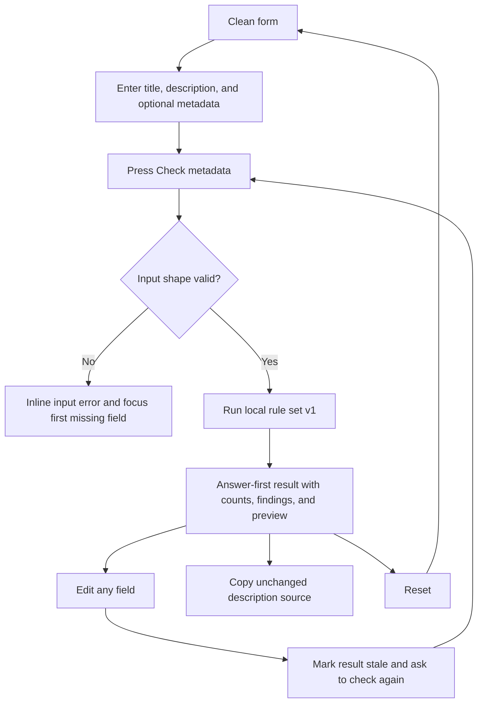

# Implementation report: KDP metadata checker

Status: ready
Tool: KDP metadata checker
Route: `/kdp-metadata-checker`
Depends on: `competitive-report.md`
Input fingerprint: `competitive-report.md sha256:21ea246bc4296561bf01e86b92a55a3655d01964ebbc420f8749fde0c13b9847`
Contract type: resolution

## Product decision

- Primary user: A self-publishing author with book metadata ready to paste into KDP's book details form.
- Job: Find documented formatting and metadata problems, plus clearly labelled local review prompts, before submission.
- Product thesis: stack127 can win by combining all five planned field groups in one local checker and separating source-backed checks from heuristics instead of compressing them into an approval score.
- Evidence: The competitive report's Research scope, Technical truth to verify, Competitor reviews, Comparison matrix, and Evidence-backed opportunities sections. The report shows that description formatters dominate the category while title, subtitle, and seven-keyword checks are rarely joined in an open tool.

The checker reports what its rule set found. It never says that a listing is accepted, safe, compliant, or guaranteed to pass KDP review.

## Scope

### Table stakes

- Accept one title, one optional subtitle, one description, and exactly seven keyword slots.
- Count the title and subtitle together against the documented fewer-than-200-character rule.
- Count the raw description, including HTML syntax, against the 4,000-character limit.
- Check the current twelve-tag description allowlist: `br`, `p`, `b`, `em`, `i`, `u`, `h4`, `h5`, `h6`, `ol`, `ul`, and `li`.
- Find unsupported tags, tag attributes, unclosed tags, mismatched nesting, and HTML-like input in non-description fields.
- Find obvious URLs, email addresses, phone numbers, prices, promotional phrases, and review requests.
- Compare normalized keyword phrases for exact duplicates and compare keyword wording with the title and subtitle.
- Show field-specific findings, counts, a safe description preview, the rule-set date, and a limitation beside the result.
- Keep processing in the browser with no account, upload, AI writing, scraping, remote request, or metadata storage.

### Launch differentiators

- Use the official twelve-tag list checked on 2026-09-16. Do not copy the mixed ten-, twelve-, or thirteen-tag lists observed in competitor tools.
- Give every finding a field, severity, excerpt or position when available, a plain recovery message, and a distinction between a documented check and a heuristic review prompt.
- Keep the original description unchanged and make the preview safe by mapping parsed allowed tags to React elements rather than injecting HTML.
- Show raw description characters separately from visible text characters and supported-tag count, so markup cost is visible.
- Make the source date and official KDP links part of the result's rule disclosure instead of hiding the data boundary in page prose.
- Use one explicit `Check metadata` action for a stable result. Counters may update while typing, but findings come from the last submitted snapshot.

### Deferred

- A deterministic cleaned-description export that removes unsupported tags. It needs its own fixtures for malformed nesting, literal angle brackets, and content preservation before it can ship.
- A KDP form or marketplace-specific numeric keyword limit. The reviewed official keyword page confirms seven keyword fields but does not publish a universal per-field byte limit.
- Trademark, category, author, contributor, ISBN, cover, search-volume, and Amazon listing checks.
- AI rewriting, title generation, keyword generation, readability scoring, and a recommendation or approval score.
- URL-shared metadata state, saved drafts, account sync, and automatic source refreshing.

### Non-goals

- The checker must not decide whether a book's title matches its cover or whether a phrase is legally usable.
- The checker must not treat a duplicate or title-overlap heuristic as a confirmed KDP rejection.
- The checker must not claim that a clean result proves KDP acceptance.
- The checker must not apply a hidden mutation to the user's description or keyword fields.
- The checker must not turn the seven keyword inputs into a keyword-research or ranking product.

## Formula and data contract

### Inputs and normalization

The client passes one immutable input object to the pure engine. The route creates exactly seven keyword values, including empty strings for unused slots. A non-string value, an array with any length other than seven, or a field over the local input guard is an input error and produces no metadata result.

| Input | Type and unit | Default | Valid range | Normalization |
| --- | --- | --- | --- | --- |
| `title` | string, text characters | empty form field | 1 to 64 KiB UTF-8 bytes to run a check | Preserve source for display; normalize CRLF and CR to LF for counting and matching; trim only for the required-field check. |
| `subtitle` | string, text characters | empty | 0 to 64 KiB UTF-8 bytes | Preserve source; normalize line endings for counting and matching. |
| `description` | string, source text including markup | empty form field | 1 to 64 KiB UTF-8 bytes to run a check | Preserve source; normalize line endings before parsing and counting. The 4,000-character rule remains a finding, not an input-size guard. |
| `keywords` | exactly seven strings, one per KDP keyword field | seven empty strings | each slot 0 to 8 KiB UTF-8 bytes | Preserve source for display; trim surrounding whitespace for empty checks; use NFKC, lower case, punctuation-to-space replacement, and whitespace collapse only for comparisons. |

The local character counter uses Unicode code points after line-ending normalization. Description counts include every code point in the source, including tag names, brackets, and attributes. KDP does not publish its internal Unicode counting implementation, so the UI labels these as local counts and does not turn them into an acceptance promise. The title-plus-subtitle check includes one separator space when both fields are populated. This is a conservative local interpretation of the combined-field rule.

The engine exposes `ruleSetVersion: 1` and `inputVersion: 1`. There is no serialized URL state, so no shared-input decoder is needed. A future rule change increments the rule-set version and records a new source-review date.

### Equations or resolution order

1. Validate the input shape. Require a non-empty title, a non-empty description, exactly seven keyword strings, and the local byte guards. Stop with `input-error` if the shape is invalid.
2. Normalize line endings for all checks while retaining the original source strings for the UI and copy action.
3. Count `titleCharacters`, `subtitleCharacters`, and `descriptionCharacters` with Unicode code points. Calculate `titleSubtitleCharacters` as `titleCharacters + subtitleCharacters + 1` when both fields are non-empty, otherwise the sum without the separator.
4. Resolve title and subtitle checks. Flag `titleSubtitleCharacters >= 200` as a documented error. Flag tag-shaped HTML in title or subtitle as a documented error. Run the obvious restricted-pattern checks as heuristic warnings.
5. Tokenize the description without executing it. A tag token is a case-insensitive opening or closing tag with an optional self-closing slash. Only the twelve allowlisted tag names are supported. `br` is the only void tag. Attributes, unknown names, incomplete tag-like tokens, and malformed nesting create documented formatting findings. A stack resolves opening and closing order.
6. Flag `descriptionCharacters > 4,000` as a documented error. Count visible text after tag tokens, count supported tag tokens, and scan visible text for obvious restrictions. URL and email patterns also scan the source so an invalid attribute cannot hide them.
7. For each keyword, count local Unicode characters, detect tag-shaped HTML and quotation marks, and run the same obvious URL, email, phone, price, promotion, and review-request patterns as heuristic warnings. A keyword over the local 50-character advisory receives a `keyword-too-long` warning that explicitly names this as a stack127 review prompt. This is not an official KDP byte limit, KDP threshold, or pass/fail rule.
8. Normalize each non-empty keyword with NFKC, lower case, punctuation-to-space replacement, and collapsed whitespace. Flag exact normalized duplicates across slots as heuristic warnings. The first occurrence remains the reference slot.
9. Tokenize the normalized title and subtitle into Unicode letter-or-number words. For each keyword with at least one word of three or more characters, flag a heuristic title-overlap warning only when every keyword word appears in the combined title/subtitle word set. Partial overlap alone does not create a finding.
10. Return a result with `status: clean` when there are no findings, `status: possible-issues` when one or more documented errors or heuristic warnings exist, and `status: input-error` without a result payload for invalid input shape. A clean result is a completed local check, not an approval verdict.

The obvious-pattern set is deliberately bounded. It includes `https://`, `http://`, `www.`, domain-like URLs, email addresses, phone-like digit runs of 7 to 15 digits, currency symbols or currency words next to a price, direct review or rating requests, and a small list of promotional or time-sensitive phrases such as `buy now`, `free`, `sale`, `discount`, `best seller`, `#1`, `limited time`, and `available now`. Unicode emoji detection is a heuristic warning. A pattern match says "review this text" and never says that KDP will reject it.

### Rounding, display, and versioning

No numeric result is rounded. Counts are integers. The UI displays the title/subtitle count as `n / 199` and the raw description count as `n / 4,000`. It displays per-slot keyword counts without an official KDP threshold; a value over 50 local Unicode characters may produce a stack127 review prompt, never an official limit or pass/fail verdict. Findings retain source offsets in normalized input where a matcher can provide one, but the original text remains the copy source.

The result shape is:

```text
{
  ruleSetVersion: 1,
  inputVersion: 1,
  status: "clean" | "possible-issues" | "input-error",
  counts: {
    title, subtitle, titleSubtitle, descriptionRaw, descriptionVisible,
    supportedTags, populatedKeywords, keywordCharacters[7]
  },
  findings: [{ id, field, severity, code, message, recovery, start?, end? }],
  preview: [{ type: "text" | "tag", name?, closing?, selfClosing?, value? }]
}
```

`severity: error` is reserved for a deterministic documented rule or parser problem. `severity: warning` is reserved for a local heuristic or an unknown KDP boundary. The answer lead uses "Possible issues found" or "Review prompts found", never "Approved" or "KDP safe". The rule disclosure links to the official metadata, description, keyword, create-a-book, and troubleshooting pages and shows the 2026-09-16 review date.

### Invalid, unknown, absent, and partial states

- Missing title or description, malformed input shape, non-string values, wrong keyword-slot count, or input over the local byte guard produces `input-error`, inline recovery, and no result lead. The first invalid control receives focus.
- An empty subtitle or empty keyword slot is allowed. Empty keyword slots contribute zero to the populated count and do not create an error.
- A description with unsupported tags or malformed nesting still receives a result because the checker can report the problem. The result lead says "Possible issues found" and the affected finding explains the recovery.
- A duplicate keyword or title overlap is a warning, not a confirmed violation. The warning names the normalization rule and asks the author to review the phrase.
- KDP does not publish a universal numeric keyword limit. The tool may show a local over-50-Unicode-character review prompt, but it never presents that heuristic as a 50-byte KDP rule or pass/fail verdict.
- There is no upstream request, timeout, rate limit, stale remote response, or partial catalog state. The rules are bundled with the client. A future source update is a code and rule-set release, not a runtime fetch.
- A safe preview always renders parsed text and known tags as React content. Unknown or malformed tags are shown as non-executing text or neutralized preview content, and the issue list remains the source of truth.
- Editing after a result marks the result stale. The old result remains visible with a `Check again` prompt until the user submits the new snapshot; it is never silently presented as current.

### Assumptions and exclusions

The checker covers the obvious, text-detectable part of KDP metadata review. It cannot judge a title's truthfulness, a spoiler, a trademark, a category, a book-cover match, or the full meaning of promotional language. It does not reproduce KDP's private automated systems or human review. It does not infer a numeric keyword limit from competitor tools. It treats official KDP help pages as the rule source and competitor behavior as product evidence only.

### Primary sources

- [KDP Metadata Guidelines for Books](https://kdp.amazon.com/en_US/help/topic/G201097560), checked 2026-09-16. Title, subtitle, description restrictions, and review boundaries.
- [Write a Book Description](https://kdp.amazon.com/en_US/help/topic/G201189630), checked 2026-09-16. The 4,000-character limit, HTML counting, and supported description tags.
- [Make Your Book More Discoverable with Keywords](https://kdp.amazon.com/en_US/help/topic/G201298500), checked 2026-09-16. Seven keyword fields and the documented avoid list; no universal numeric field limit is stated.
- [Create a Book](https://kdp.amazon.com/en_US/help/topic/G202172740), checked 2026-09-16. HTML is not accepted in title, subtitle, author, contributor, or keyword fields.
- [Fixing errors or formatting with book descriptions](https://kdp.amazon.com/en_US/help/topic/GC4VASCGNQP6LQ7L), checked 2026-09-16. Invisible characters, copied markup, and missing or mismatched tags.

## User flow



Counters update while the user types because they are cheap and useful during editing. Findings update only on the explicit action so a long description does not produce a moving target while it is being pasted. A repeat submission replaces the prior snapshot after the local check completes. Reset clears all fields, removes findings, and focuses the title field.

There is no remote loading or upstream failure path. The client may expose a brief `Checking metadata` status to assistive technology while the synchronous engine runs, but it must not add a decorative spinner for a local operation. The only copy failure is a denied clipboard permission, which leaves the unchanged source visible for manual selection.

## Interface wireframes

### Desktop: clean

```text
┌──────────────────────────────────────────────────────────────────────────────┐
│ KDP metadata checker                                                         │
│                                                                              │
│ ┌────────────────────────────── metadata workbench ───────────────────────┐ │
│ │ Inputs                                           Result                   │ │
│ │ Title                                            No check yet             │ │
│ │ [________________________________________]       Enter the fields, then   │ │
│ │ Subtitle                                         check the metadata.      │ │
│ │ [________________________________________]                                 │ │
│ │ Description                                      Counts                   │ │
│ │ [                                        ]       Title + subtitle 0 / 199  │ │
│ │ [                                        ]       Description 0 / 4,000      │ │
│ │ 0 / 4,000 local characters                                                   │
│ │                                                                              │
│ │ Keywords                                                               │ │
│ │ 1 [________________]  2 [________________]  3 [________________]          │ │
│ │ 4 [________________]  5 [________________]  6 [________________]          │ │
│ │ 7 [________________]                                                       │ │
│ │                                                                              │ │
│ │ [Check metadata]  [Reset]                         Rule date and limits     │ │
│ └──────────────────────────────────────────────────────────────────────────┘ │
└──────────────────────────────────────────────────────────────────────────────┘
```

### Desktop: result

```text
┌──────────────────────────────────────────────────────────────────────────────┐
│ ┌────────────────────────────── metadata workbench ───────────────────────┐ │
│ │ Inputs                                           Possible issues found   │ │
│ │ Title [A Quiet Atlas____________________]        3 findings, 2 review    │ │
│ │ Subtitle [Notes for paying attention____]       prompts                  │ │
│ │ Description [source text................]                                 │ │
│ │ 421 / 4,000 local characters                     Counts                   │ │
│ │ Keywords 1 [quiet travel] ...                   title + subtitle 43 /199 │ │
│ │                                                     description 421 /4000 │ │
│ │ [Check again] [Reset]                             7 keyword slots         │ │
│ │                                                  Findings by field        │ │
│ │                                                  Description              │ │
│ │                                                  [error] Unsupported tag  │ │
│ │                                                  Remove <h3>.              │ │
│ │                                                  Keywords                 │ │
│ │                                                  [warning] Keyword 4      │ │
│ │                                                  repeats keyword 2.       │ │
│ │                                                  Description preview      │ │
│ │                                                  Rendered safe preview...  │ │
│ │                                                  [Copy source]             │ │
│ └──────────────────────────────────────────────────────────────────────────┘ │
└──────────────────────────────────────────────────────────────────────────────┘
```

The result order is fixed at the product level: lead and limitation, counts, findings grouped by field with documented errors before heuristic warnings, then the safe description preview and source disclosure. The interface-plan stage may choose the final grouping and component treatment without adding a score or a second answer region.

### Narrow mobile

```text
┌──────────────────────────────┐
│ KDP metadata checker         │
│                              │
│ Inputs                       │
│ Title                        │
│ [__________________________] │
│ Subtitle                     │
│ [__________________________] │
│ Description                  │
│ [                          ] │
│ [                          ] │
│ 0 / 4,000 local characters  │
│ Keywords                     │
│ 1 [_______________________]  │
│ 2 [_______________________]  │
│ ...                          │
│ 7 [_______________________]  │
│ [Check metadata]             │
│ [Reset]                      │
│                              │
│ Result                       │
│ No check yet                 │
│                              │
│ After checking:              │
│ Possible issues found       │
│ Counts                       │
│ Findings by field           │
│ Description preview         │
│ Rule source and limitation  │
└──────────────────────────────┘
```

### Error, checking, stale, and reset states

```text
Missing title or description:
[Title]  Enter a title to check the metadata.  <- focus returns here
[Check metadata]
No result is shown.

Checking:
[Checking metadata...]  Previous result stays marked as stale if one exists.

After editing a result:
Results from the previous check. Check again.
[Check again]

Reset:
All fields empty. Counters at zero. No result. Focus on Title.

Reload or shared URL:
No metadata is restored. The form starts clean because input is private.
```

There is no partial upstream state. A heuristic the engine cannot establish is omitted rather than guessed, and the result explains that the check is limited to visible text patterns and the documented tag grammar.

## Interaction contract

| Event | UI response | Result state | Focus/announcement | URL/persistence |
| --- | --- | --- | --- | --- |
| User types in title, subtitle, description, or a keyword | Update the relevant local count and field-level input state without running findings | Clean form or stale previous result | Counts use a polite live region; focus stays in the edited control | No URL or storage change |
| User presses `Check metadata` with missing required input | Show the first required-field message and preserve entered text | `input-error`; no result payload | Focus the first invalid control and announce the error | No URL or storage change |
| User presses `Check metadata` with valid input | Run rule set v1 and replace the prior snapshot | `clean` or `possible-issues` | Move focus to the result lead and announce the status and finding count | No URL or storage change |
| User edits after a result | Keep the old result but label it stale | `stale` until the next submit | Announce that the result must be checked again; keep focus in the edited control | No URL or storage change |
| User activates `Copy source` | Copy the exact original description string, including markup and line breaks | Existing result plus copy status | Announce `Description source copied` or a manual-copy recovery message | Clipboard only after explicit user action |
| User activates `Reset` | Clear all fields, counts, findings, and preview | Clean form | Focus title and announce reset | No URL or storage change |
| Browser reloads or a user opens a shared URL | Do not restore metadata | Clean form | No announcement beyond the normal empty state | No localStorage, cookies, query state, or server persistence |

## Page composition

| Claim or task | Medium | Position | Why this medium |
| --- | --- | --- | --- |
| Check whether the supplied metadata needs attention | Tool UI result lead | Top of the result region | The user needs an answer before reading detail, but the answer must stay qualified. |
| Title, subtitle, and description limits | Tool UI counts | Beside the relevant fields and repeated in the result summary | Counts are exact repeated facts and do not need a chart. |
| Which field needs a change and why | Tool UI findings list | Immediately after the result lead and counts | A field-specific message and recovery path are more useful than a single score. |
| What the description will look like with supported tags | Safe rendered preview | After findings | A preview communicates tag structure better than prose, while the source remains available. |
| Which rules and date were used | Sentence and source disclosure | Near the preview and result limitation | The rule boundary and freshness matter to trust but do not belong in the primary answer. |

No marker art, clean chart, or screenshot is planned. The exact output is text, counts, a finding list, and a safe preview. A conceptual drawing would not improve this task.

## Technical plan

### Architecture and file ownership

- `app/(site)/(tools)/kdp-metadata-checker/page.tsx` owns the server-rendered route shell. It loads the database-backed `ToolPageHeader` and `ToolPageMarkdown` through `getRequiredToolPage`, following the sibling tool routes.
- `app/(site)/(tools)/kdp-metadata-checker/kdp-metadata-checker.tsx` owns the smallest client island: controlled fields, counters, submit/reset/copy events, focus movement, result rendering, and safe preview mapping.
- `app/(site)/(tools)/kdp-metadata-checker/kdp-metadata-checker.module.css` owns the route layout and responsive styles. It must use the existing workbench tokens and not add selectors to `app/globals.css`.
- `lib/kdp/metadata.ts` owns the pure resolution engine, normalization, tag tokenizer, restricted-pattern matchers, duplicate and title-overlap comparisons, result types, and rule/input versions. It must not import React or browser APIs.
- `lib/kdp/index.ts` may re-export the metadata contract with the other KDP engines, but it must not duplicate rule data.
- `tests/pages/kdp-metadata-checker/kdp-metadata-checker.test.mjs` owns deterministic engine fixtures. Add the route's `page.test.mjs` and `kdp-metadata-checker.spec.ts` only when the implementation stage begins, plus `tests/pages/kdp-metadata-checker/page.json` as the ownership manifest.
- `content_docs/kdp-metadata-checker/implementation-report.md` and `brief.md` are the product-plan records. Later page writing belongs in the database through the reviewed tool-page content command, not a second Markdown copy in the route.
- No page-specific script is needed. No new npm dependency is needed. The UI can use the existing `app/tool-ui` controls and a small Lucide icon consistent with sibling tools.

The engine is pure so unit tests can lock the rule set without rendering React. The client owns only browser concerns such as clipboard access, focus, controlled input, and the safe token-to-element preview. The route remains a normal repo-owned flat route and does not add metadata, canonical, robots, sitemap, or JSON-LD code.

### Accessibility, privacy, security, and performance

- Use visible labels for all fields, a fieldset or equivalent grouping for the seven keyword slots, native form submission, and a single primary action.
- Use `aria-describedby` for the relevant count and recovery text, a polite live region for count/status changes, and a focusable result lead for successful checks. Error focus must not jump while the user types.
- Keep the seven keyword labels readable at 320, 375, 760, and desktop widths. Do not require horizontal scrolling for the form or issue messages.
- Never use `dangerouslySetInnerHTML` for the preview. The parser must turn only allowlisted tags into React elements and must render untrusted text as text.
- Do not send title, subtitle, description, or keywords to a server. Do not use analytics events, cookies, localStorage, sessionStorage, URL parameters, or third-party libraries for metadata handling.
- Clipboard access is opt-in from the copy button. If permission fails, leave the exact source visible and provide manual recovery.
- The engine runs in O(n) time over the total input length, with at most one normalized comparison pass over the seven keyword slots. The browser should handle a 4,000-character description and seven ordinary keyword fields in one interaction without a network wait.
- The result must work in dark and light themes, respect reduced motion, preserve keyboard order, and avoid a coloured left rule or nested dashboard-card layout.

### Publication state

The route remains unpublished. This planning stage must not add or change a `public.stack127_pages` row, a tool-page content row, a publication migration, sitemap state, or route SEO code. The later implementation can be exercised through a development-only preview row, but public access requires a separate publication decision.

## Acceptance criteria

| ID | Observable acceptance criterion | Evidence at build time |
| --- | --- | --- |
| R1 | The form renders one title, one optional subtitle, one description, and exactly seven labelled keyword fields. | Route Browser test and page manifest review. |
| R2 | A missing title or description, malformed input object, or wrong keyword-slot count prevents a metadata result, identifies the first recovery target, and preserves entered text. | Engine unit fixtures and keyboard Browser test. |
| R3 | The engine normalizes line endings, counts Unicode code points, includes one combined-field separator when both title fields are populated, and flags title/subtitle counts of 200 or more. | Locked formula fixtures for empty, 199, 200, and CRLF inputs. |
| R4 | The engine counts every description source character, including markup, and flags a count above 4,000 while showing visible-text and supported-tag counts separately. | Boundary fixtures at 4,000 and 4,001 plus rendered counter check. |
| R5 | The allowlist contains exactly `br`, `p`, `b`, `em`, `i`, `u`, `h4`, `h5`, `h6`, `ol`, `ul`, and `li`; `h1`, `h2`, `h3`, `hr`, `a`, and tag attributes produce documented formatting findings. | Allowlist table fixture and unsupported-tag/attribute tests. |
| R6 | Unclosed, mismatched, incomplete, or wrongly ordered description tags produce findings without executing or silently deleting source text. | Parser fixtures for each malformed form and safe-preview Browser test. |
| R7 | HTML-like input in title, subtitle, or keyword fields produces a field-specific documented finding. | Field matrix fixtures for opening, closing, and attribute-bearing tags. |
| R8 | The bounded URL, email, phone, price, promotion, review-request, time-sensitive, and emoji patterns produce heuristic warnings with recovery text and never an acceptance verdict. | Pattern fixture matrix with false-positive plain angle-bracket and ordinary prose cases. |
| R9 | Keyword duplicates compare normalized case, Unicode compatibility, punctuation, and whitespace, while partial overlap alone remains unflagged. | Duplicate, punctuation, Unicode, and partial-overlap fixtures. |
| R10 | A keyword whose significant words all occur in the title/subtitle produces a title-overlap review prompt, while a keyword with only partial overlap does not. | Title-overlap fixtures including one-word and multi-word phrases. |
| R11 | The result distinguishes documented errors from heuristic warnings, groups findings by field, orders documented findings first, and never displays a 0-to-100 score or approval label. | Result-shape unit test and rendered result inspection. |
| R12 | The description preview renders allowlisted tags through a safe parsed representation, cannot execute unknown markup, and states that it approximates KDP's renderer. | Static scan for forbidden HTML injection, parser unit tests, and Browser preview probe. |
| R13 | `Copy source` copies the unchanged original description, including markup and line endings as displayed by the preserved source, and reports clipboard failure without rewriting the text. | Clipboard success/failure Browser tests and exact string fixture. |
| R14 | Findings are produced only for the submitted snapshot; editing marks the old result stale, rechecking replaces it, and reset clears the state and focuses title. | Interaction test covering submit, edit, recheck, and reset. |
| R15 | The tool performs no remote request, AI generation, scraping, analytics event, cookie write, URL serialization, or browser storage write for metadata. | Static source checks, network-observation Browser test, and privacy review. |
| R16 | Keyboard users can reach every control, all fields have visible labels, status and copy feedback are announced, and focus moves to the result lead after a valid check or to the first invalid field after input failure. | Accessibility Browser test at desktop and mobile widths. |
| R17 | The workbench remains readable and has no horizontal overflow at 320, 375, 760, and desktop widths in dark and light themes. | Standalone Playwright screenshots and computed-width checks. |
| R18 | The engine is deterministic, uses `ruleSetVersion: 1` and `inputVersion: 1`, and completes the ordinary 4,000-character case without a network wait. | Repeated unit runs, version assertion, and performance sample. |
| R19 | The page follows the sibling route pattern with server-rendered tool content, a client-only workbench island, colocated CSS, and no route-local SEO or publication logic. | Static route test, typecheck, and ownership-manifest review. |
| R20 | The route is not publicly reachable until its publication registry state is separately approved. | Unpublished route and sitemap checks; no publication-state diff in this stage. |

## Open questions and blockers

There is no launch blocker. The official sources do not publish a universal keyword byte limit or KDP's internal Unicode counter, so the checker keeps the >50 Unicode-character check as a stack127-local review prompt rather than an official limit or pass/fail rule. The next source review should re-check the five official links before a rule-set version changes. Cleaned-description export remains a deferred feature until deterministic preservation tests exist.
