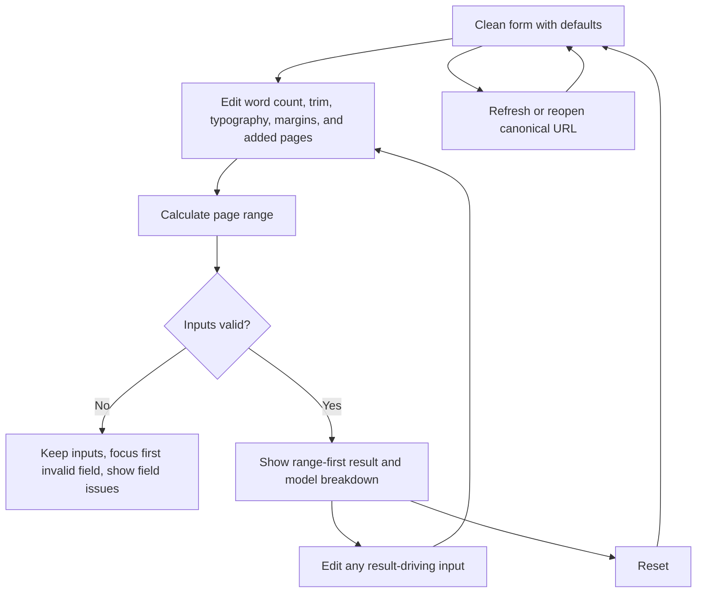

# Implementation report: KDP page count estimator

Status: ready
Tool: KDP page count estimator
Route: `/kdp-page-count-estimator`
Depends on: `competitive-report.md`
Contract type: formula

## Product decision

- Primary user: A self-publishing author or book formatter who has a manuscript word count but no final typeset PDF.
- Job: Estimate a plausible paperback print-page range from trim, typography, margins, chapter starts, artwork pages, and front or back matter before making cover or pricing decisions.
- Product thesis: The estimator earns trust by making uncertainty visible. It separates text capacity from added pages, shows the assumptions behind the range, applies KDP's even-page rule, and keeps official KDP guidance separate from local typography assumptions.
- Evidence: `Research scope`, `Search intent`, `User pain evidence`, `Formula and data disagreements`, and `Evidence-backed opportunities` in `competitive-report.md`. Competitors commonly hide the words-per-page model or lead with one precise number. SmartKDP is the clearest range-based example, while the report's KDP sources establish even-page rounding and gutter bands.

## Scope

### Table stakes

- Accept word count, KDP paperback trim, font width class, font size, line spacing, inside margin, outside margin, top and bottom margin, chapter count, image or table pages, and front and back matter pages.
- Use supported KDP paperback trim presets. Do not accept custom trim dimensions in version 1.
- Return a low to high page range, a labelled midpoint, text pages, added-page components, words-per-page assumptions, and the selected trim.
- Round the displayed planning range up to even page counts using the documented KDP rule. Keep the unrounded intermediate values for the breakdown.
- Show KDP's 24-page paperback minimum and inside-margin bands as guidance. Do not invent one universal KDP maximum when paper, ink, binding, and trim combinations differ.
- Use one explicit `Calculate page range` action, `Reset`, inline recovery, and stale-result clearing after an input changes.
- Calculate in the browser with no file upload, account, network request, or saved input.

### Launch differentiators

- Lead with the range instead of a single page claim. The midpoint is a planning anchor, not a promise.
- Show text pages and added pages separately so a user can see whether typography, chapter starts, artwork, or matter drives the total.
- Show the local words-per-page model, its width-class assumptions, and its uncertainty band beside the result. Mark these as estimator assumptions rather than KDP rules.
- Show when the predicted range crosses a KDP inside-margin band. Keep the range useful for early planning without presenting a format acceptance verdict.
- Keep zero words valid when the user is estimating an image-led or matter-only book. Do not turn an empty manuscript into invented body pages.

### Deferred

- Binding, ink, paper, and format-specific maximum-page eligibility. Version 1 is paperback-oriented and cannot give a reliable maximum-page verdict without those selections.
- Hardcover-specific page ranges and cover constraints.
- Custom trim dimensions, named-font metrics, paragraph styles, headings, tables inferred from text, chapter-opening templates, and a real typesetting engine.
- PDF or DOCX import, automatic word counting, image inspection, page-count extraction, and cover or spine calculation.
- Share URLs, local storage, export files, reading-time estimates, royalties, print cost, and advertising calculations.

### Non-goals

- The result is not the final KDP page count. The submitted manuscript file remains authoritative.
- The result does not promise KDP acceptance, a finished cover size, a spine width, or a production quote.
- The estimator does not determine how a specific font engine wraps text, place images, or handle widows, orphans, headings, tables, blank pages, and paragraph spacing.
- The estimator does not upload content to KDP, call a KDP API, scrape Amazon, write book metadata, or generate book copy.

## Formula and data contract

### Inputs and normalization

The calculation adapter accepts a typed input object after strict form parsing. All margins use inches. Font size uses points. Page and matter counts use whole pages. The first release is paperback-oriented, so `trimId` resolves through the shared KDP paperback trim table and there is no hidden binding or paper default.

| Input | Type and unit | Default | Valid range | Normalization |
| --- | --- | --- | --- | --- |
| `words` | safe integer, words | `50,000` | `0` to `10,000,000` | Accept ASCII decimal digits only. Zero is valid. Reject signs, separators, decimals, exponent notation, and unsafe integers. |
| `trimId` | enum, KDP paperback preset | `6x9` | A supported preset in `lib/kdp/specs.ts` | Store the canonical preset ID. Reject custom width and height in version 1. |
| `font` | enum, width class | `serif` | `serif`, `sans`, `mono` | Map to a documented average-glyph-width factor. Do not label a class as an exact installed font. |
| `fontSize` | finite decimal, points | `11` | `8` to `24` | Parse as a decimal number. Keep the numeric value for the formula and display it with its `pt` unit. |
| `lineSpacing` | finite decimal, multiplier | `1.15` | `1` to `2.5` | Preserve the multiplier. Do not convert it to a named style. |
| `insideMargin` | finite decimal, inches | `0.5` | `0.1` to `2` | Trim whitespace, parse a strict decimal, and reject a value that leaves no text width. |
| `outsideMargin` | finite decimal, inches | `0.375` | `0.1` to `2` | Use the same strict decimal grammar and text-width check. |
| `topBottomMargin` | finite decimal, inches | `0.75` | `0.1` to `2` | Apply the same value to the top and bottom of the text block. Reject a value that leaves no text height. |
| `chapterCount` | safe integer, chapter starts | `20` | `0` to `2,000` | Accept whole decimal digits only. It becomes a separate planning allowance, not text capacity. |
| `imagePages` | safe integer, full pages | `0` | `0` to `2,000` | Count full image or table pages supplied by the user. Do not infer them from word count. |
| `frontMatterPages` | safe integer, pages | `4` | `0` to `2,000` | Count the user's estimated front matter. |
| `backMatterPages` | safe integer, pages | `2` | `0` to `2,000` | Count the user's estimated back matter. |

The adapter validates the exact supported key set, resolves the trim before calculating, and returns structured field issues. It does not silently clamp values. The three margin inputs are independent user assumptions. The result compares the estimated page range with KDP's published inside-margin bands but does not replace the user's margins with KDP values.

### Equations or resolution order

Use the following calculation version 1 contract. All derived page counts are whole numbers. The accepted bounds keep the intermediate values within JavaScript safe integers.

1. Validate every input. Resolve `trimId` to `trimWidthInches` and `trimHeightInches` from the shared paperback specification. Stop with `values = null` if any input is invalid.
2. Calculate the text block: `textWidth = trimWidthInches - insideMargin - outsideMargin` and `textHeight = trimHeightInches - (2 × topBottomMargin)`. Both values must be positive.
3. Select the average glyph-width factor: serif `0.50`, sans `0.52`, and monospaced `0.60`. These are stack127 model constants, not KDP measurements.
4. Calculate `characterWidthInches = (fontSize / 72) × glyphWidthFactor` and `lineHeightInches = (fontSize / 72) × lineSpacing`.
5. Calculate `charactersPerLine = max(1, floor(textWidth / characterWidthInches))` and `linesPerPage = max(1, floor(textHeight / lineHeightInches))`.
6. Calculate `nominalWordsPerPage = charactersPerLine × linesPerPage / 5`. The divisor of 5 is an average character-slot allowance per word and includes the spacing assumption.
7. Calculate the model range: `lowWordsPerPage = max(1, floor(nominalWordsPerPage × 0.80))` and `highWordsPerPage = max(1, ceil(nominalWordsPerPage × 1.20))`. The low value produces the high page estimate.
8. Calculate text pages: `textPages.min = words === 0 ? 0 : ceil(words / highWordsPerPage)` and `textPages.max = words === 0 ? 0 : ceil(words / lowWordsPerPage)`.
9. Calculate added pages. `chapterStartPages = words > 0 ? chapterCount : 0`. Then `addedPages.total = chapterStartPages + imagePages + frontMatterPages + backMatterPages`. One page per chapter is a conservative local allowance for a chapter start. It is not an official KDP rule.
10. Calculate raw totals: `rawPages.min = textPages.min + addedPages.total` and `rawPages.max = textPages.max + addedPages.total`.
11. Apply KDP-style even rounding only to the displayed planning result: `evenCeiling(pages) = 2 × ceil(max(0, pages) / 2)`. Return `totalPages.min = evenCeiling(rawPages.min)` and `totalPages.max = evenCeiling(rawPages.max)`. Return a midpoint labelled `range midpoint`, not as an exact page count.
12. Compare the total range with KDP's published inside-margin bands: 24 to 150 pages uses 0.375 inches, 151 to 300 uses 0.5, 301 to 500 uses 0.625, 501 to 700 uses 0.75, and 701 to 828 uses 0.875. Return every band touched by the range. If the range extends above the published table, return a non-blocking warning to check the selected KDP format rather than a made-up maximum.
13. Return `values` with exact integer counts, model assumptions, gutter-band guidance, and warnings. Never serialize formatted strings as engine values.

### Rounding, display, and versioning

- `calculationVersion` is `kdp-page-count-1` and `inputVersion` is `kdp-page-count-input-1`. A later change to a coefficient, bound, default, addition rule, or rounding rule requires a new calculation version.
- Keep raw intermediate page counts for the breakdown. Display page counts as whole values and display ranges as `N to M pages`; do not use an en dash or imply a precise single result.
- Display `lowWordsPerPage` and `highWordsPerPage` as a range. The midpoint is the rounded midpoint of the displayed total range and is secondary to the range.
- Display margins in inches with up to three fractional digits. Do not feed formatted values back into the formula.
- The 24-page KDP paperback minimum is guidance. A range below or across that floor produces a warning, not a clamped result. No universal maximum is shown in version 1.
- Store no URL state, derived result, personal data, or browser persistence. Refreshing the canonical route returns to the clean default form.

### Invalid, unknown, absent, and partial states

- The clean form has the documented defaults and no result. It does not calculate on mount or write a query string.
- A blank, malformed, negative, fractional, unsafe, or out-of-range input produces a field issue, preserves the other inputs, clears any previous result, and shows no derived values.
- A margin combination that leaves no positive text width or height is invalid. A valid calculation may still carry a non-blocking gutter warning when its chosen margin is below a band used by the predicted range.
- Zero words is valid. With no added pages it returns a zero-to-zero estimate so an image-led book can be planned without invented text pages.
- Any result-driving input edit clears the result and removes its live announcement. The next submission calculates from the current form only.
- A valid result has no error-level issue. A result with a KDP floor or gutter warning remains usable, but the warning appears beside the affected value and is not repeated as a second error.
- There is no loading, network failure, upstream failure, or partial-data state because the engine is synchronous and uses embedded, versioned KDP guidance. The UI must not render a fake spinner.
- There is no restored or shared state in version 1. A query parameter or stored value is ignored rather than treated as a result.

### Assumptions and exclusions

- `words` is the user's body-manuscript count. The tool does not count words from a pasted manuscript or uploaded file.
- The text model estimates a text block from trim, margins, font width class, font size, and line spacing. It does not perform font shaping or typesetting.
- The 5-character word slot, width factors, 0.80 to 1.20 density band, and one-page chapter allowance are local assumptions. They must be labelled as model inputs in the result.
- Image pages, front matter, and back matter are direct user allowances. The estimator does not infer placement, captions, blank verso pages, or table overflow.
- KDP's even-page rule, 24-page paperback minimum, and inside-margin bands are official guidance. KDP's final submitted PDF remains the source of truth.
- Bleed, binding, paper, ink, hardcover ranges, format-specific maximums, cover dimensions, spine width, and royalties are outside this contract. The setup and royalty tools own those jobs.

### Primary sources

- [KDP paperback submission guidelines](https://kdp.amazon.com/en_US/help/topic/G201857950), checked 2026-09-16. Supports page-count rounding to an even number, the paperback minimum, and final-file authority.
- [KDP trim size and margin requirements](https://kdp.amazon.com/en_US/help/topic/GVBQ3CMEQW3W2VL6), checked 2026-09-16. Supports paperback trim presets and inside-margin bands.
- [KDP hardcover trim and page limits](https://kdp.amazon.com/en_US/help/topic/G201834180), checked 2026-09-16. Supports the decision to keep hardcover eligibility out of this paperback-oriented version.
- `competitive-report.md`, checked 2026-09-16. Records the ten competitor reviews, range-model evidence, and the distinction between KDP rules and estimator assumptions.

## User flow



The form uses one explicit primary action because the inputs change a shared estimate and the user benefits from a stable answer. Pressing Enter from any field submits the same action. A valid submission moves focus to the result heading and announces the range. An invalid submission keeps values, focuses the first invalid field, and announces one short recovery status. Reset returns the documented defaults. Editing any result-driving input clears the old answer so a stale range cannot remain visible.

## Interface wireframes

### Desktop: clean

```text
[shared shell and paperback tools navigation]

KDP page count estimator

+-------------------------------------------------------------------------+
| Estimate print pages                                                   |
|                                                                         |
| Word count        [ 50,000                         ]                   |
| Trim size         [ 6 × 9 in                       v ]                  |
| Font              [ Serif                          v ]                  |
| Font size         [ 11                             ] pt                 |
| Line spacing      [ 1.15                           ]                    |
|                                                                         |
| Inside margin     [ 0.5                            ] in                 |
| Outside margin    [ 0.375                          ] in                 |
| Top and bottom    [ 0.75                           ] in                 |
|                                                                         |
| Chapter starts    [ 20                             ]                    |
| Image pages       [ 0                              ]                    |
| Front matter      [ 4                              ]                    |
| Back matter       [ 2                              ]                    |
|                                                                         |
| [Reset]                                      [Calculate page range]     |
+-------------------------------------------------------------------------+
| Result appears after calculation.                                      |
+-------------------------------------------------------------------------+
```

### Desktop: valid result

```text
+-------------------------------------------------------------------------+
| Result                                                                  |
| 100 to 138 pages                                                       |
| KDP-rounded planning range                                              |
|                                                                         |
| Range midpoint 119 pages       Text pages 74 to 112                    |
|                                                                         |
| Page anatomy                                                            |
| Chapter starts 20 | Images 0 | Front matter 4 | Back matter 2            |
|                                                                         |
| Model inputs                                                             |
| 450 to 676 words per page | 6 × 9 in | serif 11 pt | 1.15 spacing       |
| Text block 5.125 × 7.5 in                                               |
|                                                                         |
| KDP guidance                                                            |
| Inside-margin band: 24 to 150 pages uses 0.375 in                      |
| Final pages come from the submitted manuscript file.                    |
|                                                                         |
| [Reset]                                                                 |
+-------------------------------------------------------------------------+
```

### Narrow mobile

```text
KDP page count estimator

+-------------------------------+
| Word count [50,000]            |
| Trim [6 × 9 in             v]  |
| Font [Serif                v]  |
| Font size [11] pt              |
| Line spacing [1.15]            |
| Inside [0.5] in                |
| Outside [0.375] in             |
| Top and bottom [0.75] in       |
| Chapters [20]                  |
| Image pages [0]                |
| Front matter [4]               |
| Back matter [2]                |
|                               |
| [Reset]                        |
| [Calculate page range]         |
+-------------------------------+

Result
100 to 138 pages
KDP-rounded planning range

Text pages 74 to 112
Added pages table
KDP guidance
```

### Error, loading, partial, and restored states

```text
Invalid input

Word count [ -4 ]
Use a whole word count from 0 to 10,000,000.

[Calculate page range]
No result is shown. Focus moves to the first invalid field.

Loading or upstream failure: not applicable. The local calculation is synchronous.
Partial data: not applicable. Embedded KDP guidance is versioned and complete for this scope.
Restored or shared state: not applicable in version 1. The canonical URL opens the clean form.
```

## Interaction contract

| Event | UI response | Result state | Focus/announcement | URL/persistence |
| --- | --- | --- | --- | --- |
| Open the canonical route | Render defaults and the complete form | Clean, no result | No automatic focus or announcement | URL stays canonical; no storage |
| Submit valid inputs | Calculate once and render the result workbench | Valid range with optional warnings | Focus the result heading and announce the range | No URL change |
| Submit invalid inputs | Keep entered values and show field-linked issues | Invalid, no result | Focus the first invalid control and announce one recovery status | No URL change |
| Edit any input after a result | Clear the old range and warning list | Clean or incomplete, no stale result | Remove the old result announcement | No URL change |
| Press Enter in a form control | Submit the same form action as the primary button | Valid or invalid according to the current inputs | Follow the same focus rule as button submission | No URL change |
| Activate Reset | Restore defaults and clear the result | Clean | Announce `Estimate reset.` through the status region | No URL change or storage |

## Page composition

| Claim or task | Medium | Position | Why this medium |
| --- | --- | --- | --- |
| Likely print-page range | Tool UI | First line of the result region | The user needs the planning answer before the assumptions. |
| Text pages versus chapter, image, front-matter, and back-matter additions | Table | Directly below the result lead | Repeated components are easier to compare as exact rows. |
| Words-per-page model and text-block dimensions | Table plus disclosure | Below the page anatomy | The intermediate values make the range auditable without turning the lead into a formula dump. |
| KDP even-page rule and inside-margin guidance | Sentences plus compact table | After the model breakdown | KDP rules need a short explanation beside the exact bands they affect. |
| Final-file limitation | Sentence | End of the result and later supporting content | The caveat belongs beside the estimate and should not compete with it. |
| Conceptual artwork or decorative chart | None | Not planned | Exact page relationships are clearer in the result table, and a marker drawing would imply precision it cannot carry. |

## Technical plan

### Architecture and file ownership

- `app/(site)/(tools)/kdp-page-count-estimator/page.tsx` owns the server-rendered route shell. It loads `getRequiredToolPage("kdp-page-count-estimator")`, uses `AppShell`, `PageCanvas`, `ToolPageHeader`, and `ToolPageMarkdown`, and contains no route-local metadata, canonical, robots, sitemap, or JSON-LD logic.
- `app/(site)/(tools)/kdp-page-count-estimator/kdp-page-count-estimator.tsx` owns the smallest client island: form state, submission, focus, status, and result rendering. It uses the shared `Tool*` controls and one primary action.
- `lib/kdp/page-count.ts` owns the pure formula adapter, typed inputs, structured issues, exact derived counts, warning semantics, and calculation version. `lib/kdp/specs.ts` owns the shared paperback trim data and official KDP source links.
- `app/(site)/(tools)/_components/kdp-tool.module.css` may provide shared KDP workbench styling. Page-specific layout belongs in `app/(site)/(tools)/kdp-page-count-estimator/kdp-page-count-estimator.module.css`; `app/globals.css` must not receive page selectors.
- `tests/pages/kdp-page-count-estimator/kdp-page-count-estimator.test.mjs` owns pure engine fixtures. A route-scoped Playwright file owns visible form, result, invalid, mobile, theme, and overflow checks. `tests/pages/kdp-page-count-estimator/page.json` owns the page state and links these artifacts.
- `content_docs/kdp-page-count-estimator/` owns this implementation report, the brief, the later interface contract, edge-case plan, and writing plan. The database row remains the live source for supporting page copy.
- No page-specific script or external dependency is required. The implementation must not add a KDP API client, PDF library, font service, or network call.

### Accessibility, privacy, security, and performance

- Use persistent labels, numeric input modes, field-associated errors, keyboard-safe selects, and a semantic form. Do not use placeholder text as the only label.
- Give the result a focusable heading and a polite status region. Announce the range once. Keep warnings readable without relying on color, and expose the anatomy as a real table with headers.
- Keep the calculation and all entered values in the browser. Do not send manuscript counts or typography settings to a server, write local storage, or add analytics events for input values.
- Bound every numeric field before the engine runs. Do not evaluate arbitrary expressions or accept HTML from inputs. Use the fixed trim data rather than remote content.
- Keep the client island synchronous and dependency-free. The clean route should render without waiting for calculation, and the result should not create page-level horizontal overflow at 320px, 375px, 760px, or desktop widths in both themes.

### Publication state

The route remains unpublished. Do not add or change a `public.stack127_pages` row, sitemap entry, publication migration, metadata, or production registry state in this planning stage. The eventual route should continue to return 404 until a separate publication decision is approved.

## Acceptance criteria

| ID | Observable acceptance criterion | Evidence at build time |
| --- | --- | --- |
| R1 | A clean route shows the documented defaults and no page-count result until the user submits the form. | Unit default fixture and browser clean-state check |
| R2 | The engine accepts the documented input set, trim presets, bounds, defaults, and strict numeric grammar without silently clamping invalid values. | Pure engine validation tests |
| R3 | The engine derives text-block dimensions, character capacity, line capacity, and words-per-page values using the versioned formula and width-class constants. | Formula fixtures with intermediate assertions |
| R4 | A valid submission returns a low to high text-page range and total-page range rather than one unlabeled exact count. | Pure engine range fixtures and result-region browser check |
| R5 | Chapter starts, image pages, front matter, and back matter appear as separate added-page values and affect the total according to the contract. | Addition and zero-word fixtures |
| R6 | Total page values use even upward rounding, while raw text and addition values remain available for the breakdown. | Rounding boundary fixtures at odd and even totals |
| R7 | The result shows the 24-page paperback floor and the KDP inside-margin bands it touches, while avoiding a universal maximum or acceptance claim. | KDP guidance fixture and browser warning check |
| R8 | The result leads with the range, then shows page anatomy, model assumptions, and KDP guidance in that order. | Browser result hierarchy and accessibility snapshot |
| R9 | Invalid inputs produce field-linked issues, clear stale values, preserve entered values, and render no plausible result. | Invalid grammar and stale-result browser tests |
| R10 | Zero words remains valid and returns zero text pages without inventing body content; added pages still appear in the result. | Zero-word pure engine fixture |
| R11 | Valid submission focuses the result heading and announces one summary. Invalid submission focuses the first invalid field and announces recovery. | Keyboard and accessibility browser checks |
| R12 | The form and result remain usable at 320px, 375px, 760px, and desktop widths in dark and light themes without page-level overflow. | Route-scoped responsive Playwright checks |
| R13 | The calculation makes no network request and stores no input or derived result in the URL, local storage, or analytics payload. | Static inspection and browser request/storage check |
| R14 | The route uses the shared tool shell and controls, keeps formula logic in `lib/`, keeps page styles outside `app/globals.css`, and keeps readable copy in the tool-page database boundary. | Static ownership checks and route review |
| R15 | The exact route remains unpublished and is excluded from the public registry and sitemap until separately approved. | Unpublished route and SEO registry checks |

## Open questions and blockers

- None. Hardcover support, format-specific maximums, document import, and shared URLs are explicit deferred scope rather than unresolved launch decisions.
