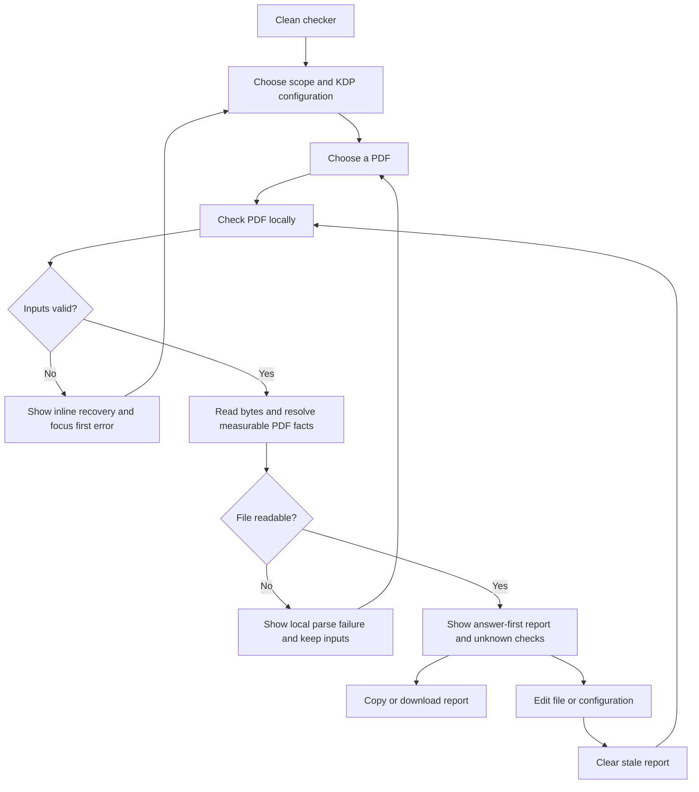

# Implementation report: KDP PDF preflight checker

Status: ready
Tool: KDP PDF preflight checker
Route: `/kdp-pdf-preflight-checker`
Depends on: `competitive-report.md`
Contract type: resolution

## Product decision

- Primary user: A self-publishing author or formatter with a finished KDP interior or paperback cover PDF and a warning they want to investigate before uploading it.
- Job: Check the selected file against one stated KDP book configuration and leave with measurable page facts, possible issues, and the exact page or property that needs attention.
- Product thesis: The checker earns preference by connecting one configuration to page-level actual-versus-expected measurements, while making unknown checks visible instead of presenting a broad acceptance verdict.
- Evidence: The competitive report's search intent, user pain evidence, formula disagreements, and evidence-backed opportunities sections show repeated confusion around generic bleed messages, mixed page sizes, page-count-dependent covers, and unsupported acceptance claims. The KDP and Adobe sources in its technical truth table define the measurable boundaries.

## Scope

### Table stakes

- Accept one user-selected PDF through a native file input and process its bytes in the browser.
- Let the user choose an interior check or a paperback cover check, then state the KDP binding, trim, bleed, interior, paper, and book page-count assumptions needed for that check.
- Count pages, read page dimensions, identify mixed-size outliers, and compare actual dimensions with expected dimensions.
- Inspect MediaBox, CropBox, TrimBox, and BleedBox values, including inherited and defaulted values where they can be resolved.
- Report embedded-font states, measurable image resolution, empty-looking or malformed pages, encryption, missing EOF markers, and the KDP file-size boundary only when the PDF exposes enough data.
- Use `possible issue`, `measured`, `not declared`, `not measured`, and `unknown` language. Never say that a file is accepted or guaranteed to pass KDP review.
- Provide a deterministic report that the user can copy or download without sending the PDF to a server.

### Launch differentiators

- One configuration drives the interior geometry, page-limit check, and paperback cover spine calculation instead of splitting those jobs across separate calculators.
- Issue rows identify the page number, actual value, expected value, and the rule or measurement that produced the finding.
- The report distinguishes a missing optional PDF box from a broken required box and distinguishes an unmeasurable image from a confirmed low-resolution image.
- The result shows the KDP rule date and direct source links beside the measured report boundary.

### Deferred

- Hardcover cover-file geometry and spine comparison. The reviewed KDP hardcover cover guidance documents wrap and safe-area offsets but does not publish a closed total-width and spine formula.
- Text and image safe-area or gutter verdicts based on object bounds.
- Automatic repair, rasterization, cover-template generation, or PDF export.
- PDF/X, color-space, output-intent, barcode, OCR, licensing, transparency, and hidden-object claims that the local parser cannot prove.
- Preview rendering, 3D mockups, page thumbnails, and server-side batch checking.

### Non-goals

- The tool must not upload, store, or inspect a user's PDF outside the current browser session.
- The tool must not promise KDP acceptance, replace KDP Print Previewer, or reproduce manual review.
- The tool must not infer a commercial font license or call a PDF safe because its page rectangle is correct.
- The tool must not silently round a supplied cover page count, invent a hardcover cover formula, or treat an unavailable measurement as a pass.
- The tool must not add email capture, sign-in, AI rewriting, cross-sells, or a generic KDP tool hub around the workbench.

## Formula and data contract

### Inputs and normalization

| Input | Type and unit | Default | Valid range | Normalization |
| --- | --- | --- | --- | --- |
| PDF file | Browser `File`, bytes | None | Required, PDF header, at most 650 MB | Read as `Uint8Array`; use the byte signature rather than the filename extension; keep only the filename for the local report. |
| Check scope | Enum: `interior` or `paperback-cover` | `interior` | Two supported values | A scope change clears the stale result and reveals only the fields used by that scope. |
| Binding | Enum: `paperback` or `hardcover` | `paperback` | Both for interiors; paperback only for cover scope | Filter trim, interior, paper, and page-limit options through the shared KDP specification table. |
| Trim size | Shared KDP trim ID | `6x9` | Presets supported by the selected binding | Store the canonical trim ID and derive width and height in inches from `lib/kdp/specs.ts`. |
| Interior | Enum: `black-white`, `standard-color`, or `premium-color` | `black-white` | Only combinations in the KDP table | Filter out unsupported hardcover standard color and non-white color-paper combinations. |
| Paper | Enum: `white`, `cream`, or `groundwood` | `white` | Only combinations in the KDP table | Filter by binding and interior; do not accept a value that has no source-backed page limit or spine coefficient. |
| Interior bleed | Boolean | `false` | Only for interior scope | Interpret `true` as the asymmetric KDP interior bleed rule. Cover scope always uses the paperback cover formula and does not expose this toggle. |
| Book page count | Integer pages | None for interior, `300` for paperback cover | Even integer within the selected paperback configuration range for cover scope | Do not silently round. For a cover, require the final even book count that should drive the spine. For an interior, derive the actual PDF page count and report whether it is odd or outside the selected KDP range. |
| Display values | Fixed inches, millimeters, and points | All three in the report | No user input | Keep inches as the comparison unit, derive millimeters with `inches * 25.4`, and derive points with `inches * 72`. |

The UI must not offer a hardcover cover option in v1. A hardcover interior remains supported because its trim and page-limit rules are documented independently of the unresolved cover geometry.

The parser reads untrusted bytes without rendering, executing, or embedding the PDF. It resolves direct and indirect page dictionaries, page-tree inheritance, box arrays, font dictionaries, image dictionaries, and readable content streams. A field whose reference, compressed data, or transform cannot be resolved becomes `unknown`; it never becomes a positive pass by fallback.

### Equations or resolution order

1. Guard the file before parsing. Reject an empty file, a file without a `%PDF-` header, and a file over the 650 MB KDP limit as blocking input errors. Treat a missing `%%EOF` marker as a possible file issue if the page tree can still be read.
2. Resolve the page tree and preserve source order. A document with no usable page objects is an invalid PDF and produces no result. A page with a broken non-critical reference stays in the report with the affected property marked `unknown`.
3. Resolve each page's `MediaBox`, `CropBox`, `TrimBox`, and `BleedBox` through page-tree inheritance. `MediaBox` is required. `CropBox` defaults to `MediaBox` when absent. `TrimBox` and `BleedBox` are optional and default to the effective `CropBox` in PDF semantics, while the report separately records whether each value was declared, inherited, defaulted, or unreadable.
4. Convert a usable box `[x0, y0, x1, y1]` to `widthPoints = x1 - x0`, `heightPoints = y1 - y0`, `widthInches = widthPoints / 72`, and `heightInches = heightPoints / 72`. Reject a box with non-finite values or non-positive width or height as malformed for that page.
5. For an interior, derive the expected MediaBox from the selected trim: `expectedWidth = trimWidth` and `expectedHeight = trimHeight` when bleed is off; `expectedWidth = trimWidth + 0.125 in` and `expectedHeight = trimHeight + 0.25 in` when bleed is on. Compare the effective MediaBox to those values. Use the source MediaBox for the expected-size comparison, not a CropBox or an optional TrimBox.
6. For a paperback cover, require one PDF page and a valid final even book page count. Resolve `spine = bookPageCount * coefficient`, where the coefficient is selected by the shared KDP table: black-and-white white and standard color white `0.002252 in/page`, black-and-white cream `0.0025 in/page`, groundwood `0.00235 in/page`, and premium color white `0.002347 in/page`. Then derive `expectedCoverWidth = 2 * trimWidth + spine + 0.25 in` and `expectedCoverHeight = trimHeight + 0.25 in`. The `0.25 in` additions represent two `0.125 in` side or vertical bleeds in the full cover file.

The cover-specific KDP page is the controlling source for the standard-versus-premium color split. The broader paperback submission page's generic color-paper row is retained as source context, but is not used to override the cover-specific standard-color rule.
7. For a paperback cover, derive an observed spine only when the cover MediaBox is usable: `observedSpine = actualCoverWidth - 2 * trimWidth - 0.25 in`. Compare it with the expected spine and report the difference as a possible issue when it exceeds the product tolerance.
8. Count the actual pages. For interior scope, compare that count with the selected KDP page-limit range and report an out-of-range count as a possible issue. Report an odd count as a possible parity issue because KDP rounds paperback page counts up to an even number. For cover scope, compare the cover file count with one and use the supplied book count only for the spine calculation.
9. Compare page dimensions with a product tolerance of `0.02 in` in each axis. This is stack127's documented comparison tolerance, not an official KDP tolerance. Preserve the unrounded source value for the difference and round only displayed inches to four decimals, millimeters to two decimals, and points to two decimals.
10. Scan all pages for mixed dimensions. The first usable page establishes the dominant size; any later page outside the same tolerance is an outlier and receives its page number, actual size, and expected or dominant size. Do not collapse outliers into one global warning.
11. Resolve font objects and their font descriptors. Mark a font `embedded` only when a readable `FontFile`, `FontFile2`, or `FontFile3` reference is present; mark it `not embedded` when a readable font object has no embedding reference; mark it `unknown` when the font or descriptor cannot be resolved. A font result never proves licensing.
12. Resolve image pixel dimensions and placement transforms only when both are available. For an image with pixel width `Pw`, pixel height `Ph`, placed width `Wp` points, and placed height `Hp` points, calculate `dpiX = Pw / (Wp / 72)`, `dpiY = Ph / (Hp / 72)`, and `effectiveDpi = min(dpiX, dpiY)`. Report a possible issue below 300 DPI, an advisory above 600 DPI, and `unknown` when a transform or image dimension cannot be measured. Do not claim page-wide DPI from an image that cannot be mapped to a placement.
13. Mark a page `appears empty` only when the page has no readable content stream or all readable streams contain no measurable drawing or text operators. A page with unreadable, compressed, invisible, or hidden content is `unknown`, not empty. A malformed page reports the failed property and keeps unrelated page facts.
14. Sort findings by blocking file or configuration errors, page geometry, mixed sizes and count, page boxes, fonts, images, and page-content uncertainty. Within a group, sort by page number and stable finding code so copied reports are deterministic.

### Rounding, display, and versioning

- The engine keeps source values in points or full-precision inches until comparison. Formatting never feeds a rounded value back into a formula.
- Every dimension row shows the actual value and expected value in inches. Millimeters and points are secondary values in the same row, not alternate calculations.
- The report uses `measured` for a value read from the file, `possible issue` for a product rule or threshold that the value may violate, `not declared` for an absent optional box, `not measured` when the parser has no supported measurement, and `unknown` when the file cannot provide a reliable answer.
- The deterministic engine version is `kdp-pdf-preflight-1.0.0`; the KDP ruleset date is `2026-09-16`. Store both in copied and downloaded reports. No file bytes, PDF text, or user-entered metadata enter the URL or an analytics event.
- No shared URL state is supported because a local `File` cannot be restored safely from a URL. The clean route stays unchanged after hydration.

### Invalid, unknown, absent, and partial states

- Blocking input errors show no result: no file, non-PDF bytes, a file over 650 MB, unsupported binding or paper combination, invalid trim configuration, or an invalid paperback cover book page count.
- A structurally unreadable PDF shows no result and names the recovery action: choose another PDF. It must not leave a previous report visible.
- A parseable file with a missing EOF marker, encryption flag, unresolved page property, unreadable font descriptor, or unmeasurable image produces a partial report. The report includes measured facts and an explicit unknown row.
- Missing optional TrimBox or BleedBox declarations are informational. They do not become automatic KDP failures. A missing or malformed MediaBox is a page-level possible issue; if no usable page exists, the document is invalid.
- A valid report may contain possible issues. It must not use a success label that implies KDP acceptance. A clean result says `No measurable issues found` and retains the review-boundary note.
- Any new file or configuration edit clears the old report and announces that the inputs changed. A failed retry keeps the selected file and configuration so the user can replace only what is wrong.

### Assumptions and exclusions

- The checker targets KDP paperback and hardcover interior PDFs and paperback cover PDFs. It does not validate KDP's manual review, Print Previewer rendering, commercial font rights, live ink bounds, safe margins, gutter placement, color management, or barcode placement.
- KDP's 300 DPI requirement, 650 MB file boundary, page limits, interior bleed geometry, and paperback cover coefficients are treated as source-backed rules checked on 2026-09-16. The source pages may change, so the ruleset date must remain visible.
- PDF box semantics follow Adobe PDF Reference 1.7. KDP does not require an explicit TrimBox or BleedBox in the reviewed sources, so absence is not a failure.
- The local parser is intentionally conservative. It may return `unknown` for compressed or unsupported structures rather than guessing from a filename, page count, or rendered screenshot.
- The tool uses no upstream request, cache, rate limit, or server fallback. There is no upstream failure state; a worker or parser failure is a local retry state.

### Primary sources

- Amazon KDP, [Paperback Submission Guidelines](https://kdp.amazon.com/en_US/help/topic/G201857950), checked 2026-09-16. Supports file size, page counts, dimensions, bleed, fonts, images, blank pages, and supported configurations.
- Amazon KDP, [Set Trim Size, Bleed, and Margins](https://kdp.amazon.com/en_US/help/topic/GVBQ3CMEQW3W2VL6), checked 2026-09-16. Supports the asymmetric interior bleed formula and page geometry.
- Amazon KDP, [Create a Paperback Cover](https://kdp.amazon.com/en_US/help/topic/G201953020), checked 2026-09-16. Supports the paperback cover formula, spine coefficients, and cover-file structure.
- Amazon KDP, [Fix Paperback and Hardcover Formatting Issues](https://kdp.amazon.com/en_US/help/topic/G201834260), checked 2026-09-16. Supports the review boundary, font and image requirements, blank-page guidance, and formatting warnings.
- Amazon KDP, [Create a Hardcover Cover](https://kdp.amazon.com/en_US/help/topic/GDTKFJPNQCBTMRV6), checked 2026-09-16. Supports the deferred hardcover-cover decision because it documents offsets and safe areas without a closed total formula in the reviewed page.
- Adobe, [PDF Reference 1.7](https://opensource.adobe.com/dc-acrobat-sdk-docs/pdfstandards/pdfreference1.7old.pdf), checked 2026-09-16. Supports MediaBox, CropBox, TrimBox, BleedBox, defaults, and inheritance.

## User flow



The check runs only after one explicit action. Selecting a file does not read or parse it until the user submits the form. A repeat check uses the current file and configuration. Reset returns to the default interior configuration, clears the file and result, and focuses the file control. A clean URL never serializes a file, filename, configuration, or result.

## Interface wireframes

### Desktop: clean

```text
┌──────────────────────────────────────────────────────────────────────────────┐
│ KDP PDF preflight checker                                                     │
│                                                                              │
│ Check scope  ( Interior )  ( Paperback cover )        PDF file [Choose file] │
│ Binding [Paperback]  Trim [6 × 9 in]  Bleed [No]  Interior [Black and white] │
│ Paper [White]       Book page count [             ]                         │
│                                                                              │
│ [Check PDF]  [Reset]                                                        │
│ The file stays in this browser. This report cannot guarantee KDP acceptance. │
└──────────────────────────────────────────────────────────────────────────────┘
```

### Desktop: result

```text
┌──────────────────────────────────────────────────────────────────────────────┐
│ Possible issues found                                                        │
│ interior.pdf · 302 pages · Interior · 6 × 9 in · bleed on                    │
│ [Copy report] [Download report]                                              │
│                                                                              │
│ Possible issues                                                            3 │
│ page 12  MediaBox 6.0000 × 9.0000 in, expected 6.1250 × 9.2500 in           │
│ page 12  Font embedding could not be measured                               │
│ file     The PDF has no EOF marker in its final bytes                       │
│                                                                              │
│ Page geometry                                                               │
│ Page       Actual MediaBox       Expected       Difference       Status       │
│ 1          6.1250 × 9.2500 in    6.1250 × 9.2500 in  0.0000      Measured     │
│ 12         6.0000 × 9.0000 in    6.1250 × 9.2500 in  -0.125/-0.25 Possible    │
│                                                                              │
│ Page boxes, fonts, images, empty-page checks                                │
│ [measured / not declared / not measured / unknown rows]                     │
│                                                                              │
│ KDP rules checked 2026-09-16. KDP review can find issues this tool cannot.   │
└──────────────────────────────────────────────────────────────────────────────┘
```

### Narrow mobile

```text
┌──────────────────────────────┐
│ KDP PDF preflight checker    │
│                              │
│ Check scope                  │
│ ( Interior )                │
│ ( Paperback cover )         │
│ PDF file                    │
│ [Choose file]               │
│ Binding [Paperback]        │
│ Trim [6 × 9 in]             │
│ Bleed [No]                  │
│ Interior [Black and white]  │
│ Paper [White]               │
│                              │
│ [Check PDF]                 │
│ [Reset]                     │
│                              │
│ Possible issues found       │
│ [Copy report]               │
│ [Download report]           │
│                              │
│ Page geometry               │
│ Page 12                     │
│ Actual 6.0000 × 9.0000 in  │
│ Expected 6.1250 × 9.2500 in│
│ Possible issue              │
└──────────────────────────────┘
```

### Error, loading, partial, and restored states

```text
Invalid configuration
PDF file: [Choose file]
Book page count: [23]  Error: enter an even count in the selected KDP range.
[Check PDF]
No previous report remains visible.

Checking locally
PDF file: paperback-cover.pdf
[Checking PDF...]  [Reset]
Status: Checking the PDF in this browser.
The action stays disabled against duplicate submissions.

Partial report
Some properties are unknown.
Measured: 302 pages, page boxes, dimensions.
Unknown: image placement transform, font descriptor for page 88.
[Show unknown checks]

Restored or shared state
The route opens clean with no query string.
The file and result are never restored from a URL or browser storage.
Choose the PDF again, then run the check.
```

Focus moves to the first invalid field after submit. During parsing, focus stays on the busy action and a polite live region announces the local check. On completion, focus moves to the result lead. Blocking failures use an alert with the next action. Result edits clear stale output, and copy or download never changes the report.

## Interaction contract

| Event | UI response | Result state | Focus/announcement | URL/persistence |
| --- | --- | --- | --- | --- |
| Scope or configuration changes | Reveal the relevant fields and clear the old report | Initial or stale-input state | Announce `Inputs changed. Check again.` | No URL or storage write |
| File selection | Show filename and size without parsing | Ready to check | Keep focus on the file control | Bytes stay in memory only |
| Submit with missing or invalid input | Show one field-level message per blocking issue | No result | Focus the first invalid control and announce the recovery | No URL or storage write |
| Valid submit | Keep controls, disable duplicate action, and begin local analysis | Loading | Announce `Checking PDF locally.` | No request, cache, or URL change |
| Parse success with findings | Show the lead, issue rows, measurements, and unknown states | Valid or partial result | Focus the result lead and announce the lead text | Result remains in memory only |
| Parse failure | Keep file and configuration, show a replacement or retry action | Failure with no stale result | Focus the failure message | No request, cache, or URL change |
| Copy report | Copy deterministic plain text after explicit activation | Result unchanged | Announce success or copy failure | Clipboard write only, never clipboard read |
| Download report | Create a local text download with the engine and ruleset version | Result unchanged | Announce download start | No server request |
| Reset | Clear file, result, findings, and status; restore defaults | Clean state | Focus the file control and announce reset | No URL or storage write |

## Page composition

| Claim or task | Medium | Position | Why this medium |
| --- | --- | --- | --- |
| Choose the file and state the KDP assumption | Tool UI | First region of the workbench | The user must see the file and the configuration that gives the measurements meaning. |
| Whether the file needs attention | Tool UI | First line of the result | One answer-first lead is faster to scan than a dashboard of equal metrics, while `possible issue` avoids a false guarantee. |
| Which page or property differs | Table | Immediately after the lead | Repeated page, actual, expected, difference, and status fields are easier to compare in rows. |
| How the expected dimensions were derived | Exact result visualization | Beside or directly below the geometry table | A compact back, spine, and front relationship is useful for paperback covers; it carries exact values through the table rather than marker art. |
| What the PDF exposes about boxes, fonts, images, and empty pages | Table | After the main geometry and issue list | These are repeated diagnostics with different measurable states, so a table preserves the distinction between unknown and pass. |
| What the tool cannot decide | Sentence | Near the source and ruleset line | The manual-review and licensing boundary needs connected explanation, not a badge or a large warning panel. |
| Copying or downloading the measured receipt | Tool UI | Beside the result lead | The action is useful after the answer is visible and does not compete with the primary check. |

No marker art, clean chart, or screenshot is planned for v1. Exact PDF facts belong in the result tables; a decorative page diagram would make the measured relationship less clear.

## Technical plan

### Architecture and file ownership

- `app/(site)/(tools)/kdp-pdf-preflight-checker/page.tsx` owns the server-rendered route shell, loads `getRequiredToolPage("kdp-pdf-preflight-checker")`, and renders `ToolPageHeader`, the client workbench, and `ToolPageMarkdown`. It owns no metadata, canonical, robots, sitemap, JSON-LD, or live supporting prose.
- `app/(site)/(tools)/kdp-pdf-preflight-checker/kdp-pdf-preflight-checker.tsx` owns the smallest client island: file selection, configuration state, explicit submit, loading and recovery states, accessible result rendering, copy, and local download.
- `app/(site)/(tools)/_components/kdp-tool.module.css` supplies the existing KDP workbench layout. A route-owned CSS Module may add only preflight-specific file, diagnostic, and responsive rules if the shared stylesheet cannot express them.
- `lib/kdp/pdf-preflight.ts` owns the pure resolution engine, PDF byte parsing, box inheritance, geometry comparisons, issue ordering, image DPI derivation, deterministic report serialization, and engine version. It must not import React, browser globals, network clients, or UI strings that are not part of the resolution result.
- `lib/kdp/specs.ts` remains the single source for trim presets, supported binding and material combinations, page limits, paperback bleed, spine coefficients, and ruleset version. Do not duplicate those constants in the route.
- `tests/pages/kdp-pdf-preflight-checker/kdp-pdf-preflight-checker.test.mjs` owns pure fixtures for valid, mixed, malformed, encrypted, missing-box, image, font, empty-page, and cover-spine cases. `tests/pages/kdp-pdf-preflight-checker/page.test.mjs` and the route browser spec own unpublished route behavior, focus, local processing, result hierarchy, copy/download, and responsive states.
- `tests/pages/kdp-pdf-preflight-checker/page.json` owns route state, docs, tests, skills, and script references. The route remains unpublished and the manifest's `repositories` array stays empty.
- `content_docs/kdp-pdf-preflight-checker/` owns this implementation contract and the brief now. Later interface, edge-case, and writing plans must fingerprint this report rather than duplicate live copy.
- No page-specific script or database migration is part of this product-plan stage. No production registry row or publication change is authorized.

### Accessibility, privacy, security, and performance

- Use native file, select, radio, and button semantics with persistent labels. Keep the primary action singular and reachable by keyboard.
- Use one polite live region for status, one alert scope for blocking failures, and a focusable result lead. Keep diagnostic tables with real headers and page numbers.
- Process bytes locally. Do not call `fetch`, an API route, an external PDF service, `localStorage`, `sessionStorage`, analytics events containing file facts, or clipboard read APIs.
- Treat PDF bytes, filenames, dictionary strings, and report values as untrusted text. Do not use `dangerouslySetInnerHTML`, execute JavaScript embedded in a PDF, render an untrusted PDF in a frame, or expose raw PDF contents in errors.
- Enforce the 650 MB KDP boundary before parsing. Keep parsing deterministic and bounded. If implementation uses a worker for large files, the worker may own parsing but must return only the typed result and a retryable failure. The UI must remain responsive during the explicit check.
- Keep the workbench within the shared wide page canvas, avoid page-level horizontal overflow, and verify 320, 375, 760, and desktop widths in dark and light themes.

### Publication state

Unpublished. The route and its manifest may be built and tested locally, but no `public.stack127_pages` publication row or sitemap inclusion is part of this plan. The exact route should remain blocked from public rendering until a separate publication decision.

## Acceptance criteria

| ID | Observable acceptance criterion | Evidence at build time |
| --- | --- | --- |
| R1 | The workbench accepts a user-selected PDF and performs the check without a network request or upload. | Browser request log plus a pure-engine test that accepts bytes directly. |
| R2 | Scope, binding, trim, interior, paper, and bleed controls expose only source-backed combinations, and paperback cover scope requires a valid even book page count. | Unit tests for option filtering and invalid configurations; browser test for conditional fields. |
| R3 | Interior expected dimensions use trim size with no bleed, or plus `0.125 in` width and plus `0.25 in` height with bleed. | Resolution fixtures with 6 × 9 trim for both bleed states and exact expected values. |
| R4 | Paperback cover expected dimensions use the selected spine coefficient, `2 * trimWidth + spine + 0.25 in`, and `trimHeight + 0.25 in`. | Resolution fixtures for white, cream, groundwood, standard color, and premium color where supported. |
| R5 | The checker identifies page count, page-limit violations, odd interior counts, and a cover PDF that is not exactly one page. | Unit fixtures at minimum, maximum, odd, and out-of-range counts. |
| R6 | The report resolves and labels MediaBox, CropBox, TrimBox, and BleedBox values as declared, inherited, defaulted, malformed, or unknown. | Fixtures with page-tree inheritance, missing optional boxes, malformed arrays, and differing CropBox values. |
| R7 | The report compares every readable page, identifies mixed-size outliers, and shows page number, actual size, expected or dominant size, difference, and status. | A multi-page mixed-size fixture plus browser table assertions. |
| R8 | Font checks distinguish embedded, not embedded, and unknown, without claiming a commercial license verdict. | Fixtures with FontFile, no FontFile, and unresolved descriptor references. |
| R9 | Image checks calculate effective DPI only when pixel dimensions and placement transforms are available, flag below 300 DPI, and leave unsupported measurements unknown. | Fixtures for low, acceptable, high, and unmeasurable image placements. |
| R10 | Empty-looking, malformed, encrypted, EOF-missing, and oversized files use the documented blocking or partial state without leaking PDF contents. | Pure fixtures and a browser test for invalid-file recovery and retained inputs. |
| R11 | A clean result says `No measurable issues found`, and every issue uses possible-issue language without an acceptance guarantee. | Static copy assertion and result-state browser test. |
| R12 | A partial report keeps measured facts visible and names each unknown or not-measured check. | Fixture with compressed or unresolved image/font data and result assertions. |
| R13 | Any input edit clears stale output, submit shows a local loading state, duplicate submits are blocked, and parser failures offer retry or replacement. | Browser tests for edit, submit, failure, and retry transitions. |
| R14 | Copy and download produce deterministic reports containing the file name, scope, measured facts, findings, engine version, and ruleset date. | Unit serialization test and browser clipboard/download test. |
| R15 | Invalid submit focuses the first invalid control, completion focuses the result lead, statuses are announced, and tables have accessible headers. | Browser accessibility assertions at desktop and mobile widths. |
| R16 | The clean route remains unchanged after hydration, and no file, result, or configuration is stored in URL parameters or browser storage. | Browser URL and storage instrumentation test. |
| R17 | The workbench has one primary action, fits the shared page gutters, has no page-level horizontal overflow at 320, 375, 760, and desktop widths, and remains legible in dark and light themes. | Browser viewport and computed-layout checks. |
| R18 | The route is covered by an unpublished ownership manifest and remains excluded from public rendering and the sitemap. | Manifest inspection and unpublished SEO route test. |
| R19 | The report exposes the KDP ruleset date and direct source links, while the engine version changes when resolution behavior changes. | Pure result metadata assertion and source inventory review. |
| R20 | The implementation does not offer a hardcover cover formula, automatic repair, server processing, or unsupported acceptance claims. | Static source review and browser option/content assertions. |

## Open questions and blockers

- None for the v1 contract. Hardcover cover geometry is a deliberate deferred scope decision, not an implementation blocker.
- If a later parser cannot expose a property reliably, it must return `unknown` and update the edge-case and interface plans before widening the claim.
- A source review is required before changing the `2026-09-16` KDP ruleset or its coefficients. Publication remains a separate decision.
