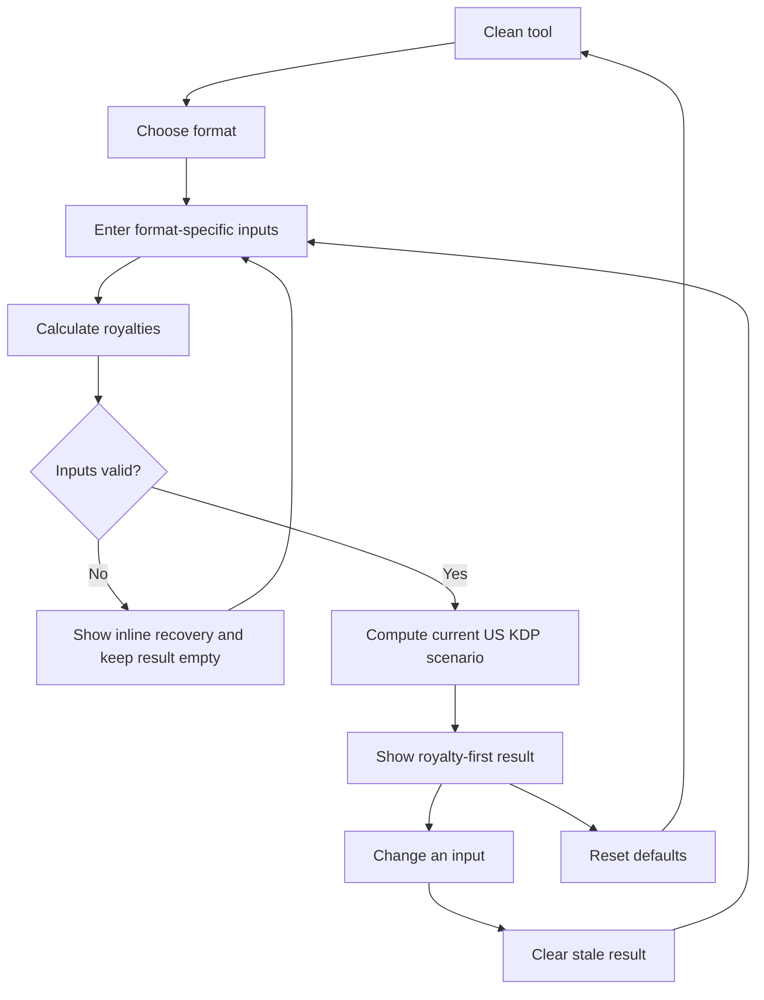

# Implementation report: KDP royalty calculator

Status: ready
Tool: KDP royalty calculator
Route: `/kdp-royalty-calculator`
Depends on: `competitive-report.md`
Contract type: formula

## Product decision

- Primary user: A self-publishing author choosing a US KDP list price for a print book or Kindle eBook.
- Job: Compare a list price with KDP costs and leave with royalty per sale, the minimum viable price, ad headroom, and the sales needed for a monthly target.
- Product thesis: The planner earns preference by showing the current rate band and a small cost receipt beside the answer, instead of returning one opaque royalty number.
- Evidence: `Search intent`, `User pain evidence`, `Technical truth to verify`, `Comparison matrix`, and `Formula and data disagreements` in `competitive-report.md`.

## Scope

### Table stakes

- Calculate paperback, hardcover, and Kindle eBook scenarios.
- Use current Amazon.com printing costs, royalty rates, price limits, and eBook delivery rules.
- Show printing cost or delivery cost, the selected-price royalty, the minimum allowed price, and the royalty margin.
- Show maximum break-even ad spend per sale, break-even ACoS, and optional copies for a monthly income target.
- Show a compact price comparison that exposes the print rate threshold or the eBook 70% band.
- Keep Expanded Distribution out of every result.

### Launch differentiators

- Use a dated US source contract and show the applicable rate beside the selected price.
- Keep the calculation receipt visible: fixed cost, page cost, delivery cost where applicable, rate, and royalty.
- Treat a selected eBook 70% option outside its price band as a 35% calculation with a clear warning, rather than silently applying 70%.
- Explain ad headroom as a break-even ceiling, not as a recommended advertising budget.
- Use a small comparison table with the exact price boundary rows that change the answer.

### Deferred

- Non-US marketplaces and currencies.
- VAT, GST, withholding tax, price matching, refunds, and promotional pricing.
- Expanded Distribution and other distribution channels.
- KDP API or live price scraping.
- Demand, sales, ranking, Kindle Unlimited, or advertising performance forecasts.
- Saved scenarios, shareable URL state, and account-linked book data.

### Non-goals

- The result is not a guarantee of the royalty Amazon will report for every order.
- The result is not net profit after editing, cover design, taxes, refunds, or ad spend.
- The result does not recommend a book price or predict how many books will sell.
- The result does not model a customer's discounted or price-matched sale price.

## Formula and data contract

### Inputs and normalization

The launch scope is Amazon.com, USD, and standard Amazon distribution. Marketplace and currency are fixed display facts, not user inputs.

| Input | Type and unit | Default | Valid range | Normalization |
| --- | --- | --- | --- | --- |
| `format` | enum | `paperback` | `paperback`, `hardcover`, `ebook` | Canonical string. Determines the remaining fields. |
| `trimSizeId` | enum, inches | `6x9` for print | Official US KDP trim IDs supported by the selected binding | No free-text dimensions. Derive regular or large trim class from the preset. |
| `printProfile` | enum | `bw-white` | `bw-white`, `bw-cream`, `groundwood`, `standard-color`, `premium-color` for paperbacks; `bw-white`, `bw-cream`, `premium-color` for hardcovers | Filter options by binding. `bw-white` and `bw-cream` share the black-ink cost branch. |
| `pageCount` | integer pages | `300` | The selected trim and profile's KDP page range | Round up to the next even page for `effectivePageCount`; reject if the normalized count is outside the KDP range. |
| `listPriceUsd` | decimal USD | `$14.99` print, `$4.99` eBook | Greater than `$0.00`; print maximum `$250.00`; eBook maximum `$200.00`; also above the calculated floor | Parse to integer cents. Do not use floating point values for money. |
| `ebookRoyaltyOption` | enum percent | `70` | `35` or `70`, eBook only | Apply 70% only inside the Amazon.com `$2.99` to `$12.99` band. Otherwise use 35% and return a warning. |
| `ebookFileSizeMb` | decimal MB | `1` | Greater than `0` and no more than `650` | Convert with `fileSizeKb = ceil(fileSizeMb * 1024)`. Only eBooks use this field. |
| `monthlyTargetUsd` | optional decimal USD | blank | Blank or `0` to `$1,000,000` | Parse to cents. Blank omits the unit target; zero returns zero copies. |

The print preset catalog is shared with the KDP setup work. Paperback IDs are `5x8`, `5.06x7.81`, `5.25x8`, `5.5x8.5`, `6x9`, `6.14x9.21`, `6.69x9.61`, `7x10`, `7.44x9.69`, `7.5x9.25`, `8x10`, `8.25x6`, `8.25x8.25`, `8.27x11.69`, `8.5x8.5`, and `8.5x11`. Hardcover IDs are `5.5x8.5`, `6x9`, `6.14x9.21`, `7x10`, and `8.25x11`. A trim is regular when it is no more than 6.12 inches wide and 9 inches high. A trim is large when either dimension is greater than that limit.

The page-limit table is part of the versioned data contract. For paperback trims from `5x8` through `8x10`, the maximums are 828 pages for black ink with white paper, 776 for cream, 812 for groundwood, 600 for standard color, and 828 for premium color. For `8.25x6` and `8.25x8.25`, the maximums are 800, 750, 784, 600, and 800. For `8.27x11.69`, the maximums are 780, 730, 764, standard color unavailable, and 590. For `8.5x8.5` and `8.5x11`, the maximums are 590, 550, 578, 600, and 590. All paperback profiles have a 24-page minimum except standard color, which has a 72-page minimum. Hardcover profiles use the supported trim IDs above and a 75 to 550 page range.

### Equations or resolution order

1. Resolve the binding, trim preset, print profile, and effective page count. `effectivePageCount = 2 * ceil(pageCount / 2)`. The input count and effective count remain available to the result so an odd count is not hidden.
2. Reject an unavailable print profile or any effective page count outside the selected trim's current KDP range. eBooks skip trim, profile, and page-cost steps.
3. Select the US Amazon.com printing branch. Parse list price and optional target amounts into integer cents. Compute each printing or delivery cost in cents, rounding the source cost expression to the nearest cent at that cost boundary; use those integer cents for royalty, floor, comparison-row, margin, and target calculations. Do not claim microdollar or unrounded-cost precision.
4. For a paperback, use `fixedCost + (effectivePageCount * perPageCost)` with these current US values:
   - Black ink with white or cream paper: regular trim is `$2.30` fixed through 110 pages, then `$1.00 + $0.012 * pages`; large trim is `$2.84` fixed through 110 pages, then `$1.00 + $0.017 * pages`. At the source table's overlapping 110-page label, the fixed-only note wins. The normalized even-page input makes the following branch begin at 112 pages.
   - Groundwood: regular trim is `$2.23` fixed through 112 pages, then `$1.00 + $0.0114 * pages`; large trim is `$2.75` fixed through 112 pages, then `$1.00 + $0.0162 * pages`.
   - Premium color: regular trim is `$3.60` fixed through 40 pages, then `$1.00 + $0.065 * pages`; large trim is `$4.20` fixed through 40 pages, then `$1.00 + $0.080 * pages`.
   - Standard color: regular trim is `$1.00 + $0.0255 * pages`; large trim is `$1.00 + $0.0402 * pages`.
5. For a hardcover, use `fixedCost + (effectivePageCount * perPageCost)` with these current US values:
   - Black ink with white or cream paper: regular trim is `$6.80` fixed through 108 pages, then `$5.65 + $0.012 * pages`; large trim is `$7.49` fixed through 108 pages, then `$5.65 + $0.017 * pages`.
   - Premium color: regular trim is `$5.65 + $0.065 * pages`; large trim is `$5.65 + $0.080 * pages`.
6. For print, select the royalty rate by list price. Prices at or below `$9.98` use 50%; prices at or above `$9.99` use 60%. Round the rate-times-list-price result to integer cents, then subtract the integer-cent printing cost: `printRoyaltyCents = round(rate * listPriceCents) - printingCostCents`.
7. For print, solve the minimum cost-covering price by band from the rounded integer-cent printing cost. Let `floor50 = ceil(printingCostCents / 0.50)`. If `floor50 <= $9.98`, use `floor50`. Otherwise let `floor60 = ceil(printingCostCents / 0.60)` and use `max($9.99, floor60)`. Reject the configuration if the floor is above `$250.00`.
8. For an eBook, round the file size up to the nearest kilobyte and calculate `deliveryCost = max($0.01, roundToCents(fileSizeKb * $0.15 / 1024))`. Delivery cost is zero for the 35% option.
9. For an eBook, the effective rate is 70% only when the selected option is 70% and the list price is from `$2.99` through `$12.99`, inclusive. Otherwise the effective rate is 35%. `ebookRoyalty = roundToCents(0.70 * (listPrice - deliveryCost))` for an eligible 70% sale, or `roundToCents(0.35 * listPrice)` for a 35% sale. VAT is zero in this US-only model.
10. For an eBook, the 35% floor is `$0.99` below 3 MB, `$1.99` from 3 MB through less than 10 MB, and `$2.99` at 10 MB or more. The 70% floor is `$2.99`. Validate the selected price against the floor and the applicable maximum before calculating.
11. For every valid selected price, calculate `royaltyMargin = royalty / listPrice`, `maxBreakEvenAdSpend = max(0, royalty)`, and `breakEvenAcos = royalty / listPrice` when royalty is positive. If royalty is zero or negative, report no positive ad headroom instead of a negative advertising budget.
12. If `monthlyTargetUsd` is present and royalty is positive, calculate `copiesForTarget = ceil(monthlyTargetCents / royaltyCents)`. If the target is blank, omit the value. If the target is positive and royalty is not positive, return `unknown` with the reason that no positive per-sale royalty exists.
13. Build the comparison rows from unique, valid prices in ascending order. Print rows use `[minimumPrice, selectedPrice, $9.98, $9.99]`. eBook rows use `[minimumPrice, selectedPrice, $2.99, $12.99]`. Each row recalculates the effective rate, cost or delivery, royalty, and margin at that price. Rows outside the format's valid price range are omitted, and duplicates are shown once.

### Rounding, display, and versioning

- Parse and display monetary inputs in integer cents. Compute and round each printing or delivery cost to integer cents, then use those cents for royalty, floor, comparison, margin, and target math. Use a ceiling to choose a price floor so the integer-cent floor covers the integer-cent printing cost; this contract has no precision below cents.
- Display USD with two decimal places, rates as whole percentages, margin and ACoS to one decimal place, and page counts as whole numbers. Show the entered page count and effective even page count when they differ.
- Recalculate each comparison row from integer-cent inputs and costs, with the same cent-rounding rules as the selected result. Use integer-cent royalty for monthly-copy division because KDP reports royalty money to cents in this model.
- Store the constants and formula contract under `formulaVersion: "kdp-us-amazon-com-2026-09-16-v1"`. Show `KDP US rules checked Sep 16, 2026` beside the source links.
- There is no URL state in v1, so there is no durable serialized-input contract. If shared URLs are added later, add `schemaVersion: 1` and include `formulaVersion` in the encoded state.

### Invalid, unknown, absent, and partial states

- Missing or malformed required input produces an inline field error and no result. The previous result is cleared as soon as an input changes, so stale economics never sit beside new inputs.
- An unavailable profile, unsupported trim, page count outside the selected KDP range, price below the calculated floor, or price above the applicable maximum blocks calculation. Show the allowed range and the field that needs correction.
- Selecting 70% for an eBook outside `$2.99` to `$12.99` is a warning, not a failed calculation. Calculate at 35% and state that the 70% option is not eligible at the selected price.
- A blank monthly target is normal and removes only the copies-for-target row. A zero target returns zero copies. A positive target with zero or negative royalty returns `unknown`, not infinity or a negative copy count.
- A zero or negative royalty shows no positive ad headroom and no ACoS percentage. Do not display a negative amount as spendable ad budget.
- Missing versioned constants or a data-contract mismatch fails closed with no result and a short source-data error. The client does not fetch pricing rules at runtime.
- Taxes, VAT, refunds, price matching, promotions, and actual marketplace discounts are unknown to this contract and stay outside the result rather than being estimated.

### Assumptions and exclusions

- The scenario represents an Amazon.com sale in USD through standard KDP distribution.
- Print royalty is list-price royalty minus KDP printing cost. It is not author profit.
- eBook VAT is modeled as zero. The 70% delivery rate is the current US `$0.15/MB` rule with KDP's nearest-kilobyte rounding and `$0.01` minimum.
- The monthly target assumes every unit sells at the selected price and earns the selected per-sale royalty. It is a unit-math result, not a sales forecast.
- The tool excludes Expanded Distribution even though Amazon documents a separate 40% formula.
- The current source table shows an overlapping paperback black-ink boundary at 110 pages. The source's fixed-only note takes precedence, and the boundary is covered by a dedicated regression test.

### Primary sources

- [KDP paperback printing costs](https://kdp.amazon.com/en_US/help/topic/G201834340), checked 2026-09-16. Fixed and per-page US paperback costs, regular and large trim definitions, and paperback price-floor formula.
- [KDP paperback royalties](https://kdp.amazon.com/en_US/help/topic/G201834330), checked 2026-09-16. 50% and 60% Amazon.com rate bands, royalty equation, and price limits.
- [KDP hardcover printing costs](https://kdp.amazon.com/en_US/help/topic/GHT976ZKSKUXBB6H), checked 2026-09-16. Hardcover fixed costs, per-page costs, page range, and price limits.
- [KDP hardcover royalties](https://kdp.amazon.com/en_US/help/topic/G77F3WPD3KQLJTFS), checked 2026-09-16. Hardcover royalty rate bands and royalty equation.
- [KDP eBook list price requirements](https://kdp.amazon.com/en_US/help/topic/G200634560), checked 2026-09-16. Amazon.com eBook price bands and file-size-dependent 35% floors.
- [KDP digital book pricing](https://kdp.amazon.com/en_US/help/topic/G200634500), checked 2026-09-16. 35% and 70% equations, US delivery rate, kilobyte rounding, and minimum delivery cost.
- [KDP paperback submission guidelines](https://kdp.amazon.com/en_US/help/topic/G201857950), checked 2026-09-16. US trim catalog, page-count limits, and even-page rounding used by the shared print preset data.

## User flow



The calculation is local and synchronous. The primary action is explicit so an author can finish the form before reading the answer. A new input clears the old result. A valid submission replaces the result and moves focus to its heading. An invalid submission keeps the user in the form, focuses the first invalid field, and announces the error summary. Reset restores format-specific defaults. There is no URL or browser-storage restoration in v1.

## Interface wireframes

### Desktop: clean

```text
┌──────────────────────────────────────────────────────────────────────────────┐
│ KDP royalty calculator                                      US Amazon.com USD │
├───────────────────────────────┬──────────────────────────────────────────────┤
│ SCENARIO                      │ RESULT                                       │
│ Format   [Paperback       v]  │ Choose a format and enter a price.           │
│ Trim     [6 x 9           v]  │ The answer appears here after calculation.   │
│ Interior [Black / white   v]  │                                              │
│ Pages    [300              ]  │                                              │
│ List price [$14.99         ]  │                                              │
│ Monthly target [optional   ]  │                                              │
│                               │                                              │
│            [Calculate royalties]                                            │
└───────────────────────────────┴──────────────────────────────────────────────┘
```

### Desktop: valid result

```text
┌──────────────────────────────────────────────────────────────────────────────┐
│ SCENARIO                       │ ROYALTY PER SALE                             │
│ Format [Paperback]             │ $4.39                                       │
│ Trim [6 x 9]  Pages [300]      │ 60% rate at $14.99                          │
│ Interior [Black / white]       │                                              │
│ Price [$14.99]                 │ COST RECEIPT                                │
│ Target [$1,000]                │ Printing cost        $4.60                 │
│ [Calculate royalties] [Reset]  │ Minimum price        $9.20                 │
│                                │ Royalty margin       29.3%                  │
│                                │                                              │
│                                │ PRICE COMPARISON                            │
│                                │ Price | Rate | Cost | Royalty | Margin      │
│                                │ ... rows at floor, threshold, and choice   │
│                                │                                              │
│                                │ AD HEADROOM       MONTHLY TARGET             │
│                                │ $4.39 per sale    228 copies                │
│                                │ Break-even ACoS 29.3%                      │
│                                │                                              │
│                                │ KDP US rules checked Sep 16, 2026          │
└──────────────────────────────────────────────────────────────────────────────┘
```

### Narrow mobile

```text
┌─────────────────────────────┐
│ KDP royalty calculator      │
│ US Amazon.com · USD         │
├─────────────────────────────┤
│ Format [Paperback       v]  │
│ Trim   [6 x 9           v]  │
│ Interior [Black / white v]  │
│ Pages  [300              ]  │
│ Price  [$14.99           ]  │
│ Target [optional        ]  │
│ [ Calculate royalties ]      │
├─────────────────────────────┤
│ ROYALTY PER SALE            │
│ $4.39                       │
│ 60% rate at $14.99          │
│                             │
│ Cost receipt                │
│ Printing cost  $4.60        │
│ Minimum price  $9.20        │
│                             │
│ Price comparison            │
│ [horizontal table scroll]   │
│                             │
│ Ad headroom and target      │
│ Source and assumptions      │
└─────────────────────────────┘
```

### Error, loading, partial, and restored states

```text
Error:   Price      [ $5.00 ]  Price must be at least $9.20.
         [Calculate royalties]  Result is removed. Focus goes to Price.

Loading: [Calculating royalties...]  No stale result is shown during submit.

Partial: eBook at $14.99 with 70% selected.
         Result uses 35% and says the 70% band ends at $12.99.
         A blank target omits the copies row.

Restored: v1 has no URL or storage state. Refresh starts with defaults.
```

## Interaction contract

| Event | UI response | Result state | Focus/announcement | URL/persistence |
| --- | --- | --- | --- | --- |
| Change format | Show only relevant fields and reset incompatible values | Clear result | Announce the new scenario fields without moving focus | No persistence |
| Edit any input after a result | Clear field-level error and mark the scenario uncalculated | Remove stale result | Keep focus in the edited field | No persistence |
| Submit valid form | Run the pure engine and render the answer hierarchy | Replace with valid result or a non-fatal rate warning | Move focus to the result heading and announce the selected royalty | No persistence |
| Submit invalid form | Show concise field errors and allowed ranges | Keep result empty | Focus the first invalid field and announce the error summary | No persistence |
| Choose 70% eBook outside its band | Keep the input, use the 35% fallback, and show the reason beside the result | Valid with warning | Announce the fallback once | No persistence |
| Enter a positive monthly target with non-positive royalty | Keep cost result and show target copies as unknown | Valid with limitation | Announce that no positive royalty exists for the target math | No persistence |
| Reset | Restore format, trim, profile, page, price, file-size, and target defaults | Clear errors and result | Focus the format control and announce defaults restored | No persistence |

## Page composition

| Claim or task | Medium | Position | Why this medium |
| --- | --- | --- | --- |
| Enter one KDP pricing scenario | Tool UI | First surface in the workbench | The author must set the scenario before any number has meaning. |
| What remains per sale | Tool UI result lead | First result region | A single money answer is the primary decision. |
| What KDP deducted | Tool UI cost receipt | Directly below the lead | Fixed cost, page cost, and delivery cost are exact repeated fields. |
| Which prices change the answer | Tool UI comparison table | Below the cost receipt | Repeated price, rate, cost, royalty, and margin values belong in a table. |
| What can be spent on ads and how many copies meet a target | Tool UI economics block | After the comparison | These are derived decisions from the selected royalty, not separate calculators. |
| Why the result has limits | Sentence with source links | Result footer and later supporting content | Taxes, price matching, and sales demand need connected explanation, not another number. |
| KDP rate changes and source date | Sentence with source links | Beside the result footer | The date and primary source make rate-sensitive output reviewable. |

No marker art or clean chart is planned. The exact relationship is clearer in the result lead, receipt, and comparison table.

## Technical plan

### Architecture and file ownership

- `app/(site)/(tools)/kdp-royalty-calculator/page.tsx` will remain a thin server route. It will load the central tool row with `getRequiredToolPage`, render the shared shell, and keep metadata, canonical, robots, sitemap, and JSON-LD out of the route.
- `app/(site)/(tools)/kdp-royalty-calculator/kdp-royalty-calculator.tsx` will be the smallest client island. It owns form state, conditional fields, validation messages, submit and reset behavior, focus, and the result announcement.
- `app/(site)/(tools)/kdp-royalty-calculator/kdp-royalty-calculator.module.css` will own the workbench layout and responsive states. It will use shared tokens and avoid global CSS changes, gradients, shadows, and nested dashboard cards.
- `lib/kdp/specs.ts` will own the shared US KDP trim and page-limit catalog. `lib/kdp/royalty.ts` will own the pure input types, versioned cost tables, normalization, validation, formulas, comparison rows, and typed result states.
- `tests/pages/kdp-royalty-calculator/kdp-royalty-calculator.test.mjs` will cover the pure engine and boundary fixtures. `tests/pages/kdp-royalty-calculator/page.test.mjs` and `tests/pages/kdp-royalty-calculator/kdp-royalty-calculator.spec.ts` will cover route ownership, the rendered workbench, accessibility, responsive layout, and invalid-result behavior.
- `tests/pages/kdp-royalty-calculator/page.json` will own this route's docs, tests, skills, and publication state. The future implementation will keep `content_docs/kdp-royalty-calculator/` as the planning and content ownership directory.
- No page-specific script or external pricing dependency is needed at launch. A future data refresh must update the source date, formula version, cost-table tests, and supporting record together.

### Accessibility, privacy, security, and performance

- Use explicit labels, fieldsets for format-dependent choices, keyboard-reachable controls, visible focus, an error summary, and a polite live result region. Never rely on color alone for warnings or negative economics.
- Keep the comparison table semantic and horizontally scrollable on narrow screens without hiding its headings. Use the same order in the DOM as the mobile reading order.
- Perform all calculations in the browser. Do not send prices, page counts, file sizes, or target income to a server. Do not add analytics events for input values.
- Parse numeric input as bounded values before passing it to the engine. The engine must return typed validation errors rather than throwing on user input.
- Ship no new runtime dependency for the formula. The scenario calculation should complete synchronously and stay below 50 ms for one submission on a mid-range device.

### Publication state

Unpublished. This plan does not add a route, database row, production registry entry, sitemap entry, or publication state. The eventual route must remain a 404 outside a deliberate local preview until `public.stack127_pages` and `public.stack127_tool_pages` are reviewed and updated through the normal workflow.

## Acceptance criteria

| ID | Observable acceptance criterion | Evidence at build time |
| --- | --- | --- |
| R1 | The tool states Amazon.com and USD as fixed scope and never offers a marketplace selector. | Unit fixture and rendered UI test |
| R2 | Format selection exposes only compatible print or eBook fields and resets incompatible values. | Browser test |
| R3 | The canonical US paperback and hardcover trim catalogs resolve to the correct regular or large class and page limits. | Unit table fixtures |
| R4 | An odd print page count is rounded up to an even effective count, shown to the user, and rejected when that count exceeds the selected KDP maximum. | Unit boundary fixtures |
| R5 | Paperback printing costs match every current US branch, including short black ink, groundwood, standard color, premium color, regular trim, and large trim. | Unit fixture matrix |
| R6 | Hardcover printing costs match the current US black ink and premium color branches, including 108/110-page and regular/large boundaries. | Unit fixture matrix |
| R7 | Print royalty uses 50% at `$9.98` and 60% at `$9.99`, with the rate visible in the result and comparison rows. | Unit threshold fixtures and Browser assertion |
| R8 | Print minimum price uses the correct piecewise band algorithm and never displays a price below the cost-covering floor. | Unit floor fixtures around both rate bands |
| R9 | eBook delivery rounds the file size up to kilobytes, uses `$0.15/MB`, applies the `$0.01` minimum, and affects only the 70% equation. | Unit delivery fixtures |
| R10 | eBook 70% applies only from `$2.99` through `$12.99`; an out-of-band selection falls back to 35% with a warning and no false 70% result. | Unit band fixtures and Browser assertion |
| R11 | eBook 35% minimum price follows the `<3 MB`, `3 to <10 MB`, and `>=10 MB` file-size bands, with the applicable maximum enforced. | Unit price-floor fixtures |
| R12 | Invalid fields, unsupported combinations, page limits, and price limits clear the result and focus the first recovery point. | Browser validation test |
| R13 | A valid result leads with royalty per sale, then shows cost or delivery, minimum price, selected rate, and royalty margin. | Browser result-order test |
| R14 | The comparison table contains unique valid rows for the format's minimum, selected price, and rate-boundary prices, with recalculated rate, cost, royalty, and margin. | Unit output fixture and Browser table test |
| R15 | Positive royalty shows maximum break-even ad spend equal to royalty per sale and break-even ACoS equal to royalty divided by list price. | Unit economics fixtures |
| R16 | A positive monthly target returns ceiling copies from rounded royalty cents; blank target omits the row, zero returns zero, and non-positive royalty returns unknown. | Unit economics fixtures and Browser test |
| R17 | Money uses two decimals, rates use whole percentages, margins and ACoS use one decimal place, and the result shows the formula version and source date. | Static and Browser assertions |
| R18 | Editing an input removes the old result, valid resubmission focuses the result heading, and reset restores defaults. | Accessibility Browser test |
| R19 | The workbench stays one surface at desktop and stacks in the same logical order on narrow screens. The comparison table can scroll without page overflow. | Responsive Browser test at 320, 760, and desktop widths |
| R20 | No scenario input leaves the browser, enters storage, or creates analytics payload data. | Static source review |
| R21 | The route and registry remain unpublished until a separate publication decision. | Page manifest and SEO registry test |

## Open questions and blockers

- None. The next stage should turn this contract into the interface contract, then the exhaustive edge-case and test contract, without adding a second pricing model.
