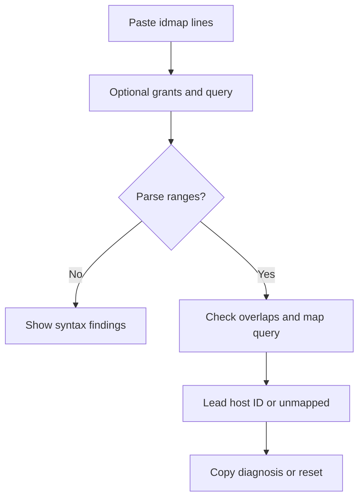

Status: ready
Tool: LXC ID mapping checker
Route: /lxc-idmap-checker
Contract type: resolution

## Product decision

Primary user: an operator fixing an unprivileged LXC mapping.

Job: verify map arithmetic and optional subordinate ID grants for one queried identity.

Product thesis: diagnosis of an existing map is more useful than another offset generator.

Evidence: Proxmox requests and existing generators show demand for mapping help but leave grant coverage manual.

## Scope

### Table stakes

Parse `u` and `g` `lxc.idmap` lines, validate ranges, map queried IDs, and optionally parse `/etc/subuid` or `/etc/subgid` style grants.

### Launch differentiators

Show container-to-host range arithmetic, gaps, overlaps, and a separate grant coverage result for UID and GID.

### Non-goals

Do not inspect a host, read live files, validate kernel namespace settings, or promise that a static pass grants filesystem access.

## Formula and data contract

### Inputs and normalization

Input is `{ uidMap, gidMap, grantOwner, uidGrants, gidGrants, queryType, queryId }`. Each map line is `u|g containerStart hostStart length`; comments and blank lines are ignored. UID and GID grants are separate `owner:start:length` lists. IDs use the usable unsigned 32-bit range through `4294967294`; lengths are positive and range endpoints must stay within that bound.

### Equations or resolution order

Parse and sort ranges by type. Reject container-side and host-side overlaps and report container gaps. A container ID maps when `containerStart <= id < containerStart + length`; host ID is `hostStart + id - containerStart`. If grants are supplied for the selected type, one exact-owner grant must cover the complete matched host range. Syntax follows the LXC configuration reference: https://linuxcontainers.org/lxc/manpages/man5/lxc.container.conf.5.html

### Rounding, display, and versioning

All arithmetic is integer exact. Results include `resolutionVersion: lxc-idmap-v1` and display inclusive endpoints for ranges while retaining half-open math internally.

### Invalid, unknown, absent, and partial states

Malformed lines, zero lengths, negative or reserved IDs, endpoint overflow, container overlaps, host overlaps, and an empty grant owner when grants are present are invalid. Missing grants for the selected type leave coverage unknown. A valid map with a query outside all ranges is valid input with an unmapped result.

### Assumptions and exclusions

The checker does not infer default namespace maps. Grant owner matching is exact after trimming, and UID grants never satisfy a GID query or vice versa. It checks supplied arithmetic and delegation, not file ownership, ACLs, or container runtime state.

### Primary sources

LXC map syntax: https://linuxcontainers.org/lxc/manpages/man5/lxc.container.conf.5.html

Subordinate UID grants: https://man7.org/linux/man-pages/man5/subuid.5.html

## User flow



## Interface wireframes

```text
DESKTOP
[UID map textarea] [GID map textarea]
[Grant owner]
[UID grants] [GID grants]
[Query type + ID]
[Check mapping]
[UID 1000 -> host 101000]
[range table] [findings]
```

```text
MOBILE
[UID map]
[GID map]
[Grant owner]
[UID grants]
[GID grants]
[Query]
[Check mapping]
[lead result]
[range rows]
```

## Interaction contract

| Event | Result |
|---|---|
| Check mapping press | Parse ranges, resolve query, focus the lead result, and retain text |
| Any map edit | Mark the prior result stale until checking again |
| Reset press | Clear maps, grants, owner, and query and announce readiness |
| Copy diagnosis press | Copy ranges and findings with a short status |

## Page composition

| Claim | Medium | Detail |
|---|---|---|
| What host ID is visible | Tool UI | Lead query mapping |
| Whether ranges are safe | Tool UI | Range table and findings |
| Why access can still fail | Sentences | Grant and runtime caveat below |
| UID versus GID difference | Table | Separate map rows |

## Technical plan

The route and client workbench live under `app/(site)/(tools)/lxc-idmap-checker/`. Pure parsing and arithmetic live in `lib/lxc-idmap-checker/engine.ts`. Unit, page contract, and Playwright tests live in `tests/pages/lxc-idmap-checker/`. Supporting content lives in `content_docs/lxc-idmap-checker/`; no host access is included, and the registry migration keeps the route unpublished.

## Acceptance criteria

| ID | Requirement | Evidence |
|---|---|---|
| R1 | UID and GID ranges map queried IDs with exact integer arithmetic | Engine fixtures |
| R2 | Overlaps, gaps, and malformed lines are reported | Validation tests |
| R3 | Optional grants distinguish covered from unknown | Grant tests |
| R4 | Unmapped queries are clear and recoverable | Boundary test |
| R5 | Route uses shared shell and no host/network APIs | Page contract test |
