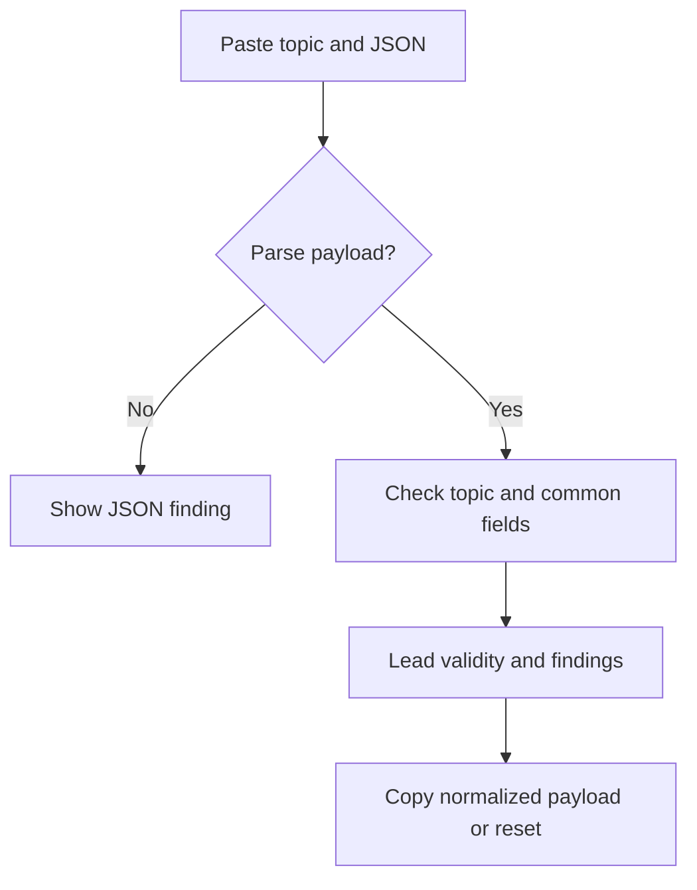

Status: ready
Tool: Home Assistant MQTT discovery checker
Route: /mqtt-discovery-checker
Contract type: resolution
Input fingerprint: `competitive-report.md sha256:bc5315672de2d9b070ef29c6cec1bb0eaefc9223bae7dcbb7fe267812fbeb516`

## Product decision

Primary user: a Home Assistant MQTT integration builder.

Job: find structural discovery errors before publishing a config message.

Product thesis: topic-aware findings beat a generic JSON validator for this task.

Evidence: Home Assistant docs and community threads show recurring topic, device, and schema confusion.

## Scope

### Table stakes

Parse JSON without silently losing large integers, validate the discovery topic shape and IDs, recognize stable component names, check common identity fields, and list findings with paths.

### Launch differentiators

Separate errors from warnings, show the normalized payload, and link each class of finding to the official MQTT integration documentation.

### Non-goals

Do not connect to MQTT, publish or subscribe, validate every component-specific field, or claim compatibility with every Home Assistant release.

## Formula and data contract

### Inputs and normalization

Input is `{ topic, payload, prefix }`. The prefix is one non-empty segment. Topic segments are slash-separated and must end in `config`; node and object IDs use letters, numbers, underscores, or hyphens. Payload must be a JSON object. Keys are preserved, while the displayed preview is stable two-space JSON.

### Equations or resolution order

Scan integer tokens before parsing, validate prefix and suffix, recognize the component segment, then apply common checks: object payload, `name` or `unique_id`, QoS, availability, and device identity. The checker accepts documented abbreviations such as `uniq_id`, `stat_t`, and `dev`. Sensor and binary sensor profiles require a state topic; button requires a command topic. Other recognized components return a partial warning because only common fields were checked. The profile follows the integration documentation: https://www.home-assistant.io/integrations/mqtt

### Rounding, display, and versioning

No numeric rounding is used. Findings include `profileVersion: mqtt-discovery-v1`, severity, code, path, and message. JSON preview preserves numbers and booleans.

### Invalid, unknown, absent, and partial states

Malformed JSON, unsafe integers, empty or multi-segment prefixes, invalid topic IDs, missing config suffix, unsupported components, non-object roots, missing required profile topics, and invalid QoS values are invalid. Missing optional fields are warnings. Recognized components outside the checked profiles are partial rather than claimed valid.

### Assumptions and exclusions

The checker uses a stable common subset and does not infer broker ACLs, retained-message state, Home Assistant logs, or version-specific component schemas. It never stores input.

### Primary sources

MQTT integration and discovery: https://www.home-assistant.io/integrations/mqtt

Core discovery implementation: https://github.com/home-assistant/core/blob/dev/homeassistant/components/mqtt/discovery.py

## User flow



## Interface wireframes

```text
DESKTOP
[Discovery topic field]
[JSON payload textarea]
[Check discovery]
[Valid with 0 errors]
[finding table] [normalized JSON]
```

```text
MOBILE
[Topic]
[Payload]
[Check discovery]
[Valid / Invalid]
[findings]
[JSON preview]
```

## Interaction contract

| Event | Result |
|---|---|
| Check discovery press | Parse, resolve, focus the validity lead, and retain text |
| Topic or payload edit | Mark findings stale until the next check |
| Reset press | Clear the topic and payload and announce readiness |
| Copy JSON press | Copy normalized payload and expose status |

## Page composition

| Claim | Medium | Detail |
|---|---|---|
| Is discovery structurally valid | Tool UI | Lead status and finding count |
| What should be fixed | Tool UI | Severity, path, code, and message |
| What was recognized | Table | Topic segments and component |
| Version caveats | Sentences | Supporting Markdown below the workbench |

## Technical plan

The route and client workbench live under `app/(site)/(tools)/mqtt-discovery-checker/`. Pure topic and payload checks live in `lib/mqtt-discovery-checker/engine.ts`. Unit, page contract, and Playwright tests live in `tests/pages/mqtt-discovery-checker/`. Supporting content lives in `content_docs/mqtt-discovery-checker/`; no broker integration is included, and the registry migration keeps the route unpublished.

## Acceptance criteria

| ID | Requirement | Evidence |
|---|---|---|
| R1 | Valid topic and common payload produce a valid lead | Engine fixture |
| R2 | Malformed JSON and topic shape produce actionable findings | Invalid-state test |
| R3 | Errors and warnings remain separate | Severity test |
| R4 | Normalized preview equals the checked payload | Serialization test |
| R5 | Route uses shared shell and avoids network calls | Page contract test |
