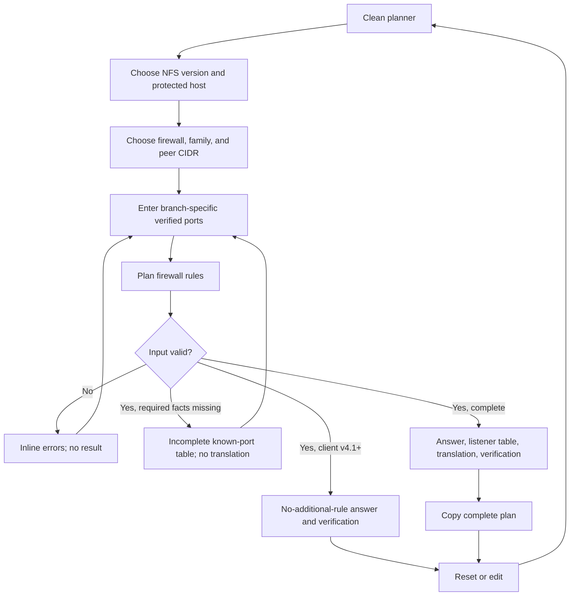

# Implementation report: NFS Firewall Rules Planner

Status: ready
Tool: NFS Firewall Rules Planner
Route: `/nfs-firewall-rules`
Depends on: `competitive-report.md`
Contract type: formula
Formula version: `nfs-firewall-plan-v1`

## Product decision

- Primary user: A Linux administrator who knows the NFS version and the host firewall they are changing but does not want to miss a listener, open a dynamic guess, or confuse server and client rules.
- Job: Turn one NFS host-firewall scenario into a reviewable listener table, identify any missing local facts, and translate a complete table into a bounded firewalld, UFW, or nftables fragment with verification steps.
- Product thesis: The tool earns preference by separating universal protocol facts from user-verified RPC ports, making endpoint and direction explicit, and refusing copy-ready NFSv3 output while any required helper port is unknown.
- Evidence: `competitive-report.md` sections `Search intent`, `User pain evidence`, `Technical truth to verify`, `Comparison matrix`, and `Evidence-backed opportunities`.

## Scope

### Table stakes

- Support NFSv3, NFSv4.0, and NFSv4.1 or later as distinct protocol choices.
- Plan a stateful host firewall on either the NFS server or one NFS client.
- Support IPv4 or IPv6 peer CIDRs, TCP, and explicitly selected legacy UDP for NFSv3.
- Require locally verified NFSv3 helper ports before a complete server or client plan.
- Produce a neutral table with protected endpoint, traffic direction, peer source, service, protocol, destination port, why the listener is needed, and whether the port is fixed or user-verified.
- Translate a complete non-empty table into firewalld, UFW, or nftables syntax under a stated context.
- Provide listener, ruleset, and version-pinned mount verification steps.
- Keep all calculation local to the browser with no URL, storage, analytics payload, or network request.

### Launch differentiators

- Separate server-host and client-host listeners instead of presenting one undirected port list.
- Distinguish NFSv4.0 callback listeners from NFSv4.1 or later backchannels.
- Show known rows even when an NFSv3 plan is incomplete, but withhold translations and copy until every required helper port is verified.
- Treat a firewalld zone as deployment context rather than defaulting silently to `public`.
- Keep nftables output as rule expressions for an existing `inet` input chain, never as a fabricated table, chain, hook, or base policy.
- Keep fixed universal ports and user-verified local ports visibly different.

### Deferred

- Routed or forwarding firewall planning.
- Network-appliance syntaxes such as pfSense, OPNsense, Cisco ACLs, or cloud security groups.
- NFS over RDMA, NFS over TLS, RPCSEC_GSS and Kerberos ports, pNFS data-server topology, clustered failover, NAT, and port forwarding.
- Whole-ruleset parsing, live host discovery, pasted `rpcinfo` parsing, saved or shared plans, and automatic persistence.
- iptables and ip6tables output.
- Remote quota service planning for NFSv4.

### Non-goals

- Do not call a plan secure, correct for production, applied, reachable, or working.
- Do not scan a server, inspect an existing firewall, modify a system, or execute a command.
- Do not infer dynamic RPC assignments from distro examples.
- Do not prove `/etc/exports`, filesystem permissions, SELinux policy, identity mapping, DNS, routing, NAT, security flavor, or mount success.
- Do not treat an unrestricted source as a safe default.
- Do not generate a complete nftables ruleset or choose an active firewalld zone.

## Formula and data contract

### Inputs and normalization

| Input | Type and unit | Default | Valid range | Normalization |
| --- | --- | --- | --- | --- |
| `nfsVersion` | Enum | `v4_1_plus` | `v3`, `v4_0`, `v4_1_plus` | Exact enum |
| `protectedHost` | Enum | `server` | `server`, `client` | Exact enum |
| `firewallFamily` | Enum | `firewalld` | `firewalld`, `ufw`, `nftables` | Exact enum |
| `addressFamily` | Enum | `ipv4` | `ipv4`, `ipv6` | Exact enum |
| `peerCidr` | CIDR string | `192.0.2.0/24` for IPv4; `2001:db8::/64` after an explicit family switch | One IPv4 or IPv6 network with prefix | Trim outer whitespace; validate family; display IPv6 hex lowercase; do not silently add a prefix |
| `transport` | Enum, visible only for NFSv3 | `tcp` | `tcp`, `tcp_udp` | Exact enum; v4 always resolves to TCP |
| `firewalldZone` | Identifier, visible only for firewalld | empty | 1 to 32 ASCII letters, digits, `_`, or `-` | Trim; no implicit `public`; absence creates a partial translation state, not a false plan error |
| `mountdPort` | Destination port, NFSv3 server only | empty | Decimal integer 1 to 65535 | Trim, digits only, remove leading zeroes in display |
| `statdPort` | Destination port, NFSv3 server or client | empty | Decimal integer 1 to 65535 | Same port is used for selected TCP and UDP listener protocols |
| `lockdTcpPort` | Destination port, NFSv3 server or client | empty | Decimal integer 1 to 65535 | Required for every NFSv3 plan |
| `lockdUdpPort` | Destination port, NFSv3 with `tcp_udp` | empty | Decimal integer 1 to 65535 | Hidden and ignored for TCP-only NFSv3 |
| `includeRquotad` | Boolean, NFSv3 server only | `false` | `true`, `false` | Exact boolean |
| `rquotadPort` | Destination port, visible when `includeRquotad` | empty | Decimal integer 1 to 65535 | User-verified local port; never prefilled |
| `v4CallbackPort` | Destination TCP port, NFSv4.0 client only | empty | Decimal integer 1 to 65535 | User-configured and verified client callback listener |

IPv4 CIDR validation requires exactly four decimal octets from 0 to 255 and a prefix from 0 to 32. IPv6 CIDR validation permits one `::`, one to eight hexadecimal groups after expansion, an optional embedded IPv4 tail counting as two groups, and a prefix from 0 to 128. Zone identifiers, brackets, ports, hostnames, multiple slashes, multiple `::`, signs, whitespace inside the address, and bare addresses without a prefix are invalid.

Port parsing accepts ASCII decimal digits only. Exponent notation, signs, decimals, separators, hex, embedded whitespace, and values outside 1 to 65535 are invalid. The engine detects a listener collision when two different services on the same protected host resolve to the same protocol and destination port. Sharing one number between TCP and UDP for the same service is allowed.

### Equations or resolution order

The engine is a deterministic transformation named `buildNfsFirewallPlan(input)` and returns one of `invalid`, `incomplete`, `ready`, or `no_additional_rule`. A `ready` result has a nested translation status of `ready` or `missing_context`; the neutral listener plan remains ready when only the selected firewall syntax lacks required deployment context.

1. Normalize enum values, trim user strings, and reject unknown keys at the public parser boundary.
2. Validate `peerCidr` against `addressFamily`. The peer always means the remote endpoint allowed to initiate the modeled inbound connection: a client CIDR when protecting the server, or the server CIDR when protecting the client.
   - Prefix length zero is valid for either address family, but the result must warn that it permits every source address in that family. The warning does not block translation or copy.
3. Validate the selected firewall context. `firewalldZone` may remain absent while the neutral plan is computed, but a firewalld translation then remains unavailable.
4. Select the exact service dependency branch:
   - `server + v4_0` or `server + v4_1_plus`: add `nfs` on TCP destination port 2049, fixed by the NFS protocol registration.
   - `client + v4_1_plus`: add no inbound listener. Return `no_additional_rule` because callbacks use the client-established session connection in the modeled stateful host-firewall path.
   - `client + v4_0`: require `v4CallbackPort`, then add `nfs4_callback` on TCP at that user-verified port.
   - `server + v3`: add `rpcbind` on 111, `nfs` on 2049, `mountd` on `mountdPort`, `statd` on `statdPort`, and `lockd` on `lockdTcpPort`. Add `rquotad` only when selected. Use TCP for all rows; when `transport=tcp_udp`, add UDP rows for rpcbind, nfs, mountd, statd, rquotad when selected, and lockd on `lockdUdpPort`.
   - `client + v3`: add `rpcbind` on 111, `statd` on `statdPort`, and `lockd` on `lockdTcpPort` from the server peer. When `transport=tcp_udp`, add matching UDP rows and use `lockdUdpPort` for UDP lockd.
5. For every required user-verified port that is empty, return `incomplete`. Include the fixed known rows and a missing-facts list, but do not emit firewall translations or enable result copy.
6. For every syntactically invalid port or listener collision, return `invalid`. Clear all prior result rows and translations. A collision key is `protectedHost + protocol + destinationPort`; repeated rows for the same service are deduplicated.
7. Sort rows by endpoint, then protocol with TCP before UDP, then numeric port, then service name. Never sort user text into a command without validation.
8. Build the answer sentence:
   - ready non-empty: `Allow <row count> listener rule(s) on the NFS <server|client>.`
   - incomplete: `The NFSv3 plan is incomplete until <missing service list> ports are verified.`
   - client v4.1+: `No new inbound callback listener is needed on this NFS client for v4.1 or later.`
9. Build firewall translation only for `ready` and non-empty rows:
   - firewalld: require a valid zone. Emit one explicit rich-rule command per row using the selected family, peer source, destination port, protocol, and `accept`. Do not rely on distro service definitions. Example shape: `firewall-cmd --permanent --zone=<zone> --add-rich-rule='rule family="ipv4" source address="192.0.2.0/24" port port="2049" protocol="tcp" accept'`.
   - UFW: emit one host-ingress command per row with protocol, peer source, and destination port. Example shape: `ufw allow in proto tcp from 192.0.2.0/24 to any port 2049 comment 'NFS nfs'`.
   - nftables: group rows by protocol and emit an expression for an existing `inet` input chain. Use `ip saddr` for IPv4 or `ip6 saddr` for IPv6 and a destination-port set when more than one port exists. Example shape: `ip saddr 192.0.2.0/24 tcp dport { 111, 2049 } accept`. Do not prepend `nft add rule` or invent table and chain names.
10. Build verification steps from the same branch:
    - inspect local listeners with `rpcinfo -p` for NFSv3 and `ss -lntup` for every branch;
    - inspect the selected firewall using `firewall-cmd --zone=<zone> --list-all`, `ufw status verbose`, or `nft list ruleset`;
    - test from the modeled peer with a version-pinned mount such as `mount -t nfs -o vers=3,proto=tcp ...` or `vers=4.1`;
    - confirm the negotiated mount with `findmnt -o TARGET,FSTYPE,OPTIONS <mountpoint>`;
    - treat `access denied` as an export or permission path, not proof of a missing firewall port.
11. Serialization is not supported in formula version 1. The base route remains clean and no input is written to a URL, cookie, localStorage, sessionStorage, IndexedDB, or analytics payload.

### Rounding, display, and versioning

There is no numeric rounding. Ports display as base-10 integers without leading zeroes. CIDRs display as trimmed input, with IPv6 hex letters lowercased. Service names display as exact technical identifiers: `nfs`, `rpcbind`, `mountd`, `statd`, `lockd`, `rquotad`, or `nfs4_callback`.

The formula version is `nfs-firewall-plan-v1`. It is exported by the pure engine and included in the result metadata and copied plan. Any future change to service dependency branches, callback behavior, command syntax, or state serialization requires a new formula version and fixture review.

### Invalid, unknown, absent, and partial states

- Empty or mismatched peer CIDR: invalid; show an associated error, clear the result, focus the peer field, and make no copy or command available.
- Malformed or out-of-range required port: invalid; associate the error with that input, clear all result data, and announce the first error.
- Listener collision across different services: invalid; show the conflicting services, protocol, and port beside the port group and produce no plan.
- Missing required NFSv3 helper port or NFSv4.0 callback port: incomplete; show only fixed known rows plus a missing-facts list, with no syntax translation or copy action.
- Missing firewalld zone after a complete neutral plan: keep the top-level result `ready` with `translation.status = missing_context`; keep the valid neutral table visible, state that a zone is required for firewalld syntax, and disable copy because no complete translation exists.
- Client NFSv4.1 or later: `no_additional_rule`; show why no new inbound callback listener is planned and show verification, not an empty success badge.
- Input edit after any result: clear the result and live-region content immediately. Never leave a plausible stale plan visible.
- No loading, timeout, upstream, offline, or rate-limit states exist because the engine is local and synchronous.

### Assumptions and exclusions

- The modeled firewall is stateful and protects one Linux NFS server or client host. Existing established-connection handling is outside the generated new-listener rules.
- The peer CIDR has already been approved by the administrator and matches the real route and interface policy.
- NFSv3 helper values came from the local system configuration and were confirmed against active listeners. The tool cannot establish this fact.
- TCP-only NFSv3 is the launch default because it is the current common path. UDP remains available only through an explicit legacy choice.
- The server-side NFSv4 plan covers ordinary client traffic to TCP/2049. NFSv4.0 callback planning belongs to the client-host branch.
- A translation is a review fragment, not an apply script. Existing rule order, zones, interfaces, tables, chains, hooks, policies, forwarding, NAT, and cloud firewalls can override it.
- UFW IPv6 output assumes IPv6 support is enabled in UFW. Firewalld output assumes the named zone exists and is bound to the intended source or interface. Nftables output assumes an existing `inet` input chain and omits surrounding policy.
- Remote quota, NFS over RDMA or TLS, Kerberos, RPCSEC_GSS, pNFS, clustered servers, containers, NAS vendor services, and non-Linux clients are not inspected.

### Primary sources

- RFC 7530: https://www.rfc-editor.org/rfc/rfc7530.html, checked 2026-08-09. NFSv4 registered port, TCP support, and v4.0 callback program.
- RFC 8881: https://www.rfc-editor.org/info/rfc8881/, checked 2026-08-09. NFSv4.1 port and session backchannel behavior.
- RHEL 9 NFS server deployment: https://docs.redhat.com/en/documentation/red_hat_enterprise_linux/9/html/configuring_and_using_network_file_services/deploying-an-nfs-server_configuring-and-using-network-file-services, checked 2026-08-09. Current service dependencies, static ports, and verification.
- RHEL 9 NFS client firewall: https://docs.redhat.com/en/documentation/red_hat_enterprise_linux/9/html/managing_file_systems/mounting-nfs-shares_managing-file-systems, checked 2026-08-09. Client-side NFSv3 and NFSv4 callback behavior.
- Linux `nfs.conf(5)`: https://man7.org/linux/man-pages/man5/nfs.conf.5.html, checked 2026-08-09. Mountd, statd, and lockd keys.
- Firewalld rich language: https://firewalld.org/documentation/man-pages/firewalld.richlanguage.html, checked 2026-08-09. Family, source, port, protocol, action, and rule-order syntax.
- Ubuntu UFW manual: https://manpages.ubuntu.com/manpages/jammy/man8/ufw.8.html, checked 2026-08-09. Host-ingress rule syntax and IPv6 boundary.
- Netfilter nftables sets: https://wiki.netfilter.org/wiki-nftables/index.php/Sets, checked 2026-08-09. Address and destination-port set expressions.

## User flow



## Interface wireframes

### Desktop: clean

```text
NFS Firewall Rules Planner

+--------------------------------------------------------------------------+
| NFS version        ( ) v3  ( ) v4.0  (x) v4.1+                          |
| Protect this host  (x) NFS server  ( ) NFS client                       |
| Firewall           (x) firewalld  ( ) UFW  ( ) nftables                 |
| Address family     (x) IPv4  ( ) IPv6                                   |
| Allowed client CIDR [192.0.2.0/24____________________]                  |
| Firewalld zone      [________________________________]                  |
|                                                                          |
| [Plan firewall rules]                                      [Reset]       |
+--------------------------------------------------------------------------+
```

### Desktop: result

```text
+--------------------------------------------------------------------------+
| inputs                                                                   |
| [Plan firewall rules]                                      [Reset]       |
|--------------------------------------------------------------------------|
| Allow 5 listener rules on the NFS server.                  [Copy plan]   |
|                                                                          |
| Service | Direction | Peer source   | Protocol | Port  | Port source     |
| rpcbind | inbound   | 192.0.2.0/24 | TCP      | 111   | protocol fixed  |
| nfs     | inbound   | 192.0.2.0/24 | TCP      | 2049  | protocol fixed  |
| mountd  | inbound   | 192.0.2.0/24 | TCP      | 20048 | user verified   |
| statd   | inbound   | 192.0.2.0/24 | TCP      | 32765 | user verified   |
| lockd   | inbound   | 192.0.2.0/24 | TCP      | 32766 | user verified   |
|                                                                          |
| firewalld review commands                                                |
| [monospace command list]                                                  |
|                                                                          |
| Verify on the real hosts                                                  |
| 1. rpcinfo -p and ss                                                      |
| 2. inspect the selected firewall                                          |
| 3. version-pinned mount and findmnt                                       |
| Formula nfs-firewall-plan-v1                                              |
+--------------------------------------------------------------------------+
```

### Narrow mobile

```text
NFS Firewall Rules Planner

+----------------------------------+
| version choices wrap             |
| protected-host choices wrap      |
| firewall choices wrap            |
| address family choices           |
| CIDR [________________________]   |
| conditional verified ports       |
|                                  |
| [Plan firewall rules]            |
| [Reset]                          |
|----------------------------------|
| Allow 5 listener rules.          |
| [Copy plan]                      |
|                                  |
| Service  rpcbind                 |
| Direction inbound               |
| Peer      192.0.2.0/24           |
| Protocol  TCP                    |
| Port      111                    |
| Source    protocol fixed         |
| -------------------------------- |
| repeated labelled rows           |
|                                  |
| command block scrolls internally |
| verification list                |
+----------------------------------+
```

### Error, loading, partial, and restored states

There is no loading or restored state in formula version 1.

```text
INVALID
[Allowed client CIDR: 192.0.2.999/24]
Enter an IPv4 CIDR with octets from 0 to 255.
[Plan firewall rules]
No result or prior translation remains.
```

```text
INCOMPLETE NFSv3
The NFSv3 plan is incomplete until mountd, statd, and lockd ports are verified.
[known fixed rows: rpcbind 111, nfs 2049]
Missing facts
- mountd listener from rpcinfo -p
- statd listener from rpcinfo -p
- lockd listener from rpcinfo -p
No command translation or copy action.
```

```text
PARTIAL FIREWALLD TRANSLATION
Allow 1 listener rule on the NFS server.
[complete neutral listener table]
Enter the active firewalld zone to create review commands.
No copy action until the zone is supplied and the plan is recalculated.
```

```text
NFSv4.1+ CLIENT
No new inbound callback listener is needed on this NFS client.
The server uses the client-established session connection for callbacks.
[verification steps]
```

## Interaction contract

| Event | UI response | Result state | Focus/announcement | URL/persistence |
| --- | --- | --- | --- | --- |
| Initial load | Show defaults and only relevant fields | Clean | Normal document order | Base route; no storage |
| Change NFS version or protected host | Recompute visible field set and clear hidden values that do not belong to the branch | Clear | Focus stays on the chosen control; no announcement | None |
| Change address family | Replace the example CIDR only if the current value is still the untouched prior default; otherwise clear it | Clear | Focus stays; no announcement | None |
| Change firewall | Show zone only for firewalld; label nftables output boundary | Clear | Focus stays | None |
| Edit any field after a result | Clear result, copy status, and live region | Clear | Focus stays | None |
| Submit valid complete inputs | Render answer, table, translation, and verification | Ready | Focus remains on submit; polite live region announces answer | None |
| Submit missing NFSv3 ports | Render known rows and missing-facts list | Incomplete | Focus the first missing port; polite live region announces incomplete plan | None |
| Submit invalid input | Associate every error and render no result | Invalid | Focus first invalid input; assertive error summary once | None |
| Submit client v4.1+ | Render no-additional-rule answer and verification | No additional rule | Polite live announcement | None |
| Submit complete firewalld plan without zone | Render table and zone-required translation note | Partial | Focus zone; polite announcement | None |
| Press Enter in a field | Invoke the same primary submit action once | Same as submit | Same as submit | None |
| Rapid or repeated submit | Run one synchronous calculation per event with identical deterministic output | Replace, never duplicate | One live announcement per result | None |
| Copy plan | Copy complete answer, table, translation, verification, formula version, and source date | Ready plus temporary copied status | Button text and polite status change, then reset | Clipboard only after user action |
| Reset | Restore defaults, clear conditional values and result | Clean | Focus NFS version group | Base route; storage remains empty |
| Reload, back, or forward | Return to clean defaults | Clean | Browser default | No restoration |

## Page composition

| Claim or task | Medium | Position | Why this medium |
| --- | --- | --- | --- |
| Choose protocol, protected host, firewall, family, peer, and verified ports | Tool UI | First inside the workbench | These choices directly change the plan |
| Immediate conclusion | Exact result visualization | First in the result region | The user needs ready, incomplete, or no-additional-rule status before syntax |
| Repeated listener facts | Table | Under the answer | Endpoint, source, protocol, port, and provenance repeat across services |
| Missing local facts | Exact result visualization | Beside the known table in incomplete state | It is recovery, not background prose |
| Firewall translation | Tool UI | After the neutral table | Syntax is secondary and depends on the complete plan |
| Verification sequence | Ordered list in the result | Last inside result | The sequence prevents command output from implying success |
| Why v3 and v4 differ | Sentences, later writing stage | After the tool | One compact explanation resolves the main surprise |
| Firewall and protocol limits | Sentences, later writing stage | After interpretation | These are judgment boundaries, not another table |

No marker art, screenshot, or chart is justified. The service-and-direction table is the exact visual.

## Technical plan

### Architecture and file ownership

- `app/(site)/(tools)/nfs-firewall-rules/page.tsx`: server component with title only during the tool-only build, then the later server-rendered introduction and guide.
- `app/(site)/(tools)/nfs-firewall-rules/nfs-firewall-rules-planner.tsx`: smallest client island owning form state, submit, copy, reset, live regions, and responsive result rendering.
- `app/(site)/(tools)/nfs-firewall-rules/nfs-firewall-rules.module.css`: all route and component layout; no global selectors.
- `lib/nfs-firewall/plan.ts`: pure types, CIDR validation, port parsing, branch resolution, collision detection, translations, and copy formatting. No React, DOM, network, or storage access.
- `content_docs/nfs-firewall-rules/`: route-owned competitive research, product contract, visual brief, test contract, later writing plan, and no public registry data.
- `tests/pages/nfs-firewall-rules/nfs-firewall-rules.test.mjs`: pure engine fixtures and invariants.
- `tests/pages/nfs-firewall-rules/page.test.mjs`: static route ownership, server content identity, no route metadata, and later content checks.
- `tests/pages/nfs-firewall-rules/nfs-firewall-rules.spec.ts`: rendered form, state, accessibility, copy, keyboard, theme, and responsive flows.
- `tests/pages/nfs-firewall-rules/page.json`: unpublished route ownership manifest.
- `scripts/nfs-firewall-rules/preview-local-page.mjs`: guarded local-only preview that restores publication state.
- `scripts/nfs-firewall-rules/scripts.json`: route script ownership.

Use no new production dependency. The engine should remain auditable TypeScript. Compare the workbench width, controls, table treatment, and mobile result with `/nginx-proxy-pass-calculator` and `/dockerignore-tester` before styling.

### Accessibility, privacy, security, and performance

- Use fieldsets and legends for every visible radio group; every input has a programmatic label and associated error via `aria-describedby`.
- Keep compact radio choices visible and wrapping instead of hiding protocol, role, or family choices in selects.
- Use a single result heading, a polite result live region, and an assertive error summary only after submit. Do not announce every keystroke.
- Put table headers in semantic `<th>` cells. On narrow screens, reflow rows into labelled records without hiding any value or requiring page-level horizontal scroll.
- Keep every interactive target at least 44 px, preserve visible focus, support Enter submit, and do not create keyboard traps.
- Treat every value as text. Never use `dangerouslySetInnerHTML`, shell interpolation, HTML parsing, `eval`, or dynamic code execution.
- Validate CIDRs, zone names, and ports before inserting them into command text. No hostname, shell metacharacter, quote, newline, comment delimiter, or arbitrary command field is accepted.
- Copy only after an explicit button action. No input or result reaches a server, URL, browser storage, logging call, analytics event, or error payload.
- Target under 18 KiB gzip for the route-specific client island and engine combined, under 50 ms calculation for 100 repeated submissions on a normal desktop, and no layout shift after the local synchronous result.

### Publication state

Unpublished. The ownership manifest must say `unpublished`, the guarded local preview must restore state, and the slug must not be added to `public.stack127_pages`, the sitemap, or central metadata. No route-level metadata, canonical, robots, sitemap, or JSON-LD code is permitted.

## Acceptance criteria

| ID | Observable acceptance criterion | Evidence at build time |
| --- | --- | --- |
| R1 | The clean page uses the locked flat route and renders one workbench with no result. | Static route test and Browser |
| R2 | Server-side NFSv4.1+ yields exactly TCP/2049 from the client CIDR. | Unit fixture |
| R3 | Server-side NFSv4.0 also yields TCP/2049 and states that client callback planning is separate. | Unit fixture and Browser |
| R4 | Client-side NFSv4.1+ yields `no_additional_rule`, not an empty success or port 2049 inbound rule. | Unit and Playwright fixture |
| R5 | Client-side NFSv4.0 requires and returns only the verified TCP callback listener. | Unit fixture |
| R6 | Server-side TCP NFSv3 returns rpcbind, nfs, mountd, statd, and lockd with fixed versus verified provenance. | Unit fixture |
| R7 | Explicit TCP+UDP NFSv3 returns protocol-specific rows and uses the separate lockd UDP value. | Unit fixture |
| R8 | Client-side NFSv3 returns rpcbind, statd, and lockd listeners without server-only nfs or mountd rows. | Unit fixture |
| R9 | Optional rquotad appears only in the NFSv3 server branch and requires a verified port. | Unit fixture |
| R10 | Missing required dynamic ports return incomplete known rows with no translation or copy. | Unit and Playwright fixture |
| R11 | Invalid CIDRs, wrong address families, invalid ports, and listener collisions render no result or stale plan. | Unit and Playwright fixture |
| R12 | Firewalld emits explicit source-scoped rich rules only after a valid zone is supplied. | Unit fixture |
| R13 | UFW emits source-scoped host-ingress rules and makes the IPv6 configuration boundary visible. | Unit fixture and Browser |
| R14 | Nftables emits only existing-chain expressions using the correct `ip` or `ip6` source selector. | Unit fixture |
| R15 | Every ready plan includes listener, firewall, version-pinned mount, and `findmnt` verification steps. | Unit fixture and rendered test |
| R16 | Any input edit clears a prior result immediately; reload and history never restore state. | Playwright |
| R17 | Click, Enter, rapid repeat submit, copy, and reset have deterministic non-duplicating behavior. | Playwright |
| R18 | Field groups, labels, errors, live regions, focus recovery, and result reading order work by keyboard and accessibility tree. | Playwright and Browser |
| R19 | A complete longest NFSv3 result has no document, frame, table, command, or record overflow at 320, 375, 760, and desktop widths in both themes. | Playwright measurements and Browser |
| R20 | The formula engine makes no network or storage access and all output is plain text. | Static and unit tests |
| R21 | The route manifest, preview script, and static policy preserve the unpublished state and sitemap exclusion. | Static and SEO tests |
| R22 | The tool-only build contains no introduction, guide, FAQ, methodology, or long public strings. | Tool-only validator |

## Open questions and blockers

- None. The product contract resolves the research-stage questions by using TCP as the explicit default with an available legacy UDP choice, excluding routed firewalls from launch, and limiting nftables output to existing-chain expressions.
