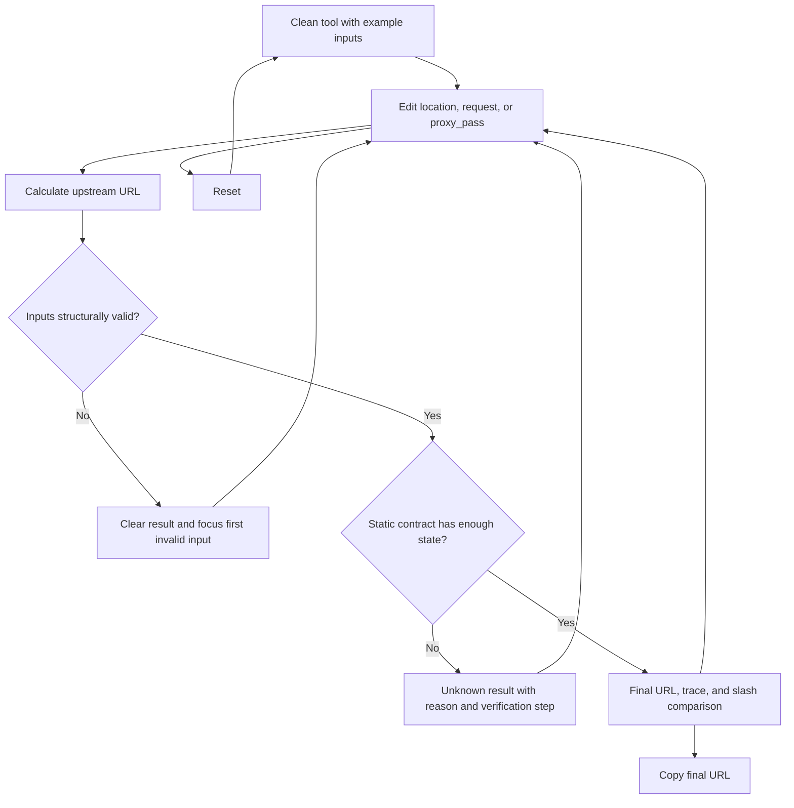

# Implementation report: NGINX proxy_pass URI Calculator

Status: ready
Tool: NGINX proxy_pass URI Calculator
Route: `/nginx-proxy-pass-calculator`
Depends on: `competitive-report.md`
Input fingerprint: `competitive-report.md sha256:f78bf0883e6c127eccafe1488f0478b657149d12435c901690727dde2dd2b281`
Contract type: formula

## Product decision

- Primary user: A developer or homelab operator debugging one static NGINX HTTP reverse-proxy location before reloading it.
- Job: Enter the matched location, incoming request target, and `proxy_pass` value, then see the exact upstream URL NGINX constructs or a clear reason it cannot be calculated statically.
- Product thesis: The result joins inputs that competing tools keep separate, makes every retained or replaced URI segment visible, and refuses plausible output when NGINX needs runtime or broader configuration state.
- Evidence: `competitive-report.md` sections `Search intent`, `User pain evidence`, `Comparison matrix`, and `Evidence-backed opportunities`.

## Scope

### Table stakes

- Accept one prefix or exact string location, one request target, and one static HTTP or HTTPS `proxy_pass` URL.
- Preserve ordinary request arguments and distinguish an omitted `proxy_pass` URI from a `/` URI.
- Return the exact upstream URL plus an ordered replacement trace.
- Detect variables, regex and named locations, rewrites declared by the user, and normalization-sensitive request paths as unknown or unsupported rather than guessing.
- Compare the current `proxy_pass` with its final slash toggled without changing the main inputs.
- Clear a previous result as soon as current inputs become invalid or unknown.
- Run locally with no requests, analytics payloads, persistence, or serialized URL state.

### Launch differentiators

- The final upstream URL is the strongest result, not a validation badge.
- A structured trace names the original target, matched location, retained suffix, replacement URI, final path, and request arguments.
- The slash comparison calculates both configurations from the same request and labels neither one as universally correct.
- Every unknown state names the missing runtime fact and the real NGINX verification step.
- A fixture receipt pins the engine to NGINX stable 1.30.4, with a mainline 1.31.3 spot check when the local container runtime permits it.

### Deferred

- A complete location-selection engine across multiple nested and regex locations.
- A narrowly verified `rewrite ... break` parser and trace.
- A complete variable-expansion environment.
- `proxy_pass` values containing their own query arguments.
- Full raw-request URI normalization and re-encoding for percent-encoded delimiters, dot segments, or merged slashes.
- Shareable state, exports, and full configuration paste.

### Non-goals

- Validate an entire `nginx.conf` or replace `nginx -t`.
- Prove that the upstream exists, accepts the path, or returns a successful response.
- Select the winning location from a full server block.
- Recommend whether a trailing slash is correct for the user's backend.
- Model headers, redirects, DNS resolution, upstream groups, WebSockets, caching, or response behavior.
- Claim an exact URL for variable, rewrite, normalization-sensitive, regex, named, or internally redirected cases.

## Formula and data contract

### Inputs and normalization

| Input | Type and unit | Default | Valid range | Normalization |
| --- | --- | --- | --- | --- |
| Location type | Enum: `prefix`, `exact`, `regex`, `named` | `prefix` | One enum value | `prefix` and `exact` are calculable; `regex` and `named` return unknown |
| Location value | UTF-8 string | `/api/` | 1 to 512 characters | Trim outer whitespace; for calculable types require a literal path beginning `/`, no query, fragment, controls, backslash, variables, or normalization-sensitive form |
| Request target | UTF-8 string | `/api/users?id=42` | 1 to 4096 characters | Trim outer whitespace; split at the first `?` into path and raw arguments; require one leading `/`; retain raw argument text; reject fragment and controls |
| `proxy_pass` URL | UTF-8 string | `http://backend/` | 8 to 2048 characters | Trim outer whitespace; parse from the original string so authority-only and URI-bearing forms remain distinct; require `http` or `https`, authority, optional port, no credentials, fragment, variables, or query |
| Rewrite state | Enum: `none`, `break`, `last`, `other` | `none` | One enum value | Only `none` is calculable at launch; every other value returns unknown with its specific reason |
| Slash comparison | Boolean | `true` | `true` or `false` | A presentation option only; it does not alter the primary result |

For launch, a request or location path is normalization-safe only when all of these hold:

1. It contains no percent sign, backslash, ASCII control, raw space, `#`, adjacent `//`, or path segment equal to `.` or `..`.
2. It begins with exactly one `/`.
3. Its literal prefix relationship can therefore be compared without emulating NGINX decoding, dot-segment removal, or slash merging.

An unsafe but syntactically recognizable path produces `unknown`, not `invalid`, because a real NGINX instance can resolve it but this launch engine deliberately does not simulate normalization.

### Equations or resolution order

Formula version: `nginx-proxy-pass-uri-v1`.

1. Parse and validate all inputs. Any structurally invalid input returns `invalid` with no result URL.
2. If location type is `regex` or `named`, return `unknown`. NGINX cannot determine an ordinary URI prefix to replace in those location forms.
3. If rewrite state is not `none`, return `unknown`. `break`, `last`, and other rewrite paths require different or broader processing state.
4. If `proxy_pass` contains `$`, a query, credentials, fragment, unsupported scheme, or cannot be divided into authority and optional URI from the raw string, return `invalid` for forbidden syntax or `unknown` for variables.
5. If request or location path is normalization-sensitive, return `unknown` before prefix comparison.
6. For an exact location, require `requestPath === locationPath`. For a prefix location, require `requestPath.startsWith(locationPath)`. A mismatch returns `invalid` because the caller identified a location that did not match.
7. Split raw `proxy_pass` into `schemeAuthority` and `proxyUri` while preserving whether the URI was omitted:
   - `http://backend` gives `schemeAuthority = http://backend`, `proxyUri = absent`;
   - `http://backend/` gives `schemeAuthority = http://backend`, `proxyUri = /`;
   - `http://backend/v2` gives `schemeAuthority = http://backend`, `proxyUri = /v2`.
8. If `proxyUri` is absent, set `finalPath = requestPath` and mark the trace `original request path retained`.
9. If `proxyUri` is present, set `retainedSuffix = requestPath.slice(locationPath.length)` and `finalPath = proxyUri + retainedSuffix`. Concatenation is literal. Do not add, remove, or collapse slashes.
10. If request arguments are present, set `finalTarget = finalPath + "?" + rawArguments`; otherwise `finalTarget = finalPath`.
11. Set `finalUrl = schemeAuthority + finalTarget`.
12. For slash comparison, toggle only the final `/` of the static `proxy_pass` path:
    - authority-only becomes URI `/`;
    - URI `/` becomes authority-only;
    - URI ending `/` loses that slash;
    - other URI gains `/`.
    Run steps 8 to 11 for the comparison. A comparison failure does not invalidate the primary result, but the comparison must still respect the same contract.

### Rounding, display, and versioning

- No numerical rounding exists.
- Display every URI part verbatim in a monospace surface. Do not decode, prettify, or normalize user data for display.
- Long values wrap or scroll inside their own code surface without causing page-level overflow.
- Formula version `nginx-proxy-pass-uri-v1` and fixture baseline `NGINX 1.30.4` appear as restrained result metadata.
- No URL serialization exists in version 1. A future serialized state must include its own version and must not silently restore under a changed contract.

### Invalid, unknown, absent, and partial states

- `empty`: no result, no error summary, and an available Calculate action.
- `invalid`: one or more fields cannot describe a valid supported NGINX input. Associate each error with its control, focus the first invalid control after submit, announce one summary, and show no current or stale URL.
- `unknown`: the input may be valid NGINX, but the static contract lacks necessary processing state. Show the reason, official rule boundary, and verification command. Never show a plausible URL.
- `success`: show one final URL, one ordered trace, optional slash comparison, source/version note, Copy result, and Reset.
- `copy feedback`: short status adjacent to Copy; it must not modify the result or use a modal.
- `partial`: not used. The engine either has a complete deterministic URL or has no URL.
- `loading` and `upstream failure`: not applicable because the pure formula is synchronous and local.

### Assumptions and exclusions

- The supplied location is already the one NGINX selected. The tool checks that it matches but does not search a full configuration.
- Default `merge_slashes` and raw request normalization are not simulated. Normalization-sensitive inputs return unknown.
- The result models URI construction only. It does not include the upstream request Host header, DNS address, selected upstream peer, response redirect, or backend routing.
- Request arguments are carried verbatim only when the `proxy_pass` target has no arguments of its own. Targets with their own `?` are deferred.
- Ordinary HTTP and HTTPS upstream authorities, including hostname, IPv4, bracketed IPv6, and optional valid port, are supported. UNIX sockets are deferred.
- A successful result is a calculation, not proof that the configuration is safe or the backend path is correct.

### Primary sources

- NGINX `proxy_pass` directive: https://nginx.org/en/docs/http/ngx_http_proxy_module.html#proxy_pass, checked 2026-08-09. URI presence, prefix replacement, unchanged request target, variables, regex and named locations, and rewrite boundary.
- NGINX rewrite directive: https://nginx.org/en/docs/http/ngx_http_rewrite_module.html#rewrite, checked 2026-08-09. `break`, `last`, redirect, and argument semantics.
- NGINX location directive: https://nginx.org/en/docs/http/ngx_http_core_module.html#location, checked 2026-08-09. Normalized URI matching.
- NGINX downloads: https://nginx.org/en/download.html, checked 2026-08-09. Stable 1.30.4 and mainline 1.31.3 baselines.

## User flow



## Interface wireframes

### Desktop: clean

```text
NGINX proxy_pass URI Calculator: see the upstream URL

┌──────────────────────────────────────────────────────────────────┐
│ Location type  ( Prefix ) ( Exact ) ( Regex ) ( Named )          │
│ Location        [/api/____________________________]               │
│ Request target  [/api/users?id=42_________________]               │
│ proxy_pass      [http://backend/__________________]               │
│ Rewrite state   ( None ) ( break ) ( last / other )               │
│ [Calculate upstream URL]  [Reset]                                 │
│                                                                  │
│ Enter a supported static case to see the upstream URL.            │
└──────────────────────────────────────────────────────────────────┘
```

### Desktop: result

```text
┌──────────────────────────────────────────────────────────────────┐
│ [same compact form]                                               │
│                                                                  │
│ http://backend/users?id=42                          [Copy URL]     │
│                                                                  │
│ Request path       /api/users                                    │
│ Matched location   /api/                                         │
│ Retained suffix    users                                         │
│ Replacement URI    /                                             │
│ Request arguments  id=42                                         │
│                                                                  │
│ Slash comparison                                                │
│ current  http://backend/users?id=42                               │
│ toggled  http://backend/api/users?id=42                           │
│                                                                  │
│ Formula v1 · verified with NGINX 1.30.4                           │
└──────────────────────────────────────────────────────────────────┘
```

### Narrow mobile

```text
NGINX proxy_pass URI Calculator

┌──────────────────────────────┐
│ Location type                │
│ [Prefix] [Exact]             │
│ [Regex]  [Named]             │
│ Location                     │
│ [/api/____________________]  │
│ Request target               │
│ [/api/users?id=42_________]  │
│ proxy_pass                   │
│ [http://backend/__________]  │
│ Rewrite state                │
│ [None] [break] [last/other]  │
│ [Calculate upstream URL]     │
│ [Reset]                      │
│                              │
│ http://backend/              │
│ users?id=42        [Copy]    │
│                              │
│ Request path                 │
│ /api/users                   │
│ Matched location             │
│ /api/                        │
│ Retained suffix              │
│ users                        │
│ Replacement URI              │
│ /                            │
│ Arguments                    │
│ id=42                        │
│                              │
│ Slash comparison             │
│ current ...                  │
│ toggled ...                  │
└──────────────────────────────┘
```

### Error, loading, partial, and restored states

```text
Invalid
proxy_pass [backend:3000____________]
           Use an http:// or https:// URL.
[Calculate upstream URL]
No previous URL remains visible.
```

```text
Unknown from these inputs
Regex locations do not define a literal prefix that proxy_pass can replace.
Use a proxy_pass without a URI, then verify with nginx -T and an upstream request log.
No URL is shown.
```

Loading, partial, upstream failure, shared, and restored states do not apply in version 1. The base route stays clean and no state persists across reload.

## Interaction contract

| Event | UI response | Result state | Focus/announcement | URL/persistence |
| --- | --- | --- | --- | --- |
| First load | Render server-owned title shell and client tool with example values | Empty | Natural document order | Base route unchanged; no storage |
| Edit any input after success or unknown | Keep form value; remove prior result immediately | Empty | Stay in edited control; no announcement | None |
| Submit valid supported case | Calculate synchronously | Success | Focus result heading; polite announcement with final URL once | None |
| Submit invalid case | Show field errors and one summary | Invalid | Focus first invalid control; errors linked with `aria-describedby` | None |
| Submit valid but unsupported case | Show one unknown reason and next step | Unknown | Focus unknown heading; polite announcement once | None |
| Press Enter in a text field | Run the same primary submit | Same as submit | Same as submit | None |
| Repeat submit without edits | Recalculate once without duplicate announcements | Success or error | Result remains the focus target | None |
| Copy URL | Write only the final URL to clipboard | Success unchanged | Announce `URL copied` adjacent to action | No URL or storage change |
| Copy fails | Keep result and show local failure | Success unchanged | Announce retry guidance | None |
| Toggle slash comparison | Show or hide secondary exact comparison | Primary success unchanged | No focus move; result region updates politely only if necessary | None |
| Reset | Restore defaults and clear result/errors/copy feedback | Empty | Focus Location value | None |
| Reload/back/forward | Return to default clean state | Empty | Browser default | No serialized state |

## Page composition

| Claim or task | Medium | Position | Why this medium |
| --- | --- | --- | --- |
| Exact final upstream target | Tool UI | First result line | It is the user's answer |
| How the path was transformed | Table-like trace in Tool UI | Under final URL | Repeated named parts are faster to scan than prose |
| What the trailing slash changes | Exact result visualization | Under trace | Side-by-side exact outputs prevent mental concatenation errors |
| Unsupported or unknown scope | Tool UI status | In result position | It must replace, not trail, a plausible answer |
| What inputs mean and what to verify next | Sentences, after the stable tool | Deferred writing stage | Short judgment and limits need prose, not another panel |
| Exact common configurations | Table, after the stable tool | Deferred writing stage | Repeated location and target examples compare cleanly |

No marker art, screenshot, or clean chart is planned. The transformation trace and slash comparison are the useful visuals.

## Technical plan

### Architecture and file ownership

- `app/(site)/(tools)/nginx-proxy-pass-calculator/page.tsx`: server component, title only during tool build and later server-rendered intro/guide composition during writing.
- `app/(site)/(tools)/nginx-proxy-pass-calculator/nginx-proxy-pass-calculator.tsx`: smallest client island for form, actions, result, clipboard state, and accessible focus.
- `app/(site)/(tools)/nginx-proxy-pass-calculator/nginx-proxy-pass-calculator.module.css`: route-owned layout using shared tokens.
- `lib/nginx/proxy-pass-uri.ts`: pure types, parsing, validation, formula, comparison, and structured trace. No React, DOM, network, or environment state.
- `tests/pages/nginx-proxy-pass-calculator/nginx-proxy-pass-calculator.test.mjs`: engine fixtures, invariants, parser, security, and real-NGINX receipt checks.
- `tests/pages/nginx-proxy-pass-calculator/nginx-proxy-pass-calculator.spec.ts`: rendered behavior, focus, keyboard, clipboard, themes, widths, stale-result clearing, and overflow.
- `tests/pages/nginx-proxy-pass-calculator/page.test.mjs`: route ownership, server identity, tool-only boundary, and later content assertions.
- `tests/pages/nginx-proxy-pass-calculator/page.json`: one unpublished ownership manifest.
- `tests/pages/nginx-proxy-pass-calculator/fixtures/`: checked fixture JSON and version receipt from real NGINX.
- `scripts/nginx-proxy-pass-calculator/verify-nginx-fixtures.mjs`: explicit, version-pinned fixture verifier using a disposable NGINX container and local echo upstream when permitted.
- `scripts/nginx-proxy-pass-calculator/preview-local-page.mjs`: local-database-only guarded preview helper with `--remove` cleanup.
- `scripts/nginx-proxy-pass-calculator/scripts.json`: route script ownership manifest.
- `content_docs/nginx-proxy-pass-calculator/`: competitive, product, visual brief, test, and later content-plan artifacts for this flat route.

### Accessibility, privacy, security, and performance

- Native form, radio, input, button, `dl` or semantic table elements; no clickable `div` controls.
- Visible labels and descriptions, 44px minimum controls, high-contrast focus, error association, and a single polite live region.
- Result focus uses `tabIndex={-1}` only after explicit submit. No focus movement on ordinary edits.
- Exact values remain textual so color is never the only signal.
- Inputs are untrusted strings. Reject controls, fragments, credentials, unsupported schemes, variables, and oversized values. Render through React text nodes only.
- No `dangerouslySetInnerHTML`, `eval`, regex constructed from user input, network request, analytics event, log, query state, cookie, localStorage, or sessionStorage.
- Pure synchronous calculation should finish within 10ms for maximum accepted inputs on an ordinary development machine. No new dependency and no client-side code editor.
- Keep initial layout stable and the client island below 20 KiB minified route-specific JavaScript where repository tooling can measure it.

### Publication state

Unpublished. The route may be previewed only through the guarded local row and must remain absent from the production registry, sitemap, and public metadata until a separate approval.

## Acceptance criteria

| ID | Observable acceptance criterion | Evidence at build time |
| --- | --- | --- |
| R1 | Authority-only `proxy_pass` retains the supported request path and arguments exactly | Pure engine fixtures plus real NGINX receipt |
| R2 | URI-bearing `proxy_pass` replaces the matched prefix using literal concatenation | Pure engine fixtures plus real NGINX receipt |
| R3 | `/` and omitted URI produce visibly different correct upstream URLs | Fixture pair and rendered slash comparison |
| R4 | Exact locations calculate only when request path equals the location string | Pure engine tests |
| R5 | Regex and named locations show unknown with no URL | Engine and rendered tests |
| R6 | Variables, rewrites, target query arguments, and normalization-sensitive paths show unknown or explicit unsupported state with no URL | Engine and rendered tests |
| R7 | Invalid scheme, authority, port, fragment, control, mismatch, or oversize input shows associated recovery and no stale URL | Engine and Playwright tests |
| R8 | A success result shows final URL, all trace parts, request arguments, formula version, and fixture version | Static and rendered tests |
| R9 | Slash comparison toggles only the final slash and never labels either result recommended | Engine, content/static, and rendered tests |
| R10 | Editing any input after success immediately removes the result | Playwright test |
| R11 | Calculate works by pointer and Enter, reset restores defaults, copy reports success or failure, and focus moves only after submit | Playwright keyboard and clipboard tests |
| R12 | 320px, 375px, 760px, and desktop layouts show every value in both themes with no page-level horizontal overflow | Playwright measurements and Browser QA |
| R13 | The complete tool uses the shared shell, one workbench band, one primary accent action, and no nested-card dashboard | Independent Browser QA |
| R14 | Inputs remain in the browser and neither state nor user values appear in the URL, storage, analytics, logs, or network | Static policy and Playwright request/state tests |
| R15 | The server-rendered route contains an H1 and tool fallback identity while route metadata remains centralized | Static route tests |
| R16 | The route stays unpublished, returns 404 without guarded preview, and remains absent from the sitemap | Manifest and SEO Playwright checks |
| R17 | Fixture verification records the exact NGINX image digest/version and fails on output drift | Route script and fixture receipt test |

## Open questions and blockers

- None. Real NGINX fixture execution is a build gate. If local Docker access remains unavailable after normal approval, the build must stop rather than replacing real-instance evidence with hand-written expectations.
