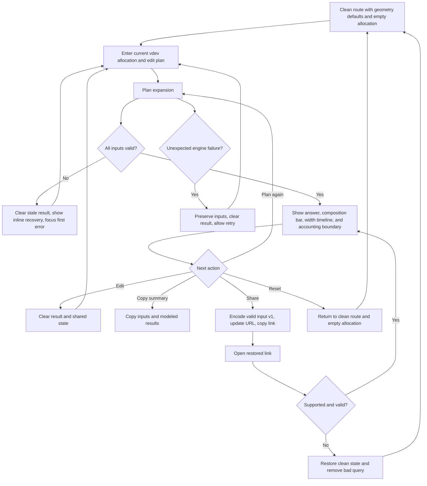

# Implementation report: RAIDZ Expansion Planner

Status: ready
Tool: RAIDZ Expansion Planner
Route: `/raidz-expansion-planner`
Depends on: `competitive-report.md`
Input fingerprint: `competitive-report.md sha256:fb4e7085ef6e43a6ce5653fb787c7c6bf04a39bfe3fa14431362aef69897f110`
Contract type: formula

## Product decision

- Primary user: A ZFS administrator with one healthy, unexpanded RAIDZ vdev who is deciding whether to widen it by one or more disks.
- Job: Estimate the modeled logical capacity available before expansion, immediately after each one-disk expansion, and in a fresh vdev at the final width, then understand the gap caused by old blocks retaining their original geometry.
- Product thesis: The planner earns preference by making the width transition the central visual, using version127's exact integer RAIDZ allocation primitive for every width, rejecting impossible plans, and keeping modeled physical allocation separate from the capacity that `df` or `zfs list` may report.
- Evidence: `competitive-report.md` sections `User pain evidence`, `Formula and data disagreements`, `Evidence-backed opportunities`, and `Comparison matrix`. Two direct competitors prove demand, but neither combines an exact block-allocation basis, a complete step timeline, strict invalid states, and a visible accounting boundary.

## Scope

### Table stakes

- Plan one RAIDZ1, RAIDZ2, or RAIDZ3 vdev from its current width through one or more sequential one-disk expansions.
- Use the smallest existing member capacity, added-disk capacity, current physical allocation, representative block size, and `ashift` to calculate the scenario with exact integer bytes.
- Keep the new disk size as a real preflight input. Reject a new disk smaller than the smallest existing member; treat larger excess as unavailable to this common-member model.
- Use an explicit `Plan expansion` action. Input and inventory actions never replace it.
- Show current modeled logical envelope, modeled capacity immediately after every step, a fresh/native comparator at the same width, and the gap between them.
- State beside the answer that parity and fault tolerance do not change.
- Keep reported capacity unknown. Explain that `zfs list`, `df`, and related accounting can stay pessimistic rather than manufacturing a reported number.
- Clear stale results after every edit, preserve invalid entries for recovery, and never silently clamp a width or capacity.
- Reset to the clean route; share only a submitted valid configuration through versioned state.

### Launch differentiators

- A width timeline shows each legal one-disk step, the immediate modeled logical envelope, the native comparator, and the remaining geometry gap.
- One exact final-width allocation bar divides the native logical envelope into old logical payload, newly writable logical data, and the geometry gap. Its adjacent values remain authoritative.
- Every width uses the shared `calculateRaidzAllocation()` primitive, so RAIDZ padding, sector rounding, `recordsize` or `volblocksize`, and `ashift` cannot drift from the ZFS capacity and padding tools.
- The result distinguishes physical-allocation modeling from reported filesystem accounting in the main answer, not in a distant disclaimer.
- A compact calculation trace exposes the old-block basis, new-width basis, unmodeled occupancy remainder, and every integer floor.

### Deferred

- Importing real `zpool list -vp`, `zpool status`, or `zdb` output.
- A scenario with known earlier expansion generations.
- Writes, deletes, or rewrites between planned expansion steps.
- Comparing expansion against a new top-level vdev or a replacement-and-rebuild plan.
- CSV, image, or PDF export.
- An optional measured reflow throughput and duration range.

### Non-goals

- Do not decide that an expansion is safe, recommend a parity level, or replace a verified backup and platform-specific preflight.
- Do not predict `df`, `zfs list`, application-visible free space, or the exact value a running pool will report.
- Do not model mirrors, dRAID, SHR, Unraid, top-level vdev addition, parity conversion, drive replacement, or pool recreation.
- Do not predict reflow time, performance, IOPS, throughput, URE probability, or hardware failure risk.
- Do not model compression, deduplication, metadata, snapshots, copies, slop, fragmentation, gang blocks, special vdevs, quotas, reservations, or live pool writes.
- Do not execute, submit, or validate device commands against a running system.

## Formula and data contract

### Inputs and normalization

| Input | Type and unit | Default | Valid range | Normalization |
| --- | --- | --- | --- | --- |
| RAIDZ level | Enum: `raidz1`, `raidz2`, `raidz3` | `raidz2` | Exact enum only | Map to parity `P = 1`, `2`, or `3`. Preserve the current width if a level edit makes it invalid. |
| Current width | Integer members | `6` | `P + 1` to `63` | Parse base-10 digits only. Reject signs, decimals, exponents, unsafe integers, and whitespace-only values. A current width of 64 cannot expand within version 1. |
| Final width | Integer members | `7` | `currentWidth + 1` to `64` | Parse independently. Never clamp, swap, or interpret a smaller value as removal. The plan contains one attach per intervening width. |
| Smallest existing member capacity | Exact decimal plus unit | `8 TB` | Greater than zero through `10 PB` | Units: `GB`, `TB`, `GiB`, `TiB`. Convert with `bytesFromUnit()` to exact integer bytes, then align down to the selected sector size for formula use. Preserve the entered value for display. |
| Added-disk capacity | Exact decimal plus unit | `8 TB` | Existing member capacity through `10 PB` | Same parser and units. All planned added disks use this capacity. Formula common-member bytes remain the aligned smallest existing capacity; excess on larger new disks is reported as unavailable in this model. |
| Current allocated physical space | Exact decimal plus unit | Empty | `0` through aligned current raw vdev bytes | This is physical allocation in the selected vdev, not logical file size or a fill percentage. Parse exactly, preserve zero, and reject a value above the modeled current raw envelope. Align neither upward nor downward. |
| Workload term | Enum: `filesystem`, `zvol` | `filesystem` | Exact enum only | Changes the property label and allowed block-size ceiling, not the equations. |
| Representative block size | Exact integer bytes | `128 KiB` | Filesystem: 512 B to 16 MiB. Zvol: 512 B to 128 KiB. Power of two only. | Reuse the ZFS padding presets and exact custom parser. The value is a model assumption, not proof that every real record has this size. |
| `ashift` | Enum integer | `12` | `9`, `12`, `13`, `14` | Sector bytes `S = 2^ashift`. Show sector bytes beside the choice. |

Capacity decimals must convert to a whole byte without floating point. Input strings are limited to 256 characters. The serialized payload contains only `{ level, currentWidth, finalWidth, memberBytes, addedDiskBytes, allocatedBytes, workload, blockSizeBytes, ashift }`. Results, display units, labels, copied text, timestamps, and derived values are never serialized.

### Equations or resolution order

Let:

- `P` be parity count.
- `N0` be current width and `Nf` final width.
- `S = 2^ashift` be sector bytes.
- `D = floor(memberBytes / S) * S` be aligned common-member bytes.
- `A` be current allocated physical bytes.
- `L` be representative logical block bytes.
- `allocation(N)` be `calculateRaidzAllocation({ logicalBytes: L, sectorBytes: S, width: N, parity: P })`.
- `B(N) = allocation(N).physicalBytes` be physical bytes consumed by one modeled logical block at width `N`.
- `C(N) = D * N` be the modeled raw common-member envelope at width `N`.

Derive the scenario in this order:

1. Validate all normalized inputs before calculating. Require `A <= C(N0)` and `addedDiskBytes >= memberBytes` before sector alignment. A failed validation returns no values.
2. Calculate the old block generation once: `oldBlockCount = floor(A / B(N0))`, `oldLogicalBytes = oldBlockCount * L`, and `occupancyRemainderBytes = A - oldBlockCount * B(N0)`. The remainder stays consumed physical space but cannot be assigned a logical payload under the one-block-size model.
3. Calculate the current native block capacity: `nativeBlockCount(N0) = floor(C(N0) / B(N0))` and `nativeLogicalBytes(N0) = nativeBlockCount(N0) * L`.
4. Calculate the current modeled writable logical bytes: `currentFreePhysicalBytes = C(N0) - A`, `currentNewBlockCount = floor(currentFreePhysicalBytes / B(N0))`, `currentWritableLogicalBytes = currentNewBlockCount * L`, and `currentImmediateLogicalBytes = oldLogicalBytes + currentWritableLogicalBytes`.
5. For every sequential expansion width `N` from `N0 + 1` through `Nf`, calculate `C(N)` and `B(N)` independently with the shared RAIDZ primitive.
6. Because version 1 assumes no writes, deletes, or rewrites between the planned attach operations, keep `A`, `oldBlockCount`, `oldLogicalBytes`, and `occupancyRemainderBytes` unchanged at every future step.
7. At each width, calculate `freePhysicalBytes(N) = C(N) - A`, `newBlockCount(N) = floor(freePhysicalBytes(N) / B(N))`, and `newWritableLogicalBytes(N) = newBlockCount(N) * L`.
8. Calculate the immediate modeled logical envelope at each width: `immediateLogicalBytes(N) = oldLogicalBytes + newWritableLogicalBytes(N)`.
9. Calculate the same-width fresh/native comparator: `nativeBlockCount(N) = floor(C(N) / B(N))` and `nativeLogicalBytes(N) = nativeBlockCount(N) * L`.
10. Calculate the geometry gap: `geometryGapBytes(N) = max(0, nativeLogicalBytes(N) - immediateLogicalBytes(N))`. A negative pre-clamp value is an engine invariant failure, not a valid result.
11. Calculate immediate gain from the current state: `immediateGainBytes(N) = immediateLogicalBytes(N) - currentImmediateLogicalBytes`.
12. Calculate the final-width composition bar from exact logical bytes: `oldLogicalBytes + newWritableLogicalBytes(Nf) + geometryGapBytes(Nf) = nativeLogicalBytes(Nf)`. If integer tails make this fail, the engine returns an invariant error and no result.
13. Calculate effective new-disk excess for disclosure only: `addedDiskExcessBytes = max(0, addedDiskBytes - memberBytes)` and `totalAddedDiskExcessBytes = addedDiskExcessBytes * (Nf - N0)`. It does not enter `C(N)`.
14. Return the exact `allocation(N)` sector counts for the initial and every future width so the trace can show how block allocation changed.

This formula estimates one vdev's logical data envelope from physical allocation. It is not a prediction of a pool accounting command. It intentionally uses the current allocated physical amount as the invariant occupied region because OpenZFS reflows old allocation without changing old blocks during expansion.

### Rounding, display, and versioning

- Every source capacity, block count, sector count, gap, and result uses `bigint`. No calculation step passes through JavaScript `Number`.
- Integer division floors only where the equations specify `floor`. Member capacity aligns down to a whole sector. Current allocated physical bytes remain exact and any non-block remainder is visible in the trace.
- Default display follows the user's member-capacity unit family: decimal input defaults result controls to TB; binary input defaults them to TiB. A result control may switch all capacity values between TB and TiB without changing stored bytes.
- Friendly capacity values show at most two decimal places, rounded half up by the shared formatter. Trace values can reveal exact bytes. Percentages use integer basis points with at most two decimal places.
- Timeline bar lengths derive from exact logical bytes. Text values and the table are authoritative when a nonzero segment is visually tiny.
- `calculatorId = raidz-expansion`, `calculationVersion = 1`, and `inputVersion = 1`. The shared storage schema and engine versions remain unchanged.
- Any changed occupancy meaning, historical-generation model, supported width, block-allocation equation, or output classification requires calculation version 2. A serialized shape change requires input version 2. Old adapters remain available so an old shared link is never reinterpreted under a new contract.
- Primary-source behavior was checked on 2026-08-13. Source drift requires review before changing formula version 1.

### Invalid, unknown, absent, and partial states

- Clean state uses valid geometry defaults but leaves current allocated physical space empty. It has no result and no error until submission.
- Blank, signed, exponential, fractional member counts; current width below `P + 1` or above 63; final width at or below current or above 64; and an unsupported RAIDZ value are invalid.
- Zero or negative member capacity, a decimal that cannot become whole bytes, unsupported units, or a capacity above 10 PB is invalid.
- A new disk smaller than the smallest existing member is invalid. A larger disk is valid, but the result discloses unused excess instead of treating it as immediately addressable by the common-member model.
- Blank allocated space is incomplete. Negative allocation, allocation above `C(N0)`, a decimal that cannot become exact bytes, or an unsupported unit is invalid. Zero is valid.
- Unsupported workload, block size, or `ashift` follows the existing ZFS padding validation. A workload edit preserves a now-invalid block size and explains the applicable limit.
- Any invalid or incomplete input clears the old result immediately. An invalidating error and numeric result never coexist.
- There is no loading, partial upstream, timeout, or no-data state. The calculation is synchronous and local. An unexpected engine or invariant failure preserves inputs, clears results, and shows a compact retry message.
- A valid shared state restores inputs and calculates immediately because the saved link represents an explicit completed action.
- Corrupt base64url, invalid UTF-8 or JSON, unsafe keys, reserved BigInt tags, extra payload keys, oversized state, wrong calculator ID, unsupported schema/engine/formula/input version, or invalid payload restores clean defaults, removes the query parameter, shows one restoration notice, and produces no result.
- A result may say reported capacity is unknown; it must never show a numeric reported-capacity estimate.

### Assumptions and exclusions

- Version 1 models exactly one current RAIDZ vdev that has never been expanded. Every existing modeled block is assumed born at `N0`.
- Planned future expansions happen one disk at a time with no writes, deletes, snapshots, rewrites, or other allocation changes between them. The step timeline is a plan, not a progress monitor.
- All existing modeled data and all future writable capacity use the selected representative block size, workload terminology, and `ashift`. Real pools contain metadata and a distribution of block sizes.
- The entered allocation is physical occupied space in this vdev. If it includes metadata, multiple block geometries, slop, or another vdev's allocation, the logical envelope will not match the live pool.
- The smallest existing member limits the common-member envelope. Larger added-disk excess is excluded until the relevant vdev-size conditions change outside this model.
- Reflow scratch space, automatic scrub work, temporary performance, pauses, and duration are excluded from capacity output.
- `zfs list`, `zpool list`, `df`, file logical size, block accounting, and actual free-space reporting can use different bases. OpenZFS documents that reported space may remain pessimistic. Those values are unknown here.
- Expansion keeps parity and failure tolerance unchanged. It does not convert RAIDZ1 to RAIDZ2 or RAIDZ3.
- The route offers a non-executable command shape only in supporting text after the tool is stable. It never includes real device identifiers, `-f`, or an execution action.

### Primary sources

- [OpenZFS 2.3.0 release](https://github.com/openzfs/zfs/releases/tag/zfs-2.3.0), checked 2026-08-13. Supports RAIDZ Expansion availability in OpenZFS 2.3.0.
- [OpenZFS `zpool-attach(8)`](https://openzfs.github.io/openzfs-docs/man/master/8/zpool-attach.8.html), checked 2026-08-13. Supports one-disk attachment, minimum new-device size, expansion progress, unchanged redundancy, repeated expansion, old and new parity ratios, scrub behavior, and reported-space caveat.
- [OpenZFS Changing Pool Layout](https://openzfs.github.io/openzfs-docs/Basic%20Concepts/Pool%20Structure/Changing%20Pool%20Layout.html), checked 2026-08-13. Supports the distinction between widening one RAIDZ vdev, adding a top-level vdev, and replacing every member.
- [OpenZFS RAIDZ](https://openzfs.github.io/openzfs-docs/Basic%20Concepts/Pool%20Structure/RAIDZ.html), checked 2026-08-13. Supports parity levels, minimum geometry, block-size and sector effects, and old-block behavior after expansion.
- [OpenZFS `vdev_raidz.c`](https://raw.githubusercontent.com/openzfs/zfs/master/module/zfs/vdev_raidz.c), checked 2026-08-13. Supports reflow without logical rewrite, health and pause behavior, repeated expansion, time-dependent geometry, copied allocation, and post-expansion scrub.
- [OpenZFS `zpool-features(7)`](https://openzfs.github.io/openzfs-docs/man/master/7/zpool-features.7.html), checked 2026-08-13. Supports the `org.openzfs:raidz_expansion` feature and its on-disk compatibility boundary.

## User flow



The explicit action is deliberate. Current allocation is required and may be incomplete while the user copies a value from their system. Editing never writes URL state or leaves a stale result visible.

## Interface wireframes

### Desktop: clean

```text
RAIDZ expansion planner

+----------------------------------------------------------------------------+
| RAIDZ level       RAIDZ1  [RAIDZ2]  RAIDZ3                                |
| Current width     [ 6 ]             Final width        [ 7 ]               |
| Smallest member   [ 8       ] [TB]  Added disks        [ 8       ] [TB]    |
| Current allocated [             ] [TB]                                     |
|                                                                            |
| Workload          [Filesystem]  Zvol                                       |
| recordsize        [128 KiB v]        ashift            [12, 4 KiB v]       |
|                                                                            |
| [Reset]                                             [Plan expansion]        |
+----------------------------------------------------------------------------+
```

The clean frame contains no placeholder result cards. The primary action is visible even though allocated space is initially incomplete.

### Desktop: result

```text
+----------------------------------------------------------------------------+
| Inputs remain editable                                                     |
| [Reset]                                             [Plan expansion]        |
|============================================================================|
| Widening this RAIDZ2 vdev from 6 to 8 members adds about 19.2 TiB of       |
| modeled writable logical capacity now. Parity stays RAIDZ2.                |
|                                                          [TiB] [TB]        |
|                                                                            |
| Final 8-wide modeled logical envelope                                      |
| [ old logical payload ][ newly writable ][ gap to fresh 8-wide ]           |
|                                                                            |
| Immediate envelope  67.2 TiB     Fresh 8-wide  72 TiB     Gap  4.8 TiB     |
| Reported by df or zfs list: unknown                                        |
|                                                                            |
| Expansion steps                                                           |
| Width     Immediate envelope    Gain now    Fresh at width    Gap           |
| 6         ...                   current     ...               ...           |
| 7         ...                   ...         ...               ...           |
| 8         ...                   ...         ...               ...           |
|                                                                            |
| What stays the same: RAIDZ2, two-device fault tolerance                    |
| New device excess excluded: 0 B                                            |
| > Show exact calculation                                                   |
|                                                                            |
| [Copy summary] [Share configuration]                                       |
+----------------------------------------------------------------------------+
```

The values above illustrate hierarchy only. Tests must derive fixture truth from the locked integer contract rather than copy these placeholders.

### Narrow mobile

```text
RAIDZ expansion planner

+----------------------------------+
| RAIDZ level                      |
| [R1] [R2] [R3]                  |
| Current width                   |
| [ 6                            ]|
| Final width                     |
| [ 8                            ]|
| Smallest member                 |
| [ 8                    ][TB v]  |
| Added disk size                 |
| [ 8                    ][TB v]  |
| Current allocated              |
| [                      ][TB v]  |
| Workload                        |
| [Filesystem] [Zvol]             |
| recordsize                      |
| [128 KiB                     v] |
| ashift                          |
| [12, 4 KiB                   v] |
|                                  |
| [Plan expansion                 ]|
| [Reset                          ]|
|==================================|
| 19.2 TiB more is writable now.  |
| RAIDZ2 stays RAIDZ2.             |
|                                  |
| Immediate           67.2 TiB    |
| Fresh 8-wide          72 TiB    |
| Gap                  4.8 TiB    |
| Reported value        unknown    |
|                                  |
| [old][new writable][gap]         |
|                                  |
| Expansion steps                 |
| 6 wide   current                 |
| 7 wide   ...                     |
| 8 wide   ...                     |
|                                  |
| [Show exact calculation]         |
| [Copy summary] [Share]           |
+----------------------------------+
```

At 320 CSS pixels, capacity and unit controls remain on one row where possible and otherwise reflow as one labeled control group. The page has no horizontal scroll, clipped values, overlapping actions, or icon-only primary action.

### Error, loading, partial, and restored states

Invalid final width:

```text
+----------------------------------------------------------------------------+
| Current width [ 6 ]       Final width [ 5 ]                                |
|                           Final width must be greater than 6.               |
| [Reset]                                             [Plan expansion]        |
|----------------------------------------------------------------------------|
| No old result is rendered. Focus moves to Final width.                     |
+----------------------------------------------------------------------------+
```

Invalid new disk:

```text
+----------------------------------------------------------------------------+
| Smallest member [ 8 TB ]  Added disk [ 6 TB ]                              |
|                           The added disk must be at least 8 TB.             |
| No result. The typed 6 TB remains available to correct.                    |
+----------------------------------------------------------------------------+
```

```text
Valid shared state: inputs restored, result recalculated, "Shared plan loaded"
Invalid shared state: clean defaults, empty allocation, no result, restoration notice
Unexpected failure: inputs preserved, no result, "Planning failed. Try again."
Loading: not rendered because calculation is synchronous and local
Partial/no data: not rendered; incomplete form is an editor state, not a result
```

## Interaction contract

| Event | UI response | Result state | Focus/announcement | URL/persistence |
| --- | --- | --- | --- | --- |
| First clean visit | Render geometry defaults and blank current allocation. Keep both actions visible. | No result and no error. | Normal document focus; no announcement. | Keep `/raidz-expansion-planner` exactly. |
| Edit any control | Preserve the editor value and optionally expose dependent validation. | Remove the old result immediately. | Keep focus on the edited control; announce `Inputs changed` once. | Remove any `state` query with `history.replaceState`. |
| Submit valid inputs with button or Enter | Calculate the current state and every width step. | Show only the current valid result. | Move focus to a `tabIndex=-1` result heading and announce the answer sentence through one polite live region. | Keep the clean route unless Share is used. |
| Submit invalid or incomplete inputs | Show inline recovery beside each invalid field and a compact form summary. | No result. | Move focus to the first invalid control; use `aria-invalid` and `aria-describedby`. | Keep or restore clean route. |
| Change RAIDZ level so a width is invalid | Keep both width values and show both dependent errors as needed. | Clear result. | Keep focus on the chosen level; announce the first new error politely. | Clean route. |
| Change unit | Preserve exact normalized bytes only when the current value converts exactly; otherwise keep the string and show the parser error on submit. | Clear result. | Keep focus. | Clean route. |
| Expand calculation trace | Show numbered width allocations, old-block derivation, remainder, formula version, and source links. | Keep result. | Use native disclosure behavior; do not steal focus. | No change. |
| Copy summary | Copy a plain-text answer, exact inputs, final comparison, parity statement, accounting caveat, and formula version. | Keep result. | Announce `Copied` or `Copy failed`. | No change. |
| Share configuration | Encode only the valid normalized input, replace the URL with one `state` parameter, and copy the absolute link. | Keep result. | Announce `Share link copied` or `Share failed`. | Versioned state appears only after this action. |
| Open a valid shared link | Restore inputs and calculate through the registered formula version. | Show recalculated result. | Do not steal focus on initial render; expose `Shared plan loaded` as a polite status. | Preserve supported `state` until edit or reset. |
| Open an invalid shared link | Restore clean defaults and empty allocation, remove the bad query, and show one notice. | No result. | Notice is polite; normal document focus. | `history.replaceState` restores the flat base route. |
| Reset | Restore geometry defaults, blank allocation, no errors, and no result. | No result. | Focus the first RAIDZ choice. | Restore `/raidz-expansion-planner`. |
| Unexpected engine failure | Keep inputs and show a neutral retry message. | No result. | Move focus to the failure message. | Clean route. |

## Page composition

| Claim or task | Medium | Position | Why this medium |
| --- | --- | --- | --- |
| What this planner answers | Two-sentence server-rendered introduction | Immediately below h1, before tool | A short scope boundary prevents users from confusing expansion with a fresh pool calculator. |
| Enter the current vdev and intended widths | Tool UI form in the single framed surface | Tool head | Inputs are actions, not prose or cards. |
| Immediate answer and unchanged parity | Answer sentence plus four exact values | First result region | The real decision is visible before audit detail. |
| Old logical payload, new writable capacity, and gap | One exact proportional bar with adjacent value rows | Directly under answer | This is a part-to-whole relationship at the final width. |
| One-disk expansion sequence | Compact responsive table/timeline | After final-width bar | Three or more repeated width facts belong in a table, with structural connectors allowed on narrow screens. |
| Exact math and source versions | Native disclosure with derivation table | End of tool result | Experts can audit without forcing everyone through the details. |
| Difference between reflow, rewrite, and reported capacity | A small concept table plus a few sentences | Server-rendered guide after tool | Repeated terms need comparison; the accounting caveat needs a sentence beside it. |
| Preconditions and unsupported cases | Compact checklist/table | After the concept distinction | Exact operational boundaries scan better than a warning essay. |
| Existing related ZFS tools | Two internal links in a short closing sentence | End of guide | Pool planning and block padding are real adjacent next steps, not extra features in this tool. |

No marker art, clean chart, or screenshot is required. The live width timeline and exact allocation bar already carry the core visual explanation. Public writing is deferred to the writing stage after technical QA.

## Technical plan

### Architecture and file ownership

- Route source: `app/(site)/(tools)/raidz-expansion-planner/page.tsx`. It renders the shared `AppShell`, title treatment, short server introduction, client tool island, and later server-rendered guide. It contains no route-owned metadata, canonical, robots, sitemap, or JSON-LD logic.
- Client island: `app/(site)/(tools)/raidz-expansion-planner/raidz-expansion-planner.tsx`. It owns editor strings, submission, restoration, focus, copy/share/reset behavior, unit display, and result rendering. It does not own formula logic.
- Colocated styling: `app/(site)/(tools)/raidz-expansion-planner/raidz-expansion-planner.module.css`. It uses shared tokens and prose primitives, one outer tool frame, no nested card dashboard, no page-level overflow, and no changes to `app/globals.css`.
- Pure engine: `lib/storage/zfs-expansion.ts`. It owns strict input validation, integer formulas, step generation, result values, source metadata, summary formatting, adapter registration, and versions. Export it from `lib/storage/index.ts`.
- Shared primitive: reuse `lib/storage/zfs-raidz-allocation.ts` without duplicating its math. A needed shared fix requires regression tests for the ZFS capacity and padding tools before adoption.
- Collection ownership: add the flat `/raidz-expansion-planner` link and identity icon to `app/(site)/storage-tools/page.tsx` and `storage-tools-sidebar.tsx`; update only collection-owned count and tests. The collection does not own the tool's URL namespace.
- Ownership manifest: `tests/pages/raidz-expansion-planner/page.json`, state `unpublished`, with docs, route tests, engine tests, Browser tests, shared preview script, and applicable skills.
- Tests: `tests/pages/raidz-expansion-planner/raidz-expansion-planner.test.mjs` for formula/validation/state/format fixtures, `page.test.mjs` for server content and policy, and `raidz-expansion-planner.spec.ts` for Browser interactions, accessibility, widths, themes, restoration, and clean URL behavior.
- Scripts: no new page-specific script is required for version 1. Reuse `scripts/storage-tools/preview-local-pages.mjs` with an explicit local-only row during Browser QA and update `scripts/storage-tools/scripts.json` only if that shared script's owned purpose changes.
- Docs: this report, `competitive-report.md`, `brief.md`, later `edge-cases-and-tests.md`, and later `writing-and-seo.md` remain under `content_docs/raidz-expansion-planner/`.
- Dependencies: no new runtime or development package. Use shared storage state, byte parsing/formatting, result, icon, prose, and shell primitives.

### Accessibility, privacy, security, and performance

- Use a semantic form, fieldsets for RAIDZ level and workload, visible labels, native number/text inputs and selects, real buttons, one h1, ordered headings, `aria-invalid`, `aria-describedby`, and a focused result heading.
- Keep capacity value and unit in one logical labeled group. On narrow screens, reflow the group without separating its error or losing source order.
- The composition bar has an accessible sentence naming every segment and exact value. The table remains the authoritative repeated-fact structure and uses column headers on desktop, labeled stacked rows on narrow screens.
- Do not rely on chartreuse or semantic color alone. Dark and light themes must preserve contrast, focus, zero-value legibility, and selected-state meaning.
- All calculation and encoding happen locally. Make no network requests, analytics events containing inputs or results, cookies, storage writes, device access, file upload, command execution, or clipboard read. Clipboard write occurs only after Copy or Share.
- Treat restored state as untrusted. Enforce envelope version, byte limit, exact keys, safe object prototypes, calculator ID, formula/input versions, BigInt validation, input bounds, and fresh recalculation. Never render serialized result text.
- Formula calculation across all supported widths must finish within 50 ms at the 95th percentile in the project test environment. Normal input and result rendering must not need a loading state.
- Add no new third-party JavaScript. Keep the route's client island within the established sibling tool budget and avoid one component per metric.
- Browser QA must cover at least 1280 x 800, 809 x 881, 390 x 844, and 320 x 720 in dark and light themes. Require `scrollWidth <= clientWidth` and no clipped control, table, value, action, or focus ring.

### Publication state

Keep `/raidz-expansion-planner` unpublished. It must not be added to the production `public.version127_pages` registry or sitemap and must return 404 outside a guarded local preview. The preview script may add an explicit local-database-only row for Browser QA and must remove or restore it before handoff. Publication, registry metadata, commit, push, and deployment require separate user approval.

## Acceptance criteria

| ID | Observable acceptance criterion | Evidence at build time |
| --- | --- | --- |
| R1 | The flat route source lives under `app/(site)/(tools)/raidz-expansion-planner` and the route stays unpublished outside guarded local preview. | Manifest, static policy, SEO test, registry diff. |
| R2 | Clean visit shows RAIDZ2, current width 6, final width 7, 8 TB member and added disk, filesystem, 128 KiB, ashift 12, blank allocation, visible Reset, and visible `Plan expansion`, with no result. | Component unit/static test and Browser. |
| R3 | RAIDZ1, RAIDZ2, and RAIDZ3 enforce `P + 1` minimum members, current width at most 63, final width greater than current and at most 64, without coercion. | Engine tests and Browser invalid-state tests. |
| R4 | Member, new-disk, and allocation inputs parse exact GB, TB, GiB, and TiB values without floating point, preserve invalid strings, and reject values outside contract. | Parser and engine tests. |
| R5 | A new disk smaller than the smallest existing member blocks results; a larger disk is valid and reports excluded excess without adding it to common capacity. | Unit fixtures and Browser. |
| R6 | Current allocated physical space is required, accepts exact zero, rejects more than the current raw envelope, and is never labeled as logical data or fill percentage. | Engine, page, and Browser tests. |
| R7 | Every initial and future width calls the shared RAIDZ allocation primitive with selected block size and `ashift`; no duplicated parity/padding formula exists. | Unit test spies or shared fixture equivalence plus source policy test. |
| R8 | A valid result exposes current immediate envelope, every sequential one-disk step, final immediate envelope, fresh final comparator, gain, and geometry gap as exact integer-derived values. | Authoritative formula fixtures and Browser result assertions. |
| R9 | The final composition reconciles old logical payload, newly writable logical data, and gap exactly to the fresh final comparator; an invariant failure returns no result. | Unit reconciliation and fault-injection tests. |
| R10 | The answer sentence leads with immediate gain and final width, states unchanged parity, and shows reported capacity as `unknown`, never as a number. | Page/component tests and Browser. |
| R11 | The width timeline is a table on desktop and a readable labeled sequence on narrow screens, preserving all exact values and current/final emphasis. | Browser desktop/mobile screenshots and accessibility tree assertions. |
| R12 | Editing any input clears prior results and shared state immediately; invalid input and numeric results never coexist. | Component and Browser regression tests. |
| R13 | Valid submission by button or Enter focuses and announces the answer once; invalid submission focuses the first bad control with an associated recovery message. | Browser keyboard and accessibility tests. |
| R14 | Reset restores clean defaults, blank allocation, no errors, no result, clean URL, and focus on the first RAIDZ choice. | Browser. |
| R15 | Share is available only for a valid submitted result, serializes only normalized input under `raidz-expansion` v1, updates the URL only on explicit action, and copies the link. | State unit tests and Browser clipboard/URL tests. |
| R16 | A valid share restores and recalculates; corrupt, wrong-calculator, unsupported, oversized, unsafe, or invalid state restores clean defaults, removes the query, and shows no result. | State unit tests and Browser restoration tests. |
| R17 | Copy writes a plain-text summary only after user action and reports success or failure without reading the clipboard. | Component/Browser tests. |
| R18 | The calculation trace lists initial/future block allocations, old block count, physical remainder, free physical bytes, formula version, assumptions, and dated OpenZFS sources. | Unit result contract, page test, Browser disclosure. |
| R19 | No loading, upstream failure, duration estimate, safety verdict, parity conversion, compression estimate, or numeric reported-capacity result appears. | Static and negative unit tests. |
| R20 | The framed tool, actions, values, composition bar, and timeline fit 1280, 809, 390, and 320 CSS pixel widths in both themes with no page overflow. | Browser measurements and visual review. |
| R21 | The route adds no new dependency, network request, input analytics, cookies, local/session storage, upload, device access, or command execution; calculation completes within the 50 ms budget. | Static scan, Browser request log, performance unit test. |
| R22 | The storage-tools collection links to the flat route with the same identity icon and count, without creating a nested `/storage-tools/raidz-expansion-planner` route. | Hub tests, route inventory, and Browser. |

## Open questions and blockers

- None. Occupancy is locked to current physical allocation in the selected vdev. The result models physical allocation and deliberately leaves command-reported capacity unknown. Version 1 supports an unexpanded current vdev and planned sequential widths through 64, with no allocation changes between planned steps.
