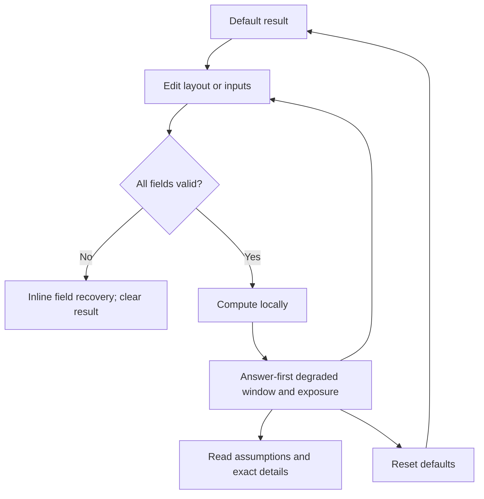

# Implementation report: Rebuild Window and Read-Error Exposure Calculator

Status: ready
Tool: Rebuild Window and Read-Error Exposure Calculator
Route: `/rebuild-calculator`
Depends on: `competitive-report.md`
Input fingerprint: `competitive-report.md sha256:9c0712973b389965bcc4e2fb5e003012cb929750a6ecf4ed1196ebfcea144be8`
Contract type: formula

## Product decision

- Primary user: A homelab builder or NAS operator who is sizing an array or is looking at a degraded array before a rebuild starts.
- Job: Estimate how long the array will remain degraded and how much source media the rebuild model reads, then see the modeled chance of at least one specified read error during that exposure.
- Product thesis: The page earns preference by putting the rebuild window, exact read work, and the transparent URE exposure model in one answer-first result without turning the result into an unsupported data-loss verdict.
- Evidence: The competitive report's search-intent table, the RaidSize review, the ToolFoundry review, the ReclaiMe review, and the formula-and-data-disagreements section.

## Scope

### Table stakes

- Support standard RAID 1, RAID 5, RAID 6, and RAID 10 layouts with explicit minimum drive counts.
- Accept drive count, decimal drive capacity, effective rebuild throughput, member read scope, URE specification, and replacement delay.
- Show rebuild copy time, total degraded window, modeled source bytes read, source-drive equivalents, modeled probability of at least one read error, and modeled read-error tolerance.
- Keep the formula and its assumptions close to the result, including the RAID 6 minimum-read choice.
- Validate every input before computing, clear stale results after an invalid edit or submit, and offer a visible reset.
- Work locally in the browser. Do not send inputs to an API, persist them in browser storage, or put them in the URL.
- Remain usable at 320px, 375px, 760px, and desktop widths in light and dark themes.

### Launch differentiators

- Use one calm result surface where the degraded window is the primary answer and read exposure is its directly related evidence.
- Show exact bytes read and the source-drive count so the percentage can be audited instead of presenting a categorical risk label.
- Treat replacement delay as part of the degraded window while keeping it separate from the data-copy time.
- Name the read-scope input as a model assumption and default it to a full member, avoiding an implicit claim about a particular filesystem or controller.
- Show modeled read-error exposure and error tolerance as separate values. Never collapse them into a data-loss verdict.

### Deferred

- MTTDL, AFR, second-drive timing, fleet size, correlated failures, hot-spare behavior, and annual failure estimates.
- RAIDZ, SHR, Unraid, nested RAID, mixed drive sizes, and controller-specific rebuild scheduling.
- Share links, export files, browser persistence, remote drive lookups, and vendor recommendations.
- Comparison mode, historical tracking, and charts across several scenarios.

### Non-goals

- This is not a capacity planner, a performance benchmark, a drive selector, a recovery procedure, or a guarantee that an array will survive a rebuild.
- `P(at least one modeled read error)` is not `P(data loss)`, `P(rebuild failure)`, or an observed drive-failure rate.
- `Read-error tolerance` describes the modeled RAID parity margin for this simplified exposure calculation. It does not promise that a particular controller, filesystem, or scrub implementation will recover after every media error.

## Formula and data contract

### Inputs and normalization

All capacity and throughput units use decimal SI values. One GB is `10^9` bytes, one TB is `10^12` bytes, and one PB is `10^15` bytes. URE choices are rates in errors per bit read.

| Input | Type and unit | Default | Valid range | Normalization |
| --- | --- | --- | --- | --- |
| `raidLevel` | enum: `raid1`, `raid5`, `raid6`, `raid10` | `raid6` | listed enum only | Store the enum; no inferred aliases. |
| `driveCount` | integer, drives | `6` | RAID 1: 2; RAID 5: 3-20; RAID 6: 4-20; RAID 10: 4-20 and even | Parse a finite base-10 integer. Reject fractions, signs, blanks, and non-numeric text. |
| `driveCapacity` | positive decimal number | `8` | `0 < value <= 100000` | Parse a finite number and multiply by the selected decimal capacity unit. |
| `capacityUnit` | enum: `TB`, `GB`, `PB` | `TB` | listed enum only | Convert to bytes before calculation. |
| `rebuildThroughput` | positive decimal number, MB/s | `150` | `0 < value <= 100000` | Convert decimal MB/s to bytes per second. This is effective end-to-end rebuild throughput, not a disk-interface maximum. |
| `memberReadScope` | decimal percentage | `100` | `1 <= value <= 100` | Divide by 100 to get a fraction. Label the value as the modeled portion of each source member read. |
| `ureExponent` | integer exponent `14`, `15`, or `16` | `15` | listed exponent only | Convert to `ureBits = 10^ureExponent`. Display as `1 error per 10^n bits`. |
| `replacementDelay` | non-negative decimal hours | `0` | `0 <= value <= 8760` | Convert to seconds. This is time before the rebuild copy begins and remains part of the degraded window. |

The UI may use number inputs and native selects, but the engine receives a normalized object with finite numeric values and enum values only. Empty strings, `NaN`, `Infinity`, exponent notation that cannot be represented by the parser, unknown enums, and values outside the ranges above are invalid.

### Equations or resolution order

Formula contract version: `rebuild-exposure-v1`.

1. Validate all normalized inputs and the layout-specific drive-count rule. If any check fails, return field errors and no result.
2. Resolve the minimum reconstruction source-drive equivalents for one failed drive:
   - RAID 1: `1`
   - RAID 5: `N - 1`
   - RAID 6: `N - 2`
   - RAID 10: `1`
3. Resolve modeled additional read-error tolerance:
   - RAID 1: `0`
   - RAID 5: `0`
   - RAID 6: `1`
   - RAID 10: `0`
4. Convert capacity: `memberBytes = driveCapacity * capacityUnitBytes`.
5. Convert throughput: `bytesPerSecond = rebuildThroughput * 10^6`.
6. Convert the scope: `scopeFraction = memberReadScope / 100`.
7. Calculate modeled source bytes read: `readBytes = sourceDriveEquivalents * memberBytes * scopeFraction`.
8. Calculate copy time: `copySeconds = readBytes / bytesPerSecond`.
9. Calculate degraded window: `degradedSeconds = replacementDelay * 3600 + copySeconds`.
10. Calculate the modeled expected read-error exposure units: `lambda = readBytes * 8 / 10^ureExponent`.
11. Calculate the modeled probability of at least one specified read error with a numerically stable expression: `readErrorProbability = -expm1(-lambda)`. This is equivalent to `1 - exp(-lambda)` for the supported range.
12. Return all source values and derived values. The engine never returns a success or data-loss verdict.

The RAID 6 rule is deliberately called a minimum reconstruction-read model. It uses `N - 2` full-drive equivalents because double parity can reconstruct the missing member with two parity equations, while a real implementation may read more media depending on stripe layout, filesystem behavior, scrubbing, controller policy, and the populated portion. The visible result must show the source-drive count and this caveat.

### Rounding, display, and versioning

- Keep calculations in unrounded numbers. Never feed formatted strings back into the engine.
- Display time as the largest useful combination of days, hours, and minutes, with one decimal hour when the result is under 48 hours and a rounded whole day plus hours when longer. Always expose an accessible exact decimal-hours label.
- Display bytes read using decimal units with two significant decimals below 100 and one decimal at or above 100. Keep the exact byte value in the accessible description and details table.
- Display probability as a percentage with two decimals below 1%, two decimals between 1% and 10%, and one decimal at or above 10%. Display `less than 0.01%` for a positive probability below that threshold and `100%` only when the unrounded value rounds to 100% at the displayed precision.
- Display `sourceDriveEquivalents` as an integer for the supported layouts and `read-error tolerance` as `0` or `1` additional specified errors.
- Use tabular numerals for result values. Exact raw values may be available in a details table, but the primary result must stay compact.
- Include `formulaVersion: rebuild-exposure-v1` in engine results for tests and future serialized diagnostics. No URL serialization is supported in v1, so an old URL cannot silently acquire new semantics.

### Invalid, unknown, absent, and partial states

- Any invalid field prevents a result. The result region is replaced by a short recovery message and no old numeric result remains visible.
- A RAID level change immediately revalidates the drive count. If the count is invalid for the new layout, show the layout-specific rule beside the field and keep the result absent.
- A blank or invalid number is not treated as zero. Replacement delay may be zero only when the user explicitly enters `0` or uses the default.
- A valid zero probability is displayed as `0%`; a probability that is only below display precision uses the lower-bound phrase above, not a fake zero.
- There is no loading, upstream failure, or partial-data state because the engine is synchronous and has no network dependency. The implementation may expose a brief calculating status to assist screen readers only if it does not delay the result.
- Reset restores the documented defaults and a valid default result. It is not a browser history action.
- Unexpected internal exceptions must render a generic local error state and never display a partly computed result.

### Assumptions and exclusions

- One drive is already failed and one rebuild is modeled. The tool does not model a second drive failure arriving during the window.
- Source reads are independent for the probability model, and the selected URE specification is treated as a constant per-bit rate. Vendor specifications, workload, age, temperature, sector remapping, controller behavior, and correlated errors are excluded.
- The read scope is a user-supplied model fraction. Full member is the safe default for a generic rebuild estimate. A lower value does not claim that a specific RAID implementation will skip untouched stripes.
- Rebuild throughput is effective user-observed throughput. It may include controller and workload effects, but the page does not infer it from drive marketing specifications.
- The probability is a mathematical exposure model and not a recommendation or guarantee.
- Inputs are transient component state only. No request, cookie, local storage, analytics event, or URL state carries calculator values.

### Primary sources

- Seagate IronWolf product manual: https://www.seagate.com/www-content/product-content/ironwolf/en-us/docs/100818527d.pdf, checked 2026-08-23. Supports the nonrecoverable read-error specification as a maximum rate per bits read.
- WD Red Plus data sheet: https://documents.westerndigital.com/content/dam/doc-library/th_th/assets/public/western-digital/product/internal-drives/wd-red-plus-hdd/data-sheet-western-digital-wd-red-plus-hdd.pdf, checked 2026-08-23. Provides a second vendor example of the URE specification.
- Intel RAID Software User Guide: https://cdrdv2-public.intel.com/840787/SWUG_full_featured_entry_RAID.pdf, checked 2026-08-23. Supports RAID 6 double-parity protection and the boundary between RAID-level tolerance and implementation behavior.
- Intel RSTe degraded-array rebuild guidance: https://www.intel.com/content/www/us/en/support/articles/000024286/server-products/server-boards.html, checked 2026-08-23. Supports degraded state and replacement-triggered rebuild behavior.
- Fujitsu RAID Protection and Drive Failure Fast Recovery: https://www.fujitsu.com/us/imagesgig5/Storage-RAID-Fast-Recovery-whitepaper.pdf, checked 2026-08-23. Supports the contrast between parity reconstruction and mirror rebuild reads.
- Research artifact: `competitive-report.md`, fingerprinted above. Provides the competitor observations and the explicit rationale for the launch model.

## User flow



The default state computes immediately because the defaults are valid and give the user a reference answer. Later edits recalculate on an explicit `Calculate` button or Enter submission so a user can finish a group of edits without result thrash. Reset returns focus to the first input and announces that defaults were restored. The result heading is an `aria-live="polite"` region that announces only after a successful calculation; validation messages are associated with their fields and the first invalid field receives focus after submit. No URL or browser storage restoration exists in v1, so the restored state is reset only.

## Interface wireframes

### Desktop: clean/default result

```text
stack127 shell

Rebuild window and read-error exposure calculator
Estimate the degraded window and the source media read by one simplified rebuild model.

┌──────────────────────────────────────────────────────────────────────────────┐
│ Calculator                                                                    │
│ [RAID 1] [RAID 5] [RAID 6] [RAID 10]                                         │
│                                                                              │
│ Drive count [ 6 ]   Drive capacity [ 8 ] [ TB v ]                           │
│ Rebuild throughput [ 150 ] MB/s     Member read scope [ 100 ] %              │
│ URE specification [ 1 error per 10^15 bits v ]                               │
│ Replacement delay [ 0 ] hours                                                │
│                                                                              │
│ [Calculate] [Reset]                                                         │
│                                                                              │
│ RESULT                                                                       │
│ Total degraded window                                                        │
│ 2 days 11 hours                                                              │
│                                                                              │
│ Rebuild copy time     2 days 11 hours     Source media read    32.0 TB      │
│ Modeled read error    22.60%                 Additional errors tolerated 1  │
│                                                                              │
│ Model trace: [read scope bar: 32.0 TB] [URE scale: 22.60%]                  │
│ Source-drive equivalents: 4     Replacement delay: 0 hours                  │
│                                                                              │
│ [How this model works]                                                       │
│ Minimum reconstruction-read model. A real implementation may read more.     │
│                                                                              │
│ Exact details table: layout, inputs, bytes, formula version                  │
└──────────────────────────────────────────────────────────────────────────────┘
```

### Desktop: result with replacement delay

```text
┌──────────────────────────────────────────────────────────────────────────────┐
│ RESULT                                                                       │
│ Total degraded window                                                        │
│ 3 days 5 hours                                                               │
│                                                                              │
│ [replacement delay segment] + [rebuild copy segment] = degraded window       │
│ 18 hours before rebuild                 2 days 11 hours copying               │
│                                                                              │
│ The delay is included in the window but does not add read exposure.          │
└──────────────────────────────────────────────────────────────────────────────┘
```

### Narrow mobile

```text
stack127 shell

Rebuild window and read-error exposure calculator
Short intro.

┌─────────────────────────────┐
│ Calculator                  │
│ [RAID 1] [RAID 5]           │
│ [RAID 6] [RAID 10]          │
│                             │
│ Drive count                 │
│ [ 6 ]                       │
│ Drive capacity              │
│ [ 8 ] [ TB v ]              │
│ Rebuild throughput          │
│ [ 150 ] MB/s                │
│ Member read scope           │
│ [ 100 ] %                   │
│ URE specification            │
│ [ 1 error per 10^15 bits v ]│
│ Replacement delay            │
│ [ 0 ] hours                 │
│                             │
│ [Calculate] [Reset]         │
│                             │
│ RESULT                      │
│ Total degraded window       │
│ 2 days 11 hours             │
│                             │
│ Copy time       2d 11h      │
│ Source read     32.0 TB     │
│ Modeled error   22.60%      │
│ Tolerance       1 error     │
│                             │
│ [exposure visual]           │
│                             │
│ Source drives: 4            │
│ [How this model works]      │
│ Exact details table         │
└─────────────────────────────┘
```

### Error, loading, partial, and restored states

```text
Invalid configuration
┌──────────────────────────────────┐
│ Drive count [ 3 ]                │
│ RAID 6 needs at least 4 drives.  │
│                                  │
│ [Calculate]                      │
│ No result shown until fixed.     │
└──────────────────────────────────┘

Unexpected local error
┌──────────────────────────────────┐
│ We could not calculate this set. │
│ Check the inputs and try again.  │
│ [Reset defaults]                 │
└──────────────────────────────────┘
```

There is no network loading or upstream failure state. If a calculating status is added for assistive technology, it is transient and must be replaced by either a complete result or the generic local error state.

## Interaction contract

| Event | UI response | Result state | Focus/announcement | URL/persistence |
| --- | --- | --- | --- | --- |
| Initial render | Show controls with documented defaults and computed result | Valid default result | Heading is visible; no unsolicited announcement on page load | None |
| Select RAID level | Update the layout rule and revalidate count | Pending until Calculate; clear if current count is invalid | Keep focus on selector; expose rule text | None |
| Edit a field | Preserve input text and mark dirty | Previous result remains only while all current fields are valid; otherwise clear immediately | Do not announce every keystroke | None |
| Press Calculate or Enter | Normalize, validate, compute synchronously | Complete result or field error state, never both | Focus first invalid field; otherwise announce result heading politely | None |
| Invalid field | Show field-specific message and layout-specific bounds | No numeric result | `aria-describedby` links message to field | None |
| Reset | Restore all defaults and compute | Valid default result | Focus first input and announce defaults restored | None |
| Open assumptions | Toggle a short model disclosure and details table | Result unchanged | Button has expanded state; disclosure is keyboard reachable | None |
| Narrow viewport | Stack controls and metric rows, allow long labels to wrap | Result unchanged | Reading order follows form, answer, details | None |
| Light/dark theme | Use shared tokens and semantic labels, never color alone | Result unchanged | Contrast remains accessible | None |

## Page composition

| Claim or task | Medium | Position | Why this medium |
| --- | --- | --- | --- |
| Enter the scenario | Tool UI | First workbench band | Inputs are the user's job, not article prose. |
| Total degraded window | Exact result metric | Top of result | This is the primary answer. |
| Copy time versus replacement delay | Segmented duration visual plus exact labels | Immediately below primary metric | The relationship is easier to scan than a paragraph. |
| Source-drive count and bytes read | Exact result metrics and details table | Beside the window | These values audit the calculation. |
| Modeled read-error probability | Exact percentage plus a semantic exposure bar | Beside the window | The bar gives a visual scale while the number carries precision. |
| RAID 6 minimum-read caveat and probability limits | Short sentences in an assumptions disclosure | After result | These are caveats that genuinely need words. |
| Formula steps and normalized inputs | Details table | Collapsed after result | Repeated fields compare better in a table than prose. |
| Broader RAID advice | Not included | Not applicable | It would exceed the contract and imply a recommendation. |

## Technical plan

### Architecture and file ownership

- Route source lives under `app/(site)/(tools)/rebuild-calculator/` and owns the server route, the smallest client calculator island, the pure formula engine, the server-rendered supporting guide, and colocated CSS modules.
- The engine is the route-local `lib/rebuild-calculator/engine.ts` module with no React, DOM, time, network, storage, or formatting dependencies. It exports normalized input types, validation, calculation, and display-safe result values. The UI owns form state and formatting. This new lib path is owned only by this route and must not change the existing shared storage calculators.
- The server page renders the heading, short intent-setting copy, tool shell, and supporting guide. The calculator island owns only interactive inputs, validation, result rendering, and disclosure state.
- Route-owned tests live under `tests/pages/rebuild-calculator/`, including engine/unit tests, page behavior tests, static route ownership tests, and Browser/Playwright coverage. The ownership manifest is `tests/pages/rebuild-calculator/page.json` and must remain unpublished.
- Route-local helper scripts, if needed for guarded local preview or focused QA, live under `scripts/rebuild-calculator/`. No shared script, collection, hub, registry, migration, or other tool may change.
- `content_docs/rebuild-calculator/` owns this report, `brief.md`, `competitive-report.md`, `edge-cases-and-tests.md`, and `writing-and-seo.md`. Public page prose is added only after the technical tool is stable.
- Use existing AppShell, PageTitleIcon, shared typography, tokens, and prose classes. Add route styles in a colocated CSS module. Do not add global styles or new dependencies.

### Accessibility, privacy, security, and performance

- Use real labels, fieldsets, buttons, native select semantics where appropriate, a visible focus ring, keyboard-submit support, `aria-describedby` for errors, and an `aria-live="polite"` result heading.
- Do not rely on chart color. The exposure visual has text labels, a legend, and a useful accessible description. Do not use a colored left-edge callout.
- Keep all input and calculation work local. Do not read arbitrary URLs, use remote data, use cookies, use browser storage, or add analytics events for values.
- Bound numeric inputs before arithmetic, reject non-finite values, avoid unsafe integer assumptions in display formatting, and render no result when validation fails.
- Keep the client island small, avoid third-party chart libraries, use CSS for the exact exposure visual, and target a fast first render with server-rendered headings and guide text.
- Run the page at 320px, 375px, 760px, and desktop widths in both themes. Test keyboard and screen-reader-oriented semantics through DOM assertions.

### Publication state

Unpublished. The route may exist in the worktree for local validation, but its ownership manifest must say `state: unpublished`; do not edit `public.stack127_pages`, sitemap data, robots behavior, or any publication registry.

## Acceptance criteria

| ID | Observable acceptance criterion | Evidence at build time |
| --- | --- | --- |
| R1 | A valid default scenario renders a total degraded window, copy time, source bytes, source-drive equivalents, modeled read-error probability, and modeled tolerance. | Engine tests and Browser result assertion. |
| R2 | RAID 1, RAID 5, RAID 6, and RAID 10 use the documented source-drive and tolerance rules. | Table-driven engine tests. |
| R3 | Drive-count bounds change with layout and invalid configurations show field recovery with no stale result. | Engine invalid-case tests and Browser interaction test. |
| R4 | Decimal capacity units and MB/s throughput normalize to the documented byte equations. | Unit tests with GB, TB, and PB fixtures. |
| R5 | Read scope changes source bytes, duration, and modeled probability while replacement delay changes only the degraded window. | Unit tests and Browser result update test. |
| R6 | The probability uses a stable at-least-one-error model and displays a percentage without calling it data loss or rebuild success. | Boundary/precision tests and copy assertions. |
| R7 | The result exposes the RAID 6 minimum reconstruction-read model and its implementation caveat. | DOM content test and content review. |
| R8 | Reset restores defaults, recomputes, focuses the first field, and announces restoration. | Browser keyboard test. |
| R9 | No user inputs leave the browser through requests, storage, cookies, analytics, or URL state. | Static code review and Browser request/storage assertions. |
| R10 | The route is responsive and usable at 320px, 375px, 760px, and desktop widths in both themes with no horizontal page overflow. | Independent Playwright screenshots and assertions. |
| R11 | Server-rendered supporting content stays concise and follows the brief, with the tool before the guide and no FAQ or methodology sprawl. | Content/SEO validator and source review. |
| R12 | Route ownership is complete while publication remains unchanged and no shared storage files are modified. | Pipeline handoff validator and `git diff --name-only`. |

## Open questions and blockers

- None for the launch contract. The RAID 6 source-read disagreement is resolved as an explicitly named minimum-read model with a visible caveat.
- Delegated product-planning worker stalled during the orchestrated run; the main agent completed this contract from the ready research artifact and will re-run the product validator before test design.
