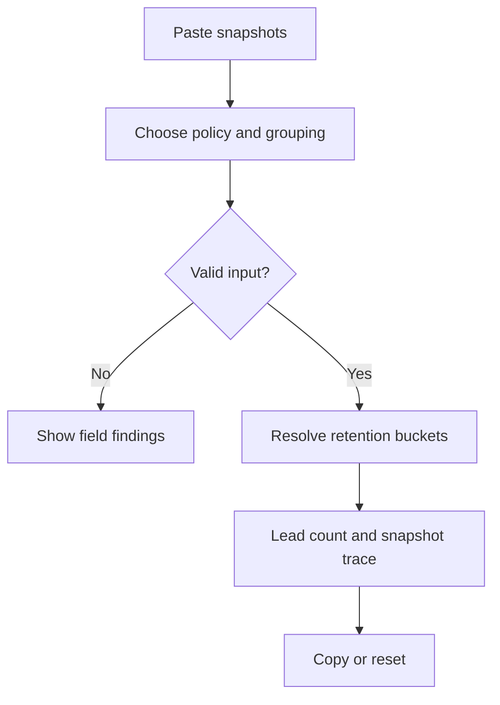

Status: ready
Tool: Restic retention simulator
Route: /restic-retention-simulator
Contract type: resolution

## Product decision

Primary user: a restic operator preparing a forget policy.

Job: preview which supplied snapshots survive and why.

Product thesis: a transparent offline trace is more useful than another command generator.

Evidence: official forget rules and repeated forum confusion support a per-snapshot explanation.

## Scope

### Table stakes

Accept restic-like snapshot JSON, retention counts, grouping, timezone, and a deterministic kept/pruned table.

### Launch differentiators

Show every rule that keeps each snapshot and the calendar bucket behind each choice. Keep all processing in the browser.

### Non-goals

Do not connect to a repository, execute restic, delete data, infer repository timezone, or model every future restic flag.

## Formula and data contract

### Inputs and normalization

Input is an object with `snapshots`, `policy`, `groupBy`, and `timezone`. A snapshot has a unique trimmed `id`, ISO `time`, native restic `hostname`, and optional `paths` and `tags`. The legacy `host` field remains accepted. Counts are integers from 0 through 365. Group keys serialize sorted arrays so distinct path or tag sets cannot collide.

### Equations or resolution order

Validate all snapshots, group them, then select newest snapshots for `keep-last` followed by one newest snapshot in each daily, weekly, monthly, and yearly calendar bucket. When a calendar rule requests more periods than the history contains, it also keeps the oldest snapshot in that group. A snapshot is kept when any rule selects it. Rules are evaluated against each group. Calendar boundaries use the supplied IANA timezone. This is a documented simulator of the official model: https://restic.readthedocs.io/en/stable/060_forget.html

### Rounding, display, and versioning

No numeric rounding affects decisions. Dates display in the selected timezone with an ISO fallback. Results carry `resolutionVersion: restic-retention-v1` and the input count.

### Invalid, unknown, absent, and partial states

Malformed JSON, duplicate IDs, invalid dates, empty snapshots, unknown grouping, or a policy with no positive rule is invalid. Missing host, paths, or tags are valid and grouped as empty values. An unknown timezone falls back to UTC only after an explicit warning.

### Assumptions and exclusions

The simulator omits keep-within, tag selectors, and repository-local timezone discovery in v1. It does not claim byte-level pruning or repository safety.

### Primary sources

Restic retention semantics: https://restic.readthedocs.io/en/stable/060_forget.html

Machine-readable snapshot output: https://github.com/restic/restic/blob/master/doc/075_scripting.rst

## User flow



## Interface wireframes

```text
DESKTOP
[Snapshot JSON textarea] [Policy counts + grouping]
[Preview retention]
[Kept 6 / 8 snapshots]
[timeline: kept reason | pruned reason]
```

```text
MOBILE
[Snapshot JSON]
[Policy]
[Preview retention]
[Kept 6 / 8]
[snapshot rows]
```

## Interaction contract

| Event | Result |
|---|---|
| Preview retention press | Validate, resolve, focus the lead result, and preserve input |
| Policy or grouping change | Clear stale result and keep the input visible |
| Reset press | Clear the snapshot input, keep a minimal policy, and announce the new state |
| Copy trace press | Copy plain text with a visible success or failure status |

## Page composition

| Claim | Medium | Detail |
|---|---|---|
| Which snapshots survive | Tool UI | Lead count and kept/pruned rows |
| Why a row survives | Tool UI | Rule and bucket beside each row |
| How grouping changes output | Table | Group key and snapshot count |
| Restic limitations | Sentences | Supporting Markdown below the workbench |

## Technical plan

The route shell and client workbench live under `app/(site)/(tools)/restic-retention-simulator/`. Pure resolution code lives in `lib/restic-retention-simulator/engine.ts`. Unit, page contract, and Playwright tests live in `tests/pages/restic-retention-simulator/`. Supporting content and pipeline artifacts live in `content_docs/restic-retention-simulator/`. The registry migration creates a complete unpublished tool row.

## Acceptance criteria

| ID | Requirement | Evidence |
|---|---|---|
| R1 | Valid snapshot JSON produces deterministic kept and pruned rows | Pure engine fixture |
| R2 | Grouping and timezone are explicit and affect resolution | Engine and browser state test |
| R3 | Invalid input never produces a deletion recommendation | Invalid-state test |
| R4 | Route uses shared shell and server-rendered supporting Markdown | Page contract test |
| R5 | Copy output contains the same rule trace shown in the table | Interaction test |
