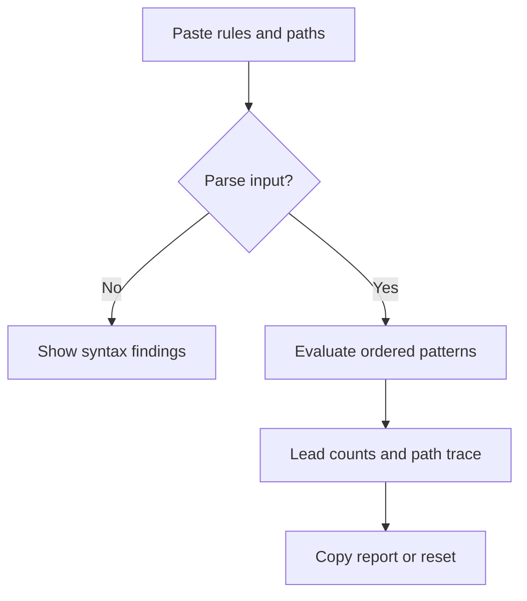

Status: ready
Tool: Rsync filter tester
Route: /rsync-filter-tester
Contract type: resolution
Input fingerprint: `competitive-report.md sha256:4f4a859b5fb12f2ebf860ee66b4922d754ba9988db66de07de0c5b3ceafba64d`

## Product decision

Primary user: an operator debugging an rsync filter file.

Job: determine which representative paths are sent, skipped, or never visited.

Product thesis: a first-match trace makes ordered filters understandable before a dry run.

Evidence: the rsync manual and mailing-list examples repeatedly require users to reason about order and parent traversal.

## Scope

### Table stakes

Accept newline-separated rules and relative file or directory paths. Support `+`, `-`, `!`, anchored paths, `*`, `**`, and `?` in the documented subset.

### Launch differentiators

Show the winning rule, rule line, and parent traversal state for every path. Include a copyable summary and a small sample tree.

### Non-goals

Do not run rsync, inspect a filesystem, resolve shell quoting, or claim complete parity with every version-specific filter flag.

## Formula and data contract

### Inputs and normalization

Rules are trimmed non-empty lines. A rule starts with `+` or `-`, followed by an optional space and pattern; `!` resets the rule list. Paths are UTF-8 relative paths; a trailing slash marks a directory. Duplicate paths are rejected. The transfer root is `/`.

### Equations or resolution order

Compile each supported pattern once. For each path and ancestor, check rules in source order and choose the first matching pattern. `*` matches characters except `/`, `**` matches any characters including `/`, and `?` matches one non-slash character. A trailing slash matches directories only; a pattern without a slash matches a basename at any depth. An excluded ancestor marks a descendant unvisited, including when the unmatched default excludes that ancestor. Syntax follows the rsync manual: https://rsync.samba.org/ftp/rsync/rsync.1

### Rounding, display, and versioning

There is no numeric rounding. Results show exact rule line numbers and `resolutionVersion: rsync-filter-v1`. Paths retain their entered spelling after slash normalization.

### Invalid, unknown, absent, and partial states

Invalid states include empty rules, malformed prefixes, absolute paths, duplicate paths, more than 1000 rules or paths, and unsupported character classes or rule modifiers. Unmatched paths follow the chosen default.

### Assumptions and exclusions

The checker models one transfer root and does not emulate shell expansion, daemon modules, delete mode, symlink metadata, or filesystem permissions. Directory traversal is inferred from the supplied tree only.

### Primary sources

Rsync filter syntax: https://rsync.samba.org/ftp/rsync/rsync.1

Ordering example: https://lists.samba.org/archive/rsync/2006-June/015744.html

## User flow



## Interface wireframes

```text
DESKTOP
[Rules textarea] [Representative paths textarea]
[Test filters]
[Included 4 | Excluded 2 | Unvisited 1]
[path | state | matching rule]
```

```text
MOBILE
[Rules]
[Paths]
[Test filters]
[Included / Excluded / Unvisited]
[path rows]
```

## Interaction contract

| Event | Result |
|---|---|
| Test filters press | Parse, resolve, focus the lead result, and retain both text areas |
| Text change after a result | Mark the result stale until the next test |
| Reset press | Clear both text areas and announce readiness |
| Copy report press | Copy rule traces and show a short status |

## Page composition

| Claim | Medium | Detail |
|---|---|---|
| Which paths transfer | Tool UI | Lead counts and state table |
| Why a path is skipped | Tool UI | Winning line and parent note |
| Pattern scope | Table | Rule, glob, and match examples |
| Rsync caveats | Sentences | Supporting Markdown below the workbench |

## Technical plan

The server shell and client workbench live under `app/(site)/(tools)/rsync-filter-tester/`. Pure pattern parsing and resolution live in `lib/rsync-filter-tester/engine.ts`. Unit, page contract, and Playwright tests live in `tests/pages/rsync-filter-tester/`. Supporting content lives in `content_docs/rsync-filter-tester/`; the registry migration creates a complete unpublished row.

## Acceptance criteria

| ID | Requirement | Evidence |
|---|---|---|
| R1 | First matching rule is reported for each matched path | Engine fixture |
| R2 | Slash-aware `*` and `**` behavior is deterministic | Glob tests |
| R3 | Excluded parents produce unvisited descendants | Traversal test |
| R4 | Invalid rules are recoverable and never silently included | Invalid-state test |
| R5 | Route uses shared shell and concise workbench states | Page contract test |
