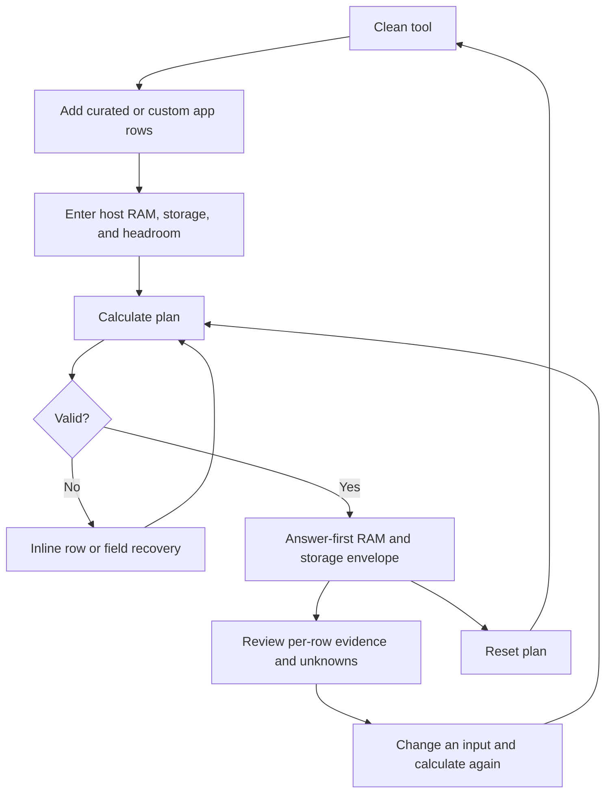

# Implementation report: self-hosted app resource planner

Status: ready
Tool: Self-hosted app resource planner
Route: `/self-hosted-app-resource-planner`
Depends on: `competitive-report.md`
Contract type: formula

## Product decision

- Primary user: A self-hosting builder deciding whether a chosen app mix fits on an existing or planned host.
- Job: Calculate a source-aware RAM and storage planning envelope, compare it with the host budget, and see what remains unknown.
- Product thesis: The planner earns preference by showing reviewed app ranges, explicit headroom, the binding known resource, and unknown coverage in one neutral result instead of hiding assumptions inside a hardware or provider recommendation.
- Evidence: Competitive report sections `User pain evidence`, `Technical truth to verify`, `Comparison matrix`, and `Evidence-backed opportunities`.

## Scope

### Table stakes

- Add multiple curated self-host apps and set a positive quantity for each row.
- Add a custom app row when the curated list does not contain the app.
- Enter host RAM and app-storage budgets.
- Set visible headroom for the plan, defaulting to 20 percent as an editable planning choice.
- Calculate an answer-first result with known RAM, known storage, budget remainder, and binding known resource.
- Show per-row evidence state and source links for curated values.
- Keep a row with missing data usable while refusing a false fit verdict for that resource.
- Keep all typed planning data in the browser after the app catalogue has rendered.

### Launch differentiators

- Aggregate reviewed RAM and storage ranges instead of one unexplained point value.
- Separate `known subtotal`, `unknown requirements`, and `within this budget` so missing evidence cannot read as zero.
- Show headroom as a user-controlled reservation against the host budget, not as an invisible multiplier.
- Show a short verification handoff to the app's documentation and Docker runtime observation rather than generating limits or claiming compatibility.
- Use the published self-host app directory as the curated option source while preserving the existing provenance model.

### Deferred

- Reviewed per-app CPU ranges or a CPU capacity calculation. The current directory schema has no reviewed per-app CPU requirement field.
- App-specific workload controls for media transcodes, OCR, camera retention, AI model size, and database concurrency.
- Shareable URLs, saved plans, exports, provider recommendations, hardware catalogue matching, and cost estimates.
- Live Docker host inspection, `docker stats` ingestion, Compose parsing, or Kubernetes output.

### Non-goals

- Do not say that an app will run, is compatible, or is safe on a host.
- Do not turn an estimate into Docker memory limits, CPU shares, reservations, or Compose YAML.
- Do not infer a resource requirement from an app category, image size, deployment method, popularity, or a missing source.
- Do not use an affiliate or provider recommendation as the primary result.
- Do not expose private app-directory rows or unpublished technical facts.

## Formula and data contract

### Inputs and normalization

| Input | Type and unit | Default | Valid range | Normalization |
| --- | --- | --- | --- | --- |
| Curated app row | Published app slug plus resource record | None | One or more rows | Resolve to the server-rendered catalogue record; keep slug stable. |
| Custom app name | String | Empty | 1 to 120 visible characters | Trim whitespace, collapse repeated whitespace, reject empty names. |
| Row quantity | Integer | 1 | 1 to 99 | Parse as base-10 integer; reject decimals, zero, and negative values. |
| Custom RAM lower bound | Decimal GiB | Empty | 0.05 to 4096 | Convert GiB to MiB for calculation; keep the entered precision for the row note. |
| Custom RAM upper bound | Decimal GiB | Empty | 0.05 to 4096 | Require it when a lower bound is entered; require upper >= lower. |
| Custom storage lower bound | Decimal GB | Empty | 0.1 to 100000 | Keep decimal GB and normalize to one internal numeric unit. |
| Custom storage upper bound | Decimal GB | Empty | 0.1 to 100000 | Require it when a lower bound is entered; require upper >= lower. |
| Host RAM budget | Decimal GiB | Empty | 0.25 to 4096 | Convert to MiB; this is the total host budget before the planner's reserve. |
| Host app-storage budget | Decimal GB | Empty | 1 to 1000000 | Keep decimal GB; this is storage available to app data and volumes. |
| Headroom reserve | Integer percent | 20 | 0 to 80 | Parse as an integer percentage and apply to both host budgets. |

Each curated app record passed to the client includes only published directory facts and a normalized resource summary:

```text
slug, name, icon metadata
ram: { minMb, maxMb, kind, confidence, basis, sourceUrls, note, checkedAt } | null
storage: { minGb, maxGb, kind, confidence, basis, sourceUrls, note, checkedAt } | null
```

The resource summary comes from `self_host_app_resource_estimates`. A missing resource summary remains null. The builder must not silently substitute `ram_min_mb`, `ram_recommended_mb`, image size, or a generated deployment default into the estimate range. Those facts may be shown as supporting evidence later only if the interface contract gives them a distinct label.

### Equations or resolution order

1. Validate every row, host budget, and headroom value. If any result-affecting input is invalid, return no result and field-level errors.
2. For each row and resource dimension, classify the value as `known-range` when both bounds exist, `unknown` when neither exists, or `partial` only if a future data record has one bound. Launch data should normally be `known-range` or `unknown`.
3. For every known-range dimension, multiply each bound by the row quantity and sum across rows:

   `knownMin = sum(row.quantity * row.resource.min)`

   `knownMax = sum(row.quantity * row.resource.max)`

4. Count rows with unknown or partial data for each dimension and retain their names and quantities. Do not add them as zero.
5. Calculate the host budget available to selected app resources:

   `available = hostBudget * (1 - headroomPercent / 100)`

6. For a dimension with no unknown rows, classify the plan using the known envelope:

   - `within`: `knownMax <= available`
   - `tight`: `knownMin <= available < knownMax`
   - `over`: `knownMin > available`

7. For a dimension with any unknown or partial row, show the known subtotal and mark fit as `unknown` even if the known subtotal fits. The user can still see the known subtotal and the missing rows.
8. Compare the `knownMax / available` ratios only for dimensions with complete ranges. The highest ratio is the binding known resource. If RAM and storage are both incomplete, binding resource is `unknown`.
9. Return a result object with separate RAM and storage dimensions, the available budgets, per-row contributions, unknown rows, headroom, and evidence metadata. Never return a success result alongside a validation error.

The launch formula intentionally does not create a CPU total. The result may include a non-calculating note when a curated app has a documented workload caveat, but that note does not change the RAM or storage arithmetic.

### Rounding, display, and versioning

- Formula version: `1`.
- Serialized-input version: `1`, reserved for a future explicit share action; launch does not write query parameters or local storage.
- Store and calculate RAM in integer MiB after converting user GiB input. Display RAM in GiB with one decimal below 10 GiB and the nearest whole GiB at or above 10 GiB; display the exact range when the bounds differ.
- Store storage in decimal GB. Display one decimal below 10 GB and the nearest whole GB at or above 10 GB.
- Round only for display. Fit comparisons use normalized source values and the full headroom calculation.
- Display percentages with one decimal when they are not whole. Never display a rounded `0` for a positive amount that still affects the calculation.
- Display evidence kind, confidence, and checked date in metadata or the source detail, not as a substitute for the result label.

### Invalid, unknown, absent, and partial states

- Empty app list: no calculation; the result says to add an app and the first app chooser receives focus after submit.
- Missing host RAM or storage: field error; no result because the comparison budget is absent.
- Invalid quantity, bound, budget, or headroom: field-level error; preserve all other inputs and focus the first invalid field.
- Lower bound greater than upper bound: row-level error; no result.
- Curated app with missing RAM or storage estimate: keep the row and mark that dimension unknown. Do not block calculation of the known other dimension, but withhold the affected fit verdict.
- Custom row with no numeric resource bounds: allow the row, show it in the unknown list, and withhold the affected fit verdict.
- Custom row with only one bound: either require the matching upper bound before calculation or treat it as partial and withhold fit. Launch should use the stricter validation path and require both bounds when a custom bound begins.
- No selected row after a reset: return to the empty state.
- Client calculation failure: keep inputs, clear only the stale result, announce a concise retry message, and focus the primary action.
- There is no upstream lookup after hydration. A server catalogue failure is a route-level error, not a fake empty catalogue.

### Assumptions and exclusions

- A selected range is a planning envelope from Stack127's reviewed evidence, not a publisher guarantee or an observed runtime profile.
- Headroom is a user-controlled reserve for the host, growth, and unmodeled load. It is not a Docker memory limit.
- RAM and storage are independent dimensions. A storage estimate describes app data and volume planning, not backups, parity, media-library growth, or the operating system unless the source note says so.
- The planner assumes selected rows share one host. It does not model scheduling, NUMA, GPU memory, hardware transcoding, I/O throughput, network bandwidth, swap, database tuning, or burst concurrency.
- A custom row is user-supplied planning input and is never presented as Stack127-verified evidence.
- The result is useful for deciding what to investigate next. It cannot prove that a stack will start or remain healthy.

### Primary sources

- Docker resource constraints: https://docs.docker.com/engine/containers/resource_constraints/, checked 2026-09-10. Supports the distinction between host capacity, hard limits, soft reservations, CPU shares, and OOM risk.
- Docker container stats: https://docs.docker.com/reference/cli/docker/container/stats/, checked 2026-09-10. Supports the runtime verification handoff.
- Stack127 self-host app schema: `content_docs/self-host-apps/schema.md`, checked 2026-09-10. Defines reviewed RAM and storage facts and planning-range provenance.
- Stack127 self-host app workflow: `content_docs/self-host-apps/data-workflow.md`, checked 2026-09-10. Defines review, source, workload, and unknown rules.

## User flow



The calculation is explicit because several repeatable rows and a host budget should be checked together. It is synchronous and local after the catalogue renders. A short calculating state prevents duplicate submission and announces completion through an `aria-live` status. Launch has no restored or shared URL state; a clean canonical route remains clean.

## Interface wireframes

### Desktop: clean

```text
Self-hosted app resource planner
Choose apps, enter a host budget, and see the known resource envelope.

APP MIX
  [Choose a published app or custom row                     v] [Add app]
  (No apps added yet)

HOST BUDGET
  [RAM budget                ] GiB    [App storage budget      ] GB
  [Headroom reserve          ] %

                                      [Calculate plan]
RESULT
  Add an app and a host budget to calculate a plan.
```

### Desktop: result

```text
APP MIX
  [Immich                                     v] [qty 1] [Remove]
    RAM 2.0-6.0 GiB (estimated)   Storage unknown
  [Vaultwarden                                v] [qty 2] [Remove]
    RAM 0.2-0.5 GiB (estimated)   Storage 1-2 GB (estimated)
  [Add app]

HOST BUDGET
  RAM 8 GiB    App storage 100 GB    Headroom 20%
                                      [Calculate plan]

RESULT
  RAM is the closest known budget
  RAM       2.4-7.0 GiB of 6.4 GiB available    UNKNOWN
  Storage   2-4 GB of 80 GB available           UNKNOWN
  Known subtotal, not a fit guarantee
  [RAM allocation bar with exact legend]
  Per-app contribution table
  Unknown requirements: Immich storage
  Evidence and verification: reviewed sources, then check app docs and runtime usage
```

### Narrow mobile

```text
title

APP MIX
[Choose app                         v]
[Add app]
row 1: app name
       quantity
       RAM range
       storage range
       Remove

HOST BUDGET
[RAM] GiB
[Storage] GB
[Headroom] %
[Calculate plan]

RESULT
lead answer
RAM summary
storage summary
binding resource
allocation bars
unknown list
per-app table in its own horizontal scroll region
source and verification note
```

### Error, loading, partial, and restored states

```text
Invalid:
  row error directly below the bad bound
  host error directly below the missing budget
  no result region

Calculating:
  [Calculate plan] remains fixed width and reads "Calculating..."
  previous result is hidden as stale until the new result returns

Partial:
  known subtotal remains visible
  affected dimension reads "Unknown: add a reviewed range or custom bounds"
  unknown rows are named and counted

Restored:
  not supported at launch; clean URL opens the clean state
```

## Interaction contract

| Event | UI response | Result state | Focus/announcement | URL/persistence |
| --- | --- | --- | --- | --- |
| Add curated app | Append one stable row with quantity 1 and evidence summary | Empty until calculate | Focus the new row's chooser | In memory only |
| Choose custom row | Replace the row with name and optional bound fields | Empty until calculate | Focus custom name | In memory only |
| Remove row | Remove only that row; keep other inputs | Previous result becomes stale | Focus the nearby add action or previous row | In memory only |
| Change quantity or bound | Keep input; mark existing result stale | No automatic recompute | No focus jump | In memory only |
| Submit valid plan | Compute synchronously | Result replaces stale state | Announce `Plan calculated`; move focus to result lead | No URL change |
| Submit invalid plan | Preserve values and show field or row errors | No result | Focus first invalid field; announce one summary | No URL change |
| Partial resource data | Render known subtotal and unknown state | Partial result, no affected fit verdict | Announce `Plan has unknown requirements` | No URL change |
| Reset | Clear rows and result; restore headroom default | Clean empty state | Focus app chooser; announce `Plan reset` | No URL change |
| Catalogue server error | Render route-level error with retry or navigation recovery | No fake catalogue or result | Announce error in page status | No persistence |

## Page composition

| Claim or task | Medium | Position | Why this medium |
| --- | --- | --- | --- |
| Choose the app mix | Interactive repeatable rows | Workbench first | The user has to act on the mix. |
| Work through the planning task | Tool UI | Workbench first | The tool UI is the primary visual medium and keeps inputs, action, and answer together. |
| Compare selected range with host budget | Exact result values plus allocation bars | Immediately after the action | Bars show the relationship; text keeps exact values accessible. |
| Compare repeated app contributions | Table | Result detail | Repeated fields belong in a table, not prose. |
| Show evidence quality and unknowns | Source/status rows and a named unknown list | Result detail | Provenance and absence need explicit labels. |
| Explain estimate versus runtime usage | Connected sentences | Supporting content below workbench | The distinction needs context and caveats. |
| Explain the aggregation | Short formula block or sentence | Supporting content below result | Exact math is useful, but should not displace the answer. |
| Show app-specific caveats | Source note or supporting prose | Beside the affected row and below tool | A note is more honest than a universal flag. |
| Decorative illustration or marker art | None at launch | Not used | It would not clarify an exact resource relationship. |

## Technical plan

### Architecture and file ownership

- Route: `app/(site)/(tools)/self-hosted-app-resource-planner/page.tsx`.
- Client workbench: `self-hosted-app-resource-planner.tsx` with the smallest client island needed for rows, validation, calculation, result announcements, and reset.
- Pure formula boundary: `lib/self-hosted-app-resource-planner/engine.ts` for normalized inputs, validation, aggregation, fit states, binding resource, and display-independent result objects.
- Types and fixture data: `lib/self-hosted-app-resource-planner/types.ts` and focused fixtures under `tests/pages/self-hosted-app-resource-planner/`.
- Content ownership: `content_docs/self-hosted-app-resource-planner/brief.md`, `implementation-report.md`, `interface-contract.md`, `edge-cases-and-tests.md`, and the reviewed supporting Markdown are the durable page-doc owners; no supporting prose is duplicated in TSX.
- Catalogue loading: server-side query of published self-hostable app rows and reviewed resource estimates, passing a compact normalized catalogue to the client. Reuse existing directory data conventions; do not create a new public data table.
- Styles: `self-hosted-app-resource-planner.module.css`, following the tool workbench and existing tokens. Do not put page CSS in `app/globals.css`.
- Tests: pure engine unit tests, route/page tests, focused Playwright states, and one ownership manifest at `tests/pages/self-hosted-app-resource-planner/page.json`.
- Script: `scripts/self-hosted-app-resource-planner/preview-local-page.mjs` and `scripts.json` if the route needs a preview helper.
- Dependency policy: use existing React, Next, and tool UI primitives. Add no dependency for arithmetic or bars.
- Publication: keep `public.stack127_pages` unpublished during build and QA. The route must return 404 until separately published.

### Accessibility, privacy, security, and performance

- Every field has a persistent visible label, programmatic name, unit, and error association.
- Repeatable rows use stable labels and buttons with accessible names. Adding a row moves focus to its first useful control; removing a row restores focus to a nearby stable control.
- Result changes use one polite live region. The result lead receives focus after a valid submission, not on every keystroke.
- Allocation bars have exact text legends and do not rely on color. Tables use real headers and an authored mobile scroll wrapper where needed.
- No user input is sent to a server after the server-rendered catalogue is delivered. Do not add analytics events for app names, custom notes, or plan values.
- Do not accept URLs, Docker socket paths, image names, or remote endpoints. The route must not create SSRF or secret-handling paths.
- Keep the catalogue payload bounded and avoid sending full directory records. Keep the client calculation synchronous and below a 100 ms target for 50 rows.
- Do not load a charting library. Use semantic HTML and existing allocation primitives.
- Respect dark mode as the default and verify dark and light themes at 1440, 760, 375, and 320 px.

### Publication state

Unpublished during all implementation and QA. The route may be previewed through the local development harness, but its exact slug must not be added to `public.stack127_pages` until the page, content, SEO, and final QA gates pass.

## Acceptance criteria

| ID | Observable acceptance criterion | Evidence at build time |
| --- | --- | --- |
| R1 | A published curated app can be added as a row with quantity 1 and its reviewed RAM/storage evidence is visible. | Route test plus Browser assertion |
| R2 | A custom row can be added without making a source-backed claim. | Engine and Browser test |
| R3 | Quantity values are integer, bounded, and validated without clearing other inputs. | Engine unit tests |
| R4 | Host RAM, storage, and headroom are required or defaulted exactly as the interface contract states and reject invalid values. | Engine and page tests |
| R5 | Known min and max ranges are multiplied by quantity and summed without display rounding changing the result. | Engine unit tests with fractional and large values |
| R6 | Headroom changes available host budget and changes fit status predictably. | Engine boundary tests |
| R7 | Complete known dimensions classify as within, tight, or over using the specified inequalities. | Engine truth-table tests |
| R8 | Any unknown or partial selected row withholds the affected fit verdict while retaining the known subtotal. | Engine and Browser partial-state tests |
| R9 | The binding known resource is the highest complete `knownMax / available` ratio, or unknown when no dimension qualifies. | Engine unit tests |
| R10 | RAM and storage are shown as separate dimensions with exact units and accessible legends. | Browser semantic assertions and screenshot review |
| R11 | Invalid submission focuses the first invalid control, announces one summary, and renders no stale result. | Browser keyboard test |
| R12 | Reset clears rows and results, restores the headroom default, and returns focus to the app chooser. | Browser test |
| R13 | Clean route render has no query-string mutation, no user-input network request, and no page-level horizontal overflow at 320 px. | Playwright and network assertions |
| R14 | The page is server-rendered with the curated catalogue, but the route remains unpublished and returns 404 outside an approved preview state. | Static route test and publication check |
| R15 | Supporting content is not duplicated in the client workbench, and metadata or JSON-LD is not added to the route file. | Content handoff and static checks |

## Open questions and blockers

- None for the launch contract. CPU aggregation, workload controls, sharing, and provider matching are explicitly deferred rather than blocking.
