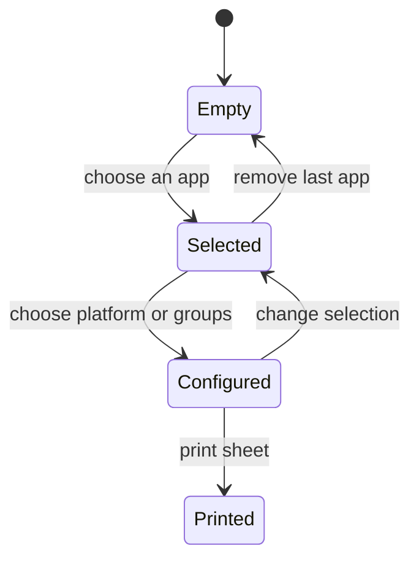

# Implementation report: shortcut cheat sheet generator

Status: ready
Tool: Shortcut cheat sheet generator
Route: /shortcuts-cheatsheet-generator
Contract type: resolution
Input fingerprint: `competitive-report.md sha256:676fa9955fe3d39ad936069881af8225df978e8a2575f96141e6d9552bb2c2c3`

## Product decision

Primary user: A developer or power user who wants one printed page for a few tools.
Job: Choose apps, platforms, and task groups, then print the matching reference.
Product thesis: The preview should be the strongest part of the page because the printed sheet is the product.
Evidence: The competitive review shows that most references stop at browsing one app at a time.

## Scope

### Table stakes

- Select and remove apps without a page reload.
- Choose all platforms or one supported platform per app.
- Keep task groups selected by default and let the reader remove them.
- Show an empty state before the first app is selected.
- Print only the generated sheet.

### Launch differentiators

- Use the same source records as the directory and app pages.
- Show the live paper preview beside the controls.
- Carry official source labels and last-verified dates into the printed result.

### Non-goals

- No account, saved sheet, payment, custom branding, server-side PDF, or comparison page.
- No new shortcut data inside the client component.
- No route-changing state or automatic reload.

## Formula and data contract

### Inputs and normalization

The engine accepts app slugs, a non-empty platform subset for each app, and either null for all groups or an explicit group ID list. Unknown slugs and group IDs are invalid.

### Equations or resolution order

The engine resolves each selection in app order, filters platform key entries, filters selected groups, drops groups with no remaining shortcuts, and returns one printable app section per selected app. It rejects the result if no section remains.

### Rounding, display, and versioning

There is no numeric rounding. Shortcut counts are integer record counts. The output keeps the source record's last verified date. The data contract version is the repository version at build time.

### Invalid, unknown, absent, and partial states

No app returns an invalid result. An unknown app or group returns an explicit reason. A missing platform binding renders "Not documented". A selected app with no remaining groups returns an invalid result.

### Assumptions and exclusions

The engine trusts only the structured app records passed to it. It does not fetch sources in the browser and does not infer a key for a missing platform.

### Primary sources

- https://developer.mozilla.org/en-US/docs/Web/CSS/@media
- https://support.google.com/chrome/answer/157179
- https://code.visualstudio.com/docs/getstarted/keybindings

## User flow



## Interface wireframes

```text
+-------------------------------------------------------------+
| Build a printable sheet                                     |
|                                                             |
| +----------------------+  +-------------------------------+ |
| | Choose apps          |  | 1 app, 24 shortcuts           | |
| | [x] Brave Browser    |  |                               | |
| | [ ] Claude Code      |  |  Keyboard shortcuts           | |
| | [ ] Codex CLI        |  |  Brave Browser                | |
| | Brave Browser        |  |  Action  Windows macOS Linux | |
| | Platform  Groups     |  |  ...                          | |
| +----------------------+  +-------------------------------+ |
+-------------------------------------------------------------+
```

```text
+--------------------------------------+
| Choose an app to see the sheet.      |
|                                      |
| Print sheet                          |
| disabled until an app is selected    |
+--------------------------------------+
```

## Interaction contract

| Event | State change | Visible result |
| --- | --- | --- |
| Check an app | Add its slug to the selection set | The app options open and the sheet renders |
| Uncheck an app | Remove its slug | The app section disappears from the preview |
| Choose a platform | Replace that app's platform choice | Key columns and count update |
| Uncheck a group | Add its ID to the excluded set | That group leaves the preview |
| Print sheet | Call browser print | Print CSS hides controls and keeps the sheet |

## Page composition

| Claim or job | Medium | Ownership |
| --- | --- | --- |
| Choose apps, platforms, and groups | Tool UI | app/(site)/(tools)/shortcuts-cheatsheet-generator |
| Show the exact selected output | Tool UI and table | app/(site)/(tools)/shortcuts-cheatsheet-generator |
| Explain source provenance | Sentences and source list | Structured app records |
| Preserve exact shortcut relationships | Table | lib/shortcuts/cheatsheet.ts |

## Technical plan

- `app/` owns the server-rendered route heading, client controls, preview, and print styles.
- `lib/` owns selection normalization and resolution output.
- `tests/` owns pure engine cases, route tests, static checks, and Browser smoke coverage.
- `content_docs/` owns this contract, the research report, and the edge-case plan.
- `scripts/` owns local-only preview registry rows.

## Acceptance criteria

| ID | Requirement |
| --- | --- |
| R01 | Empty selection disables printing and shows the empty preview |
| R02 | A selected app renders only its selected platform and groups |
| R03 | Unknown selections return an explicit invalid reason |
| R04 | The preview includes source links and last-verified dates |
| R05 | Print CSS hides controls and prints only the sheet |
| R06 | Desktop and narrow layouts keep the tool inside the page container |
| R07 | The route has no automatic reload or URL mutation |
