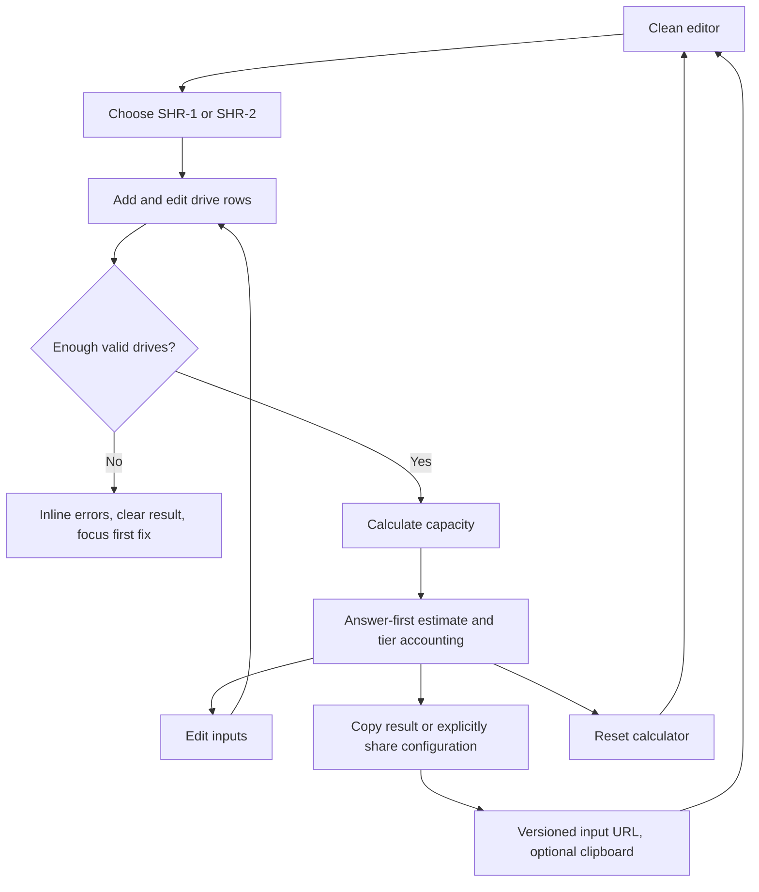

# Implementation report: Synology SHR Capacity Calculator

Status: ready
Tool: Synology SHR Capacity Calculator
Route: `/shr-calculator`
Depends on: `competitive-report.md`
Input fingerprint: `competitive-report.md sha256:eb79c88e17c13ad0555a93e882eca78d156ab5dedffa2bb446b87f6e7efab77b`
Contract type: formula

## Product decision

- Primary user: A homelab builder planning a fresh Synology SHR pool from a mixed set of known drive capacities.
- Job: Answer, `How much pool capacity will these drives provide in SHR-1 or SHR-2, and where does the rest go?`
- Product thesis: The tool earns preference by exposing the mixed-drive tier accounting and separating data capacity, protection, unused high tiers, and system reserve in one exact result.
- Evidence: The ready competitive report found that Synology exposes the categories but not the tier equation, generic calculators hide mixed-drive behavior, and the strongest independent tools add broad RAID or filesystem assumptions around the answer.

## Scope

### Table stakes

- Support SHR-1 and SHR-2 with clear one-drive or two-drive fault-tolerance statements.
- Accept a manually editable inventory of 2 to 32 drives with individual positive capacities and explicit TB, TiB, GB, or GiB units.
- Add, remove, and edit drives independently. Inventory actions never calculate.
- Use one explicit `Calculate capacity` action and one `Reset calculator` action.
- Show raw capacity, estimated pool capacity after a planning system reserve, protection capacity, unused capacity, and the selected fault-tolerance level.
- Show a responsive exact capacity-band table and an exact proportional allocation bar.
- Recalculate both SHR modes from the same valid inventory for a compact comparison.
- Keep calculation local to the browser, with no database, network request, local storage, analytics payload, or account.
- Provide accessible labels, error association, keyboard submission, visible focus, polite status announcements, and stale-result clearing.
- Keep the route unpublished and out of the central publication registry.

### Launch differentiators

- A capacity-tier table makes the SHR mixed-drive rule auditable: each band shows how many drives reach it and what becomes data, protection, or unused.
- The selected mode gets an answer-first result while a compact comparison keeps SHR-1 and SHR-2 visible without turning the page into a generic RAID dashboard.
- Protection and unused high-tier capacity are separate values. The page never calls both of them `waste`.
- Units are explicit and exact. The result can switch between decimal TB and binary TiB without changing source bytes.
- Share state is opt-in only. A normal calculation stays in the current page; an explicit Share configuration action creates a versioned URL containing inputs, not results.
- The page states that this is a fresh-pool estimate and stops before DSM expansion history, volume filesystem metadata, model compatibility, rebuild time, and backup safety.

### Deferred

- A separate existing-pool expansion planner with replacement-drive rules and historical tier state.
- Filesystem, snapshot, headroom, or application reserve scenarios.
- NAS model and drive compatibility recommendations.
- Cost, power, rebuild-time, throughput, or failure-probability estimates.
- Importing a Synology configuration file or reading a live NAS.
- Generic RAID, ZFS, unRAID, or storage comparison modes.

### Non-goals

- The result is not a promise of exact free space in Storage Manager.
- The result is not a recommendation that SHR-1 or SHR-2 is safe for a specific workload.
- The result does not prove that a drive is compatible with a particular Synology model.
- The result does not model an existing pool, a partial drive replacement, expansion history, or a volume after filesystem metadata.
- The result does not replace a tested backup and restore path.

## Formula and data contract

### Inputs and normalization

| Input | Type and unit | Default | Valid range | Normalization |
| --- | --- | --- | --- | --- |
| Redundancy mode | Literal `shr1` or `shr2` | `shr1` | `shr1` needs 2 to 32 drives; `shr2` needs 4 to 32 | Store the mode as a closed enum. |
| Drive capacity | Plain decimal string plus one of `GB`, `GiB`, `TB`, `TiB` | Empty row | Positive whole-byte result, at most 10^24 bytes per drive | Reject exponent notation, signs, commas, whitespace-only values, fractions that do not resolve to whole bytes, and values above the byte limit. |
| Drive identity | Route-local stable string | `drive-1`, `drive-2`, ... | Unique generated IDs only | IDs are not user-entered and are never included in a shell command or HTML. |
| Output unit | Literal `TB` or `TiB` | `TiB` | Display only | Source `bigint` values never change when the display unit changes. |

Capacity factors are exact: `GB = 10^9`, `TB = 10^12`, `GiB = 2^30`, and `TiB = 2^40` bytes. A decimal string is converted with integer arithmetic. If the multiplication does not produce a whole byte, the field is invalid rather than rounded.

### Equations or resolution order

The calculator models a fresh SHR pool from sorted capacity tiers. Synology documents the result categories and official examples, but does not publish a formal equation. This version is therefore an explicit, reproducible estimate based on the observed official allocation model and the tier slicing explanation in the research report.

1. Parse each drive to exact `capacityBytes` and sort a calculation copy ascending. Preserve the original editor order for the UI.
2. Set `parityDrives` to 1 for SHR-1 and 2 for SHR-2. Reject an inventory below the mode minimum.
3. Walk each distinct capacity threshold. For the current threshold `t`, let `previous` be the prior threshold, `band = t - previous`, and `active` be the count of drives whose capacity is at least `t`.
4. If `active > parityDrives`, add `(active - parityDrives) * band` to `dataBeforeSystemBytes` and `parityDrives * band` to `protectionBytes`.
5. If `active <= parityDrives`, add `active * band` to `unusedBytes`. There are too few drives at that height to form a data-bearing SHR tier for this mode.
6. Set `rawCapacityBytes` to the sum of all input capacities. The exact accounting invariant is `raw = dataBeforeSystem + protection + unused`.
7. Set `systemReserveBytes` to `driveCount * 10,000,000,000`. This is the official calculator's approximate 10 GB per-drive planning reserve, represented as decimal bytes and displayed in the selected output unit.
8. Set `estimatedPoolCapacityBytes` to `max(0, dataBeforeSystemBytes - systemReserveBytes)`. If the reserve consumes the entire data tier, retain a zero result with a warning rather than a negative capacity.
9. Calculate the selected mode and the other mode when the inventory satisfies its minimum. The comparison never invents an SHR-2 result for fewer than four drives.

For equal-size drives this reduces to `(driveCount - parityDrives) * driveSize - systemReserve`. For mixed drives it is equivalent to using the lower `N - parityDrives` capacity tiers for data, while the band walk also explains protection and unused space.

### Rounding, display, and versioning

- `calculationVersion = 1` and `inputVersion = 1` are route-local constants.
- Every source capacity and result value remains a native `bigint` byte count.
- TB and TiB display uses integer half-up rounding with at most two decimal places. Display rounding never feeds another calculation.
- Percentages are calculated from raw capacity in hundredths, using integer half-up rounding. Values below 0.01% display as `<0.01%`.
- The exact tier table shows source values in the selected output unit. It does not hide a band because its display rounds to zero; it uses `<0.01` where needed.
- `systemReserveBytes` is labelled as an approximate planning convention, not an exact current DSM allocation.
- Share URLs encode the version, mode, original row units, normalized capacity bytes, and generated IDs. Results are recalculated after restore and are never serialized.

### Invalid, unknown, absent, and partial states

- Empty inventory: no result; the editor shows one clear `Add drive` action and the primary calculate button is disabled.
- Missing, zero, negative, signed, comma-separated, exponent, malformed, or non-whole-byte capacity: field error, no result, no URL state, no calculation announcement, focus moves to the first invalid field.
- Too few drives for the selected mode: group-level error explaining the minimum; no result and no comparison output that could look valid.
- More than 32 drives: the add action is disabled and exposes a count explanation; typed state with more than 32 drives is rejected on restore.
- System reserve larger than data before system reserve: valid zero-capacity result with a warning that the model leaves no estimated pool capacity after the planning reserve. No negative or plausible positive number is shown.
- Malformed, future-version, wrong-calculator, oversized, unsafe, or invalid shared state: clean editor, no result, one polite restore-failure status, and removal of `state` from the URL.
- A current input edit clears the prior result and share URL. A result never remains visible beside inputs that no longer produced it.
- No network or upstream states exist. A browser calculation cannot be loading, timed out, partially sourced, or stale from a remote service.

### Assumptions and exclusions

- The formula represents a fresh SHR layout using the observed capacity-tier model. It does not emulate every DSM implementation detail or an already-expanded pool.
- The 10 GB per-drive reserve mirrors the official calculator's approximate system and swap note. It does not model volume metadata, Btrfs, ext4, snapshots, application space, or hidden vendor reservations.
- The formula describes capacity and allocation, not speed, rebuild duration, drive health, or backup coverage.
- The route accepts capacity inputs without claiming those drives are supported by a particular Synology model.
- A share URL contains the drive configuration in encoded form. It is not a secret and may expose sizes to anyone who receives it.

### Primary sources

- [Synology RAID Calculator](https://www.synology.com/en-uk/support/RAID_calculator), checked 2026-08-23. Official result categories, binary calculation note, and approximately 10 GB per-drive system reserve.
- [Synology Knowledge Center: What RAID type is best for my storage?](https://kb.synology.com/en-ca/DSM/tutorial/What_RAID_type_is_best_for_my_storage), checked 2026-08-23. Official SHR purpose and mixed-size guidance.
- [Synology Knowledge Center: Add drives to expand the storage pool capacity](https://kb.synology.com/en-my/DSM/help/DSM/StorageManager/storage_pool_expand_add_disk?version=6), checked 2026-08-23. Expansion boundary and compatibility caveats.
- [StashRaid SHR Calculator](https://stashraid.io/shr-calculator), checked 2026-08-23. Operated tier and slicing explanation used only to explain the inferred model.
- [Shared storage calculation engine contract](../../content_docs/storage-tools/calculation-engine.md), checked 2026-08-23. Repository exact-byte and versioning conventions.

## User flow



The page uses explicit submit because a user often edits several drive rows and the result must not flicker or imply that a partially entered inventory is current. Adding a drive is always a secondary inventory action. Calculate capacity is always the primary action.

## Interface wireframes

### Desktop: clean

```text
stack127 shell and storage sidebar with no shared sidebar change

SHR capacity [calculator] for mixed Synology drives
Short server-rendered lede added in the content pass

┌──────────────────────────────────────────────────────────────────────────────┐
│ [SHR-1] [SHR-2]                 Output: [TiB] [TB]                           │
│                                                                              │
│ Drive inventory                                             [Add drive]      │
│ Drive 01   [ capacity ] [TB v]                              [remove]         │
│ Drive 02   [ capacity ] [TB v]                              [remove]         │
│                                                                              │
│ [Calculate capacity]                                      [Reset calculator] │
└──────────────────────────────────────────────────────────────────────────────┘
```

### Desktop: result

```text
┌──────────────────────────────────────────────────────────────────────────────┐
│ SHR-1 estimate                                                               │
│ Estimated pool capacity                                                      │
│ 14.51 TiB                                                                     │
│ After the approximate system reserve of 37.25 GiB across 4 drives            │
│                                                                              │
│ [SHR-1] 14.51 TiB      [SHR-2] 7.24 TiB      [Fault tolerance] 1 drive       │
│ Raw 21.83 TB | Protection 7.28 TiB | Unused 0 B                              │
│                                                                              │
│ [exact allocation bar: data | protection | unused | system]                  │
│ Data 66.7% | Protection 33.3% | Unused 0% | System reserve                   │
│                                                                              │
│ Capacity bands                                                               │
│ Band       Drives reaching     Data         Protection      Unused            │
│ 0 to 4 TB  4                    10.91 TiB    3.64 TiB        0 B              │
│ 4 to 8 TB  2                    3.64 TiB     3.64 TiB        0 B              │
│                                                                              │
│ [Copy result] [Share configuration]                                          │
│ Formula, sources, and assumptions                                             │
└──────────────────────────────────────────────────────────────────────────────┘
```

### Narrow mobile

```text
SHR capacity [calculator]

[SHR-1] [SHR-2]
Output unit [TiB v]

Drive inventory                                         [Add drive]
01  [12] [TB v] [x]
02  [12] [TB v] [x]
03  [18] [TB v] [x]

[Calculate capacity]
[Reset calculator]

Estimated pool capacity
14.51 TiB
After system reserve

SHR-1     14.51 TiB
SHR-2      7.24 TiB
Fault tolerance: 1 drive

[data][protection][unused][system]

Capacity bands
Band: 0 to 12 TB
Drives reaching: 3
Data: ...
Protection: ...
Unused: ...
```

### Error, loading, partial, and restored states

- There is no remote loading or partial state. During synchronous calculation, the button remains available and no fake spinner is shown.
- Invalid mode count: the mode group has an associated error such as `SHR-2 needs at least 4 drives`; the result region is absent and the first capacity error or mode control receives focus.
- Invalid capacity: the row keeps the user's text, marks the input `aria-invalid`, associates one field error, clears the old result, and leaves other valid rows intact for recovery.
- Restored valid state: the editor is filled, the result is calculated deterministically, and a polite `Configuration restored` status is shown without stealing focus.
- Restored invalid or malformed state: the editor is clean, the result is absent, a polite `Configuration restore failed` status is shown, and `state` is removed from the URL.
- Share success: a visible read-only URL field appears beside a `Copy share URL` action. Clipboard failure leaves the URL selectable and says it was not copied.

## Interaction contract

| Event | UI response | Result state | Focus/announcement | URL/persistence |
| --- | --- | --- | --- | --- |
| Select SHR-1 or SHR-2 | Update mode and validate the count dependency | Clear any result | Status says inputs changed; focus stays on mode | Remove `state`; no storage |
| Add drive | Append one blank row up to 32 | Clear any result | Focus the new capacity input | Remove `state`; no storage |
| Edit capacity or unit | Preserve row and mark editor changed | Clear result immediately | No noisy announcement; field error appears on submit | Remove `state`; no storage |
| Remove drive | Remove only that row | Clear result | Focus the nearest remaining row or Add drive | Remove `state`; no storage |
| Click Calculate capacity | Validate, calculate, and render result | Valid result or absent invalid result | Invalid: focus first fix. Valid: focus result heading and announce answer | No URL update |
| Press Enter in a capacity field | Submit the form once | Same as click | Same as click | No URL update |
| Click Reset calculator | Restore clean empty editor and default mode | Clear result, errors, share URL | Focus first mode choice or Add drive | `replaceState` to clean pathname only |
| Click Copy result | Copy visible summary if result exists | Result remains | Polite success or failure status | Clipboard only; no storage |
| Click Share configuration | Encode input envelope and show URL; attempt clipboard | Result remains | Polite success or failure status | Explicit `replaceState` to `?state=`; no storage |
| Load valid `?state=` | Decode and validate, calculate result | Restored result | Status only, no focus theft | Query remains until edit/reset |
| Load malformed or future `?state=` | Reject all state and clean URL | No result | One polite restore error | `replaceState` removes query; no storage |
| Toggle output unit | Reformat displayed values only | Result remains identical in bytes | No announcement unless value text changes | No URL update |

## Page composition

| Claim or task | Medium | Position | Why this medium |
| --- | --- | --- | --- |
| What the calculator is and its fresh-pool boundary | Sentences | Short lede before the tool | A compact caveat needs human judgment and should not compete with the result. |
| Drive capacities and redundancy mode | Tool UI | Above the result | The visitor's own inputs are the primary source of the answer. |
| Estimated capacity and fault tolerance | Exact result visualization and table | First result block | The answer must scan in two seconds and remain precise. |
| Where mixed-drive capacity goes | Exact allocation bar and capacity-band table | Immediately after the answer | The relationship is visual and repeated facts belong in a table. |
| Difference between pool capacity and volume free space | Sentences | Supporting guide after the tool | This is a boundary that needs explanation, not another control. |
| Formula and system reserve | Exact table plus short sentences | Result details and supporting guide | The equation is precise; the caveat needs a sentence beside it. |
| Local handling and share privacy | Sentences beside actions and in supporting guide | Result actions and guide | Users need the scope of the privacy promise before sharing. |
| Next real verification step | Link and sentences | End of supporting guide | The official Synology calculator and Storage Manager are the correct next checks. |

## Technical plan

### Architecture and file ownership

- `app/(site)/(tools)/shr-calculator/page.tsx`: server route, `AppShell`, existing `StorageToolsSidebar active="hub"` without changing that sidebar, h1, and the eventual server-rendered content slot.
- `app/(site)/(tools)/shr-calculator/shr-capacity.ts`: pure route-local engine, parser, exact tier calculation, display helpers, validation types, and version constants. No React, network, database, browser storage, or analytics.
- `app/(site)/(tools)/shr-calculator/shr-calculator.tsx`: smallest practical client island for editor state, explicit calculate, result UI, copy/share, and restore state.
- `app/(site)/(tools)/shr-calculator/shr-calculator.module.css`: route-owned layout, controls, exact allocation bar, responsive tier-table reflow, and light/dark theme styling using existing tokens.
- `app/(site)/(tools)/shr-calculator/shr-guide.tsx`: added only during the writing stage as a server component for concise supporting content.
- `tests/pages/shr-calculator/page.json`: route ownership manifest with `state: "unpublished"`; it must not reference the storage hub or central registry as a changed file.
- `tests/pages/shr-calculator/page.test.mjs`: route ownership, static structure, no metadata, no shared route writes, and server-rendered content checks.
- `tests/pages/shr-calculator/shr-capacity.test.mjs`: pure parser, formula, fixtures, invariants, serialization, hostile state, and performance tests.
- `tests/pages/shr-calculator/shr-calculator.spec.ts`: rendered pointer, keyboard, focus, responsive, theme, restore, share, and no-stale-result tests.
- `scripts/shr-calculator/`: only a route-local guarded preview or fixture verification script if implementation proves it necessary. No central script or package script is required for launch.
- `content_docs/shr-calculator/`: this brief, the competitive report, implementation report, edge-case contract, writing and SEO plan, and final handoff artifacts are the route-owned documentation set.
- `lib/`: read-only reference to the shared storage contract. No shared library file is owned or changed by this route because the SHR formula can remain a small route-local engine.

The route must not edit `app/(site)/(catalogs)/storage-tools/*`, `supabase/migrations/*`, `public.stack127_pages`, `lib/storage/*`, or another tool. The existing storage engine is a reference contract only because this route can keep its simple formula engine local without changing shared behavior.

### Accessibility, privacy, security, and performance

- Use a real form, fieldsets for mode and output units, labels for every capacity and unit control, `aria-invalid`, `aria-describedby`, and a result heading with `tabIndex=-1`.
- Keep an `aria-live="polite"` status for restore, calculate, copy, and share outcomes. Do not duplicate the full result into a live region.
- Keep add, remove, calculate, reset, copy, and share targets at least 44 by 44 CSS pixels. Preserve one drive row at 320 px.
- Validate all decoded state as untrusted JSON. Reject prototype keys, wrong types, wrong versions, unknown modes, duplicate IDs, oversized payloads, more than 32 drives, invalid byte strings, and non-finite values. Never render decoded strings as HTML.
- Do not call `fetch`, use `localStorage`, `sessionStorage`, cookies, analytics hooks, or a server action. Clipboard and explicit URL mutation are the only side effects.
- Keep the engine deterministic and synchronous. A maximum 32-drive calculation must complete below 10 ms on the recorded test baseline. Avoid a new runtime dependency.
- Check no page-level horizontal overflow at 320, 375, 760, and desktop widths after a valid mixed result. Reflow the capacity table into labelled rows at narrow widths rather than hiding a scroll region.
- Keep the route clean on first load. Only an explicit Share configuration action serializes state.

### Publication state

Unpublished. The route exists in code for guarded local preview but is outside `public.stack127_pages`, so normal SEO checks must see a 404 or the repository's explicit unpublished behavior and exclude it from the sitemap. No migration, registry row, metadata export, canonical, robots logic, sitemap logic, or page JSON-LD is allowed in this route.

## Acceptance criteria

| ID | Observable acceptance criterion | Evidence at build time |
| --- | --- | --- |
| R1 | `/shr-calculator` uses the shared shell, renders a visible h1, and remains unpublished with no route-owned metadata or central registry change. | Route static test, ownership manifest, production route or SEO test. |
| R2 | A visitor can choose SHR-1 or SHR-2, add and remove individually labelled drive rows, edit each capacity and unit, and see inventory actions separate from Calculate capacity. | Pure interaction tests and Browser tests. |
| R3 | Plain decimal capacities in GB, GiB, TB, or TiB normalize to exact bytes and reject malformed, signed, exponent, zero, negative, non-whole-byte, oversized, and duplicate state values. | Engine unit tests and hostile serialized-state fixtures. |
| R4 | The version 1 tier walk returns exact raw, data-before-system, protection, unused, system reserve, and estimated pool capacity values for SHR-1 and SHR-2. | Formula fixtures, reconciliation properties, and official mixed-drive fixture. |
| R5 | Valid results keep protection and unused high-tier capacity distinct, show an exact allocation bar, a responsive capacity-band table, and a selected-mode answer plus comparison. | Engine and Browser result assertions at all required widths. |
| R6 | Too few drives or invalid fields prevent a result, clear any stale result, associate errors with fields, and focus the first recovery target. | Unit and Browser invalid-state tests. |
| R7 | Calculate works by click and Enter, repeated calculation is deterministic, reset is clean, and output-unit changes do not alter source bytes. | Engine and Browser keyboard/state tests. |
| R8 | Copy and explicit Share configuration expose only visible result or normalized input state, handle clipboard denial honestly, and never write storage, analytics, or network data. | Browser clipboard tests and static source policy. |
| R9 | Valid shared state restores deterministically; malformed, unsafe, future, wrong-route, and oversized state restores nothing and cleans the query. | Engine codec tests and Browser reload/history tests. |
| R10 | At 320, 375, 760, and desktop widths in dark and light themes, the page has no horizontal overflow, values stay visible, controls have 44 px targets, and the table reflows. | Standalone Playwright measurements and screenshots. |
| R11 | Server-rendered page content later answers purpose, meaningful input choice, result interpretation, limits, privacy, and next verification without repeating the live result or adding an FAQ. | Content test and final rendered reading pass. |
| R12 | A maximum supported inventory is deterministic and completes below the route performance budget without a new runtime dependency. | Focused performance test and build artifact inspection. |

## Open questions and blockers

- None. The formula is ready as an explicit version 1 estimate with an inferred but reproducible tier equation, a documented official-system-reserve convention, and a firm fresh-pool boundary.
