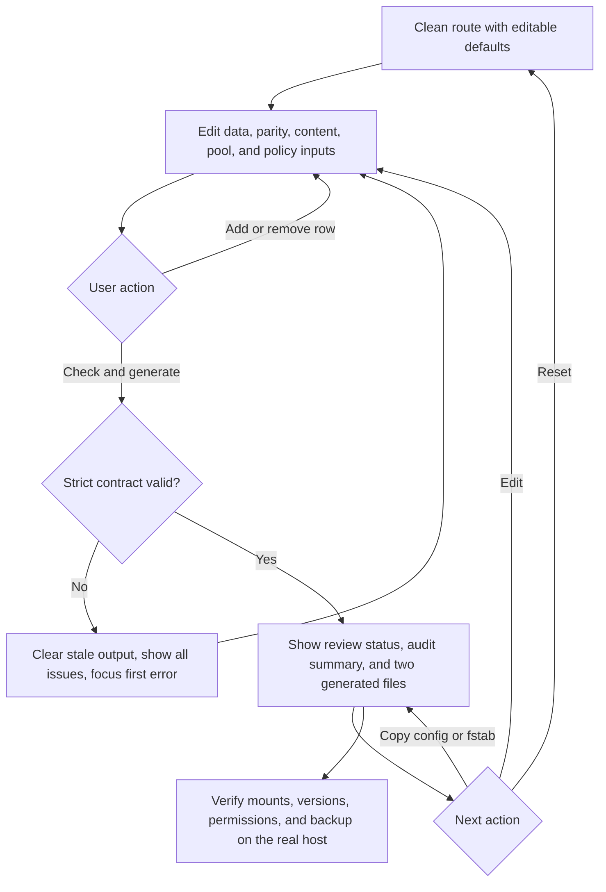

# Implementation report: SnapRAID and mergerfs Config Planner

Status: ready
Tool: SnapRAID and mergerfs Config Planner
Route: `/snapraid-mergerfs-planner`
Depends on: `competitive-report.md`
Input fingerprint: `competitive-report.md sha256:ebc4a669be6a6c45037818725eb87f42c6c2b2184ff846cece587fb594a9fd69`
Contract type: formula

## Product decision

- Primary user: A Linux homelab administrator assembling a mixed-drive SnapRAID array with a mergerfs pool and wanting a config they can review before touching `/etc`.
- Job: Enter named data mounts, parity mounts, content-file paths, a pool mount, and a mergerfs policy, then receive a validated `snapraid.conf` plus a matching mergerfs `/etc/fstab` line.
- Product thesis: The planner earns preference by generating both files from one explicit inventory and refusing to emit plausible config when data, parity, content, or pool paths overlap. The direct competitor generates useful text but silently reduces malformed input to a smaller array.
- Evidence: `competitive-report.md` sections `User pain evidence`, `Comparison matrix`, `Evidence-backed opportunities`, and `Formula and data disagreements`.

## Scope

### Table stakes

- Accept two to forty-two data mount rows. Each row has a generated stable name (`d1`, `d2`, and so on), an absolute mount path, and an exact decimal capacity with `TB` or `TiB` units.
- Accept one to three ordered parity mount rows. Each row has an absolute mount path and capacity. Row one maps to `parity`, row two to `2-parity`, and row three to `3-parity`.
- Accept two to twelve content-file paths, with a valid minimum of parity count plus one. Keep content files separate from parity files and the mergerfs pool mount.
- Accept an absolute mergerfs pool mount point, a small named policy preset, a SnapRAID blocksize of 256, 512, or 1024 KiB, and a standard exclude set toggle.
- Generate deterministic `snapraid.conf` and mergerfs `/etc/fstab` text without executing, saving, or sending commands.
- Validate parity capacity, unique names and paths, explicit branch separation, absolute path grammar, content-copy count, and pool recursion hazards before showing any config.
- Show the modeled data total, largest data capacity, parity count and capacity, content-copy count, and a review status. Do not claim a safe array or a backup.

### Launch differentiators

- One inventory drives both outputs. The data rows become SnapRAID `data dN` lines and the same paths become explicit mergerfs branches, so the user can inspect the relationship without maintaining two lists.
- Parity cannot enter the mergerfs branch list because branches are generated only from data rows. The planner also rejects path nesting that would make the pool or parity mount ambiguous.
- A focused audit result explains every failed check and what to change. Invalid input clears old config text while preserving the edited value.
- The result keeps exact generated text copyable but puts the validation verdict and boundary next to it. Policy options show their exact mergerfs options instead of hiding a fixed line.
- The tool is local and side-effect free. It does not serialize paths into the URL, inspect a SnapRAID daemon, read `/etc`, or run `mount`, `snapraid`, `systemctl`, or shell commands.

### Deferred

- Four to six parity levels and `z-parity` output.
- Multiple parity files per parity level or split parity files across several mount points.
- Arbitrary include and exclude pattern editing.
- UUID discovery, `lsblk` or `findmnt` import, existing config parsing, host inspection, daemon/API integration, or SSH.
- Full `mergerfs` option editing, filesystem-specific escaping, Windows paths, and non-POSIX path syntaxes.
- Command execution, install instructions, recovery simulation, parity sync estimates, and backup planning.

### Non-goals

- Do not decide that a layout is safe, redundant enough, or a backup.
- Do not model live free space, current mounts, permissions, installed SnapRAID or mergerfs versions, systemd ordering, filesystem health, or a successful `sync`.
- Do not treat mergerfs as parity or SnapRAID as real-time RAID.
- Do not accept a mergerfs pool path as a SnapRAID `data` path.
- Do not emit a parity path in the mergerfs branch list.
- Do not silently discard malformed rows, coerce paths, clamp capacities, or generate a partial configuration after an error.

## Formula and data contract

### Inputs and normalization

| Input | Type and unit | Default | Valid range | Normalization |
| --- | --- | --- | --- | --- |
| Data mounts | Ordered rows of `{ path, capacity }` | Four rows: `/mnt/disk1` to `/mnt/disk4`, each `8 TB` | 2 to 42 rows; absolute POSIX paths | Trim one outer space only, reject whitespace, colon, comma, backslash, `..`, empty segments, and duplicate or nested branch roots. Generate names `d1` to `dN` from order. |
| Parity mounts | Ordered rows of `{ path, capacity }` | One `/mnt/parity1`, `12 TB` row | 1 to 3 rows; each capacity at least the largest data capacity | Map index one to `parity`, two to `2-parity`, three to `3-parity`. Reject data, pool, duplicate, nested, or unsafe paths. |
| Content files | Ordered absolute paths | `/mnt/disk1/.snapraid.content`, `/mnt/disk2/.snapraid.content` | 2 to 12 paths; count at least parity count plus one | Trim one outer space only, reject unsafe grammar, duplicate paths, pool paths, parity files, and paths that are exactly a branch root. Report known mount-root reuse as an error when it leaves fewer unique roots than required. |
| Pool mount | Absolute POSIX path | `/mnt/storage` | One safe path outside every data and parity root | Reject equality, ancestor, or descendant relationships with data and parity roots that could create recursion or ambiguity. |
| Mergerfs policy | Enum: `balanced`, `most-free` | `balanced` | Exact enum only | Render the locked option list for the selected preset. Do not accept arbitrary option text in version one. |
| SnapRAID blocksize | Integer KiB | `256` | `256`, `512`, or `1024` | Render `blocksize N`; label it as an expert setting that affects future parity layout. |
| Standard excludes | Boolean | `true` | Exact boolean | When true, emit the fixed lines `/lost+found/`, `.Trash-*/`, `.recycle/`, and `*.unrecoverable` in stable order. |

Capacity parsing is exact. Accept only a non-negative decimal string that converts to a whole byte in `TB` or `TiB`; reject signs, exponents, locale separators, whitespace inside, and non-finite values. Data and parity capacities must be greater than zero. The engine uses `bigint` bytes and never passes source capacity through floating point. Display values may round to two decimals, but validation compares exact bytes.

### Equations or resolution order

1. Parse every row with strict path and capacity grammar. Return all field errors together and no generated output when any source value is invalid.
2. Let `D = max(data capacity bytes)` and `P[i] = parity capacity bytes`. For every parity row, require `P[i] >= D`. The result reports `dataTotal = sum(data capacities)`, `parityTotal = sum(P[i])`, and `parityCount = data parity rows`.
3. Require `dataCount >= 2`, `1 <= parityCount <= 3`, and `contentCount >= parityCount + 1`. Require content paths to be unique and, for paths under a known data or parity root, require enough distinct roots to meet the content minimum.
4. Normalize paths by removing a trailing slash except for `/`. Compare path segments, not string prefixes, for equality, ancestor, and descendant checks. Reject any parity root that overlaps a data root, any pool root that overlaps data or parity, and any content path equal to a root or inside the pool root.
5. Generate names `d1` through `dN` from the ordered data rows. Generate one `data dN path` line for each row. The generated names are not user-controlled text.
6. Generate one parity directive per ordered parity row: `parity path`, `2-parity path`, or `3-parity path`. Generate all `content path` lines in entered order. Generate fixed excludes when enabled. Keep a trailing newline and stable section order.
7. Generate the mergerfs branch expression by joining data paths with `:` in entered order. Generate `poolPath fuse.mergerfs options 0 0` with the selected policy preset. Parity paths and content paths never enter this expression.
8. Return a frozen `ready` result with exact normalized inputs, audit rows, summary bytes, generated SnapRAID text, generated fstab text, and assumptions. Return `invalid` with field-scoped issues and no config strings otherwise.

Policy presets are intentionally narrow:

- `balanced`: `defaults,allow_other,cache.files=off,dropcacheonclose=true,category.create=epmfs,func.getattr=newest,moveonenospc=true,minfreespace=4G,fsname=mergerfs`
- `most-free`: `defaults,allow_other,cache.files=off,dropcacheonclose=true,category.create=mfs,func.getattr=newest,moveonenospc=true,minfreespace=4G,fsname=mergerfs`

The output labels these as selected examples that must be checked against the installed mergerfs version and workload. `allow_other` may require host-level FUSE configuration. These presets are not presented as universal recommendations.

### Rounding, display, and versioning

- `calculatorId = snapraid-mergerfs`, `calculationVersion = 1`, and `inputVersion = 1` are engine constants for test receipts only. No URL state is serialized in version one.
- All capacities and comparisons use exact `bigint` byte values. Summary values render in the entered data unit family with at most two fractional digits and exact bytes remain available in the audit details.
- Config text is authoritative and deterministic. It uses normalized paths, generated names, fixed newline and option order, and no timestamp.
- Changing parity semantics, path overlap rules, supported path grammar, blocksize model, or policy output requires a calculation-version review. Changing serialized state is deferred because no state is shared.

### Invalid, unknown, absent, and partial states

- Clean defaults are editable but do not show a result until the user submits `Check and generate`.
- Empty rows, fewer than two data rows, missing parity, missing content copies, malformed decimal values, unsupported units, unsafe paths, duplicate rows, nested roots, parity below the largest data disk, a pool nested in a branch, or content paths under the pool produce a field-scoped invalid result.
- Any edit after a valid result clears both generated code blocks and the valid status immediately. The current invalid values stay in their controls.
- Add and remove row actions update inventory only. They never run validation or replace the primary action.
- There is no loading, network, timeout, upstream, or no-data state because the engine is synchronous and local. An unexpected engine exception clears output and shows a compact retry state while preserving inputs.
- Copy success and failure are visible and do not alter the URL. Clipboard denial leaves the code blocks selectable.
- Reset returns to defaults, clears output and status, and focuses the first data path field.

### Assumptions and exclusions

- This is a text generator and structural review, not a live configuration checker.
- The capacity result compares exact entered capacities only. It does not calculate filesystem free space, parity overhead, content-file size, usable free space, or recovery time.
- One parity row represents one parity level and one parity file. Split files, multiple files per level, and four or more parity levels are out of scope.
- Content-root checks infer only from the mount roots entered in this form. A user can still put two paths on the same physical disk using different paths, so the page must require host verification.
- The branch expression is explicit and contains only data mounts. It is intentionally longer than a glob to keep parity out by construction.
- The generated configuration must be saved and checked on the real host. The page does not know whether paths are mounted, writable, on separate disks, or supported by installed versions.

### Primary sources

- [Debian `snapraid(1)` configuration](https://manpages.debian.org/unstable/snapraid/snapraid.1.en.html), checked 2026-08-23. Supports parity sizing, parity levels, content-copy minimum, unique data names, blocksize, and path semantics.
- [SnapRAID CLI manual](https://www.snapraid.it/manual), checked 2026-08-23. Supports the asynchronous parity boundary and the mergerfs relationship.
- [mergerfs QuickStart](https://trapexit.github.io/mergerfs/2.41.1/quickstart/), checked 2026-08-23. Supports branch expression, fstab shape, and policy option syntax.
- [MergerFS official site](https://mergerfs.com/), checked 2026-08-23. Supports whole-file union behavior and the distinction from RAID.
- [SnapRAID daemon manual](https://www.snapraid.it/manual-daemon), checked 2026-08-23. Supports the explicit exclusion of host/API inspection from this product.

## User flow



## Interface wireframes

### Desktop: clean

```text
SnapRAID and mergerfs config planner

+----------------------------------------------------------------------------+
| Data disks                                                                  |
| Name   Mount path                         Capacity                         |
| d1     [/mnt/disk1                     ] [8       ] [TB]  [Remove]          |
| d2     [/mnt/disk2                     ] [8       ] [TB]  [Remove]          |
| d3     [/mnt/disk3                     ] [8       ] [TB]  [Remove]          |
| d4     [/mnt/disk4                     ] [8       ] [TB]  [Remove]          |
| [Add data disk]                                                              |
|                                                                            |
| Parity disks                                                               |
| p1     [/mnt/parity1                  ] [12      ] [TB]  [Remove]          |
| [Add parity disk]                                                            |
|                                                                            |
| Content files                                                              |
| [/mnt/disk1/.snapraid.content                                  ] [Remove] |
| [/mnt/disk2/.snapraid.content                                  ] [Remove] |
| [Add content file]                                                          |
|                                                                            |
| Pool mount      [/mnt/storage                                      ]       |
| Policy          [Balanced                                         v]       |
| Blocksize       [256 KiB                                           v]       |
| [x] Include standard excludes                                              |
|                                                                            |
| [Reset]                                      [Check and generate]            |
+----------------------------------------------------------------------------+
```

### Desktop: valid result

```text
+----------------------------------------------------------------------------+
| Configuration ready for review                                             |
| 4 data disks · 32 TB data · 1 parity level · 12 TB parity                  |
| Content copies: 2, minimum for this parity count                          |
|                                                                            |
| Checks                                                                      |
| [pass] parity is at least as large as the largest data disk                |
| [pass] parity and pool paths are outside data branches                     |
| [pass] content paths are unique and meet the count                         |
| [note] verify mounts, versions, permissions, and physical disk separation  |
|                                                                            |
| /etc/snapraid.conf                                      [Copy config]       |
| +------------------------------------------------------------------------+ |
| | parity /mnt/parity1/snapraid.parity                                     | |
| | content /mnt/disk1/.snapraid.content                                   | |
| | data d1 /mnt/disk1                                                     | |
| | ...                                                                    | |
| +------------------------------------------------------------------------+ |
|                                                                            |
| /etc/fstab mergerfs line                              [Copy fstab line]     |
| +------------------------------------------------------------------------+ |
| | /mnt/disk1:/mnt/disk2:/mnt/disk3:/mnt/disk4 /mnt/storage fuse.mergerfs | |
| +------------------------------------------------------------------------+ |
|                                                                            |
| This text is a reviewable example. It does not inspect or change your host. |
+----------------------------------------------------------------------------+
```

### Narrow mobile

```text
SnapRAID and mergerfs config planner

Data disks
d1  Mount path
    [/mnt/disk1                    ]
    Capacity [8                 ][TB v]
    [Remove]
d2 ...
[Add data disk]

Parity disks
p1 ...
[Add parity disk]

Content files
[/mnt/disk1/.snapraid.content      ]
[Add content file]

Pool mount [                              ]
Policy [Balanced                         v]
Blocksize [256 KiB                       v]
[ ] Include standard excludes
[Reset] [Check and generate]

Result stays below the form, with a horizontally contained code region.
```

### Error, loading, partial, and restored states

Loading, upstream, and restored states are not applicable because version one is synchronous, local, and intentionally has no URL state. The invalid state retains every typed value, removes generated text, shows all field-level issues in one alert region, and focuses the first invalid control. An unexpected engine exception uses a retry message without claiming a configuration result.

## Interaction contract

| Event | UI response | Result state | Focus/announcement | URL/persistence |
| --- | --- | --- | --- | --- |
| Add data, parity, or content row | Append a blank row within the row limit | Existing result clears | Focus moves to the new row's first field; no calculation | URL unchanged; no storage |
| Remove a row | Remove only that row; never remove the final required control without an error path | Existing result clears | Focus returns to the nearest remaining row or add button | URL unchanged; no storage |
| Check and generate by click or Enter | Validate the whole form and render output only if valid | Ready or invalid | Ready focuses result heading; invalid focuses first error and announces one summary | URL unchanged |
| Edit any input after valid result | Keep values, clear config blocks and pass state | Clean or invalid | No focus jump; status announces inputs changed only when needed | URL unchanged; no storage |
| Copy config or fstab | Write exact text to clipboard | Result remains ready | Visible copied or copy-failed message | URL unchanged |
| Reset | Restore deterministic defaults and clear output | Clean | Focus first data path | URL unchanged; no storage |
| Unexpected engine exception | Preserve inputs, clear output, show retry message | Error | Alert is announced; focus remains on current action | URL unchanged; no storage |

## Page composition

| Claim or task | Medium | Position | Why this medium |
| --- | --- | --- | --- |
| Choose the data, parity, content, pool, and policy facts | Tool UI | Above the result | These are the source inputs and need direct editing. |
| Whether the configuration passes structural checks | Tool UI plus exact audit table | First result block | The verdict must be visible before code. |
| Exact SnapRAID file | Exact result visualization | Valid result | A code block is the authoritative generated artifact. |
| Exact mergerfs fstab entry | Exact result visualization | Valid result after SnapRAID text | A second code block keeps the two configuration boundaries distinct. |
| What still needs host verification | Table and short sentences | Result footer and later guide | Repeated checks scan better as rows; judgment and limits need sentences. |
| SnapRAID versus mergerfs relationship | Diagram or short guide table, only if content pass shows a gap | Supporting guide | A conceptual relationship is clearer visually than repeated prose. |

## Technical plan

### Architecture and file ownership

- Server route: `app/(site)/(tools)/snapraid-mergerfs-planner/page.tsx` owns the shell, server-rendered identity, search-parameter omission, and the later server-rendered guide import. It must not own metadata, canonical, robots, sitemap, or JSON-LD.
- Client tool: `app/(site)/(tools)/snapraid-mergerfs-planner/snapraid-mergerfs-planner.tsx` owns the smallest form island, add/remove rows, explicit submit, focus, live status, code copy, and reset. It must not contain the later explanatory guide.
- Pure engine: `app/(site)/(tools)/snapraid-mergerfs-planner/snapraid-merfs-engine.ts` is route-local and owns parsing, path relations, capacity comparisons, validation, stable config rendering, policy presets, and version constants. It must not import React, access the DOM, read the filesystem, call `fetch`, or inspect host state.
- Styles: `app/(site)/(tools)/snapraid-mergerfs-planner/snapraid-mergerfs-planner.module.css` owns the tool frame, row layout, result blocks, code wrapping, table behavior, and responsive rules. Do not change `app/globals.css`, the storage hub styles, or the shared sidebar.
- Guide: later writing owns `app/(site)/(tools)/snapraid-mergerfs-planner/snapraid-merfs-guide.tsx`, using the shared prose class names and route module only for table or code layout.
- Tests: `tests/pages/snapraid-mergerfs-planner/page.json`, `page.test.mjs`, `snapraid-merfs-engine.test.mjs`, and `snapraid-mergerfs-planner.spec.ts` own route structure, engine fixtures, rendered behavior, accessibility, responsive states, and unpublished coverage.
- Local preview: `scripts/storage-tools/preview-local-pages.mjs` may alter only the identified managed-development database, must reject production or any other target, refuse existing rows, and remove its exact temporary rows. It must not update migrations or publication source files.
- Docs: `content_docs/snapraid-mergerfs-planner/` owns the ready research, this implementation report, the brief, later edge cases, and the writing and SEO plan.
- Shared ownership excluded: `app/(site)/storage-tools/page.tsx`, `app/(site)/storage-tools/storage-tools-sidebar.tsx`, `app/(site)/storage-tools/storage-tools.module.css`, collection counts, publication registry, migrations, `lib/storage`, and other tools remain untouched. Parent integration can add discovery later.

### Accessibility, privacy, security, and performance

- Use real labels, fieldsets for row groups, `aria-describedby` for errors, one result heading, one alert region for invalid state, and a polite status for copy feedback.
- Keep every add, remove, reset, copy, and primary action at least 44px tall. Preserve keyboard order and Enter submit without trapping focus.
- Render code in selectable `pre` blocks with `overflow-x: auto` inside the tool frame, while ensuring the page itself has no horizontal scroll. Long generated lines must remain readable.
- Treat every path and policy label as untrusted text. Use React text nodes, no `dangerouslySetInnerHTML`, no dynamic HTML, no shell execution, and no network calls.
- Reject path characters that would make the output ambiguous or inject fstab/config directives. Do not log or serialize user paths. Clipboard is the only optional browser side effect.
- Keep the engine synchronous and deterministic. The client bundle should include only the engine, controls, icons, and formatting needed for this route.
- Test dark first, then light, at 320, 375, 760, and normal desktop widths with the result populated.

### Publication state

Unpublished. The page route and ownership manifest may exist in code, but the manifest must say `state: "unpublished"` with a concrete reason. Do not edit `public.stack127_pages`, migrations, collection counts, redirects, sitemap logic, or robots behavior. Local preview may expose it only through the guarded local helper and must restore the previous state.

## Acceptance criteria

| ID | Observable acceptance criterion | Evidence at build time |
| --- | --- | --- |
| R1 | A valid mixed inventory produces deterministic SnapRAID and mergerfs text from one ordered data list. | Pure engine fixture and rendered result test. |
| R2 | Strict decimal and POSIX path parsing rejects malformed, duplicate, unsafe, and nested inputs without generating partial config. | Engine invalid matrix and page error test. |
| R3 | Every parity row is checked against the largest data capacity and the result reports exact data and parity totals. | Pure engine fixtures for equal, smaller, and larger parity. |
| R4 | Content paths are unique, meet parity count plus one, and do not create a plausible result when the minimum fails. | Content count and root-reuse fixtures plus page recovery test. |
| R5 | Generated mergerfs branches contain every data path in order and no parity or content path. | Snapshot-like engine fixture and output assertions. |
| R6 | Policy presets render the exact approved options and never accept arbitrary option injection. | Policy fixture and security static test. |
| R7 | Add/remove actions are separate from `Check and generate`; editing after success clears stale code. | Playwright pointer, keyboard, and stale-result tests. |
| R8 | Valid results lead with review status and audit rows, then expose both selectable code blocks with independent copy feedback. | Playwright success and clipboard tests. |
| R9 | Reset restores clean defaults, keeps the base route clean, and does not persist user paths in URL, storage, analytics, or network requests. | Playwright reset/privacy test and static policy. |
| R10 | The route shell and supporting content remain server-rendered, use shared layout/prose classes, and contain no route-owned SEO metadata. | Page static test and content test. |
| R11 | At 320, 375, 760, and desktop widths in dark and light themes, populated results have no page overflow and code/table regions stay contained. | Playwright measurements and screenshots. |
| R12 | The route remains unpublished and every page-owned file is listed in its ownership manifest without shared hub or registry changes. | Ownership manifest, unpublished route test, and diff inspection. |

## Open questions and blockers

- No technical product blocker remains after research. The selected version-one contract intentionally limits parity levels, policy presets, path grammar, and output directives.
- The parent integration must later decide where to place the tool in storage discovery and publication. This route must not make that shared change.
- Specialist product delegation did not return an artifact and was closed; this report was written locally from the validated research and must be reviewed as the orchestrator-owned product contract.
