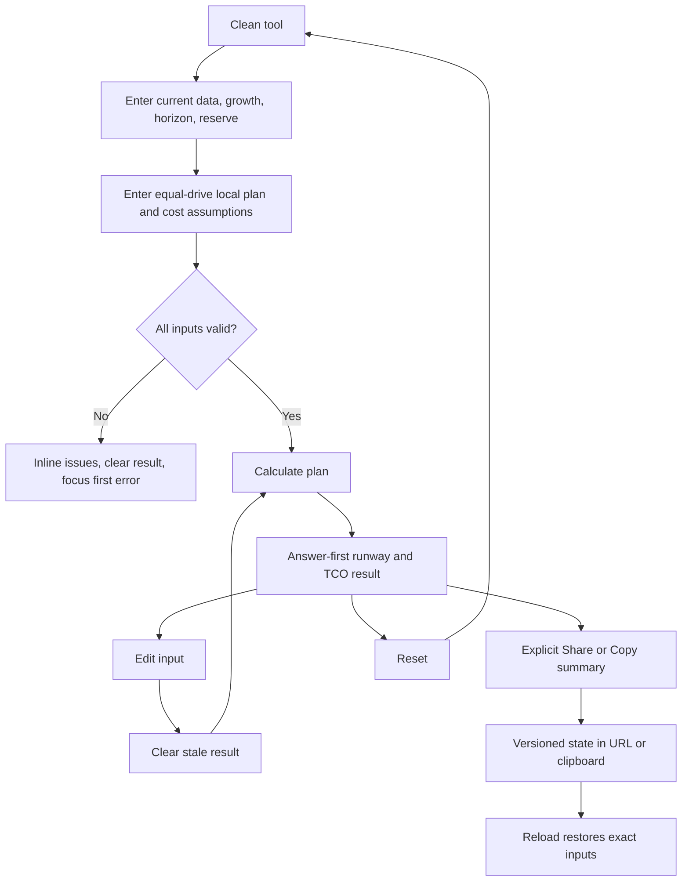

# Implementation report: Storage Growth and TCO Planner

Status: ready
Tool: Storage Growth and TCO Planner
Route: `/storage-growth-planner`
Depends on: `competitive-report.md`
Contract type: formula

## Product decision

- Primary user: A homelab owner deciding whether a local storage purchase will cover a known amount of data growth for the next few years.
- Job: Calculate the modeled capacity runway and total cost of one local storage plan, then see the first year in which the plan crosses its operating reserve.
- Product thesis: The page connects a growth curve, a transparent redundant-drive capacity model, and an auditable TCO timeline in one answer. It uses user-owned assumptions instead of volatile hardware catalogs or a universal recommendation.
- Evidence: The competitive report found capacity, power, backup, cloud, and enterprise TCO tools separately, but no calm small-lab flow that connects future demand, purchase capacity, power, replacement reserve, and timing. It also found that live prices, enterprise PUE, hidden RAID math, and large matrices reduce trust.

## Scope

### Table stakes

- Accept current data, annual growth, planning horizon, operating reserve, and one local drive plan.
- Support mirror, single-parity, and dual-parity planning models with explicit minimum drive counts.
- Show modeled usable capacity, reserve, demand by year, first shortfall year, hardware cost, power cost, replacement reserve, backup budget, and total TCO.
- Use one explicit `Calculate plan` action. Any edit clears the prior result until the current inputs are calculated again.
- Provide reset, explicit share, copy-summary, malformed-state recovery, keyboard submission, focus management, and local-browser privacy language.
- Keep every exact value and chart label visible at 320px, 375px, 760px, and desktop widths in both themes.

### Launch differentiators

- The first result answers the decision in a sentence: whether the plan clears the horizon and when it runs out of reserve.
- A precise growth-runway chart compares projected data with the capacity available after operating reserve.
- The cost view separates one-time hardware, recurring power, replacement reserve, independent-backup budget, and total instead of collapsing them into a score.
- The formula receipt states the growth convention, capacity model, costs, currency, assumptions, and version.
- No live price or provider catalog is required. The same inputs reproduce the same result offline.

### Deferred

- Exact OpenZFS RAIDZ allocation, ashift, recordsize, compression, slop, or expansion history. Link to the existing ZFS calculators for those questions.
- Cloud-provider catalog, retrieval, egress, request, and minimum-duration pricing.
- Multiple competing local plans in one result.
- Automatic purchase-event optimization, drive replacement scheduling, inflation, resale value, tax, labor, cooling, or migration cost.
- Drive models, enclosure catalogs, region-rate lookup, account sync, PDF export, and marker art.

### Non-goals

- The result is not installed filesystem free space, a ZFS or RAID implementation simulator, a reliability prediction, a backup verification, a performance estimate, or financial advice.
- “Mirror,” “single parity,” and “dual parity” are capacity planning models only. They do not certify a controller, filesystem, vdev, pool, rebuild time, or failure-domain design.
- A replacement reserve is an expected budget input, not a predicted failure count or warranty claim.
- An annual backup budget is a cost line supplied by the user. It does not prove that a copy exists or restores.
- The tool does not rank storage technologies or declare a best plan.

## Formula and data contract

### Inputs and normalization

| Input | Type and unit | Default | Valid range | Normalization |
| --- | --- | ---: | --- | --- |
| `currentData` | non-negative decimal in TB, decimal bytes | `10` | `0` to `1,000 TB` | Trim whitespace, reject exponent notation, parse to exact bytes with `1 TB = 10^12 bytes`. |
| `annualGrowth` | decimal percent, basis points | `20%` | `0%` to `100%` | Parse 0 to 2 fractional digits to basis points. Growth compounds once per year. |
| `horizonYears` | integer years | `5` | `1` to `10` | Parse as a safe integer. |
| `reserve` | decimal percent, basis points | `20%` | `0%` to `50%` | Parse 0 to 2 fractional digits. This is operating headroom selected by the user. |
| `layout` | `mirror`, `single-parity`, or `dual-parity` | `dual-parity` | enum | Keep the canonical enum in state. |
| `driveCount` | integer drives | `6` | `2` to `24` | Reject non-integers. Layout-specific minimums apply. |
| `driveSize` | positive decimal in TB, decimal bytes | `12 TB` | `0.1` to `100 TB` | Parse to exact bytes. All drives are equal in this v1 model. |
| `drivePrice` | non-negative decimal in selected currency per drive, minor units | `200` | `0` to `100,000` | Parse to minor currency units with two fractional digits. |
| `enclosureCost` | non-negative decimal in selected currency, minor units | `400` | `0` to `100,000` | Parse to minor currency units. |
| `averagePowerWatts` | integer watts for the complete local system | `60 W` | `0` to `2,000 W` | Treat as wall or system draw already measured by the user. |
| `hoursPerDay` | integer hours per day | `24` | `0` to `24` | No regional or device assumption is added. |
| `electricityRate` | non-negative decimal in selected currency per kWh, minor units | `0.15` | `0` to `10` | Parse to minor currency units per kWh. |
| `replacementReserve` | decimal percent of drive purchase cost per year, basis points | `0%` | `0%` to `25%` | This is a user budget assumption, not a failure forecast. |
| `backupAnnualBudget` | non-negative decimal in selected currency per year, minor units | `0` | `0` to `100,000` | Add once per horizon year. It does not model backup capacity or restore success. |
| `currency` | `USD`, `EUR`, `GBP`, or `INR` | `USD` | enum | No currency conversion. Every monetary input and result uses the selected currency. |
| `displayUnit` | `TB` or `TiB` | `TB` | enum | Display only. Source bytes never change. |

The planner accepts only one equal-drive local plan. It may show an empty current-data plan, but it must not show a result for an invalid layout or a malformed numeric value. Values use `bigint` bytes and integer minor currency units. No floating-point value is used for capacity or money arithmetic.

### Equations or resolution order

The adapter is `storage-growth-tco`, calculation version `1`, input version `1`.

1. Parse all decimal strings into bounded integers. `currentData` and `driveSize` become bytes. Costs become minor currency units. Percentages become basis points where `100% = 10,000`.
2. Apply layout minimums: mirror needs an even `driveCount >= 2`; single parity needs `driveCount >= 3`; dual parity needs `driveCount >= 4`.
3. Set `dataMembers` to `floor(driveCount / 2)` for mirror, `driveCount - 1` for single parity, and `driveCount - 2` for dual parity. Mirror rejects odd counts rather than silently discarding a drive.
4. Calculate `rawCapacityBytes = driveCount × driveSizeBytes`.
5. Calculate `modeledUsableBytes = dataMembers × driveSizeBytes` and `redundancyBytes = rawCapacityBytes - modeledUsableBytes`.
6. Calculate the user policy reserve with integer floor arithmetic: `reserveBytes = floor(modeledUsableBytes × reserveBasisPoints / 10,000)`. Then `planningCapacityBytes = modeledUsableBytes - reserveBytes`.
7. Set `demandBytes[0] = currentDataBytes`. For each year `y` from 1 through `horizonYears`, calculate `demandBytes[y] = roundHalfUp(demandBytes[y - 1] × (10,000 + growthBasisPoints) / 10,000)`. This is compound annual growth. Round only to whole bytes.
8. Find the first `shortfallYear` in `0..horizonYears` where `demandBytes[y] > planningCapacityBytes`. If there is no such year, return `null`. A shortfall at year `0` means the current data already exceeds the plan after reserve.
9. Calculate one-time hardware cost: `hardwareCostMinor = enclosureCostMinor + driveCount × drivePriceMinor`.
10. Calculate energy cost over the horizon: `energyWattHours = averagePowerWatts × hoursPerDay × 365 × horizonYears`; `powerCostMinor = roundHalfUp(energyWattHours × electricityRateMinor / 1,000)`.
11. Calculate expected replacement budget: `replacementCostMinor = roundHalfUp(driveCount × drivePriceMinor × replacementReserveBasisPoints × horizonYears / 10,000)`.
12. Calculate independent-backup budget: `backupCostMinor = backupAnnualBudgetMinor × horizonYears`.
13. Calculate `totalTcoMinor = hardwareCostMinor + powerCostMinor + replacementCostMinor + backupCostMinor`.
14. Calculate the modeled cost per planning-TB-year only when `planningCapacityBytes > 0`: `totalTcoMinor × 10^12 / (planningCapacityBytes × horizonYears)`, rounded half up for display. This is a comparison aid, not a universal storage price.

### Rounding, display, and versioning

- Source bytes, percentages, and minor currency units remain exact integers.
- `roundHalfUp(numerator / denominator)` adds `floor(denominator / 2)` before integer division for positive values.
- Decimal input parsing rejects exponent notation, signs, separators, fractions below one byte, more than two currency decimals, and more than two percentage decimals.
- Capacity output uses decimal TB (`10^12`) or binary TiB (`2^40`) selected by the user. `formatBytes` rounds for display without changing stored bytes.
- Money output uses `Intl.NumberFormat` for the selected currency with two fraction digits. The engine returns minor units, not locale-formatted strings.
- Percentages display at most two decimal places and preserve `<0.01%` for a non-zero rounded value.
- Result metadata includes `calculatorId`, `calculationVersion`, `inputVersion`, and `engineVersion`.
- Shared state stores the normalized input and version envelope, never formatted result values. A future version must preserve version 1 behavior for a version 1 envelope or reject it as unsupported.

### Invalid, unknown, absent, and partial states

- Empty form: no calculation result, no URL state, and one visible primary action.
- Invalid current input or impossible layout: structured field issues, no result, no chart, no cost total, and no share state. A prior result is cleared as soon as an input changes.
- Malformed or unsupported `state`: keep the clean form defaults, show a short restore status, focus the restore status only when the user explicitly tries to restore, and do not calculate.
- Valid state: restore inputs and result only for the exact supported calculator and input versions. The initial `?state=` is an explicit restoration, so it may render a result; editing it clears the result and removes the query state.
- `planningCapacityBytes = 0` cannot occur with a valid v1 layout and positive drive size. If an engine invariant is violated, return an error rather than a plausible TCO.
- No network, loading, upstream, no-data, or timeout state exists because the engine is local and deterministic. The interface must not imply that any remote source was checked.
- A valid result never coexists with an error-level issue.

### Assumptions and exclusions

- The capacity model is equal-drive RAID-like arithmetic, not exact behavior for ZFS, md, hardware RAID, SHR, dRAID, filesystems, snapshots, compression, metadata, fragmentation, or reserved blocks.
- The current-data curve represents stored data demand, not logical application data before compression or deduplication.
- Growth compounds once each year. It does not model seasonal bursts, step changes, or changing growth rates.
- Power is the complete system’s average wall draw. It does not infer watts from drive count and does not add PUE, cooling, UPS loss, or solar.
- Drive and enclosure prices are user inputs and do not inflate. Replacement reserve is a budget line based on drive purchase cost.
- Backup budget is user supplied and does not prove a second copy, off-site placement, media independence, or restoreability.
- TCO excludes labor, migration, resale, tax, financing, cloud retrieval, transfer, provider fees, and currency conversion.
- The page must link exact ZFS allocation questions to the existing ZFS capacity and padding routes instead of duplicating their version-sensitive models.

### Primary sources

- [SNIA Total Cost of Ownership Model for Storage](https://www.snia.org/sites/default/files/SSSI/SNIA_TCO_Whitepaper_03-2021.pdf), checked 2026-08-23. Supports separating CapEx and OpEx cost categories; enterprise labor and facility assumptions are not copied into v1 defaults.
- [OpenZFS VDEVs](https://openzfs.github.io/openzfs-docs/Basic%20Concepts/Pool%20Structure/VDEVs.html), checked 2026-08-23. Supports the boundary that redundancy layouts and failure domains belong to the storage technology, not this generic capacity model.
- [CISA backup guidance](https://www.cisa.gov/stopransomware/back-up-business-data), checked 2026-08-23. Supports keeping a backup budget separate from array redundancy and restore verification.
- [Amazon S3 pricing](https://aws.amazon.com/s3/pricing/?loc=ft), checked 2026-08-23. Supports excluding unmodeled cloud charge classes rather than pretending one monthly price is universal.

## User flow



## Interface wireframes

### Desktop: clean

```text
[stack127 shell]

Storage Growth and TCO Planner
Plan a local storage purchase against your data growth and cost assumptions.

┌──────────────────────────────────────────────────────────────────────────────┐
│ Demand and horizon                                                            │
│ Current data [ 10 ] TB   Annual growth [ 20 ] %   Horizon [ 5 ] years         │
│ Operating reserve [ 20 ] %                                                    │
│                                                                              │
│ Local plan                                                                   │
│ Layout ( ) Mirror  ( ) Single parity  (●) Dual parity                       │
│ Drive count [ 6 ]   Drive size [ 12 ] TB                                    │
│                                                                              │
│ Cost assumptions                                                             │
│ Currency [USD]  Drive price [200]  Enclosure [400]                          │
│ Average draw [60] W  Hours/day [24]  Electricity [0.15]/kWh                │
│ Replacement reserve [0] %  Backup budget [0]/year                          │
│                                                                              │
│ [Calculate plan]                                      [Reset]                │
└──────────────────────────────────────────────────────────────────────────────┘
```

### Desktop: result

```text
┌──────────────────────────────────────────────────────────────────────────────┐
│ [form remains above]                                                          │
├──────────────────────────────────────────────────────────────────────────────┤
│ Your plan clears 5 years of growth.                                          │
│ At year 5, projected demand is 24.88 TB against 38.40 TB after reserve.      │
│                                                                              │
│ [Capacity after reserve] [Year 5 demand] [TCO over 5 years] [Power cost]     │
│       28.80 TB              24.88 TB             $2,?        $?              │
│                                                                              │
│ Growth runway                                                                │
│ exact SVG line: projected demand, planning capacity, reserve threshold      │
│ Year 0     Year 1     Year 2     Year 3     Year 4     Year 5                │
│                                                                              │
│ Year-by-year plan                                                            │
│ Year | Projected demand | Capacity after reserve | Remaining headroom | Cost │
│ 0    | ...              | ...                    | ...                 | ...  │
│                                                                              │
│ Cost over the horizon                                                        │
│ Hardware   Power   Replacement reserve   Backup budget   Total               │
│                                                                              │
│ [Copy summary] [Share plan] [Reset]                                          │
│ Formula, assumptions, and sources ▾                                         │
└──────────────────────────────────────────────────────────────────────────────┘
```

### Narrow mobile

```text
[h1 and short lede]
┌──────────────────────────────┐
│ Demand and horizon           │
│ Current data [10] [TB]       │
│ Annual growth [20] [%]       │
│ Horizon [5] [years]          │
│ Reserve [20] [%]             │
│                              │
│ Local plan                   │
│ [Mirror] [Single parity]     │
│ [Dual parity]                │
│ Drive count [6]              │
│ Drive size [12] [TB]         │
│                              │
│ Cost assumptions             │
│ Currency [USD]               │
│ Drive price [200]            │
│ Enclosure [400]              │
│ Average draw [60] [W]        │
│ Hours/day [24]               │
│ Electricity [0.15]/kWh       │
│ Replacement [0] [%]          │
│ Backup budget [0]/year       │
│ [Calculate plan]             │
│ [Reset]                      │
├──────────────────────────────┤
│ Your plan clears 5 years.   │
│ [Capacity after reserve]    │
│ [Year 5 demand]             │
│ [TCO] [Power]               │
│                              │
│ Growth runway (responsive)   │
│ [SVG remains inside frame]   │
│                              │
│ Year-by-year plan            │
│ Year 0                      │
│ Projected demand: ...       │
│ Headroom: ...               │
│ Cumulative cost: ...        │
│ ...                          │
│                              │
│ Cost breakdown               │
│ [label] [value]             │
│ [Copy summary] [Share plan] │
└──────────────────────────────┘
```

### Error, loading, partial, and restored states

- Error: keep all entered fields; place a short summary at the top of the form; mark each invalid field with `aria-invalid` and `aria-describedby`; focus the first invalid input; hide the old result and chart; do not update or create URL state.
- Loading: not applicable. The calculation is synchronous and local. Do not render a fake spinner.
- Partial or upstream failure: not applicable. There is no network or upstream source. Invalid inputs are a complete invalid state.
- Restored: show the restored inputs and result with a short non-modal status, keep the `state` query visible until the user edits or resets, and preserve the same focus order. A malformed state keeps the clean form and gives a recoverable status instead of a plausible result.

## Interaction contract

| Event | UI response | Result state | Focus/announcement | URL/persistence |
| --- | --- | --- | --- | --- |
| First load without state | Defaults and empty result | Empty | Focus stays at browser default | Clean path, no storage |
| Edit any input or layout | Keep input, clear result and chart | Empty or invalid | No focus jump; an `aria-live="polite"` status says result cleared only when a result existed | Remove `state`; no history entry |
| Click `Calculate plan` | Validate and calculate current values | Valid result or invalid | Focus result heading on success; focus first invalid input on failure; status is polite | Clean path; no automatic state |
| Press Enter from a form control | Same as primary action | Same | Same as click | Same as click |
| Double click or rapid submit | At most one synchronous calculation and one result announcement | Deterministic | No duplicate live announcement | No duplicate URL mutation |
| Click `Reset` | Restore defaults and clear result | Empty | Focus first input | Clean path; replace state only if share state existed |
| Click `Share plan` after valid result | Encode normalized input envelope and copy/share URL | Result remains | Visible “Share link copied” status; no focus steal | Add `state` with `history.replaceState`, no network |
| Open valid `?state=` | Decode, validate, calculate exact version | Restored result | Non-modal restored status | Keep state until edit/reset |
| Open malformed or unsupported `?state=` | Ignore unsafe payload and use defaults | Empty with restore error | Status explains recovery; no result | Do not copy or persist malformed state |
| Click `Copy summary` | Copy concise values and formula version | Result remains | Visible copy confirmation; clipboard failure gets a recoverable message | No URL change |
| Toggle TB/TiB display | Reformat source values only | Result remains | No focus jump | No URL mutation unless shared explicitly |

## Page composition

| Claim or task | Medium | Position | Why this medium |
| --- | --- | --- | --- |
| Enter assumptions and calculate | Tool UI | First screen | The primary job is interactive and should not be explained in a paragraph. |
| Whether the horizon clears reserve | Sentence inside result UI | Result top | One bounded verdict is faster to scan than a prose conclusion below a chart. |
| Demand versus planning capacity | Exact chart | Result | A chart states the time relationship precisely. |
| Exact demand, headroom, and cumulative cost per year | Table or reflowed labelled rows | Result | Repeated year fields belong in a table, with a narrow reflow. |
| Hardware, power, replacement, backup, and total | Compact result table | Result | Repeated cost categories are clearer as aligned facts. |
| Formula, assumptions, and sources | Details plus short sentences | Result bottom | The technical receipt needs words and primary links but must stay secondary. |
| How to choose representative inputs and what the model excludes | Server-rendered guide | After tool, later writing stage | These are judgment and caveat questions, not calculator controls. |
| ZFS or conventional RAID detail | Internal link | Supporting guide | Existing route-owned tools already own those formulas. |

## Technical plan

### Architecture and file ownership

- Route: `app/(site)/(tools)/storage-growth-planner/page.tsx`.
- Client island: `app/(site)/(tools)/storage-growth-planner/storage-growth-planner.tsx` for form state, result view, clipboard, share URL, and focus behavior.
- Pure route-local engine: `app/(site)/(tools)/storage-growth-planner/storage-growth-planner-engine.ts` for parsing, validation, formula, formatting helpers, result types, and versioned state envelope. It must not import React, browser globals, network clients, or storage APIs.
- `lib/` ownership: read the shared `lib/storage` byte and state primitives where useful, but do not modify shared `lib/` adapters or add a cross-tool engine. Any route-specific calculation remains under the route directory.
- Route-local styles: `app/(site)/(tools)/storage-growth-planner/storage-growth-planner.module.css`. Do not add selectors to `app/globals.css` and do not modify storage hub/sidebar styles.
- `content_docs/` ownership: this route owns only `content_docs/storage-growth-planner/` and its `brief.md`, research, product, test, content/SEO, and handoff artifacts. Do not edit the shared storage docs or another page's folder.
- Server-rendered content: the route page owns the h1 and short introduction. The later writing stage may add `storage-growth-planner-guide.tsx` and route-local guide styles only after `writing-and-seo.md` is ready.
- Ownership manifest: `tests/pages/storage-growth-planner/page.json`, with state `unpublished`, route-owned docs, tests, scripts, skills, and an empty `repositories` array.
- Tests: pure engine tests, static route ownership/content tests, and Playwright route tests under `tests/pages/storage-growth-planner/`. The shared `scripts/storage-tools/preview-local-pages.mjs` manages this route's guarded managed-development preview row with the seven sibling storage routes; it refuses production or unknown databases and supports `--remove`.
- Shared files explicitly out of scope: `app/(site)/(catalogs)/storage-tools/page.tsx`, `app/(site)/(catalogs)/storage-tools/storage-tools-sidebar.tsx`, shared counts, migrations, registry rows, shared engine adapters, and other routes.

### Accessibility, privacy, security, and performance

- Use real labels, fieldsets, legends, input descriptions, `aria-invalid`, `aria-describedby`, a result heading, and one concise polite live region.
- Keep the primary action separate from reset, copy, and share. Do not make inventory or display-unit changes calculate implicitly.
- Keep the result’s exact chart paired with text values. Color cannot be the only distinction between projected demand and planning capacity.
- Treat decoded state as untrusted. Enforce size, version, prototype-key, numeric bounds, and string grammar limits. Render values as text, never as HTML.
- Do not send values to a server. Do not use `localStorage`, session storage, analytics payloads, cookies, or external price requests.
- Keep the client dependency-free beyond existing shared icons and React. The engine must be deterministic and fast for the maximum horizon.
- Use CSS `min-width: 0`, `overflow-wrap: anywhere`, and responsive labelled rows. Test document, frame, chart, table, and result bounding boxes, not only document scroll width.
- Respect `prefers-reduced-motion`, dark mode first, light mode second, zoom, keyboard-only interaction, and 44px minimum targets.

### Publication state

Unpublished. The route may exist in code and be visible only through a guarded local preview. Do not add registry metadata, a migration, a sitemap entry, a canonical, robots logic, or JSON-LD to the route.

## Acceptance criteria

| ID | Observable acceptance criterion | Evidence at build time |
| --- | --- | --- |
| R1 | A clean route renders a labelled form with no result or serialized state. | Route Playwright and static page test |
| R2 | Valid inputs calculate an exact result with modeled usable capacity, reserve, demand by year, shortfall, cost breakdown, total TCO, and formula version. | Pure engine fixtures and route Playwright |
| R3 | Mirror, single-parity, and dual-parity minimums and capacity equations match the contract. | Pure engine fixtures |
| R4 | Compound annual growth and whole-byte rounding match hand-derived fixtures through the 10-year bound. | Pure engine fixtures |
| R5 | Hardware, power, replacement, backup, and total cost use minor-unit arithmetic without floating-point drift. | Pure engine fixtures |
| R6 | An invalid field or impossible layout prevents any result and identifies recovery at the first invalid control. | Engine and Playwright tests |
| R7 | Editing any input clears a credible prior result and does not calculate implicitly. | Playwright tests |
| R8 | Click and Enter both run the primary action; rapid repeat does not duplicate state or announcements. | Playwright tests |
| R9 | The exact chart and year table remain legible at 320px, 375px, 760px, and desktop widths in both themes. | Playwright measurements and screenshots |
| R10 | URL state appears only after explicit Share, restores supported state, rejects malformed or unsafe state, and resets cleanly. | Engine state tests and Playwright |
| R11 | Copy and share feedback is visible and the calculation never makes a network request or stores inputs locally. | Playwright and static policy tests |
| R12 | The engine is outside React and contains no browser, network, or storage dependency. | Static route test and typecheck |
| R13 | The route has an unpublished ownership manifest and no route-local metadata, canonical, robots, sitemap, or JSON-LD. | Static policy and manifest test |
| R14 | The later supporting guide can explain meaningful inputs, result interpretation, limits, privacy, and a next verification step without changing the formula. | Content-plan and content tests |
| R15 | The production build and target-owned tests pass while shared storage pages remain untouched. | `npm run test`, `npm run quality`, diff review |

## Open questions and blockers

- None. The product contract intentionally excludes exact technology-specific allocation and live provider prices. The build must not widen the scope without returning to product planning.
