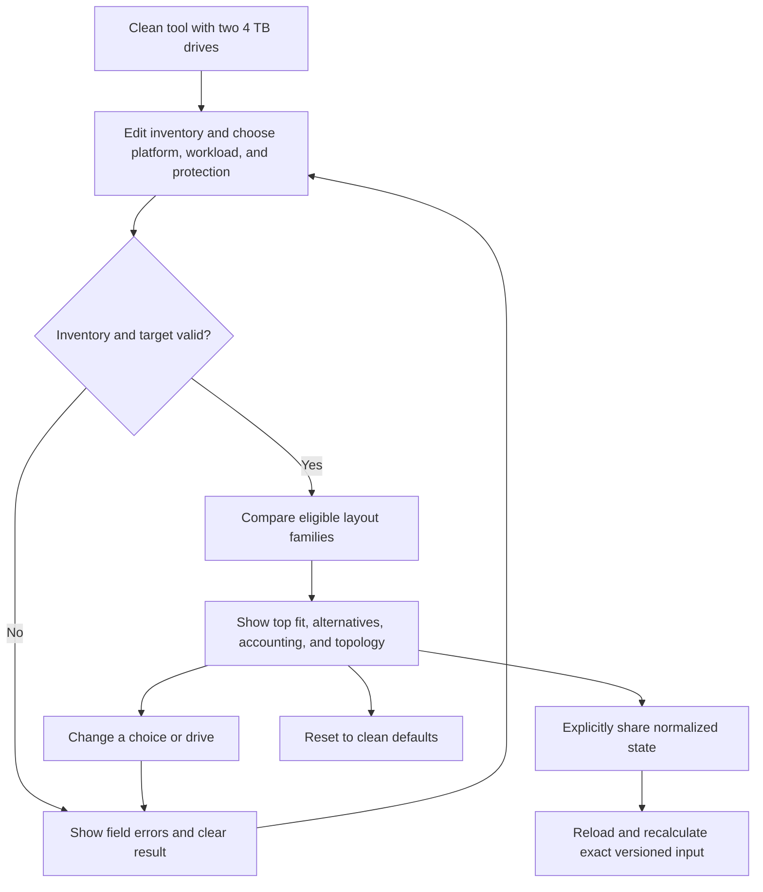

# Implementation report: Storage Layout Advisor

Status: ready
Tool: Storage Layout Advisor
Route: `/storage-layout-advisor`
Depends on: `competitive-report.md`
Contract type: formula

## Product decision

- Primary user: A homelab builder with a known drive inventory who is choosing a storage layout before creating a pool or array.
- Job: Compare layouts against an explicit protection target and workload shape, then leave with a bounded tradeoff and the facts to verify on the chosen platform.
- Product thesis: The page earns preference by showing a ranked comparison with visible topology and evidence boundaries, rather than returning one unexplained “best” layout or a vendor-specific capacity number.
- Evidence: The research report's evidence-backed opportunities, comparison matrix, formula disagreements, and the repeated user pain around mixed drives, vdev width, fault boundaries, and future expansion.

## Scope

### Table stakes

- Accept a compact inventory of one to 64 drives, including mixed exact sizes and decimal or binary units.
- Compare a small common set of layout families: stripe, mirror, striped mirrors, single parity, dual parity, and triple parity where the platform supports it.
- Show raw bytes, theoretical usable bytes, redundancy, size mismatch, efficiency, guaranteed failure tolerance, and the grouping that creates that tolerance.
- Let the user choose a platform family, workload shape, and minimum protection target.
- Keep invalid input from producing a stale or plausible result.
- Preserve exact bytes, show TB and TiB, and state that the result is a layout model rather than live filesystem capacity.
- Keep all calculation local and make sharing explicit.

### Launch differentiators

- A goal-aware shortlist that says why a layout fits the selected protection and workload without claiming universal best.
- One comparison table across common Linux RAID, NAS RAID, and OpenZFS equivalents, with unsupported platform branches removed before scoring.
- A topology strip for every candidate whose failure boundary depends on grouping.
- An exact accounting bar that separates usable, redundancy, and mixed-size mismatch instead of collapsing all loss into “waste.”
- A short growth note that distinguishes a static layout comparison from platform-specific expansion support.

### Deferred

- RAID 50 and RAID 60 subgroup optimization.
- dRAID, erasure coding, vendor-specific SHR allocation, and controller-specific layouts.
- Live system inspection, pool import, `zpool list`, `mdadm`, or NAS API queries.
- AFR, rebuild-time, IOPS, throughput, energy, cost, and data-loss probability models.
- Automatic drive reordering to optimize a nested layout.
- Hardware catalog recommendations and purchase links.

### Non-goals

- The tool must not say which layout is universally safest, fastest, or best.
- The tool must not calculate exact free space for an installed filesystem or predict compression.
- The tool must not treat redundancy as backup or imply that a valid capacity result proves a healthy array.
- The tool must not recommend a platform feature that it cannot verify from the user's running system.

## Formula and data contract

### Inputs and normalization

| Input | Type and unit | Default | Valid range | Normalization |
| --- | --- | --- | --- | --- |
| Drive inventory | Array of rows, positive decimal plus `TB`, `GB`, `TiB`, or `GiB` | Two 4 TB rows | 1 to 64 rows, each at most the shared engine drive limit | Trim whitespace, parse to exact bytes with shared `bytesFromUnit`, preserve entered order, assign stable local IDs |
| Platform | `any`, `linux-md`, `openzfs`, or `nas-raid` | `any` | Enum only | Maps layout families to displayed implementation names and removes unsupported candidates |
| Workload shape | `general`, `bulk`, or `vm-db` | `general` | Enum only | Used only by the transparent fit rubric, never as a performance forecast |
| Minimum protected failures | `0`, `1`, `2`, or `3` | `1` | Integer from 0 through 3 | Filters out candidates below the selected guaranteed tolerance |
| Display unit | `TB` or `TiB` | `TiB` | Enum only | Changes formatting only, never source bytes |

The clean page begins with two equal 4 TB rows so the first valid flow is visible without an empty inventory. A user may remove rows and return to an invalid empty state. Mixed drives remain in entered order; the advisor reports mismatch instead of silently sorting or discarding bytes.

### Equations or resolution order

1. Parse every drive into exact bytes. Reject empty, negative, fractional-byte, exponent, non-finite, or unsupported-unit values.
2. For each candidate, establish a topology and its minimum drive count. Reject candidates that cannot be formed by the current inventory or platform.
3. Let `S` be the smallest drive in the candidate group and `R` be the raw sum of all entered drive bytes.
4. For a stripe, use `usable = N × S`, `redundancy = 0`, and `mismatch = R - usable`.
5. For a two-way mirror, use `usable = S`, `redundancy = S`, and `mismatch = R - 2S`. The launch UI only exposes this candidate for two drives.
6. For striped mirrors, pair adjacent drives in entered order. Each pair contributes its smaller member. `usable` is the sum of pair minima, `redundancy` is the sum of the paired minima, and `mismatch` is the remaining raw bytes.
7. For single, dual, or triple parity, use `usable = (N - P) × S`, where `P` is 1, 2, or 3. `redundancy = P × S`, and `mismatch = R - N × S`.
8. For every valid candidate, reconcile `R = usable + redundancy + mismatch`. No candidate with a negative term is valid.
9. Set guaranteed tolerance to 0 for stripe and linear-like layouts, 1 for single parity, 2 for dual parity, 3 for triple parity, 1 for a two-way mirror, and 1 for striped mirrors. The result also shows the placement condition for striped mirrors.
10. Filter candidates below the requested protected-failure target. Score the remaining candidates with a documented rubric: capacity efficiency matters for `bulk`, mirrored layouts get a fit preference for `vm-db`, and `general` prefers dual parity when it meets the target. The score ranks a user-selected tradeoff; it is not a safety score or performance measurement.
11. Return the top fit plus all eligible alternatives. If no candidate meets the target, return an invalid configuration with a corrective message and no values.

### Rounding, display, and versioning

Calculator ID is `storage-layout-advisor`, calculation version `1`, and input version `1`. The route-local adapter uses the shared storage state envelope for explicit share links. State stores normalized inputs, not formatted results. A missing, corrupt, unsupported, oversized, or mismatched state returns to clean defaults with a short restoration message and never runs a partial calculation.

All source values remain `bigint`. TB and TiB output uses the shared integer formatter with at most two fractional digits. Percentages use integer basis points rounded half up. The display unit and fit score never alter source bytes.

### Invalid, unknown, absent, and partial states

- Empty inventory, malformed drive rows, impossible drive counts, and unsupported platform candidates show field-level issues and no result.
- A drive edit clears the current result immediately. It never leaves an old recommendation beside a new invalid inventory.
- A valid inventory that has no layout meeting the protection target shows “No eligible layout” plus the smallest change needed, such as adding drives or lowering the target. It does not show a best guess.
- `Unknown` is used for filesystem free space, compression, rebuild duration, live expansion support, AFR, performance, and data-loss probability.
- The page never makes a network request for calculation and never writes inputs to local storage, analytics, or cookies. An explicit share action places the normalized inputs in the URL, which means anyone with that URL can read the drive sizes and choices.

### Assumptions and exclusions

This is a theoretical layout envelope for one static inventory. It excludes array metadata, partitions, filesystem metadata, reserved space, snapshots, allocation history, compression, recordsize or volblocksize padding, controller behavior, resilver duration, performance, and backups. RAID and RAIDZ names are implementation labels for comparable layout families, not a claim that every NAS exposes the same semantics. Platform support and expansion behavior must be checked in the running system.

### Primary sources

- [Linux MD RAID documentation](https://docs.kernel.org/admin-guide/md.html), checked 2026-08-23. RAID level and array behavior.
- [mdadm manual](https://man7.org/linux/man-pages/man8/mdadm.8.html), checked 2026-08-23. RAID grouping and minimum layouts.
- [OpenZFS RAIDZ documentation](https://openzfs.github.io/openzfs-docs/Basic%20Concepts/Pool%20Structure/RAIDZ.html), checked 2026-08-23. RAIDZ parity and geometry.
- [OpenZFS VDEVs documentation](https://openzfs.github.io/openzfs-docs/Basic%20Concepts/Pool%20Structure/VDEVs.html), checked 2026-08-23. vdev failure boundaries.
- [OpenZFS changing pool layout](https://openzfs.github.io/openzfs-docs/Basic%20Concepts/Pool%20Structure/Changing%20Pool%20Layout.html), checked 2026-08-23. Expansion boundary.

## User flow



## Interface wireframes

### Desktop: clean

```text
┌──────────────────────────────────────────────────────────────────────────┐
│ Storage Layout Advisor                                                   │
│ Choose a layout from the drives, protection, and workload you actually  │
│ have.                                                                    │
├──────────────────────────────────────────────────────────────────────────┤
│ Drives                                                                    │
│ [4] [TB]  Drive 1                                      [Remove]           │
│ [4] [TB]  Drive 2                                      [Remove]           │
│ [Add drive]   [Add equal drives]                                        │
│                                                                          │
│ Platform: (• Any) ( ) Linux md ( ) OpenZFS ( ) NAS RAID                 │
│ Workload: (• General) ( ) Bulk files ( ) VMs and databases               │
│ Protect against: ( ) 0 (•) 1 ( ) 2 ( ) 3 drive failures                 │
│ [Compare layouts]                                      [Reset]           │
├──────────────────────────────────────────────────────────────────────────┤
│ Result appears here after Compare layouts                                │
└──────────────────────────────────────────────────────────────────────────┘
```

### Desktop: result

```text
┌──────────────────────────────────────────────────────────────────────────┐
│ 2 layouts meet your one-drive protection target                           │
│ Best fit for this goal: dual parity                                      │
│ 14.55 TiB theoretical usable   66.7% efficiency   2 guaranteed failures  │
│ Fits because: meets the target and leaves a larger recovery margin.      │
│ This is a layout model, not live filesystem capacity.                    │
│                                                                          │
│ Layout comparison                                                        │
│ Layout                 Usable       Raw     Redundancy  Mismatch  Fit     │
│ RAID 6 / RAIDZ2        14.55 TiB     24 TB   8 TB       0 B      Best    │
│ RAID 10 / mirrors      10.91 TiB     24 TB  12 TB       0 B      Also     │
│                                                                          │
│ Where the bytes go                                                        │
│ [usable────────────][redundancy──────][mismatch]                         │
│                                                                          │
│ Topology                                                                      │
│ [Disk 1][Disk 2][Disk 3][Disk 4][Disk 5][Disk 6]                        │
│ One parity group. Failure tolerance is per group.                        │
│                                                                          │
│ [Display: TiB] [Copy summary] [Share layout]                             │
└──────────────────────────────────────────────────────────────────────────┘
```

### Narrow mobile

```text
Storage Layout Advisor
Choose your drives and goal.

Drives
[4] [TB] Drive 1
[Remove]
[4] [TB] Drive 2
[Remove]
[Add drive]

Platform choices wrap
Workload choices wrap
Protection choices wrap
[Compare layouts]
[Reset]

2 layouts meet your target
Dual parity
14.55 TiB usable
2 guaranteed failures
Fits because: ...

Layout comparison
Layout: RAID 6 / RAIDZ2
Usable: 14.55 TiB
Redundancy: 8 TB
Mismatch: 0 B
Fit: Best

Where the bytes go
[bar]
Topology rows wrap without clipping
[Copy summary] [Share layout]
```

### Error, loading, partial, and restored states

This is a synchronous formula tool, so it has no network loading or upstream partial state. While a submit is calculating, the primary button is disabled for the same event loop and no old result is shown. An invalid row shows its message beside the field, a summary with the first corrective action, and focus moves to the first invalid control. A malformed shared state clears to clean defaults and announces that the shared layout could not be restored. A valid but ineligible target shows no candidate values and a recovery suggestion.

## Interaction contract

| Event | UI response | Result state | Focus/announcement | URL/persistence |
| --- | --- | --- | --- | --- |
| Add drive | Appends one positive 4 TB row and keeps all rows editable | Clears any result | Focuses new capacity input | No URL change |
| Remove drive | Removes only that row; never submits | Clears any result | Focus stays on the nearest remaining row | No URL change |
| Edit capacity or unit | Preserves exact bytes when valid; marks row invalid when not | Clears stale result immediately | Announces the invalid row only once | No URL change |
| Choose platform, workload, or target | Updates the selected radio | Clears stale result | Native radio semantics | No URL change |
| Compare layouts by click or Enter | Validates then computes every eligible candidate | Replaces result atomically | Moves focus to result heading and announces one summary | No URL change |
| No eligible layout | Shows corrective target message | Values remain null | Focuses the result heading; no fake recommendation | No URL change |
| Share layout | Builds state from normalized input and displays a copyable URL | Result stays visible | Announces success or copy failure | Adds `?state=` only after explicit action |
| Reload shared URL | Validates envelope and recalculates version 1 | Restores result if valid | Announces restored layout | Keeps versioned query |
| Reset | Restores two 4 TB drives and default choices | Clears result and share URL | Focuses first drive input | Returns to clean base route |

## Page composition

| Claim or task | Medium | Position | Why this medium |
| --- | --- | --- | --- |
| Enter drives and goals | Tool UI | First screen | The interactive form is the primary job. |
| Which eligible layout fits the selected goal | Tool UI plus exact result visualization | First result block | A ranked answer is faster to scan than a paragraph. |
| Raw, usable, redundancy, and mismatch accounting | Exact result visualization | Result block | Exact quantities belong in a bar and values, not prose. |
| Grouping and failure boundary | Topology/diagram | Result block | Placement and vdev or group boundaries are structural relationships. |
| Repeated candidate tradeoffs | Table | Result block | Layouts share the same fields and need direct comparison. |
| Meaningful inputs, model boundary, privacy, and verification step | Sentences | Server-rendered guide after the tool | These are judgment and caveat questions the UI cannot fully carry. |

## Technical plan

### Architecture and file ownership

- `app/(site)/(tools)/storage-layout-advisor/page.tsx`: server shell, title, short pre-tool introduction after the build stage, and server-rendered guide integration. No metadata, robots, canonical, sitemap, or JSON-LD.
- `app/(site)/(tools)/storage-layout-advisor/storage-layout-advisor.tsx`: smallest client island for editor state, explicit actions, result rendering, focus, copy, share, and theme-safe UI.
- `app/(site)/(tools)/storage-layout-advisor/storage-layout-advisor-engine.ts`: pure route-local formula adapter. It may import existing read-only helpers from `lib/storage/` but must not add or modify shared engine files.
- `app/(site)/(tools)/storage-layout-advisor/storage-layout-advisor-guide.tsx`: server-rendered supporting content added only after the technical build and content plan.
- `app/(site)/(tools)/storage-layout-advisor/storage-layout-advisor.module.css`: route-owned layout, tool, result, topology, table, and responsive styles.
- `content_docs/storage-layout-advisor/`: competitive report, implementation report, brief, edge-case contract, writing and SEO plan, and any route README only if needed.
- `tests/pages/storage-layout-advisor/page.json`: unpublished ownership manifest with a reason, route-owned tests, route-local preview script, and required skills.
- `tests/pages/storage-layout-advisor/storage-layout-advisor.test.mjs`: static ownership, formula contract, content, privacy, route policy, and source checks.
- `tests/pages/storage-layout-advisor/storage-layout-advisor.spec.ts`: Browser tests for pointer, keyboard, invalid, restored, share, reset, result, theme, and responsive flows.
- `scripts/storage-tools/preview-local-pages.mjs`: shared guarded managed-development registry preview row set with `--remove`; it must reject production and unknown database hosts and must not touch production.
- `lib/`: no new shared engine file. Existing `lib/storage/bytes.ts` and `lib/storage/state.ts` are read-only dependencies.

### Accessibility, privacy, security, and performance

- Use real labels, fieldsets, legends, radio inputs, table headers, `aria-invalid`, error associations, one result live region, and a focusable result heading.
- Use 44 px controls, `min-width: 0` at grid and flex boundaries, text wrapping for long values, and labelled rows instead of a clipped dense table below 760 px.
- Do not use `dangerouslySetInnerHTML`, eval, dynamic code, network requests, storage APIs, analytics events, or untrusted URL injection.
- Share only after an explicit action. State serialization must use the shared safe base64url envelope and version fields.
- Keep the engine synchronous and dependency-light. Avoid a chart library; the accounting bar and topology use semantic HTML and CSS.
- Design dark first, verify light, keep accent on the primary action and answer mark only, and avoid colored left-edge callouts, nested dashboard cards, gradients, and shadows.

### Publication state

Unpublished. The route source and docs may exist, but no `public.stack127_pages` row, migration, collection count, sidebar link, or sitemap entry is part of this task. The ownership manifest must state that the parent task will integrate shared publication and discovery changes later.

## Acceptance criteria

| ID | Observable acceptance criterion | Evidence at build time |
| --- | --- | --- |
| R1 | Clean route renders a labelled editor with two 4 TB drives and default choices without a result. | Route Browser test and server source test |
| R2 | User can add, edit, remove, and reorder-independent inspect drive rows without triggering comparison. | Browser interaction test |
| R3 | Decimal and binary capacity input normalizes to exact bytes and preserves the source value across display units. | Engine fixtures |
| R4 | Mixed sizes report raw, usable, redundancy, and mismatch values that reconcile exactly. | Engine fixtures and invariant test |
| R5 | Platform choice removes candidates that the selected platform cannot represent. | Engine fixture and Browser result test |
| R6 | Workload choice changes only the transparent fit rubric, never source capacity or tolerance. | Engine invariant test |
| R7 | Protection target filters out candidates below the requested guaranteed failure count. | Engine fixtures and invalid-target test |
| R8 | A valid submission replaces the empty state with one top fit, all eligible alternatives, and exact result values. | Browser test |
| R9 | Result shows topology and a placement condition when failure tolerance depends on grouping. | Browser semantics test |
| R10 | Invalid input clears stale values, associates errors with fields, and focuses the first corrective action. | Browser keyboard test |
| R11 | No-eligible-layout state shows recovery guidance and no plausible capacity or recommendation values. | Engine and Browser tests |
| R12 | Share is explicit, versioned, URL-safe, and restored state recalculates without network or local storage. | Engine codec and Browser reload test |
| R13 | Reset returns the clean base route and default inputs. | Browser test |
| R14 | All important content before and after the tool is server-rendered, while the client island contains only operational UI. | Static source test |
| R15 | Desktop, 760 px, 375 px, and 320 px results have no page-level overflow and keep every value and touch target visible. | Playwright measurement tests |
| R16 | Dark and light themes preserve contrast, hierarchy, and semantic labels without color-only meaning. | Playwright theme tests |
| R17 | Route has an unpublished ownership manifest, no route-owned SEO metadata, and no shared registry changes. | Static policy and manifest test |
| R18 | Production typecheck, unit tests, static policy, SEO registry check, Playwright suite, and build pass, or unrelated failures are disclosed without being relabelled. | Final quality commands |

## Open questions and blockers

- The research report found no universal best-layout formula. Product version 1 resolves this by ranking only against explicit user-selected goals and naming the rubric.
- Platform-specific expansion support remains a guide caveat, not a scored engine input.
- The standalone Playwright CLI is the visual backend because no in-app Browser instance is connected in this environment.
