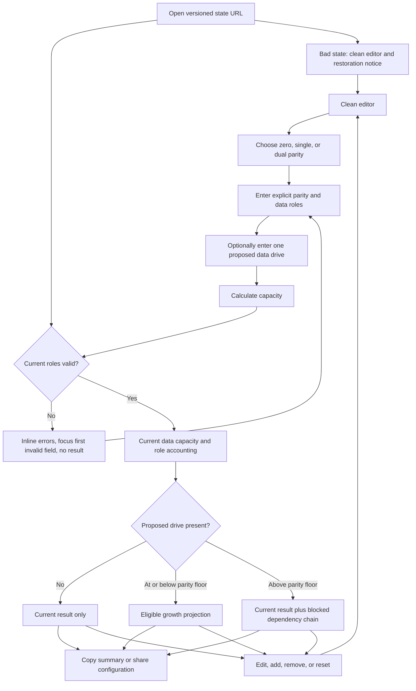

# Implementation report: Unraid Main Array Calculator

Status: ready
Tool: Unraid Main Array Calculator
Route: `/unraid-calculator`
Depends on: `competitive-report.md`
Input fingerprint: `competitive-report.md sha256:7acb0fd6b1bf4a28e3b58c5dd9c353475f5d483267d159c4f4d661fe3be0dc9a`
Contract type: formula

## Product decision

- Primary user: A homelab builder with a mixed set of HDDs who is deciding which disks belong in a new or expanded Unraid Main Array before assigning or buying them.
- Job: Enter the intended parity and data roles, then learn the array-level data capacity, the protection level, and whether one proposed future data disk is compatible with the current parity ceiling.
- Product thesis: This is a role-first Unraid planner. It keeps parity and data assignments visible, derives capacity from the explicitly assigned data disks, and shows the exact parity-upgrade dependency when a proposed disk is too large. That is more trustworthy for Unraid planning than silently sorting the largest disks into parity or subtracting a hidden largest-drive value.
- Evidence: `competitive-report.md` sections `Technical truth to verify`, `Comparison matrix`, `Formula and data disagreements`, and `Evidence-backed opportunities`. The official sources linked below state that Unraid has separate parity and data roles, does not stripe data across the array, makes parity optional with one or two disks, requires parity to meet the largest data-disk rule, and limits future data disks by the smallest current parity disk.

The capacity equation is a direct derivation from those official role semantics, not a claim that it reproduces every number in the Unraid webGUI. The page names the boundary as array-level data capacity and keeps filesystem-visible capacity unknown.

## Scope

### Table stakes

- Support zero, one, and two parity disks as visible choices. Zero parity is valid for a data-only array, but the result states that there is no parity protection.
- Represent current parity and data disks as separate, individually editable role rows. Mixed capacities are the normal input, not an exceptional mode.
- Validate every current parity disk against the largest current data disk. A smaller parity disk produces no current capacity result.
- Show current data capacity, assigned parity capacity, raw installed capacity, the smallest parity ceiling, and one of the documented zero, single, or dual parity protection statements.
- Accept decimal `GB` and `TB` plus binary `GiB` and `TiB` inputs, calculate in exact bytes, and offer `TB` or `TiB` for display.
- Use one explicit `Calculate capacity` action. Editing, adding, removing, or changing a role clears the old result before a new calculation.
- Keep the calculation local, with no request, account, storage write, or analytics payload containing the drive list.
- Make the main-array boundary explicit: cache pools, filesystem overhead, reserved space, and application-level free space are outside the answer.

### Launch differentiators

- A visible role topology places each parity and data disk in its own lane, so the result can be checked against the intended assignments.
- A reconciled exact-capacity visualization shows `data capacity + assigned parity capacity = raw installed capacity`, with the value table remaining authoritative when a segment is too small to see.
- One optional proposed data drive produces either an eligible growth result or a dependency chain: upgrade every parity disk below that proposed capacity before adding the data disk.
- The formula disclosure names the official source boundary, formula version, unit definitions, and exclusions beside the result.
- Sharing is explicit and opt-in. A versioned URL stores normalized roles and the optional proposed drive, never a formatted result or a model name.

### Deferred

- A multi-drive sequential growth planner. Version 1 handles one proposed data drive so the parity-upgrade dependency stays readable.
- Automatic largest-drive-to-parity assignment, a size sort, or a recommendation that chooses zero, single, or dual parity for the user.
- Filesystem-visible capacity for XFS, BTRFS, or ZFS, partition and system reservations, share allocation, free-space headroom, or snapshot estimates.
- Current-array import from Unraid configuration, diagnostics, disk serials, SMART data, or the Unraid API.
- Unraid license tiers, slot availability, power, cost, throughput, write mode, rebuild time, failure probability, URE probability, and purchase recommendations.
- Drive shopping, affiliate links, print layouts, CSV export, and named saved configurations.

### Non-goals

- Do not present a conventional RAID, cache-pool, RAIDZ, or filesystem calculation under the Main Array name.
- Do not call array-level data capacity filesystem-visible free space or promise what a share, application, or operating-system dashboard will report.
- Do not imply that parity is a backup, that dual parity makes data loss impossible, or that a proposed drive is a safe migration procedure.
- Do not auto-assign roles, silently reorder drives, or hide parity headroom inside a single usable-capacity number.
- Do not show a numeric projected capacity for a proposed drive whose parity dependency is blocked.

## Formula and data contract

### Inputs and normalization

| Input | Type and unit | Default | Valid range | Normalization |
| --- | --- | --- | --- | --- |
| Parity protection | Enum: `none`, `single`, `dual` | `single` | Exactly one of the three modes | Map to parity count `P = 0`, `1`, or `2`. Changing the mode changes the visible parity-row count and clears the old result. |
| Current parity drives | Ordered role rows | One blank row when `single` is selected | Exactly `P` rows; total current array rows at most 64 | Stable IDs `parity-1` and `parity-2`. Each row remains an explicit parity role. Dual parity rows may have different capacities. |
| Current data drives | Ordered role rows | No complete data rows | At least 1 row and at most `64 - P` rows | Stable IDs `data-1`, `data-2`, and so on. Each row remains an explicit data role. |
| Drive capacity text | Plain decimal string plus a selected unit | Blank until the user enters it | More than 0 and at most `10^24` bytes after conversion | Trim outer whitespace at the editor boundary. Reject empty, negative, exponent, suffix, non-decimal, and non-whole-byte values. Never pass through JavaScript `Number`. |
| Capacity input unit | `GB`, `TB`, `GiB`, or `TiB` | `TB` | One visible unit per drive | `GB = 10^9`, `TB = 10^12`, `GiB = 2^30`, and `TiB = 2^40` bytes. |
| Proposed data drive | One optional role candidate | Absent | Blank or one positive capacity using the same per-drive bound and units | Stable ID `proposed-data-1`. It is never part of the current result and is always interpreted as a future data disk, not as an auto-assigned parity disk. |
| Result unit | Display enum: `TB` or `TiB` | `TiB` | One of the two output units | Display-only. It does not change normalized bytes, formula behavior, or shared input state. |

The 64-row current-array boundary is a page and URL safety limit, not an Unraid license claim. The shared storage engine's higher inventory limit remains available to other adapters. A parity mode and its role rows must agree exactly before the engine receives normalized input.

### Equations or resolution order

Formula identifier: `unraid-main-array-v1`.

Let `D_i` be each current data-drive capacity in bytes, `P_j` be each current parity-drive capacity in bytes, and `G` be the optional proposed data-drive capacity.

1. Validate the editor shape, role counts, unique stable IDs, positive whole-byte capacities, and the 64-row current-array bound. An incomplete editor is not an engine input.
2. Let `dataCapacity = sum(D_i)`. This is the array-level data envelope because official Unraid help describes data disks as exclusively storing user data and says data is not striped across the array.
3. Let `assignedParityCapacity = sum(P_j)` and `rawInstalledCapacity = dataCapacity + assignedParityCapacity`.
4. If `P = 0`, set `parityFloor = null`, `parityHeadroom = 0`, and `protection = none`. The current result is valid when at least one data drive is complete.
5. If `P > 0`, let `largestData = max(D_i)` and `parityFloor = min(P_j)`. The current configuration is valid only when every `P_j >= largestData`. Let `parityHeadroom = sum(max(0, P_j - largestData))`. The headroom is a planning fact about the assigned parity devices, not extra data capacity.
6. For a valid current configuration, the primary displayed capacity is `dataCapacity`. The accounting identity is `dataCapacity + assignedParityCapacity = rawInstalledCapacity`. No filesystem or partition deduction is applied.
7. Set protection text from the selected parity mode: zero parity means no parity protection; single parity means one disk failure is recoverable under the parity model; dual parity means two disk failures are recoverable under the parity model. These are protection boundaries, not a probability or backup guarantee.
8. If the proposed drive is absent, set `growth.status = absent` and omit projected values. If `P = 0`, the proposed drive is eligible because there is no parity-size ceiling. If `P > 0` and `G <= parityFloor`, set `growth.status = eligible`, `capacityGain = G`, `projectedDataCapacity = dataCapacity + G`, and `projectedRawInstalledCapacity = rawInstalledCapacity + G`.
9. If `P > 0` and `G > parityFloor`, set `growth.status = blocked`, omit projected capacity values, and list every parity role where `P_j < G` as a required dependency. The visible chain is `upgrade each undersized parity disk to at least G -> add the proposed data disk`. A blocked growth scenario is a warning attached to a valid current result, not an error that invalidates that current result.
10. The proposed drive is not used to re-evaluate current parity validity until the user enters it as a current data row. The page does not model parity-swap execution, data movement, or rebuild sequencing.

The sum-of-data rule is intentionally not `sum(all drives) - largest` as the canonical contract. That shortcut hides explicit roles, fails to explain dual parity with unequal parity devices, and cannot express the smallest-parity growth ceiling. For a valid single-parity inventory it may produce the same number, but the role sum is the auditable source of truth.

### Rounding, display, and versioning

- Store all source capacities, sums, gains, headroom, and raw totals as native `bigint` bytes. No formula value is converted to a floating-point number.
- Format displayed capacities with exact integer half-up rounding to at most two fractional digits in the selected `TB` or `TiB` unit. Display rounding never changes source values.
- Use exact integer proportions for the data/parity accounting bar. If a non-zero segment is too narrow to render, the adjacent exact value table and accessible text still expose it.
- Show zero parity as `0 TB` or `0 TiB` only in the role-accounting table, never as a hidden negative or missing value. Omit absent proposed-drive values rather than displaying `0`.
- Define `calculatorId = unraid-main-array`, `calculationVersion = 1`, and `inputVersion = 1` as constants in the route-local engine. Do not register this calculator in, mutate, or add exports to the shared storage calculator registry.
- A formula version changes if the role equation, parity eligibility rule, growth dependency rule, accepted scope, or result classification changes. An input version changes if the serialized role shape changes. The route-local decoder rejects unsupported versions rather than relying on a shared registry to select an adapter.

### Invalid, unknown, absent, and partial states

- Clean editor: no complete current data inventory, no result, no error summary, and visible role controls. `Calculate capacity` can be present but disabled until at least one row exists; it becomes actionable with incomplete rows so submission can explain them.
- Partial row: blank, malformed, negative, exponent-form, too-large, or non-whole-byte capacity. Keep the typed text, show an inline field error after submission, focus the first invalid field, and show no numeric result.
- No data rows or parity-only inventory: invalid because the tool has no current user-data envelope. Show `Add at least one data drive` and no result.
- Parity mode and row-count mismatch, duplicate stable IDs, over-64 current rows, or an unsupported mode: invalid engine input with structured errors and no result.
- Parity too small: every offending parity row names the required largest current data capacity. The previous result is removed and no current or projected capacity is shown.
- Zero parity with valid data: valid result with `assigned parity capacity = 0` and an explicit no-protection statement. This is not an error.
- Proposed drive absent: current result may render, with no growth section or projected number.
- Proposed drive eligible: current result and a separate eligible growth projection may render together. The projection is clearly labeled as a future data-drive scenario.
- Proposed drive blocked: current result remains valid, but the growth area shows a warning and dependency chain with no projected capacity number. The warning does not coexist with a number it invalidates.
- Corrupt, oversized, wrong-calculator, unsupported-version, unsafe, or invalid shared state: restore the clean editor, remove the `state` query with `history.replaceState`, and show one polite restoration notice. Never partially trust serialized result values.
- Unexpected local engine failure: preserve editor values, remove any stale result, show a neutral retry message, and focus the message. There is no upstream or network failure state.
- Loading and calculating: not rendered. The formula is synchronous and local; a spinner would suggest an external dependency. A future asynchronous implementation would need a new contract before adding a loading state.

### Assumptions and exclusions

- The model is for the Unraid Main Array only. Cache pools, unassigned devices, application pools, and filesystem-specific pools are excluded.
- The result is an array-level theoretical data envelope. It excludes filesystem metadata, partition alignment, system and swap reservations, array metadata, share allocation, free-space policies, snapshots, and application behavior. Those values remain unknown rather than receiving a universal percentage.
- Every current data-drive byte counts because the model follows the documented non-striped role boundary. It does not emulate individual filesystem allocation or the exact free-space display of an installed array.
- Explicit parity capacities can differ in dual parity. The smallest parity disk is the future data-drive ceiling, while every parity disk must meet the largest current data disk.
- The 64 current-row limit is a tool rendering and serialized-state boundary only. Unraid license limits are not asserted or calculated.
- Parity protects against the documented number of drive failures under its model. It is not a backup and does not cover deletion, corruption, ransomware, theft, fire, or a bad command.
- The proposed-drive result is a capacity and dependency explanation, not an instruction to perform a parity swap or rebuild. It does not estimate duration, risk, health, or downtime.

### Primary sources

- [Unraid Arrays overview](https://docs.unraid.net/unraid-os/using-unraid-to/manage-storage/array/overview/), checked 2026-08-23. Supports one or two parity disks, the largest-data and smallest-parity rules, separation of cache pools, and the non-striped Main Array boundary.
- [Unraid adding disks to array](https://docs.unraid.net/unraid-os/using-unraid-to/manage-storage/array/adding-disks-to-array/), checked 2026-08-23. Supports optional parity, single and dual parity requirements, adding data disks no larger than the current parity disks, and parity upgrade planning.
- [Unraid replacing disks in array](https://docs.unraid.net/unraid-os/using-unraid-to/manage-storage/array/replacing-disks-in-array/), checked 2026-08-23. Supports the parity-swap dependency when a future data disk exceeds the current parity ceiling and limits around replacement operations.
- [Unraid `lang-en_US` help text](https://github.com/unraid/lang-en_US/blob/master/helptext.txt), checked 2026-08-23. Supports explicit parity and data assignments, data disks storing user data, non-striped data, parity redundancy, and parity-size requirements.
- [BIPM SI prefixes](https://www.bipm.org/en/measurement-units/si-prefixes), checked 2026-08-23. Defines decimal tera as `10^12`.
- [NIST binary prefixes](https://physics.nist.gov/cuu/Units/binary.html), checked 2026-08-23. Defines binary prefixes including `TiB = 2^40` bytes.

## User flow



The current result is calculated only from complete current role rows. A proposed-drive warning is a separate growth status, so a blocked future scenario never makes a valid current capacity look invalid. Share is an explicit action after calculation. Editing any input removes the prior result and removes the `state` query.

## Interface wireframes

### Desktop: clean

```text
Unraid Main Array Calculator: plan data capacity and parity growth

+----------------------------------------------------------------------------------+
| Parity protection                                                                |
| ( None )   ( Single )   ( Dual )                                                 |
|                                                                                  |
| Parity drives                                             1 drive                |
| Parity 1       [ capacity __________________ ] [ TB v ] [Remove]                |
|                                                                                  |
| Data drives                                               0 drives               |
| No data drives yet.                                      [Add data drive]        |
|                                                                                  |
| Proposed data drive, optional                                                     |
| Future data   [ capacity __________________ ] [ TB v ]                           |
|                                                                                  |
| [Calculate capacity]                                      [Reset]                |
+----------------------------------------------------------------------------------+
```

The initial mode is a neutral single-parity editor default, not a recommendation. There are no complete data rows and no result. Changing to `None` removes the parity rows; changing to `Dual` adds a second blank parity row. Current roles are never inferred from capacity.

### Desktop: valid current result with eligible growth

```text
+----------------------------------------------------------------------------------+
| [same explicit role editor, values retained]                                    |
|                                                                                  |
| 24 TB data capacity at array level                                  [TiB] [TB]   |
| 4 data drives + 1 parity · 32 TB raw installed · single parity                  |
|                                                                                  |
| Capacity accounting                                                            |
| [==================== data disks ==================|==== parity ====]            |
| Data capacity       24 TB       Assigned parity capacity    8 TB                 |
| Raw installed       32 TB       Largest data disk           8 TB                 |
| Parity ceiling       8 TB       Parity headroom             0 TB                 |
|                                                                                  |
| Assigned roles                                                                  |
| PARITY 1   [ 8 TB ]                                                             |
| DATA 1     [ 8 TB ]   DATA 2 [ 8 TB ]   DATA 3 [ 4 TB ]   DATA 4 [ 4 TB ]       |
|                                                                                  |
| One drive can fail under the single-parity model. Parity is not a backup.        |
|                                                                                  |
| Growth plan: proposed 4 TB data drive                                           |
| current parity floor 8 TB  ->  add proposed data drive                         |
| Eligible. Capacity gain 4 TB. Projected data capacity 28 TB.                    |
|                                                                                  |
| [Copy summary] [Share configuration]                                            |
| Formula v1 · exact bytes · array-level only · sources and assumptions ▾         |
+----------------------------------------------------------------------------------+
```

The role topology and value rows are the authoritative result, while the bar supplies the part-to-whole relationship. The headline is data capacity, not a filesystem free-space promise.

### Narrow mobile: valid result and role topology

```text
Unraid Main Array Calculator

+----------------------------------+
| Parity protection                 |
| [None] [Single] [Dual]            |
|                                  |
| Parity 1                         |
| [ capacity ______________ ]      |
| [ TB v ]                         |
|                                  |
| Data drives                      |
| Data 1                           |
| [ capacity ______________ ]      |
| [ TB v ] [Remove]                |
| Data 2                           |
| [ capacity ______________ ]      |
| [ TB v ] [Remove]                |
| [Add data drive]                 |
|                                  |
| Proposed data drive              |
| [ capacity ______________ ]      |
| [ TB v ]                         |
| [Calculate capacity]             |
| [Reset]                          |
|----------------------------------|
| 24 TB data capacity              |
| 4 data + 1 parity · 32 TB raw    |
|                                  |
| Data disks 24 TB                 |
| Assigned parity 8 TB             |
| Raw installed 32 TB              |
| Parity ceiling 8 TB              |
|                                  |
| Assigned roles                   |
| PARITY 1     8 TB                |
| DATA 1       8 TB                |
| DATA 2       8 TB                |
| DATA 3       4 TB                |
| DATA 4       4 TB                |
|                                  |
| Growth                         |
| 4 TB proposed: eligible          |
| +4 TB data after adding it       |
|                                  |
| [Copy summary]                   |
| [Share configuration]            |
+----------------------------------+
```

At 320 CSS pixels the rows remain single-column, each control keeps its visible label, and buttons wrap below the input group. The frame has no page-level horizontal scroll; long state and formula strings wrap inside their own text treatment.

### Error, loading, partial, and restored states

```text
Invalid current roles

Parity 1 [ 6 TB ]
Data 1   [ 8 TB ]
         Parity 1 must be at least as large as the largest data drive, 8 TB.

No result remains visible. Focus moves to Parity 1 after Calculate capacity.
```

```text
Blocked growth, current result remains valid

24 TB data capacity
Growth plan: proposed 10 TB data drive
Current smallest parity: 4 TB
Blocked. Upgrade each parity disk smaller than 10 TB to at least 10 TB,
then add the proposed data drive. Projected capacity is not shown.
```

```text
Restored state

Shared configuration loaded. Inputs are restored and recalculated.
[role rows and result]
```

```text
Invalid shared state or unexpected local failure

The shared configuration could not be restored. Start with a clean editor.
No result is shown. Inputs are preserved only for an unexpected local failure,
with [Try again].
```

Loading and upstream-failure wireframes do not apply. Calculation has no upstream and is synchronous. An incomplete row is an editor state, not a partial result.

## Interaction contract

| Event | UI response | Result state | Focus/announcement | URL/persistence |
| --- | --- | --- | --- | --- |
| First load | Render the server-owned title and the clean role editor. | No result and no errors. | Normal document order; no announcement. | Keep the flat route clean. |
| Add data or parity row | Append exactly one blank role row and retain all existing values. | Clear any old result. | Focus the new capacity input. | Remove `state` with `history.replaceState`. |
| Remove a role row | Remove only the selected explicit row and renumber display labels without changing other capacities. | Clear any old result. | Move focus to the next row, previous row, or add button. | Remove `state`. |
| Change parity mode | Set the exact parity-row count, append blanks when increasing, remove extra parity rows when decreasing, and never auto-assign data rows. | Clear any old result. | Keep focus on the parity mode group and announce the new row count. | Remove `state`. |
| Edit any capacity or unit | Keep the editor string, including an invalid string, and do not normalize it prematurely. | Clear the old current and growth results immediately. | Keep focus in the edited control. | Remove `state`; do not write draft values to storage. |
| Submit incomplete or invalid current roles | Show inline errors and a compact error summary. | No numeric current or growth result. | Focus the first invalid control and expose `aria-invalid` plus `aria-describedby`. | Keep the clean route. |
| Submit valid current roles without a proposed drive | Calculate exact current values and role topology. | Current result only. | Focus a `tabIndex=-1` result heading and announce the answer once through one polite live region. | Keep the clean route. |
| Submit valid roles with an eligible proposed drive | Add the future scenario below the current result. | Current result plus eligible growth projection. | Announce current data capacity and that the proposed drive is eligible. | Keep the clean route. |
| Submit valid roles with a blocked proposed drive | Explain the parity dependency without inventing projected bytes. | Current result plus blocked growth status. | Announce the blocked dependency as a warning, not an error. | Keep the clean route. |
| Change result unit | Reformat every visible exact value in `TB` or `TiB`. | Preserve the result and normalized bytes. | Keep focus on the selected unit control; no repeated answer announcement. | Unit is not serialized. |
| Copy summary | Copy current roles, exact data/parity/raw values, protection, proposed-drive status, formula version, and scope caveat. | Preserve the result. | Announce `Summary copied` or `Copy failed`. Never read the clipboard. | No URL or storage change. |
| Share configuration | Encode only normalized current roles and an optional valid proposed drive, then copy the absolute URL. | Preserve the result. | Announce `Share link copied` or `Share failed`. | Use `state` with calculator and input versions; explicit action only. |
| Open valid shared state | Revalidate the envelope, restore inputs, and recalculate through the route-local versioned engine. | Restored result. | Polite `Shared configuration loaded`; do not steal initial focus. | Preserve supported `state` until edit or reset. |
| Open invalid shared state | Discard the payload and restore clean defaults. | No result. | Polite restoration notice. | Remove the bad query with `history.replaceState`. |
| Reset | Restore single-parity default, one blank parity row, no complete data rows, blank proposed row, and `TiB` display. | No result and no errors. | Focus the parity protection group. | Restore `/unraid-calculator` with no query. |
| Unexpected engine exception | Preserve editor strings and expose a neutral retry path. | No result. | Focus the retry message. | Keep the flat route clean. |

## Page composition

| Claim or task | Medium | Position | Why this medium |
| --- | --- | --- | --- |
| What the calculator answers and where it stops | Two short server-rendered sentences | Above the tool | Scope needs judgment and a filesystem boundary, not a visual metric. |
| Choose parity and assign current roles | Tool UI | First region of the single framed tool | Role assignment is the user's action and should never be hidden in prose or auto-sorting. |
| Data, parity, and raw capacity relationship | Exact result visualization plus exact value table | First result region | The bar shows the part-to-whole relationship; the table preserves exact values and zero categories. |
| Which disks hold which role | Topology/diagram with accessible role rows | Directly below the headline result | A role map makes the parity rule and mixed inventory auditable. |
| Zero, single, and dual parity protection | Small comparison table | Compact guide after the tool | Repeated protection facts belong in rows, not a paragraph. |
| Proposed-drive eligibility and parity upgrade dependency | Topology/diagram plus one answer sentence | Within the result below current accounting | The dependency is a sequence and should not be flattened into a warning paragraph. |
| Formula version, derivation, units, and sources | Native disclosure with exact text and links | End of the tool result | Experts can audit the model without slowing the primary answer. |
| Filesystem, cache-pool, backup, and operational boundaries | Short sentences beside the affected claim | Guide after the tool | These are caveats and decisions, not exact data to chart. |

No marker art, clean chart, or screenshot is needed. The live role topology, exact accounting visualization, and growth dependency already explain the important relationships precisely. The tool UI is the primary visual and there is one framed tool surface with no nested card dashboard.

## Technical plan

### Architecture and file ownership

- Route source: `app/(site)/(tools)/unraid-calculator/page.tsx`. It will render `AppShell`, the storage sidebar identity, `PageTitleIcon`, the server-rendered title and scope sentences, the client tool island, and later the concise supporting guide. It will not export metadata or define canonical, robots, sitemap, or JSON-LD behavior.
- Client island: `app/(site)/(tools)/unraid-calculator/unraid-calculator.tsx`. It will own draft strings, role-row editing, explicit submission, result rendering, focus, live announcements, copy, share, reset, and output-unit presentation. It will not own formula logic.
- Colocated styles: `app/(site)/(tools)/unraid-calculator/unraid-calculator.module.css`. It will use storage-family patterns and semantic tokens, one outer tool frame, a responsive role-row layout, no global selectors, no gradients, no shadows, and no colored left-edge callouts.
- Pure engine: `app/(site)/(tools)/unraid-calculator/unraid-calculator-engine.ts`. It will own typed input guards, exact-byte normalization boundaries, current-role calculation, proposed-drive growth status, structured issues, formula metadata, assumptions, sources, uncertainty, and the route-local calculator and input version constants. It may import existing shared byte, result, state, and type primitives read-only, but it must not edit, export through, or register anything in `lib/storage/`.
- Shared primitives: use existing `lib/storage/bytes.ts`, `result.ts`, `state.ts`, and storage engine types only through read-only imports as needed. The client calls `encodeStorageState` and `decodeStorageState` directly with `calculatorId = unraid-main-array`, `calculationVersion = 1`, and `inputVersion = 1`; it does not use or mutate `createStorageCalculatorRegistry`, `lib/storage/index.ts`, or any shared calculator adapter registry.
- Page ownership manifest: `tests/pages/unraid-calculator/page.json`, state `unpublished`, with later route, engine, Browser, static, and SEO references. It is not created in this planning stage.
- Later tests: `tests/pages/unraid-calculator/unraid-calculator.test.mjs` imports the route-local `unraid-calculator-engine.ts` directly for formula and state fixtures; `page.test.mjs` checks route-local ownership and policy; `unraid-calculator.spec.ts` covers keyboard, themes, widths, restoration, copy/share, and result states. They are not created in this planning stage.
- Scripts: reuse `scripts/storage-tools/preview-local-pages.mjs` for a guarded local preview. No new page-specific script is needed. No script or manifest is changed in this stage.
- Docs ownership: this `implementation-report.md` and `brief.md` are the current planning artifacts. Later edge-case, writing, and publication artifacts belong under `content_docs/unraid-calculator/`. No public prose is written now.
- Collection ownership: the parent task owns any storage-tools hub, sidebar, collection-count, publication-registry, and migration integration. This route stage must not modify those shared surfaces; it only records the route-local ownership needed for the unpublished page.
- Dependencies: no new runtime or development dependency. Use existing `lucide-react` icons and shared shell, prose, storage, and URL-state primitives.

### Accessibility, privacy, security, and performance

- Use one semantic `<form>`, fieldsets for parity mode and each role group, visible labels, native text inputs and selects, real buttons, one h1, ordered headings, and stable source order. Remove buttons have text or an accessible row-specific name and a minimum 44 by 44 CSS pixel target.
- Associate every capacity error with its input through `aria-describedby`, set `aria-invalid` only after the relevant validation state is known, and use one concise polite live region for result announcements. Do not make the entire detailed result a repeatedly announced live region.
- The role topology is backed by a semantic table or list with role, label, and exact capacity. The accounting bar has an accessible sentence naming data, assigned parity, and raw totals, and never relies on color alone.
- Design dark first and verify light mode. Use `--text-body` for controls, tables, and results, `--text-small` only for metadata and captions, shared focus rings, neutral borders, and no colored left-edge message treatment.
- All calculations and state encoding happen in the browser. Make no network requests, cookies, analytics events containing inputs or results, local storage writes, session storage writes, uploads, device access, command execution, or clipboard reads. Clipboard write occurs only after Copy or Share.
- A share URL contains role capacities and the optional proposed capacity. The UI warns that anyone with the link can read those values. It never accepts or serializes serial numbers, paths, credentials, or drive-identifying metadata.
- Treat `state` as untrusted input. Enforce the shared envelope, calculator ID, formula and input versions, byte-size limit, safe object-tree rules, exact role counts, unique IDs, and capacity bounds, then recalculate. Never render a serialized result.
- Keep the calculation and initial result render within 50 ms at the 95th percentile for the 64-row UI boundary. No loading state or new third-party JavaScript is needed.
- Browser QA must cover 1280 x 800, 809 x 881, 390 x 844, and 320 x 720 in dark and light themes. Require no page overflow, clipped values, hidden error text, lost focus ring, or inaccessible role row at any width.

### Publication state

Keep `/unraid-calculator` unpublished. Do not add a production `public.stack127_pages` row, migration, metadata, sitemap entry, hub link, or deployment change in this stage. When implementation exists, local visual QA may use the guarded storage preview helper; production behavior must remain 404 until separate publication approval. Query state is supported only for a future local or published route implementation and is not a publication decision.

## Acceptance criteria

| ID | Observable acceptance criterion | Evidence at build time |
| --- | --- | --- |
| R1 | The canonical route is the flat `/unraid-calculator` path, with no nested storage-tools URL. | Route source, ownership manifest, static route inventory, and Browser URL check. |
| R2 | A clean visit shows one framed tool with zero, single, and dual parity choices, explicit parity and data role areas, an optional proposed data row, Calculate capacity, and Reset, with no result. | Page test and Browser clean-state assertions. |
| R3 | Zero, one, and two parity modes normalize to exactly 0, 1, and 2 explicit parity rows, and changing mode never auto-assigns or silently reorders data roles. | Route-local engine input tests importing `unraid-calculator-engine.ts` directly and Browser mode/row assertions. |
| R4 | Current data and parity rows accept mixed `GB`, `TB`, `GiB`, and `TiB` values and normalize them to exact whole-byte `bigint` values using the documented factors. | Route-local engine tests plus read-only shared byte-primitive tests with decimal, binary, fractional, and mixed-unit fixtures. |
| R5 | Empty, parity-only, zero, negative, exponent, malformed, non-whole-byte, oversized, duplicate-ID, over-64-row, and role-count-mismatch inputs return no numeric result and structured recovery. | Route-local engine invalid-input tests and Browser invalid-state coverage. |
| R6 | A parity-protected current inventory is valid only when every parity disk is at least as large as the largest current data disk, including unequal dual-parity capacities. | Formula fixtures for valid equal, valid unequal, and invalid parity assignments. |
| R7 | A valid current result calculates `data capacity = sum(data disks)`, `assigned parity capacity = sum(parity disks)`, and `raw installed = data + parity` without filesystem deductions. | Exact-byte unit fixtures and reconciliation invariant. |
| R8 | Zero parity shows zero assigned parity capacity and an explicit no-parity-protection statement without treating the configuration as invalid when data rows are valid. | Engine fixture and Browser result assertion. |
| R9 | The current result identifies the smallest parity disk as the future data-drive ceiling and shows parity headroom separately when a parity disk is larger than the largest current data disk. | Result contract test and accessible exact-value assertions. |
| R10 | An absent proposed drive produces no growth projection; an eligible proposed drive produces an exact capacity gain and projected data/raw values without changing the current result. | Growth fixtures and Browser eligible-growth state. |
| R11 | A proposed drive larger than the smallest current parity disk shows no projected capacity number and lists each parity role that must be upgraded before the drive can be added. | Blocked-growth fixture, dependency text assertion, and Browser state. |
| R12 | Current capacity remains visible beside a blocked growth warning because the warning applies only to the optional future scenario. | Result-state invariant and Browser blocked-growth assertion. |
| R13 | The headline leads with array-level data capacity, while the accounting bar, role topology, and exact value table expose data, parity, raw, ceiling, and protection facts. | Component assertions, accessibility tree, and visual review. |
| R14 | Filesystem-visible space, cache-pool capacity, license slots, performance, rebuild time, and backup guarantees never appear as computed numeric results. | Static negative checks and Browser result review. |
| R15 | Any edit, add, remove, mode change, invalid submit, or reset clears a stale result; invalid inputs and numeric current results never coexist. | Component state tests and Browser stale-result tests. |
| R16 | A valid submitted calculation focuses and announces the answer once; an invalid submission focuses the first invalid control with an associated recovery message. | Keyboard and accessibility Browser tests. |
| R17 | Share serializes only normalized current roles and an optional proposed drive under the route-local calculator and input versions through the existing shared state codec, updates the URL only after explicit action, and copies the link without reading the clipboard. | Route-local engine and state-codec round-trip tests, clipboard tests, and URL assertions. |
| R18 | Valid shared state restores and recalculates; corrupt, unsafe, wrong-calculator, unsupported-version, oversized, or invalid state restores clean defaults, removes the query, and shows no result. | State unit tests and Browser restoration tests. |
| R19 | Copy summary reports success or failure and includes exact roles, result values, protection, growth status, formula version, and array-level scope without changing the result. | Component and Browser clipboard assertions. |
| R20 | Formula disclosure includes the version, exact-byte rule, official Unraid source links, unit sources, assumptions, and the filesystem/cache/backup boundary. | Result contract and page content tests. |
| R21 | No network request, cookie, input analytics, browser storage, upload, device access, command execution, or new dependency is introduced, and the local calculation meets the 50 ms p95 budget. | Static scan, Browser request log, dependency diff, and performance test. |
| R22 | The frame, role rows, accounting visualization, actions, error text, and focus states fit 1280, 809, 390, and 320 CSS pixel widths in both themes without horizontal page overflow. | Browser measurements, screenshots, and visual QA. |
| R23 | The route remains unpublished, absent from the production registry and sitemap, and returns 404 outside an explicitly guarded local preview. | Ownership manifest, SEO/static tests, and registry diff. |

## Open questions and blockers

- None. The formula is ready because official Unraid sources resolve the role, parity, non-striping, and growth-ceiling decisions. The contract deliberately leaves filesystem-visible capacity and Unraid license limits unknown instead of inventing a deduction or limit.
