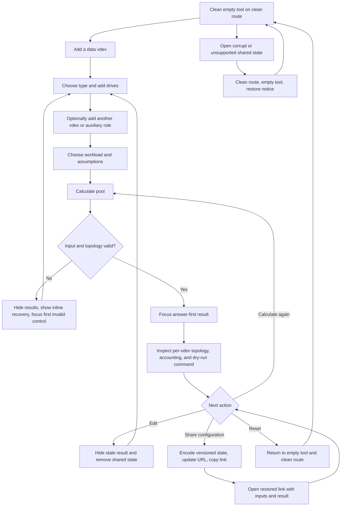

# Implementation report: ZFS Pool Capacity Calculator

Status: ready
Tool: ZFS Pool Capacity Calculator
Route: `/zfs-capacity-calculator`
Build status: local implementation and automated checks ready; OpenZFS 2.3 and 2.4 receipt evidence pending
Depends on: `competitive-report.md`
Contract type: formula

## Product decision

- Primary user: A homelab or NAS builder planning a new OpenZFS pool before buying drives or assigning devices.
- Job: Build the intended mixed-vdev topology and learn how much physical data it is estimated to hold, where the rest of the entered capacity goes, and which vdev sets each failure boundary.
- Product thesis: This is a topology-first OpenZFS planner. It shows each real top-level vdev before the pool total and reconciles entered bytes through mixed-drive limits, redundancy, RAIDZ allocation, OpenZFS slop, and optional planning headroom without calling any estimate "actual usable" capacity.
- Evidence: `competitive-report.md` sections `User pain evidence`, `Technical truth to verify`, `Formula and data disagreements`, and `Evidence-backed opportunities`, especially the repeated confusion about mixed top-level vdevs, RAIDZ block allocation, slop, auxiliary roles, and compression.

## Scope

### Table stakes

- Compose one fresh planned pool from one to 64 top-level data vdevs. Each data vdev is a mirror, RAIDZ1, RAIDZ2, or RAIDZ3 and contains individually sized drives.
- Add, duplicate, remove, and reorder data vdevs. Add and remove individual drives without flattening them into a repeated-group count.
- Create a common equal-drive vdev in one action by setting drive count, shared capacity, and unit, then keep every generated drive individually editable for mixed-size changes.
- Accept decimal and binary drive units and calculate in exact integer bytes.
- Make `ashift` and the selected filesystem `recordsize` or zvol `volblocksize` affect the named allocation estimate.
- Show each vdev's members, smallest-member boundary, stranded mixed-size bytes, redundancy, estimated allocation loss, estimated data capacity, and failure tolerance before the pool total.
- Separate OpenZFS slop from an editable 20% planning-headroom assumption. Planning headroom never reduces the physical-capacity bar or masquerades as filesystem overhead.
- Treat hot spares, SLOG, and L2ARC as physical inventory that contributes no general data capacity. Treat a special vdev as a separate mirrored allocation-class envelope.
- Suppress every numeric result for an invalid topology. A previous valid result disappears as soon as any input changes.
- Keep the route URL clean during entry and calculation. Encode a versioned state only when the user explicitly chooses `Share configuration`.
- Generate a non-executing `zpool create -n` preview with placeholder device paths only after a valid calculation.

### Launch differentiators

- The primary result mirrors OpenZFS's topology: visible per-vdev capacity and failure boundaries lead to the pool total instead of a repeated-vdev multiplier or one flattened answer.
- A raw-capacity accounting bar and exact table reconcile entered data-device bytes into estimated writable bytes, slop, mirror or parity cost, block allocation loss, alignment or tail loss, and mixed-size waste.
- The selected block size visibly changes RAIDZ allocation. The result names the modelled all-blocks-at-this-size assumption beside the affected number.
- Auxiliary roles are valid inventory without being misrepresented as general data capacity. Mirrored special capacity is shown separately as an envelope, not a workload fill prediction.
- Every valid result includes formula version, dated primary sources, assumptions, and a copyable dry-run command. The implementation is later verified against OpenZFS 2.3 and 2.4 sparse-pool fixtures before the tool can be considered complete.

### Deferred

- Nearby-width layout comparisons after the entered pool result.
- dRAID and distributed-spare modelling.
- Existing-pool import from `zpool status`, `zpool list`, or `zdb` output.
- Per-device partition, swap, boot, label, and platform reservation inputs. Launch treats entered capacity as the capacity offered to the vdev and states this boundary.
- Multiple independently configured `ashift` values in one create command. Launch uses one pool-planning `ashift` for every entered vdev.
- Cost, power, performance, IOPS, throughput, AFR, URE probability, resilver time, and dedup scenarios.
- CSV or JSON export and saved named configurations.

### Non-goals

- Do not promise the values from `zpool list`, `zfs list`, a quota, a zvol, or an application. Those are different accounting layers and depend on real allocation history.
- Do not reconstruct an already-expanded RAIDZ vdev. Old and new blocks can retain different data-to-parity ratios.
- Do not describe a compression ratio as new physical capacity or provide unsourced workload presets.
- Do not infer real device paths, add `-f`, execute a command, or claim that a generated command is safe for the user's hardware.
- Do not treat SLOG, L2ARC, spares, or special vdevs as ordinary pool data capacity.
- Do not display one pool-wide failure-tolerance count that hides which top-level vdev fails.

## Formula and data contract

### Inputs and normalization

| Input | Type and unit | Default | Valid range | Normalization |
| --- | --- | --- | --- | --- |
| Data vdevs | Ordered array | Empty | 1 to 64 for calculation | Stable IDs. Order is retained for display and command generation. |
| Data vdev type | Enum | `raidz2` for a newly added vdev | `mirror`, `raidz1`, `raidz2`, `raidz3` | Map RAIDZ type to parity count `P = 1, 2, 3`. Mirror has no parity count. |
| Data-vdev drives | Ordered drive array | Empty | Mirror: 2 to 64. RAIDZ: `P + 1` to 64. Total inventory: at most 256 drives in the UI and 1,024 in the shared engine | Each drive gets a stable unique ID and `groupId` for its vdev. Empty UI rows are partial state, not engine input. |
| Drive capacity | Plain decimal string plus unit, normalized to `bigint` bytes | Blank | More than 0 and at most `10^24` bytes | Accept `GB`, `TB`, `GiB`, and `TiB` in the UI. Reject exponent notation, negatives, and fractions smaller than one byte through the shared byte parser. |
| Auxiliary inventory | Ordered groups or devices | Empty | 0 to 64 groups, subject to the 256-drive UI total | Roles are `spare`, `slog`, `l2arc`, or `special`. Spare and L2ARC entries are individual devices. SLOG can be one device or a mirror. Special is mirror only with at least two members. |
| Workload mode | Enum | `filesystem` | `filesystem`, `zvol` | The mode exposes one block-size control. It never shows `recordsize` and `volblocksize` together. |
| Logical block size `B` | Preset `bigint` bytes | Filesystem: 128 KiB. Zvol: 16 KiB | Powers of two. Filesystem: 4 KiB to 16 MiB. Zvol: 4 KiB to 128 KiB | Label as `recordsize` for a filesystem and `volblocksize` for a zvol. Changing mode resets to that mode's default. |
| `ashift` | Integer sector shift | 12 | 9, 12, 13, or 14 | Sector size `S = 2^ashift` bytes. One launch value applies to every vdev and the command preview. |
| Slop shift | Integer | 5 | 1 to 31 | Hidden under advanced assumptions. Values other than 5 are labelled a local OpenZFS configuration override. The 128 MiB minimum and 128 GiB maximum remain fixed in version 1. |
| Planning headroom | Decimal percentage stored as integer basis points | 20% | 0% to 50%, at most two decimal places | This is a user-owned planning target and is not an OpenZFS requirement. `20%` becomes `2,000` basis points. |
| Compression scenario | Optional decimal ratio stored as an integer rational | Off | 1.00 to 10.00, at most two decimal places | No presets. When enabled, `1.5` becomes `150/100`. It affects only the conditional logical-data scenario at the planning target. |
| Output unit | Display enum | `TiB` | `TiB`, `TB` | Display-only state. It does not change formula input or shared state. |

The serialized engine input contains only complete normalized values. The client editor may hold blank rows and incomplete decimals, but it must not call the engine or encode shared state until every required value satisfies this table.

### Equations or resolution order

All capacity operations use `bigint`. Define `ceilDiv(a, b) = (a + b - 1) / b`, integer division toward zero, and `roundUp(a, k) = ceilDiv(a, k) * k` for non-negative integers.

1. **Normalize inventory.** Let `R_all` be the sum of every entered device capacity. Partition the inventory into data devices, special devices, SLOG devices, L2ARC devices, and spares. Only data vdevs enter the general writable-capacity formula. Special vdevs use the separate envelope in step 8.
2. **Align each data member to its sector.** For drive capacity `c_i` and sector size `S`, `a_i = floor(c_i / S) * S`. The sector alignment remainder is `e_i = c_i - a_i`. For one vdev with `N` members, let `m = min(a_i)`, `C = N * m`, and mixed-size waste `M = sum(a_i) - C`. Thus the vdev's entered raw bytes equal `sum(c_i) = C + M + sum(e_i)`.
3. **Calculate logical sectors for the selected block.** `L = ceilDiv(B, S)`. One physical copy consumes `L * S` bytes. Its sector-rounding cost is `Q = L * S - B` bytes.
4. **Calculate a mirror vdev.** Let `K = floor(m / (L * S))`, the count of selected-size blocks that fit on one member. Estimated logical data is `D_v = K * B`. Mirrored-copy bytes are `R_v = K * (N - 1) * L * S`. Sector-rounding bytes for the primary copy are `Q_v = K * Q`. Tail bytes are `T_v = C - K * N * L * S`. The identity `C = D_v + R_v + Q_v + T_v` must hold. Failure tolerance is any `N - 1` members of that mirror.
5. **Calculate a RAIDZ vdev.** Let parity count be `P`, data-column limit `W = N - P`, parity sectors per selected block `Y = P * ceilDiv(L, W)`, sectors before RAIDZ padding `F = L + Y`, and allocated sectors `A = roundUp(F, P + 1)`. Let `K = floor((C / S) / A)`. Then estimated logical data is `D_v = K * B`, sector-rounding bytes are `Q_v = K * Q`, parity bytes are `R_v = K * Y * S`, RAIDZ padding bytes are `G_v = K * (A - F) * S`, and tail bytes are `T_v = C - K * A * S`. The identity `C = D_v + Q_v + R_v + G_v + T_v` must hold. Failure tolerance is `P` failed members in that vdev, not `P` failures anywhere in the pool.
6. **Aggregate data vdevs without flattening them.** `D_pool = sum(D_v)`. Sum every loss category independently for the exact allocation figure. A valid pool must also reconcile `R_data = D_pool + mixed-size waste + sector alignment + mirror or parity bytes + sector rounding + RAIDZ padding + tails`.
7. **Apply the modelled OpenZFS slop reserve.** Let `H = min(D_pool >> slopShift, 128 GiB)`. Let `slop = max(H, min(D_pool >> 1, 128 MiB))`. Estimated writable physical data is `E = max(0, D_pool - slop)`. Version 1 does not subtract embedded-log space from slop, so this is a conservative planning model rather than a byte-for-byte promise of `spa_get_slop_space()`.
8. **Calculate auxiliary-role reporting.** Spare, SLOG, and L2ARC capacity is reported only as role inventory. For each mirrored special vdev, align members as in step 2 and report `specialEnvelope = min(a_i)` with mixed-size waste and failure tolerance. Do not add the envelope to `E`, subtract pool slop from it, or predict how much metadata and `special_small_blocks` data will occupy it.
9. **Apply optional planning headroom.** `userReserve = floor(E * reserveBasisPoints / 10,000)` and `planningTarget = E - userReserve`. This is an overlay on estimated writable physical capacity, not another segment of raw physical loss.
10. **Calculate the optional compression scenario.** For ratio numerator `n` and denominator `d`, `logicalScenario = floor(planningTarget * n / d)`. It is absent when the scenario is off and is always labelled conditional logical data at the selected planning target.
11. **Generate the command preview.** After a valid result, serialize the visible topology as `zpool create -n -o ashift=<value> <pool-name> ...` using `/dev/disk/by-id/<data-vdev-1-drive-1>` style placeholders. Include `mirror`, `raidz1`, `raidz2`, `raidz3`, `log`, `cache`, `spare`, and `special` tokens only for entered roles. Never add `-f` or execute the text.

The RAIDZ sector equation in step 5 mirrors the current OpenZFS `vdev_raidz_psize_to_asize()` order: round logical bytes to sectors, add parity rows across `N - P` data columns, then round the allocation to a multiple of `P + 1` sectors. Applying one chosen block size across an entire capacity is intentionally a modelled workload scenario.

### Rounding, display, and versioning

- Source capacities, losses, and results remain integer bytes. No capacity value passes through JavaScript `Number`.
- Integer division floors only where an equation says `floor`. Drive and result formatting rounds half up for display without changing stored bytes.
- Default output is TiB with at most two decimal places. A visible control switches every capacity value to TB. Percentages show at most two decimals and derive from exact byte totals.
- Bars use exact byte proportions. When a non-zero segment is too narrow to see, the table still shows it and the bar provides an accessible text description.
- `calculatorId = zfs-pool-capacity`, `calculationVersion = 1`, and `inputVersion = 1`. The URL envelope continues to use shared storage schema version 1 and engine version 1.
- Formula behavior is immutable within calculation version 1. A changed slop equation, block-allocation equation, default that affects output, accepted topology, or result classification requires calculation version 2. A changed serialized shape requires input version 2. Old adapters remain registered so old shared links replay their recorded version.
- OpenZFS sparse-pool fixtures record OpenZFS version, command, topology, `ashift`, block size, observed values, tolerance, and fixture date. The formula cannot be called implementation-complete until fixtures pass on both OpenZFS 2.3 and 2.4.

### Invalid, unknown, absent, and partial states

- Empty editor: no result and no error summary. `Calculate pool` stays visible but disabled until at least one data vdev exists.
- Partial row: blank capacity, malformed decimal, or blank vdev prevents engine input. On submission, focus the first invalid control, show its inline error, and expose no numeric result.
- Invalid topology: mirror with fewer than two drives, RAIDZ1 with fewer than two, RAIDZ2 with fewer than three, RAIDZ3 with fewer than four, duplicate IDs, excessive inventory, zero capacity, or out-of-range settings produces an invalid engine result with `values = null`.
- Invalid auxiliary topology: mirrored SLOG with fewer than two members, any non-mirrored special vdev, or an empty auxiliary group blocks results.
- A RAIDZ width above a recommendation is not invalid if it stays within the contract. The tool must not silently clamp or rewrite a user's topology.
- Any edit, add, remove, duplicate, reorder, workload change, or advanced-setting change immediately removes the old result and any `state` query parameter. The page never shows stale values beside changed or invalid inputs.
- Corrupt, oversized, unsafe, unsupported, or wrong-calculator shared state is not partially trusted. Restore the clean empty editor, remove the bad query parameter with `history.replaceState`, and show one polite notice that the shared configuration could not be restored.
- Missing compression scenario means no logical-data row. Zero auxiliary roles means their result section is absent. Unknown partition, label, swap, filesystem metadata, fragmentation, and existing allocation history remain unknown rather than becoming a default percentage.
- No loading, partial upstream, no-data, timeout, or network-failure state exists. Calculation and state encoding are synchronous and local. If computation exceeds the performance budget, that is an implementation defect, not a loading experience.

### Assumptions and exclusions

- The pool is a fresh planned topology with no existing data and no RAIDZ expansion history.
- Every modelled logical block is the selected `recordsize` or `volblocksize`. Real datasets contain a distribution of block sizes, metadata, copies, fragmentation, gang blocks, snapshots, and compression outcomes, so the headline is `estimated writable physical data`.
- Entered drive capacity is treated as capacity offered to OpenZFS. Version 1 does not infer GPT labels, boot or swap partitions, platform defaults, or vendor appliance reservations.
- One `ashift` applies to all entered vdevs. The UI does not claim to detect a drive's physical sector size.
- The slop equation models the documented default minimum and maximum. It excludes the embedded-log adjustment and any system-specific module changes other than the explicit slop-shift input.
- Special capacity is an upper mirrored allocation-class envelope. Metadata copies and `special_small_blocks` placement depend on the workload and are not predicted.
- SLOG changes synchronous-write intent-log placement, L2ARC is a second-level cache, and spares are replacements. None increases general data capacity.
- The compression ratio belongs to the user. It does not modify physical capacity or imply that future data will compress that way.
- The dry-run command is educational text with placeholders. It is not a hardware discovery or destructive-action feature.
- dRAID, dedup, performance, failure probability, resilver duration, quotas, reservations, application-visible free space, and existing-pool reconciliation are excluded.

### Primary sources

- [OpenZFS RAIDZ documentation](https://openzfs.github.io/openzfs-docs/Basic%20Concepts/Pool%20Structure/RAIDZ.html), checked 2026-08-04. Supports dynamic RAIDZ stripe allocation, `ashift` and block-size sensitivity, parity counts, minimum widths, and expansion-history limits.
- [OpenZFS `vdev_raidz.c`](https://github.com/openzfs/zfs/blob/master/module/zfs/vdev_raidz.c), checked 2026-08-04. Supports the version 1 sector, parity-row, and `P + 1` padding equation in `vdev_raidz_psize_to_asize()`.
- [OpenZFS `spa_misc.c`](https://github.com/openzfs/zfs/blob/master/module/zfs/spa_misc.c), checked 2026-08-04. Supports the default shift, 128 MiB floor, 128 GiB cap, small-pool half-space limit, and embedded-log adjustment boundary for slop.
- [OpenZFS module parameters](https://openzfs.github.io/openzfs-docs/Performance%20and%20Tuning/Module%20Parameters.html), checked 2026-08-03. Supports `spa_slop_shift` as a tunable accounting reserve.
- [OpenZFS VDEVs documentation](https://openzfs.github.io/openzfs-docs/Basic%20Concepts/Pool%20Structure/VDEVs.html), checked 2026-08-03. Supports top-level failure boundaries and data, log, cache, spare, and special role distinctions.
- [OpenZFS special vdev documentation](https://openzfs.github.io/openzfs-docs/Basic%20Concepts/Pool%20Structure/Special%20vdev.html), checked 2026-08-03. Supports special-vdev permanence, redundancy requirements, and allocation-class behavior.
- [OpenZFS workload tuning](https://openzfs.github.io/openzfs-docs/Performance%20and%20Tuning/Workload%20Tuning.html), checked 2026-08-03. Supports the distinct `recordsize` and `volblocksize` controls and their RAIDZ efficiency effects.
- [OpenZFS compression documentation](https://openzfs.github.io/openzfs-docs/Basic%20Concepts/Data%20Storage/Compression.html), checked 2026-08-03. Supports keeping compression conditional on real block outcomes.
- [OpenZFS changing pool layout](https://openzfs.github.io/openzfs-docs/Basic%20Concepts/Pool%20Structure/Changing%20Pool%20Layout.html), checked 2026-08-03. Supports the fresh-topology limit for expanded RAIDZ vdevs.
- [`zpool-create(8)`](https://openzfs.github.io/openzfs-docs/man/master/8/zpool-create.8.html), checked 2026-08-03. Supports the topology tokens and dry-run command form.

## User flow



The explicit action is deliberate. A mixed pool can contain many incomplete rows, and a live headline would repeatedly turn valid and invalid while the topology is being constructed. `Calculate pool` is the single accent action, stays visible in a sticky tool footer, and establishes when the user considers the current topology complete.

## Interface wireframes

### Desktop: clean

```text
ZFS pool capacity calculator
Plan mixed top-level vdevs and see where the entered capacity goes.

+------------------------------------------------------------------------------+
| Workload                                                                    |
| (o) Filesystem  recordsize [128 KiB v]    ( ) Zvol                         |
| ashift [12 v]   Planning headroom [20 %]   [Advanced assumptions]           |
|------------------------------------------------------------------------------|
| Data vdevs                                                   [Add data vdev] |
|                                                                              |
| No data vdevs yet. Add the mirrors or RAIDZ groups you plan to create.       |
|                                                                              |
| Auxiliary devices                                      [Add auxiliary role] |
| None                                                                         |
|------------------------------------------------------------------------------|
| [Reset]                                             [Calculate pool disabled]|
+------------------------------------------------------------------------------+
```

After `Add data vdev`, the same surface contains a flat topology editor:

```text
| Data vdev 1   [RAIDZ2 v]   0 drives             [Duplicate] [Move] [Remove] |
| Drive    Capacity                         Unit                              |
| 01       [                    ]            [TB v]                    [trash] |
|                                                       [Add drive]            |
```

`Add drive` adds one blank row and focuses its capacity. It is not a calculation action and never becomes the accent button.

### Desktop: result

```text
+------------------------------------------------------------------------------+
| Inputs remain editable above                                                  |
| [Reset]                                                     [Calculate pool] |
|==============================================================================|
| About 52.40 TiB is estimated writable after RAIDZ allocation and ZFS slop.   |
| At 20% headroom, plan for 41.92 TiB.                         (o) TiB  ( ) TB  |
|                                                                              |
| Vdev topology                                                                |
| 01 RAIDZ2  6 drives  [18][18][18][18][18][18]  65.30 TiB  tolerates 2       |
| 02 Mirror  2 drives  [8 ][8 ]                   7.28 TiB  tolerates either 1 |
|                                                                              |
| Entered data-device capacity                                                  |
| [ writable ][ slop ][ parity/copies ][ RAIDZ padding ][ mixed/tail ]         |
|                                                                              |
| Accounting                                                                   |
| Entered data devices                                      116.00 TiB         |
| Mixed-size and sector alignment                              0.00 TiB         |
| Mirror copies and RAIDZ parity                              56.00 TiB         |
| RAIDZ padding, block rounding, and tails                     5.90 TiB         |
| Before slop                                                 54.10 TiB         |
| OpenZFS slop estimate                                        1.70 TiB         |
| Estimated writable physical data                            52.40 TiB         |
| Planning headroom, 20%                                      10.48 TiB         |
| Planning target                                             41.92 TiB         |
|                                                                              |
| Auxiliary inventory                                                           |
| 1 hot spare, 2-drive SLOG mirror, 2-drive special mirror                    |
| Special mirrored envelope: 894 GiB. This is not a predicted fill amount.     |
|                                                                              |
| zpool create -n -o ashift=12 <pool-name> raidz2 <data-1> ...                 |
|                                                        [Copy command]        |
| [Formula and assumptions]              [Copy summary] [Share configuration]  |
+------------------------------------------------------------------------------+
```

### Narrow mobile

```text
ZFS pool capacity calculator

+----------------------------------+
| Workload                         |
| (o) Filesystem  ( ) Zvol         |
| recordsize [128 KiB v]           |
| ashift [12 v]                    |
| Planning headroom [20 %]         |
|----------------------------------|
| Data vdevs        [Add vdev]     |
|                                  |
| Vdev 1             RAIDZ2 [v]    |
| [Duplicate] [Move] [Remove]      |
| 01 [capacity       ][TB v][x]    |
| 02 [capacity       ][TB v][x]    |
|                    [Add drive]   |
|----------------------------------|
| Auxiliary devices      [Add]     |
|----------------------------------|
| [Reset]        [Calculate pool]  |  sticky inside the tool
|==================================|
| 52.40 TiB estimated writable     |
| Plan for 41.92 TiB at 20%        |
|                                  |
| Vdev topology                    |
| 01 RAIDZ2              65.30 TiB |
| [18][18][18]                    |
| [18][18][18]   tolerates 2       |
|                                  |
| Capacity allocation              |
| [writable][slop][parity][loss]   |
|                                  |
| Accounting                       |
| Label                    value   |
| ...                              |
|                                  |
| [Copy summary] [Share]           |
+----------------------------------+
```

Drive identity, capacity, unit, and the 44 by 44 pixel remove action remain on one row. Topology controls wrap as their own row above the drive table, never pushing the remove action below its drive.

### Error, loading, partial, and restored states

Invalid submission:

```text
+------------------------------------------------------------------------------+
| Data vdev 1   RAIDZ2                                                          |
| 01 [18][TB]   02 [18][TB]                                                     |
|     RAIDZ2 needs at least three drives.                           [Add drive] |
|------------------------------------------------------------------------------|
| Fix one vdev before this pool can be calculated.                 [Calculate] |
+------------------------------------------------------------------------------+
```

The first invalid field or vdev heading receives focus. The result divider and every old numeric result are absent.

Restored shared state:

```text
+------------------------------------------------------------------------------+
| Shared configuration restored. Edit it or calculate again after a change.    |
| [complete restored inputs]                                                    |
|==============================================================================|
| [recalculated result from the encoded calculator and input version]           |
|                                              [Share configuration]            |
+------------------------------------------------------------------------------+
```

A valid shared state recalculates and displays its result on load without moving focus. Calculation is local and synchronous, so there is no loading state, partial result, upstream failure, or no-data screen. A bad shared state becomes the clean wireframe plus the sentence `This shared configuration could not be restored.`

## Interaction contract

| Event | UI response | Result state | Focus/announcement | URL/persistence |
| --- | --- | --- | --- | --- |
| Clean route opens | Render an empty editor and visible disabled `Calculate pool` action | Absent | Normal document focus, no announcement | Exact clean path, no storage |
| Add data vdev | Append one empty RAIDZ2 vdev | Absent | Focus the vdev-type control and announce `Data vdev 1 added` | Clean path |
| Add drive | Append one blank member to that vdev | Absent | Focus its capacity input and announce `Drive added to data vdev 1` | Clean path |
| Duplicate or reorder vdev | Copy or move the full vdev as one top-level unit | Any previous result is removed | Focus the moved or new vdev heading; concise polite announcement | Remove `state` if present |
| Edit any input | Apply the edit without automatic calculation | Any previous result is removed immediately | Keep focus where the user is typing; no repeated live announcement | Remove `state` if present; no `localStorage` |
| Submit empty editor | Button is disabled | Absent | No event | Clean path |
| Submit partial or invalid editor | Reveal inline errors and one concise form-level sentence | Absent, never stale | Focus first invalid control or vdev heading; assertive error summary once | Clean path |
| Submit valid editor | Calculate synchronously and reveal answer, vdev rows, accounting, and command | Valid | Focus result heading with `tabIndex=-1`; polite live region announces estimated writable and planning target | Clean path remains unchanged |
| Submit unchanged valid editor again | Recalculate deterministically without duplicating UI | Replaced by the same versioned result | Keep focus on action, then announce completion once | No history entry |
| Change output unit | Reformat all capacities together | Remains valid | Keep focus on selected radio; no result announcement | Display-only, not serialized |
| Copy summary or command | Copy plain text after explicit activation | Remains valid | Polite status message says what was copied; failure leaves text selectable | No URL change |
| Share configuration | Validate, encode formula input, add `state`, and copy the full link | Remains valid | Polite status says link copied. Clipboard failure still leaves the share URL visible and selectable | One `history.replaceState` update, no network |
| Open valid shared state | Restore inputs, validate recorded versions, and recalculate | Valid | No automatic focus movement; polite restore status is available after the page heading | Query state remains until edit or reset |
| Open invalid shared state | Discard the payload and show a restore notice | Absent | Notice uses polite live semantics after hydration; no forced focus | Remove query with `replaceState` |
| Reset | Return to the empty editor and remove errors/results | Absent | Focus `Add data vdev` and announce `Calculator reset` | Exact clean path |

All native radio, select, input, details, and button behavior remains keyboard operable. Vdev reordering provides `Move up` and `Move down` buttons, not drag-only interaction.

## Page composition

| Claim or task | Medium | Position | Why this medium |
| --- | --- | --- | --- |
| Name the tool and distinguish a planning estimate from installed free space | Sentences | Server-rendered h1 and one lede above the tool | This is the promise and its necessary boundary, not repeated data. |
| Construct mixed top-level vdevs and auxiliary roles | Tool UI | First and dominant visual | The topology is user input and should look like the pool that will be created. |
| Show the answer and planning target | Tool UI | First result line inside the same workbench | The user came for one decision, so the conclusion leads. |
| Show per-vdev capacity and failure boundaries | Table | Directly under the lead result | Repeated columns compare each vdev without inventing geometry that cannot encode member size or failure behavior. |
| Reconcile entered data capacity | Exact result visualization | Under per-vdev topology | One proportional horizontal bar makes the relative allocation immediately scannable. |
| State every allocation value and classification | Allocation legend | Directly below the bar | The shared allocation figure keeps every exact label and value visible, including segments too small to see. |
| Separate spare, SLOG, L2ARC, and special inventory | Table | After general capacity accounting | Repeated role facts are clearer as structured rows and stay out of the primary capacity bar. |
| Preview topology syntax | Code block | Near the end of the valid result | The command is exact technical text and must remain copyable and visibly non-executing. |
| Explain the formula, slop, block-size model, and expansion limit | Sentences plus compact formula table | Collapsed details inside the result, followed by a short server-rendered reference section | These are caveats and definitions that should sit beside the numbers they limit. |
| Compare this tool with the conventional RAID calculator | Internal link sentence | Short related-tool footer | It gives users with non-ZFS arrays a clear next path without adding another comparison surface. |

There is no marker art or screenshot. The tool itself, exact bar, vdev table, auxiliary table, and command preview carry the page. Decorative media would compete with the capacity answer.

## Technical plan

### Architecture and file ownership

- `app/(site)/(tools)/zfs-capacity-calculator/page.tsx` remains a server component. It owns the shared `AppShell`, page title, lede, static reference content, and initial `state` string passed to the client island. It exports no metadata, canonical, robots, sitemap, or JSON-LD configuration.
- `app/(site)/(tools)/zfs-capacity-calculator/zfs-capacity-calculator.tsx` is the smallest client island. It owns incomplete editor strings, explicit submission, focus, clipboard actions, restored URL state, output-unit display, and rendering of the pure result. It contains no capacity equations.
- `app/(site)/(tools)/zfs-capacity-calculator/zfs-capacity-calculator.module.css` owns the topology editor, sticky action row, result hierarchy, allocation bar, compact tables, and responsive behavior. It reuses tokens and shell classes from `app/(site)/(catalogs)/storage-tools/storage-tools.module.css` without adding selectors to `app/globals.css`.
- `app/(site)/(catalogs)/storage-tools/storage-tools-sidebar.tsx` adds the ZFS route and accepts a ZFS active state. `app/(site)/(catalogs)/storage-tools/page.tsx` adds the tool to the hub when implementation begins.
- `lib/storage/zfs.ts` owns normalized types, input guard, equations, validation issues, derivation, sources, result classifications, command-token data, and the `zfs-pool-capacity` adapter. It imports shared bytes, inventory, result, and registry helpers and exports through `lib/storage/index.ts`. It has no React, DOM, database, analytics, or network dependency.
- `tests/pages/zfs-capacity-calculator/page.json` owns the unpublished route and references all page docs, tests, scripts, and skills. `tests/pages/storage-tools/page.json` is updated because the hub gains another owned link.
- `tests/pages/zfs-capacity-calculator/zfs-capacity-calculator.test.mjs` owns pure engine formula, reconciliation, validation, result classification, version replay, and command-token cases. `tests/pages/zfs-capacity-calculator/page.test.mjs` owns static route and visual-contract assertions. A page-scoped Playwright file owns keyboard, focus, URL sharing, restored state, responsive layout, dark/light theme, and clipboard fallback behavior.
- `tests/pages/storage-tools/shared/storage-engine.test.mjs` changes only if a genuinely shared invariant is required. ZFS-only fixtures stay page-owned.
- `scripts/zfs-capacity-calculator/verify-openzfs-fixtures.mjs` owns sparse-pool verification and a check mode for recorded OpenZFS 2.3 and 2.4 fixtures. The top-level `scripts/scripts.json` registry records its page-owned folder. No one-off package script is added.
- `content_docs/zfs-capacity-calculator/` owns this report, `competitive-report.md`, `brief.md`, the next-stage edge-case and writing contracts, and later fixture notes. `content_docs/storage-tools/calculation-engine.md` changes only if the shared engine contract changes.
- No new runtime dependency is approved. Use the existing storage engine, React, Next.js, Lucide, `CodeBlock`, prose primitives, and design tokens.

The server renders the page promise, tool shell, empty form labels, and static reference content. Hydration adds editing and local calculation. Formula truth remains independently importable and testable in Node, and shared links replay the adapter version recorded in their envelope.

### Accessibility, privacy, security, and performance

- Use fieldsets and legends for workload, vdev type, output unit, and auxiliary topology. Every drive input has a visible or programmatic label containing vdev and drive number.
- Use a semantic list for vdevs, native tables for repeated result facts, and a text equivalent for the proportional bar. Color is never the only distinction.
- Every interactive target is at least 44 by 44 CSS pixels on touch layouts. Focus uses `--focus-ring`. Reordering is available through named buttons. Reduced-motion preference disables non-essential scrolling or transitions.
- One result heading receives programmatic focus after successful calculation. Invalid submission focuses the first invalid field. Live regions announce only add/remove completion, validation summary, calculation conclusion, reset, share, and copy outcomes, avoiding per-keystroke noise.
- The calculator sends no topology, capacity, role, or command data to a server. It uses no local storage, cookie, or hidden persistence. Clipboard write happens only after an explicit copy/share action. The query state is readable by anyone who receives the URL, and the share control says so before copying.
- Analytics, if present sitewide, may record only a generic `zfs_calculation_completed` or `zfs_share_used` event after separate approval. It must never include drive counts, sizes, roles, block size, ratios, command text, URL state, or validation content. Launch requires no new analytics.
- Decode limits, safe-key checks, calculator identity, and version checks come from the shared state codec. Command rendering treats every label as text and never interpolates HTML or calls a shell.
- No calculation fetch, worker, database, or third-party script is allowed. The incremental client bundle target is at most 40 KiB gzip with no new runtime package. A valid 256-drive calculation should complete within 50 ms at the test baseline. If either target fails, reduce UI/state work before considering a loading state.
- Verify dark mode first, then light mode, at 320, 375, 760, and 1280 CSS-pixel widths. No horizontal page scroll is allowed. Exact tables may scroll only inside their labelled table region when a stacked representation cannot preserve meaning.

### Publication state

Unpublished. The route, sidebar entry, hub link, tests, and local registry preview may exist, but the exact slug must remain absent or unpublished in `public.stack127_pages`. It should return 404 outside the guarded local preview, remain out of the sitemap, and receive no route-owned SEO behavior. This tool may publish independently after its own launch checks pass and the user separately approves publication.

## Acceptance criteria

| ID | Observable acceptance criterion | Evidence at build time |
| --- | --- | --- |
| R1 | A clean visit shows an empty topology editor, visible `Add data vdev`, visible `Add auxiliary role`, and a visible disabled `Calculate pool` button on the clean route. | Browser and static page test |
| R2 | Adding a data vdev creates one empty RAIDZ2 group. Users can create an equal-drive starting set in one action or add one blank drive at a time; every resulting row remains individually editable and the one-drive action focuses its capacity. | Browser test |
| R3 | Users can add, duplicate, remove, and keyboard-reorder mixed mirror and RAIDZ1/2/3 top-level data vdevs without flattening their member capacities. | Browser test |
| R4 | The engine accepts exact decimal and binary capacities as `bigint` bytes and rejects zero, negative, exponent, sub-byte, duplicate-ID, over-limit, and excessive-inventory inputs. | Unit tests |
| R5 | Mirror, RAIDZ1, RAIDZ2, and RAIDZ3 enforce their documented minimum member counts and return `values = null` for invalid topologies without silently clamping. | Unit and Browser tests |
| R6 | Changing `ashift` or the selected `recordsize` or `volblocksize` changes the named sector or RAIDZ allocation estimate when the equation predicts a difference. | Formula fixtures and Browser test |
| R7 | Each valid mirror vdev reconciles common raw bytes to logical data, mirrored copies, sector rounding, and tail bytes exactly. | Unit property tests |
| R8 | Each valid RAIDZ vdev uses version 1 sector, parity-row, and `P + 1` padding equations and reconciles common raw bytes exactly. | Unit fixtures and OpenZFS source contract test |
| R9 | Mixed-size and sector-alignment loss is calculated per vdev from its own smallest aligned member, not from the smallest drive in the whole pool. | Unit fixtures |
| R10 | Per-vdev contribution and failure tolerance appear in one table after the lead answer, and no pool-wide tolerance number implies failures can occur in any placement. | Browser and static page test |
| R11 | OpenZFS slop uses the selected shift, 128 MiB floor, 128 GiB cap, and small-pool half-space rule, with the embedded-log exclusion stated. | Unit boundary tests and result details |
| R12 | The default 20% planning headroom appears separately from estimated writable physical data and does not reduce or segment the raw physical-capacity bar. | Unit and Browser tests |
| R13 | An enabled compression ratio changes only the conditional logical-data scenario at the planning target; it never changes physical capacity. | Unit and Browser tests |
| R14 | Spare, SLOG, and L2ARC devices appear in physical inventory but add zero general data capacity. | Unit and Browser tests |
| R15 | A special vdev must be mirrored and appears as a separate smallest-member capacity envelope with a permanence warning, never in general writable capacity. | Unit and Browser tests |
| R16 | A successful calculation begins with one dominant estimated-writable value and a secondary planning target, then shows the vdev table, one exact allocation bar, optional auxiliary inventory, the command, and formula details. | Browser screenshot and accessibility test |
| R17 | The allocation reconciles all entered data-device bytes, and every category remains available as an exact labelled value even when its segment is zero or visually narrow. | Unit and Browser tests |
| R18 | Any input or topology edit immediately removes the old result and removes the `state` parameter. Invalid submission never coexists with old or partial numeric results. | Browser test |
| R19 | Successful and repeated calculations do not change the URL or add history entries. Only `Share configuration` creates versioned URL state. | Browser history test |
| R20 | A valid shared link restores the full normalized topology and recalculates with its recorded formula/input version. A corrupt, unsafe, oversized, future, or wrong-calculator state restores nothing and returns to the clean route with a notice. | Unit codec and Browser tests |
| R21 | Reset clears editor, errors, result, display state, and query state, then focuses `Add data vdev`. | Browser test |
| R22 | The command preview begins with `zpool create -n`, preserves visible topology and roles with placeholders, never includes `-f`, and is never executed. | Unit and static tests |
| R23 | Keyboard users can operate every control, reorder vdevs without dragging, reach visible focus, and receive concise result, error, copy, share, and reset announcements. | Playwright accessibility test |
| R24 | At 320 CSS pixels and wider, each drive's identity, capacity, unit, and remove control remain one row, tool actions do not overlap, and the page has no horizontal scroll in dark or light mode. | Browser screenshots and layout assertions |
| R25 | The engine and route add no runtime dependency or calculation request, keep formula code outside React, and meet the 40 KiB gzip incremental bundle and 50 ms maximum-input calculation targets. | Bundle report, source inspection, and benchmark test |
| R26 | Recorded sparse-pool fixtures pass within documented tolerances on OpenZFS 2.3 and 2.4 for mirrors, RAIDZ1/2/3, mixed sizes, ashift 12/13, filesystem and zvol block sizes, slop caps, and an expansion-sensitive negative case. | Fixture script check mode and stored receipts |
| R27 | The route remains unpublished, has a complete page ownership manifest, exports no route metadata, and stays excluded from production sitemap and indexable registry state. | Static policy and SEO tests |

## Open questions and blockers

- Production blocker: the repository does not yet contain real OpenZFS 2.3 and 2.4 sparse-pool receipts. `scripts/zfs-capacity-calculator/verify-openzfs-fixtures.mjs --check` must pass with independently captured evidence before this tool can be called production-complete. Receipts must not be fabricated from the TypeScript engine or competitor output.
- Cross-platform device reservations remain deliberately excluded, expanded pools remain out of scope, planning headroom defaults to a separate editable 20%, and special-vdev capacity remains a separate envelope.
