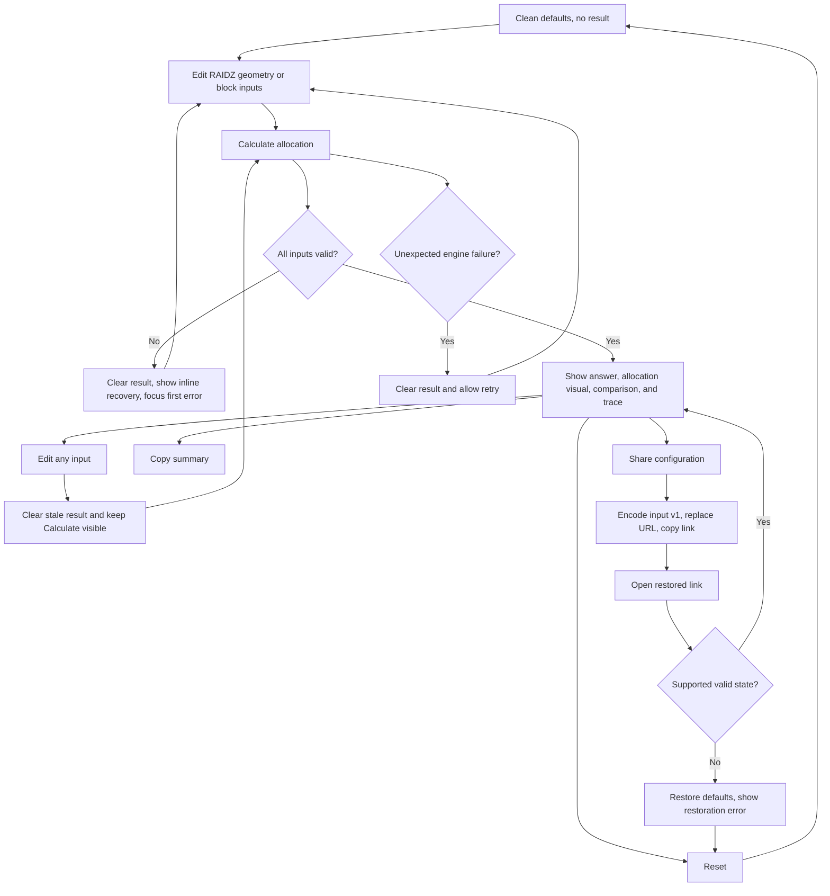

# Implementation report: ZFS Block Size and Padding Calculator

Status: ready
Tool: ZFS Block Size and Padding Calculator
Route: `/zfs-padding-calculator`
Depends on: `competitive-report.md`
Input fingerprint: `competitive-report.md sha256:0845f0afe056f88a87cbbe4ea96ecbe389c3d37f15b2bfd1233a48b04fd99de2`
Contract type: formula

## Product decision

- Primary user: A ZFS administrator choosing or diagnosing a dataset `recordsize` or zvol `volblocksize` on a known RAIDZ vdev.
- Job: See exactly how one uncompressed logical block is rounded into data, parity, and padding sectors, then compare nearby block sizes before changing a property.
- Product thesis: This is the block-level RAIDZ calculator that existing pool planners bury. It earns preference by showing an answer-first physical allocation, an exact visual split, nearby-size discontinuities, and every integer rounding step without pretending to predict a whole pool or recommend one universal block size.
- Evidence: `competitive-report.md` sections `User pain evidence`, `Comparison matrix`, `Formula and data disagreements`, and `Evidence-backed opportunities`. The strongest evidence is repeated confusion about small-block mirror-like efficiency, silent topology coercion in three competitors, and the lack of any competitor centered on one allocation.

## Scope

### Table stakes

- Calculate one uncompressed RAIDZ1, RAIDZ2, or RAIDZ3 block allocation from vdev width, `ashift`, workload terminology, and logical block size.
- Support filesystem `recordsize` values from 512 B to 16 MiB and zvol `volblocksize` values from 512 B to 128 KiB. Values must be powers of two, with presets plus an exact custom entry.
- Preserve impossible values and explain them inline. Never silently increase vdev width, reduce block size, or alter `ashift`.
- Show logical bytes, rounded data-sector bytes, parity, padding, total physical allocation, overhead, allocation multiplier, and logical efficiency.
- Compare the selected block size with up to two lower and two higher power-of-two sizes within the selected workload bounds.
- Use one explicit `Calculate allocation` action. Keep the clean route unchanged until the user explicitly shares a valid configuration.
- Restore a valid shared configuration into the same deterministic result and reject malformed, unsupported, oversized, or cross-calculator state.

### Launch differentiators

- One allocation is the main visual object. A labeled proportional bar and a sector-count row keep logical data, sector rounding, parity, and padding distinct.
- The result begins with a sentence that directly relates the selected logical block to physical bytes. Exact counts and percentages come after the answer.
- A nearby-size comparison makes efficiency cliffs visible without claiming that the most space-efficient size is best for the workload.
- An expandable calculation trace exposes every integer division and round-up with the formula version and dated primary sources.
- The existing ZFS pool calculator and this focused calculator use one shared RAIDZ allocation primitive, so the two tools cannot drift silently.

### Deferred

- An optional measured compressed-payload size or compression scenario.
- Repetition estimates for a user-supplied logical data amount.
- CSV or image export.
- Side-by-side comparison of two different vdev widths.
- dRAID and implementation-version selection.

### Non-goals

- Do not estimate whole-pool usable capacity, installed free space, metadata, slop space, fragmentation, metaslabs, special vdev allocation, or expansion history.
- Do not predict compression from a ratio, dataset contents, or a workload label.
- Do not call any block size optimal or recommend a property value from space efficiency alone.
- Do not simulate gang blocks, copies, ditto blocks, dRAID, deduplication, record coalescing, or future OpenZFS behavior.
- Do not present the ordered sector visualization as the literal on-disk column order for a specific transaction group.

## Formula and data contract

### Inputs and normalization

| Input | Type and unit | Default | Valid range | Normalization |
| --- | --- | --- | --- | --- |
| RAIDZ level | Enum: `raidz1`, `raidz2`, `raidz3` | `raidz2` | Exact enum only | Map to parity count `P = 1`, `2`, or `3`. Do not infer from text. |
| Vdev width | Integer member count | `6` | `P + 1` to `64` | Trim display input, parse base-10 digits only, reject fractions, signs, exponents, whitespace-only values, and unsafe integers. Preserve an invalid entry in the editor. |
| Workload | Enum: `filesystem`, `zvol` | `filesystem` | Exact enum only | Changes the property label and allowed block-size ceiling, not the formula. |
| Logical block size | Exact integer bytes serialized as `bigint` | `131072` bytes, 128 KiB | Filesystem: 512 B to 16 MiB. Zvol: 512 B to 128 KiB. Exact power of two only. | Presets serialize their byte value. Custom number plus `B`, `KiB`, or `MiB` must convert to one exact integer byte value without floating point. A workload change preserves the value and shows an error if the new ceiling makes it invalid. |
| `ashift` | Enum integer | `12` | `9`, `12`, `13`, `14` | Sector bytes `S = 2^ashift`. Show the corresponding 512 B, 4 KiB, 8 KiB, or 16 KiB beside the choice. |

The serialized input contains only `{ level, width, workload, blockSizeBytes, ashift }`. It never stores results, presentation units, copied text, timestamps, or derived values.

### Equations or resolution order

Let `L` be the requested logical block bytes, `S = 2^ashift` the sector bytes, `N` the vdev width, and `P` the parity count.

1. `dataColumns = N - P`.
2. `logicalSectors = ceil(L / S)`.
3. `fullRows = floor(logicalSectors / dataColumns)`.
4. `remainingDataSectors = logicalSectors mod dataColumns`.
5. `parityRows = fullRows + (remainingDataSectors > 0 ? 1 : 0)`.
6. `paritySectors = P * parityRows`.
7. `rawSectors = logicalSectors + paritySectors`.
8. `allocatedSectors = ceil(rawSectors / (P + 1)) * (P + 1)`.
9. `paddingSectors = allocatedSectors - rawSectors`.
10. `roundedDataBytes = logicalSectors * S`.
11. `sectorRoundingBytes = roundedDataBytes - L`.
12. `parityBytes = paritySectors * S`.
13. `paddingBytes = paddingSectors * S`.
14. `physicalBytes = allocatedSectors * S`.
15. Assert the reconciliation `physicalBytes = L + sectorRoundingBytes + parityBytes + paddingBytes`. A failed assertion is an engine error, never a displayed estimate.
16. `overheadBytes = physicalBytes - L`.
17. `efficiencyBasisPoints = floor((L * 10000) / physicalBytes)` for stable storage. Display may round to two decimal percentage points.
18. `allocationMultiplierMillionths = floor((physicalBytes * 1000000) / L)` for stable storage. Display may round to two decimals.
19. Build nearby comparisons by applying steps 1 to 18 independently to the selected power-of-two size and the nearest two lower and two higher valid powers. Do not interpolate.

The shared primitive should return sector and byte counts only. The page-specific engine adds validation, comparison rows, assumptions, derivation labels, sources, and the versioned calculator adapter.

### Rounding, display, and versioning

- All source values and equations use `bigint`. No formula step uses JavaScript floating point.
- `ceil(a / b)` is integer `(a + b - 1) / b` for positive values. Round-up to a multiple applies the same operation once.
- Bytes smaller than 1024 display as B. Larger values display in exact binary units using the shared storage formatter, with at most two decimal places and no mutation of stored bytes.
- Sector counts display as exact base-10 integers. The answer sentence includes both a friendly binary value and exact bytes when the friendly value is not an integer.
- Efficiency and overhead percentages display with at most two decimal places, derived from integer basis points. The allocation multiplier displays with at most two decimal places from integer millionths.
- A comparison bar's length is proportional to exact physical bytes within its local five-row set. Its adjacent text is the authoritative exact value.
- Formula contract version is `1`; serialized-input version is `1`; calculator ID is `zfs-padding`. A later semantic formula or input change increments the relevant version and does not reinterpret an old link under a new contract.
- The shared RAIDZ primitive has its own tests but no independently serialized version. Both calculator adapters record their own public formula versions.

### Invalid, unknown, absent, and partial states

- A width below `P + 1`, above 64, blank, fractional, signed, exponential, or unsafe is invalid. Keep the typed value and place the exact recovery message beside the field.
- A block size outside the selected workload range, non-integer after unit conversion, zero, negative, non-power-of-two, exponential, or above the safe parser limit is invalid.
- An unsupported RAIDZ level, workload value, `ashift`, extra serialized key, wrong calculator ID, unsupported version, unsafe key, invalid BigInt tag, invalid base64url, invalid UTF-8, invalid JSON, or oversized state is invalid.
- Any invalid configuration clears the previous result immediately. An invalidating error and a result must never coexist.
- Initial clean state is valid but unsubmitted: visible defaults, no result, and a persistent `Calculate allocation` button.
- There is no loading, partial-data, upstream-failure, or no-data state because calculation is synchronous, local, deterministic, and has no network boundary. If computation unexpectedly throws, clear the result and show a short neutral failure with a retry path.
- A valid restored share computes immediately because the link itself is an explicit saved action. An invalid share restores defaults, shows a compact restoration error, and does not calculate.

### Assumptions and exclusions

- The selected logical block is modeled as uncompressed and allocated through the supported RAIDZ path. The selected property value is a scenario input, not proof every real record has that size.
- `recordsize` is a maximum block size for datasets. Tail records may be smaller. `volblocksize` is the fixed zvol block size, but real observations can still include metadata and other effects outside this contract.
- The formula models the sector counts relevant to RAIDZ allocation. It does not identify the literal device-column rotation or transaction-group placement.
- Vdev widths above common recommendations remain calculable within the 64-member product bound, but the tool does not endorse them.
- Compression is excluded from version 1 because a user-entered ratio does not determine the exact stored size of every block. This decision avoids plausible but false physical-byte output.
- OpenZFS may change. Results are theoretical for formula contract version 1 and sources checked on 2026-08-05.

### Primary sources

- [OpenZFS RAIDZ structure](https://openzfs.github.io/openzfs-docs/Basic%20Concepts/Pool%20Structure/RAIDZ.html), checked 2026-08-05. Supports variable-width RAIDZ stripes and parity behavior.
- [OpenZFS `vdev_raidz.c`](https://github.com/openzfs/zfs/blob/master/module/zfs/vdev_raidz.c), checked 2026-08-05. Supports the parity-row and `P + 1` sector round-up contract.
- [OpenZFS workload tuning](https://openzfs.github.io/openzfs-docs/Performance%20and%20Tuning/Workload%20Tuning.html), checked 2026-08-05. Supports the distinct `recordsize` and `volblocksize` meanings and the absence of a universal workload-independent optimum.

## User flow



Repeat calculations replace the result in place. Nothing submits to a server, and ordinary input edits never write query state.

## Interface wireframes

### Desktop: clean

```text
ZFS block padding calculator

+--------------------------------------------------------------------------+
| RAIDZ level        RAIDZ1  [RAIDZ2]  RAIDZ3                              |
| Vdev width         [ 6 ]             ashift [12, 4 KiB v]                |
| Workload           [Filesystem]  Zvol                                    |
| recordsize         [128 KiB v]     [Custom...]                           |
|                                                                          |
| [Reset]                                      [Calculate allocation]       |
+--------------------------------------------------------------------------+
```

The frame has no placeholder result cards. The primary action remains visible at the bottom of the form at every supported width.

### Desktop: valid result

```text
+--------------------------------------------------------------------------+
| RAIDZ2 | 6 members | ashift 12 | recordsize 128 KiB                      |
|                                                                          |
| A 128 KiB logical block occupies 192 KiB physically.     [TiB/B units]   |
|                                                                          |
| logical data     sector rounding       parity             padding         |
| [====================][              ][==========][                     ] |
| 128 KiB           0 B                   64 KiB              0 B            |
|                                                                          |
| Physical 192 KiB     Overhead 64 KiB     Efficiency 66.66%     1.50x      |
|                                                                          |
| Sectors: 32 data + 16 parity + 0 padding = 48 allocated                  |
|                                                                          |
| Nearby block sizes                                                       |
|  32 KiB  [==============          ]  48 KiB physical  66.66%             |
|  64 KiB  [========================]  96 KiB physical  66.66%             |
| 128 KiB  [====================================] 192 KiB  66.66% selected |
| 256 KiB  [================================================] 384 KiB ...  |
| 512 KiB  [================================================] 768 KiB ...  |
|                                                                          |
| > Show calculation                                                       |
| [Copy summary] [Share configuration]                           [Reset]    |
+--------------------------------------------------------------------------+
```

The actual segment lengths and comparison values come from the engine. The example only fixes hierarchy, not fixture truth for every row.

### Narrow mobile

```text
ZFS block padding calculator

+------------------------------+
| RAIDZ level                  |
| [R1] [R2] [R3]              |
| Vdev width                  |
| [ 6                         ]|
| ashift                      |
| [12, 4 KiB                 v]|
| Workload                    |
| [Filesystem] [Zvol]         |
| recordsize                  |
| [128 KiB                   v]|
|                              |
| [Calculate allocation       ]|
| [Reset                       ]|
|------------------------------|
| 128 KiB occupies 192 KiB.    |
|                              |
| data       128 KiB           |
| rounding     0 B             |
| parity      64 KiB           |
| padding      0 B             |
| [stacked exact allocation]   |
|                              |
| Physical        192 KiB      |
| Efficiency       66.66%      |
| Multiplier          1.50x    |
|                              |
| Nearby sizes                |
| 64 KiB     96 KiB  66.66%   |
| 128 KiB   192 KiB  selected |
| 256 KiB   384 KiB  66.66%   |
|                              |
| [Show calculation]           |
| [Copy summary                ]|
| [Share configuration         ]|
+------------------------------+
```

At 320 CSS pixels, controls and values wrap vertically inside the frame. There is no page-level horizontal scroll, clipped value, overlapping action, or icon-only primary action.

### Invalid configuration

```text
+--------------------------------------------------------------------------+
| RAIDZ level        RAIDZ3                                                 |
| Vdev width         [ 3 ]                                                  |
|                    RAIDZ3 needs at least 4 members.                       |
|                                                                          |
| [Reset]                                      [Calculate allocation]       |
+--------------------------------------------------------------------------+
| No old result is rendered. Focus is on Vdev width.                       |
+--------------------------------------------------------------------------+
```

### Restored, failed, and non-applicable states

```text
Valid shared state:  inputs restored -> valid result rendered -> "Shared configuration loaded"
Invalid shared state: defaults restored -> no result -> "Shared configuration could not be restored"
Unexpected failure:  inputs preserved -> no result -> "Calculation failed. Try again."
Loading:             not rendered, local computation completes synchronously
Partial/no data:     not rendered, the formula has no upstream or partial response
```

## Interaction contract

| Event | UI response | Result state | Focus/announcement | URL/persistence |
| --- | --- | --- | --- | --- |
| First clean visit | Render visible valid defaults and both actions. | No result. | Normal document focus; no announcement. | Keep `/zfs-padding-calculator` exactly. |
| Change a valid choice or field | Preserve the exact editor value. | Clear any prior result immediately. | Keep focus on the changed control; polite status says `Inputs changed`. | Do not add or update `state`. |
| Submit valid inputs by button or Enter from a field | Calculate once and render answer, bar, comparison, and trace disclosure. | Current valid result only. | Move focus to a `tabIndex=-1` result heading and announce the answer once through a polite live region. | Do not update the URL. |
| Submit invalid inputs | Preserve values and show field-level errors plus a short form summary. | No result. | Move focus to the first invalid control; associate its message with `aria-describedby`. | Do not update the URL. |
| Change RAIDZ level so width becomes invalid | Preserve width and show the dependent-width error. | Clear prior result. | Keep focus on RAIDZ choice and announce the new error politely. | Do not update the URL. |
| Change workload with a now-invalid block size | Preserve the selected bytes and show the workload limit. | Clear prior result. | Keep focus on workload; error is associated with block size and announced. | Do not update the URL. |
| Select custom block size | Reveal exact numeric value and unit controls in source order after the preset selector. | Clear prior result. | Move focus only when the user activates `Custom`; do not steal focus on restoration. | Custom input serializes only normalized bytes after validation. |
| Expand calculation trace | Show the numbered integer derivation, formula version, and source links. | Valid result stays current. | Native disclosure keyboard behavior; no extra announcement. | No URL change. |
| Copy summary | Copy a plain-text sentence plus exact inputs, allocation parts, and formula version. | Valid result stays current. | Button status becomes `Copied` in the polite live region; clipboard rejection becomes `Copy failed`. | No URL change. |
| Share configuration | Encode input only, set the `state` query with `history.replaceState`, and copy the full URL. | Valid result stays current. | Announce `Share link copied` or a short failure. | Only this action creates query state. |
| Open a valid shared URL | Restore exact inputs and calculate once. | Current restored result. | Do not move focus on load; announce only after hydration as `Shared configuration loaded`. | Preserve the supplied canonical input state. Query variant remains centrally `noindex, follow` when eventually published. |
| Open invalid or foreign state | Restore defaults and show a restoration message. | No result. | Do not steal focus; status is available to assistive tech. | Remove invalid `state` with `history.replaceState` and return to the clean route. |
| Reset | Restore the five defaults, close disclosures, clear statuses and result. | No result. | Move focus to the RAIDZ level group. | Remove `state` and return to the clean route. |
| Unexpected calculation exception | Preserve editor inputs and show retryable failure text. | Clear result. | Focus the failure status and announce assertively once. | Do not update the URL. |

All controls must work by keyboard. RAIDZ and workload use native radio inputs; `ashift` and presets use labeled native controls; the trace uses `details` and `summary`; bars have equivalent accessible text; and color is never the only category distinction.

## Page composition

| Claim or task | Medium | Position | Why this medium |
| --- | --- | --- | --- |
| Name and scope of the utility | Tool UI plus server-rendered h1 | Top of main content | The build stage needs only the exact page identity. Explanatory prose is intentionally deferred to the manual content stage. |
| Configure RAIDZ geometry and one block | Tool UI | Head of the single framed tool | Five visible controls make dependencies inspectable without a wizard or nested cards. |
| See the physical answer | Tool UI answer sentence | First result row | The user came for the physical allocation, so the conclusion precedes diagnostics. |
| Distinguish logical data, sector rounding, parity, and padding | Exact result visualization | Directly below the answer | A labeled proportional bar is faster to scan than prose and reconciles the total. |
| Read exact sector and byte values | Tool UI definition rows | Below the bar | Labels plus mono values remain legible at narrow widths and do not require a wide table. |
| See block-size discontinuities | Exact chart | After the selected result | Five nearby sizes show the meaningful comparison without turning the page into a pool matrix. |
| Audit the integer math and sources | Tool UI disclosure | After comparison | Details stay available without overwhelming the default result hierarchy. |
| Reuse or discuss a result | Tool UI actions | End of result | Copy and explicit sharing support repeat work without automatic URL noise. |
| Explain `recordsize`, `volblocksize`, RAIDZ padding, and limitations | Sentences and possibly a small table | Deferred manual content region after the tool | The orchestrated build stops before writing this prose. The later content plan must avoid repeating exact output already shown. |
| Link whole-pool planning | Internal link in later manual content | Deferred content region | The existing ZFS capacity tool owns pool-level planning and should not be duplicated here. |

No marker art or screenshot is planned. Exact results belong in the live tool, and the interaction itself is the proof.

## Technical plan

### Architecture and file ownership

- `lib/storage/zfs-raidz-allocation.ts` owns a framework-free `bigint` RAIDZ block-allocation primitive and invariant checks. `lib/storage/zfs.ts` must call this primitive for the existing pool calculator instead of retaining a private duplicate formula.
- `lib/storage/zfs-padding.ts` owns input types, exact validation, nearby-size generation, assumptions, derivation, source ledger, result types, `ZFS_PADDING_CALCULATION_VERSION`, `ZFS_PADDING_INPUT_VERSION`, and the `zfs-padding` storage-calculator adapter. It imports the shared primitive and contains no React, DOM, network, timer, clipboard, or persistence code.
- `lib/storage/index.ts` exports the new public engine surface. Existing exports remain compatible.
- `app/(site)/(tools)/zfs-padding-calculator/page.tsx` is a server component that renders the shared `AppShell`, storage sidebar, h1, and the client island. It reads only the first `state` search parameter and exports no metadata or SEO behavior.
- `app/(site)/(tools)/zfs-padding-calculator/zfs-padding-calculator.tsx` is the smallest client island. It owns editor state, submit/reset/copy/share behavior, focus, live announcements, restoration, and result markup. Formula decisions stay outside React.
- `app/(site)/(tools)/zfs-padding-calculator/zfs-padding-calculator.module.css` owns every route selector. It uses only current semantic tokens plus established exact-visualization tones, never changes `app/globals.css`, and implements dark, light, 1280, 768, 390, and 320 CSS-pixel layouts.
- `app/(site)/storage-tools/storage-tools-sidebar.tsx` and `app/(site)/storage-tools/page.tsx` add the new tool identity and link without changing the existing active states. Use one page identity icon consistently.
- `tests/pages/zfs-padding-calculator/page.json` owns the unpublished route, documentation, tests, and scripts.
- `tests/pages/zfs-padding-calculator/zfs-padding-calculator.test.mjs` owns engine, state, invariant, comparison, regression, and performance tests.
- `tests/pages/zfs-padding-calculator/page.test.mjs` owns static route, server/client boundary, style, content-boundary, and publication assertions.
- `tests/pages/zfs-padding-calculator/zfs-padding-calculator.spec.ts` owns Browser interaction, responsive, theme, focus, URL, copy, restoration, and no-horizontal-overflow checks.
- `tests/pages/storage-tools/shared/storage-engine.test.mjs` gains only shared-primitive registry or reconciliation coverage that genuinely protects both ZFS tools.
- `scripts/storage-tools/preview-local-pages.mjs` adds the guarded local-only route so independent Browser QA can operate it without publication. `scripts/storage-tools/scripts.json` changes only if a durable route-specific verification script is actually introduced by the test contract.
- `content_docs/zfs-padding-calculator/` owns `competitive-report.md`, `implementation-report.md`, `brief.md`, the later edge-case contract, and the later content/SEO plan. Public explanatory prose is not part of this build stage.

Important page identity and the h1 remain server-rendered. Only the calculator interaction hydrates. Do not create an API route, database table, Web Worker, dynamic metadata export, page JSON-LD, route-owned canonical, robots rule, sitemap entry, or third-party dependency.

### Accessibility, privacy, security, and performance

- Use a real `form`, `fieldset`, `legend`, radio inputs, labels, button submit, native disclosure, and deterministic heading order. Every interactive target is at least 44 CSS pixels in both dimensions.
- Result focus, first-error focus, live-region messages, accessible bar descriptions, chart row labels, selected-state text, and error associations are required. Do not rely on hue, position, or icon shape alone.
- Verify zoom to 200 percent, reduced motion, dark and light themes, keyboard-only operation, and 320 CSS-pixel width without page-level horizontal overflow.
- The tool is fully local. No input, result, clipboard text, or shared state is sent to a server. Do not add analytics events for field values or result values. Normal sitewide page-view analytics, if present elsewhere, are outside this route's code.
- Treat `state` as untrusted. Reuse the bounded storage-state decoder, exact-key validation, BigInt-tag protection, prototype-key rejection, schema/version checks, and calculator-ID check. Never render state as HTML or execute any command.
- Clipboard and History APIs run only from explicit actions and must have failure handling. No local storage, session storage, cookies, network requests, web sockets, workers, or user-supplied markup.
- Add no runtime dependency. The pure engine must calculate the maximum supported input plus nearby comparisons in under 10 ms for every sample in a deterministic local performance test, and the visible interaction must settle within one animation frame under normal desktop test conditions.
- Individual sector DOM nodes are allowed only when `allocatedSectors <= 64`. Larger allocations use labeled aggregated segments, so a 16 MiB block cannot create tens of thousands of elements.
- The build must pass the existing ZFS capacity engine tests after extracting the shared primitive, preventing regression in the finished tool.

### Publication state

Unpublished. The route exists for local tool QA through the guarded preview script, has no row in `public.version127_pages`, returns 404 in production routing, and stays out of the sitemap. Publication, registry metadata, final public prose, and deployment require separate user approval after all storage tools are complete.

## Acceptance criteria

| ID | Observable acceptance criterion | Evidence at build time |
| --- | --- | --- |
| R1 | For every supported RAIDZ level, width, block size, and `ashift`, the engine returns exact integer sector and byte counts that follow the 18-step contract and reconcile physical bytes exactly. | Unit fixtures, matrix/property tests, shared-engine regression. |
| R2 | Invalid values and invalid dependent configurations preserve the editor input, identify the field, return `values: null`, and never coexist with an old or new result. | Unit tests and Browser invalid-state tests. |
| R3 | Filesystem and zvol modes expose the correct property name, defaults, presets, custom power-of-two parsing, and exact workload bounds without silently coercing a value on mode change. | Unit boundary tests and Browser control tests. |
| R4 | A clean visit shows the five visible defaults, no result, a visible `Calculate allocation` action, and a clean URL. | Server/static checks and Browser clean-state test. |
| R5 | A valid submit starts with one answer sentence relating logical and physical bytes, followed by exact physical, overhead, efficiency, multiplier, and sector counts. | Browser assertions and visual QA. |
| R6 | The allocation visual distinguishes logical data, sector rounding, parity, and padding by labels and non-color text, and its parts reconcile to the exact physical total in both themes. | Unit reconciliation, accessibility assertions, Browser screenshots. |
| R7 | The nearby comparison contains the selected power-of-two size and up to two valid neighbors on each side, recomputed independently and marked without claiming an optimum. | Unit comparison fixtures and Browser result test. |
| R8 | Calculation runs only after explicit submit, except for a valid restored share. Any subsequent input change clears the stale result while leaving the primary action visible. | Browser submit, edit, Enter-key, and stale-result tests. |
| R9 | The calculation trace exposes the numbered intermediate values, formula version, assumptions, exclusions, and dated primary-source links without a network request. | Static source checks and Browser disclosure test. |
| R10 | Input edits and normal calculation never add query state. Explicit sharing encodes only valid versioned inputs, copies the link, and restores an identical result; malformed or foreign state restores clean defaults and no result. | State unit tests and Browser URL/restore tests. |
| R11 | Copy summary includes exact inputs, allocation parts, result, limitation label, and formula version, with accessible success and failure feedback. | Browser clipboard tests and string unit test. |
| R12 | Reset restores defaults, clears results, statuses, disclosures, and query state, then moves focus to the first choice group. | Browser reset/focus test. |
| R13 | The tool is operable by keyboard with native semantics, associated errors, useful result focus, polite live updates, a non-color equivalent for every visual, 44-pixel targets, and reduced-motion support. | Automated accessibility assertions plus manual keyboard and zoom checks. |
| R14 | The one-frame interface has no nested result cards, overlap, clipping, wrapped-offscreen actions, or page-level horizontal scroll at 1280, 768, 390, and 320 CSS pixels in dark and light themes. | CSS static checks and Browser viewport screenshots. |
| R15 | The route has server-rendered identity and the smallest client island, contains no route-owned SEO metadata or public explanatory guide, makes no network request, adds no dependency, and meets the engine performance budget. | Static tests, build output, network inspection, and performance test. |
| R16 | The new route, docs, tests, preview entry, hub link, sidebar link, and ownership manifest agree on the same slug while `public.version127_pages` remains unchanged and the production route remains unpublished. | Manifest/static/SEO tests and git diff. |
| R17 | The existing ZFS pool capacity calculator uses the same shared RAIDZ primitive and its full engine and Browser tests continue to pass unchanged in behavior. | Existing ZFS test suite plus cross-tool fixtures. |
| R18 | The UI and result never predict compression, installed free space, pool capacity, performance, or a universal optimal block size. | Static forbidden-claim checks and manual UI review. |

## Open questions and blockers

- None. Compression is explicitly deferred, bounds and defaults are locked, shared-formula ownership is defined, every visible state is specified, and the route remains unpublished.
