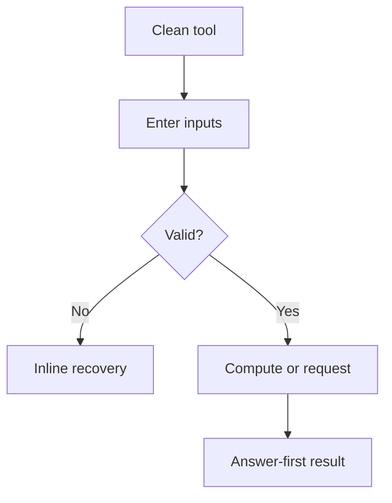

# Implementation report template

Copy this structure to `content_docs/<route-without-leading-slash>/implementation-report.md`.

```markdown
# Implementation report: [[tool name]]

Status: draft
Feasibility: [[feasible or blocked, with evidence and promise boundary]]
Tool: [[tool name]]
Route: `/[[route]]`
Depends on: `competitive-report.md`
Input fingerprint: `competitive-report.md sha256:[[64 lowercase hex characters]]`
Contract type: [[formula or resolution]]
Pipeline acceptance: `content_docs/<route-without-leading-slash>/pipeline-acceptance.json`

## Product decision

- Primary user: [[one person in one situation]]
- Job: [[answer or action they need]]
- Product thesis: [[why this tool earns preference]]
- Control-mode hypothesis: [[single, disclosure, or basic-advanced, with reason and any Basic assumptions]]
- Evidence: [[competitive report sections]]

## Scope

### Table stakes
- [[required behavior]]

### Launch differentiators
- [[evidence-backed advantage]]

### Deferred
- [[useful later, not needed now]]

### Non-goals
- [[answer the tool must not imply]]

## Formula and data contract

### Inputs and normalization
| Input | Type and unit | Default | Valid range | Normalization |
| --- | --- | --- | --- | --- |

### Equations or resolution order
[[Exact numbered derivation, algorithm, or source precedence.]]

### Rounding, display, and versioning
[[Rules.]]

### Invalid, unknown, absent, and partial states
[[Rules that prevent plausible but wrong output.]]

### Assumptions and exclusions
[[What the answer does and does not mean.]]

### Primary sources
- [[source name]]: [[URL]], checked [[date]]. [[claim supported.]]

## User flow



[[Replace with the actual flow, including repeat, reset, failure, and restored state.]]

## Interface wireframes

### Desktop: clean
```text
[[wireframe]]
```

### Desktop: result
```text
[[wireframe]]
```

### Narrow mobile
```text
[[wireframe]]
```

### Error, loading, partial, and restored states
[[Add wireframes for every relevant state.]]

## Interaction contract

| Event | UI response | Result state | Focus/announcement | URL/persistence |
| --- | --- | --- | --- | --- |

## Page composition

| Claim or task | Medium | Position | Why this medium |
| --- | --- | --- | --- |

Required media trace: [[rendered selectors or artifact paths for tool UI, lists, tables, charts, diagrams, screenshots, and registered MarkerArt]]

## Technical plan

### Architecture and file ownership
[[Server/client boundary, pure engine, route files, styles, tests, manifest, scripts.]]

### Accessibility, privacy, security, and performance
[[Concrete requirements and exclusions.]]

### Publication state
[[Published, unpublished, or noindex, with reason.]]

## Acceptance criteria

| ID | Observable acceptance criterion | Evidence at build time |
| --- | --- | --- |
| R1 | [[Observable product behavior]] | [[unit, API, Browser, or static evidence]] |

## Open questions and blockers

- [[None, or a blocker that prevents ready status.]]
```
